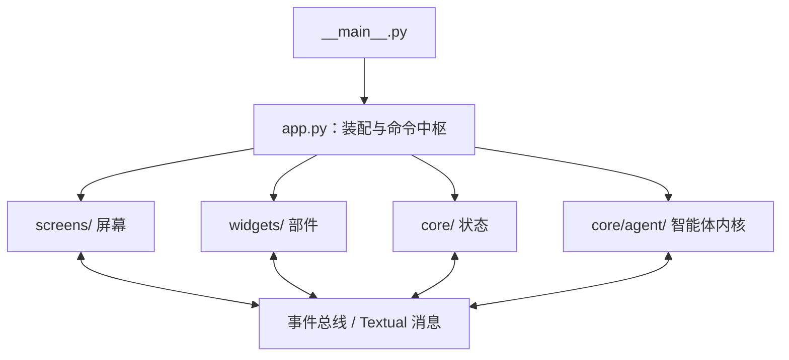
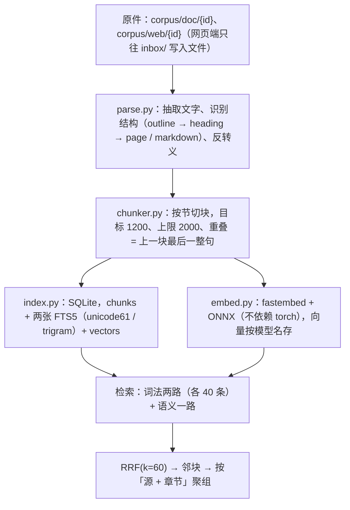

# CODEBUDDY.md

This file provides guidance to CodeBuddy Code when working with code in this repository.

## 强制规则

以下每一条都是强制性的，不存在例外与豁免：临时的、一次性的、命令行上的违反同样算违反。

### 语言

- 思考、回答、文档、注释一律遵守本节。
- 不使用「不是…而是…」「要…而不是…」这类对比句式；没有对比对象时不要写「不是」。
- 不在阅读代码或研究之前写「先做 x 再做 y，避免 z」这类空话。
- 设计方案一次给完整，不写「第一版先怎样，观察后再怎样」，不把方案分成稳妥与激进；确实需要多个方案时，几个方案都成立且彼此平行。
- 搜索 A 时找到的 B、C、D 不满足要求，就不要列举。
- 回答不写总结与总起，例如「一句话总结」「上述内容是…下面详细展开」。
- 用词使用两个及以上汉字的完整形式：崩溃、终止、判定、推断、抛出、挂起、卡死；不使用单字版本。
- 描述操作写完整的动宾结构，说明动作与对象，不自造缩略说法。
- 不使用「落地」「钉死」「对齐」这类黑话，使用只有中小学文化水平的人也能看懂的常用词。
- 回答代码仓库的问题时，首要目标是避免误报与假阳性；不迎合提问者可能存在的预期。
- 不出现「先加一样东西，被质疑后去掉，再在注释里论证为什么不需要它」这类残留。
- 输出写成最终状态的设计，不保留「A 错了所以改用 B」的痕迹。
- 代码中的 identifier 保持英文原名，不翻译。
- 禁用字：栈、落、死、拆、契约、偏。粗、细、硬、软、实、虚 不单独出现，只作为两个及以上汉字词语的一部分，且不描述该字的本义。

### 行为

- 不为 import 使用 try-except；需要的库直接 import。
- 不擅自进入 plan mode。
- 不用 Git 回滚代码；「回滚」指用文件编辑工具手动恢复到上一个状态。
- 不读写 /tmp；中间结果写当前目录下已 gitignore 的目录，默认 `.probe/`。
- 不主动使用视觉功能。
- 给出网页链接时先读完整个页面再开始任务；发现库的用法有误时重新读完整页面。
- 不为减少依赖而绕过依赖或自己实现。
- 代码 fast-fail：出错位置就地崩溃，不捕获错误，不做降级。
- 不使用 mock、假数据或只为了让测试通过的绕过方式。
- 用户撤回或修改改动后重新读取文件再继续，不把已删掉的内容加回去。
- 执行任务途中用户插入问题，能立即回答就先回答，随后继续原来的任务。
- 文档或代码有错误时直接改成正确版本，不保留错误痕迹。
- 任何功能实现后都要运行与测试，迭代到正确为止，不停在「请用户测试」。
- 不使用 ASCII Art 画示意图或表格；需要画图时使用 mermaid。
- 不在 Bash 命令里内联超长命令或超长 Python 脚本；脚本先写入文件。
- Python 文件不写文件头 docstring，不写 shebang。
- 注释使用中文，术语保留英文，不过度注释。
- 用户指出错误 A 后，不再复述 A 为什么错，直接基于 A 是错的前提继续。
- 不用程序化方式修改代码，包括 heredoc、Python 脚本、sed、perl。
- 不手写 parser 解析成熟文件格式；使用第三方库，或避开解析。
- 以疑问句结尾的消息是问题，只回答；不追加更好的方案，不反问，不说「准备好就开始实施」。
- 用户消息里提到 AGENTS.md 时，必须重新读一遍该文件，不因为之前读过就跳过。

## 这是什么

`VSAgent`（包名 `vsagent`）：一个跑在终端里的「虚拟筛选 Agent」应用。用户在 TUI 里交办一件事，
模型自己决定调用哪些工具去查靶点、取结构、准备受体、算口袋、写运行目录、打开结构查看器，
把结果与推理过程实时流回界面。附带的 `web/` + `viz/` 是同一份数据的只读网页查看端。

没有 README，没有 pyproject / setup.py / pytest / ruff / mypy 配置，也没有 Makefile。
依赖手工装，测试是**直接跑的脚本**。详细逐文件导览见 `docs/source-map.md`（很长但准确；
开头的文件/行数统计会随改动漂移，别拿它当基线，且不含 `web/` `viz/`）。

CI 只有一个 `.github/workflows/ci.yml`：Linux 上跑两个判据脚本，**两份依赖都装**
（叠合与先验口袋那几条断言需要 gemmi，缺了会直接抛出 ToolError）。
没有 Windows job——`verify_exe` 需要 pywinpty，那条路还没有人验证过。

代码注释与 docstring 一律用中文写，解释「为什么这么写」。新增代码跟随这一惯例。

## 命令

依赖：`pip install -r requirements.txt`（textual / httpx / python-dotenv / tomli-w / pypdf）。
可选化学依赖：`pip install -r requirements-chem.txt`（meeko/rdkit/gemmi/numpy/scipy + plip），
不装也能跑，只有 `prepare_receptor` 会返回一条带安装指令的错误。
`plip` 是这份文件里**唯一不进 `chemistry.CHEM_DEPS`** 的一项：它只给 `analyze_pose`
的 `interactions=true` 用，没装时那个开关退化成一句安装说明，接触/氢键/冲突照算。

**语义检索（S3）另有一份可选依赖**：`pip install -r requirements-embed.txt`
（fastembed + onnxruntime + tokenizers，约 78MB），再
`python -m vsagent.core.embed download` 拉模型（255MB，**显式下载，不自动**）。
不装时 `search_corpus` 只跑词法两路，其余功能一概不受影响。
模型缓存 `~/.vsagent/models/`，**不进仓、不进 exe**——单模型就 255MB，
超过方案稿 §8.4 的 +80MB 预算，所以打包走「用户另装」这条路（与 DTA 同一种处理）。

**亲和力打分（`score_affinity`）另有一套环境**，在 `models/DTA/.venv`（Python 3.10 +
torch 2.2.1 + dgl 2.1.0），装法见 `models/DTA/README.md`。主仓一行都不 import torch——
工具是**起子进程**跑 `models/DTA/virtual_screen.py`，所以没装这套环境时应用照常启动，
只有那一个工具返回安装指引。别把它并进 `.venv`：主仓是 3.12，`pandas==1.5.3` 没有
cp312 轮子，且 MDAnalysis 要求 `numpy<2`。

`models/DTA/` **整个目录不进版本控制**（代码 54MB + venv 1.6GB + 权重 15GB），
`.gitignore` 里一行 `models/DTA/` 挡住。它不能放进 `vsagent/` 里面：
`check_chemistry_gate` 用 `rglob("*.py")` 扫整个包，DTA 有 45 处顶层
`import torch/rdkit`，放进去那条断言当场失败。

```bash
# 启动应用（唯一入口，无参数解析）
python -m vsagent            # 或 python __main__.py

# 测试：都是独立脚本
python tests/test_smoke.py        # 界面 + 内核的超集，末尾会重跑 test_agent 的全部检查
python tests/test_agent.py        # 只跑内核检查，打印「通过 N 项检查」
python tests/test_agent.py --list                 # 列出检查组名
python tests/test_agent.py --only permission      # 只跑名字含该子串的组（秒级）
python tests/test_agent.py --only hooks-in-loop
python tests/dump_layout.py       # 100x30 布局快照，写到 tests/output/

# 领域工具调试：唯一需要真实网络的脚本（真的打 UniProt/ChEMBL/RCSB/PubMed）
python debug_tools.py             # 全跑 24 模块 61 次调用（57 工具），顺序即依赖顺序，零参数
python debug_tools.py --clean     # 同上，跑完删掉本轮产物（只删 ~/.vsagent 下的）
# dock 需要外部 vina：PATH 里有 vina，或设置 VSA_VINA_BIN；没有时这一步直接失败
# score_affinity 需要 models/DTA/.venv：没有时同样直接失败并给安装指引
python debug_tools.py --list
python debug_tools.py structure fetch_structure pdb_id=4HJO        # 显式：单工具单参数
python debug_tools.py structure fetch_structure '{"pdb_id":"4HJO"}'
python -m vsagent.core.agent.domain.structure               # 单模块，同一套语义
# 参数支持 JSON / k=v / --file -；--reset 清登记表，--raw 跳过参数校验
# handle 写占位不写编号：{receptor:raw} / {artifact}，开跑前从登记表现取

# 网页端（会话与结构只读；语料可投递、改名、删除）
python -m vsagent.core.web     # 包内实现的独立进程壳，--port 优先于 .env 的 VSA_WEB_PORT
python tools/serve_web.py           # 同一个 WebServer 的 CLI 壳（--state/--runs/--web/--corpus/--port）

# 判据脚本
python tools/check_web_api.py       # 在副本上起服务，验 API 形状 / 并发 / 写撕裂读 / 语料读写
python tools/check_retrieval.py     # 检索评测：词法单路 / 双词法 / 三路 + 组级指标，三条必须满足的条件
python tools/check_retrieval.py --list          # 只看评测集概况
python tools/build_demo_data.py     # 由 RCSB 1IEP 原始 PDB 生成 runs/1iep-demo（可复现）
python tools/check_demo_data.py     # 纯几何：口袋残基是否真的接触共晶配体（≤4.5Å、≥60%）
python tools/check_prefix.py        # 稳定前缀：token 预算 / 点名工具首步可见 / 枚举残留 / 字节稳定

# 上下文 / 记忆探针（手动，不进 CI）
python tools/eval_context.py --session ses_xxx   # 逐个截断点看装配估算与降级
python tools/eval_context.py --sweep             # 同一份会话扫多个窗口：前缀命中 / 清理 / 丢组
python tools/eval_context.py --sweep --families structure,receptor,ligand,docking
                                                 # 按已装族算工具定义（默认只发核心那 14 个）
python tools/eval_context.py --evidence          # 证据探针：20 次工具运行，查关键行/重复/引用/artifact
python tools/eval_memory.py                      # 记忆台账健康度（重复、失效、常驻占用）
python tools/eval_memory.py --cases x.jsonl      # 人工标注集的 recall@k 与 stale 比例
python tools/seed_memory_eval.py                 # 造一份可复现的合成台账 + 22 条召回集（.probe/memory-eval）
python tools/eval_memory.py --root .probe/memory-eval --cases .probe/memory-eval/cases.jsonl
                                                 # 跑它：recall@5 100%、stale 1.3%，四类难例都在里面
python tools/replay_cost.py                      # 成本探针：同一份会话按当前装配器重放，与 trace 逐层对照
python tools/replay_cost.py --session ses_xxx --json .probe/cost.json
python tools/replay_cost.py --list               # 哪些会话有 trace

# 本地语料（免费离线）
python -m vsagent.core.index reindex        # 按盘上原件重建索引，并顺手补向量
python -m vsagent.core.embed download       # 拉模型（255MB；直连不通自动走 hf-mirror）
python -m vsagent.core.embed index          # 只补向量（换模型后跑这条）

# 前端（viz/ 是唯一装 npm 包的地方）
cd viz && npm install && npm run build     # esbuild → viz/build/{viewer,markdown}-lib.js
node tools/check_web_ui.js                 # WEB_PORT，默认 8866；自己造夹具、自己 spawn serve_web.py
                                           # 含：数据驱动、口袋深链接、对接分数排序方向、
                                           # 三态主题（完成/失败/中断）与运行中卡片
python tools/seed_three_states.py --state .probe/web-ui-state/state.toml
                                           # 三条状态夹具，check_web_ui 自己会调；单独跑用于手工看

# 打包（Windows）
pip install -r requirements-pack.txt
pyinstaller --clean vsagent.spec      # → dist/VSAgent.exe
python tests/verify_exe.py                 # ConPTY + pyte 截图验证，需要 pywinpty/pyte
python tests/verify_exe.py --source
python tests/verify_modal_transparency.py  # 模态居中/半透明，聊天透出
```

`verify_exe.py` / `verify_modal_transparency.py` 依赖 `pywinpty`，只能在 Windows 跑。
`tools/check_*.js` 依赖 `playwright` 与 `pngjs`，但它们**不在** `viz/package.json` 里，要自己装。

## 配置

`.env` 在仓库根（已 gitignore，没有 example 文件）。`env.py:load_env()` 用 `override=False`
——已存在的真实环境变量永远压过文件里的值。

**模型接口不走 `.env`**：地址、密钥与模型名由应用内的 `/model` 命令填写，写入与
`state.toml` 同目录的 `connection.toml`（`core/connection.py`，权限 0600，原子替换）。
没有这份文件时应用照常启动，发消息前提示先 `/model` 配置；`/model <名字>` 只换模型，
连接参数不动。`VSA_LLM_*` 这一组变量已经没有了。

| 变量 | 说明 |
| --- | --- |
| `VSA_MAX_STEPS` | 一轮步数上限，写错时按 24 处理 |
| `VSA_WEB_PORT` | 本地网页端口，默认 8860，不合法时同样按默认值处理 |
| `VSA_CORPUS_INDEX_WEB` | `0/1`，`search_web` 的摘要是否自动入库（默认开）。关掉后它退回纯查询，不给引用号 |
| `VSA_CORPUS_EMBED` | `0/1`，语义通道总开关（默认开）。关掉只跑词法两路 |
| `VSA_EMBED_MODEL` | 嵌入模型名，默认 `sentence-transformers/paraphrase-multilingual-MiniLM-L12-v2`（384 维）。**换模型要整表重建**：`python -m vsagent.core.embed index` |
| `VSA_EMBED_MIN_SCORE` | 余弦下限，默认 `0.30`。低于它不算命中——余弦没有「不相关」这个值，不设下限的话「本地没有」会变成「命中 29 组」 |
| `HF_ENDPOINT` | 模型下载端点，**排第一**。不设时先试 `huggingface.co`，失败**自动退到 `hf-mirror.com`**（会打印实际用的端点，不悄悄换源）；镜像的 Xet 后端会回 401，所以下载子进程里固定 `HF_HUB_DISABLE_XET=1` |
| `VSA_VINA_BIN` | 外部 AutoDock Vina 可执行文件；不设时从 PATH 找 `vina`，缺失时 `dock` 返回安装指引。引擎**不随 exe 打包** |
| `VSA_AUTOGRID_BIN` | 外部 `autogrid4`；只有 `dock(scoring="ad4")` 用它（AD4 要先用它算亲和力图）。不设时从 PATH 找，缺失时只影响 ad4，vina / vinardo 不受影响 |
| `VSA_DTA_PYTHON` | 跑 `models/DTA/virtual_screen.py` 的解释器；不设时依次试 `models/DTA/.venv/bin/python` 与旧布局的 `<repo>/.venv-dta/bin/python`，都没有时 `score_affinity` 返回安装指引 |
| `VSA_DTA_ROOT` | `models/DTA`；不设时按**代码位置**定位到仓根下的 `models/DTA` |
| `VSA_DTA_DEVICE` | `cpu`（默认）/ `cuda`，写进 DTA 的 hydra 配置 |
| `VSA_DTA_WEIGHTS` | 预训练编码器目录，默认 `models/DTA/weights/`。可被更具体的 `VSA_ESM_CHECKPOINT` / `VSA_CHEMBERTA_CHECKPOINT` 单独覆盖 |
| `EDITOR` / `VISUAL` | `/editor` 外部编辑器往返 |
| `VSA_FILE_READ_LOG` | 设为 `0` / `off` / `false` 关掉文件读取日志。默认写**项目根**的 `logs/file-reads.jsonl`（已 gitignore），一行一次读取：`purpose`（`tool.read` / `tool.grep` / `import.structure` / `import.ligands` / `receptor.prepare` / `prompt.file_ref` / `state.load` / `rules.load` / `tools.load` / `memory.load` / `config.migrate`）、绝对路径、字节数、`ok`，失败时带 `detail`。`app.py` 启动时按 `root` 配置目录；没有应用可问的脚本与领域工具写入当前目录的 `logs/` |

测试不读 `.env`：`FakeModelServer` 起在 `127.0.0.1:0`，测试把地址写进
`.probe/connection.toml`（与测试用的 `state_path` 同目录），**全程离线**。

## 架构

四层，`app.py` 是唯一的装配根：



两条贯穿全仓的分界线，改代码前先确认自己在哪一侧：

1. **`core/` 不 import textual。** `session_manager.py` / `models.py` / `command_registry.py`
   都能被测试直接调用。往 `core/` 里加 `from textual...` 是破坏架构。
2. **`core/agent/` 不认识界面。** 内核只往 `EventBus` 发事件，`ChatScreen` 是唯一的
   翻译层。「把界面换成网页端」因此不需要动内核。

### 内核（`core/agent/`）

- `loop.py` — `AgentLoop` 是唯一的驱动，界面只认它的 `stream_reply / run_bash / cancel`。
  它**不维护第二份历史**：每一步从 `Session` 现场重建模型消息。上限
  `MAX_STEPS=24` / `MAX_STOP_RETRIES=2` / `MAX_RETRIES=2` / `MAX_TOOL_RETRIES=1` /
  `MAX_FAILED_STREAK=3`。**`RetryableToolError` 只在工具层重试 1 次**（模型请求那层是 2）：
  一次调用的超时就有几十秒，重试两次会把一次抖动拖成三倍等待。重试只包 `execute`，
  不重跑权限与钩子；重试用尽的文案要写清「参数没有错，也不要用 bash 自己实现」——
  否则模型会绕道自建客户端（实测一次误判烧掉 20 步）。domain 层不许用
  `except Exception` 把它包成永久失败，`tool-retry` 组盯着这一条。
- `tools.py` — `Tool` ABC + `ToolRegistry` + 五个内核文件工具（bash/read/write/patch/grep）
  + `read_turn`（按 `turn N` 取回被归档/被移出的原文，会话由内核注入）
  与 `ToolSpec` / `ToolResult` / `ToolError` / `RetryableToolError` / `argument_error` 校验器。
  **依赖注入是声明式的**：工具在类属性上写 `primary_argument`（权限匹配用）、
  `context_argument`（登记表）、`task_argument`、`evidence_argument`、`viewer_argument`、
  `event_argument`（事件运行时），
  `Tool.execute` 在 `on_arguments` 记下模型原始参数之后注入它们；声明了却收到 `None`
  直接返回「内核装配问题」，不抛出。
- `context.py` — `ContextAssembler.build` 按
  `PREFIX → MEMORY → TASK → EVENT → RECENT → EVIDENCE → HISTORY` 分层装配。
  `PREFIX` 与 `TASK` 是 `pinned`，压缩时永不驱逐（用户的约束必须活过压缩）；
  `TASK` 里除了任务状态还有**工作区索引**（`SessionLedger.digest()`，当前受体 +
  最近 5 个产物，≤10 行）与**运行环境**（`environment_block()`：日期、工作目录、
  状态目录）：handle 只在工具返回那一刻出现过，之后要么进证据层、
  要么被清走，模型要用时手里没有索引就只能凭记忆推断编号（实测推断错过三次）。
  另有 **FOCUS 复述**：把目标 / 前三条约束 / 下一步插成一条 user 消息，
  **紧贴在最后一条用户消息前面**（`_focus_block`，≤300 token）——任务状态在窗口最上面，
  RECENT 几万 token 之后模型早就看不到它了。
  预算先给固定上限（摘要 3000 / 证据 6000），剩下的全给 `RECENT`；
  `RECENT` 整 `Turn` 搬移，`tool_call` 与它的结果永远不分开。装不下时先清旧工具正文
  （`_take_recent` 里，最近 4 条与失败的除外），清不动才整组移出；清掉的原文用
  `read_turn` 取回。降级顺序
  `evidence_detail → history_summary → recent_tool_clear → event_step_detail →
  event_layer → memory → recent_turns → recent_reasoning → recent_output`。
  装不下就抛出 `ContextAssemblyError` 明说，**不静默截断**。
- `event_log.py` — 事件层按 **Topic → Step 流水**记录：
  Task（一条用户消息）→ Topic（任务里的一个独立题目）→ Step（一次模型往返加它的
  工具调用）→ Event（一个 Topic 封存后的记录）。**内核每步自动记，主题结束立即封存**，
  所以记录不依赖任何模型判断。
  Step 全部本地从 Part 拼（工具名、参数、状态、handle），不读 reasoning、零请求；
  标题、结论与交接模型可以用 `close_topic` 顺手给，不给就用本地拼的那份并标
  `degraded=True`。
  **边界是位置 `(message_index, part_index)`，不是消息下标**：一条 assistant 消息
  装着一整轮的所有往返，按消息切不出轮中途的主题边界。切点记在 `Event.cut_message` /
  `cut_part` 上，装配时 RECENT 从最后一条事件的切点开始。
  `Turn.part_start`（`context.py`）是同一个口径：它由「按 `STEP_START` 分段、逐段
  `translate_parts`」得来。
  封存时机：模型调 `close_topic`（步末执行）、轮末、新用户消息、预算达到 120K
  （`TOPIC_SOFT_LIMIT`）、溢出 / `/compact` / 中断。模型侧的触发条件是尾部那一行
  「本主题已 N 步 · 产物 … · 未决 …」（≥3 步才出现，放尾部是为了不碰前缀缓存），
  它同时也是运行中的本地摘要。
  **`seal_topic(force=True)` 与 `force=False` 的差别是覆盖**：轮末遇到纯聊天的一轮
  可以跳过，溢出 / `/compact` / 强行腾地方必须封，否则那一段原文两边都不在。
  `Event.actions` / `artifacts` / `issues` 是**从 steps 聚合的 property**，不写入磁盘——
  存两份必然漂移。`Event.step_start` / `step_end` 是会话内连号的步区间，只用于显示。
  封存之后那段原文不再随请求发出；
  所以自动封存**不推进 `compact_upto`**，只有手动 / 溢出那种明确的边界才推进。
  原文一条不删：`Step` 上的 `message_index` / `part_start` / `part_end` 就是取回它的地址。
  召回三级：`recall_event()` 列主题、`recall_event("evt_0003")` 读流水结论与原文、
  `recall_event("evt_0003", step=7)` 读那一步的工具输出原文。
  三条不变式（连续覆盖、边界不收当前步、封存不花请求）见
  [`docs/session-review-plan.md`](docs/session-review-plan.md) §4；
  [`docs/event-log-design.md`](docs/event-log-design.md) 记录的是旧设计，不随代码更新。
  事件块超额裁掉最旧几个主题时要补一行「更早还有 N 个主题」——被裁事件覆盖的原文
  既不在事件里也不在 RECENT 里，不说就是无声消失。
  **摘要已退休**：它的三段分别由 TASK、Step 流水、主题结论覆盖；
  `_summarize` 只剩「首轮就溢出、连一段都封不出来」的兜底。
- `toolset.py` — 按族加载领域工具。75 个工具里领域那 56 个的完整定义约 23K token，
  每一步都要发；核心 19 个（文件、登记表、任务、假设、事件、记忆、`load_tools`、
  开工前的盘点、结构全景、`write_run` / `open_viewer`）常驻，56 个领域工具分成 18 族由
  `load_tools` 现装现用，
  装过之后每步只发 3.5K。**族记在
  `Session.tool_families` 上，不记在注册表上**（注册表按根 / 子 agent 共享两份，
  记在那里会让一个会话装过的工具漏到另一个）；子 agent 从父会话继承。
  **装载会随轮次结束而失效**：`prune_families()` 绑定在轮末封存上，把这一轮没用过的族卸掉
  （P2-1：装到八族之后每步 12K token，而典型一轮只用两三个族）。主题封存不收敛：
  一轮里换三个主题是常事，每次装卸都改动请求体，缓存整段失效。两条边界——
  这一轮一个工具都没用过就不卸，这一轮刚装的族也不卸（`Session.family_topic`
  记着装载时的主题号），否则模型先装后用的那条路会被自己踩断。
  `hidden_names(session)` 给的是**排除集**：没登记族的工具默认常驻，
  新工具忘了登记时坏处只是白占额度，不会「写了却没装、模型看不见」。
  模型看不见某个工具时最容易直接叫它的名字，所以 `loop.missing_tool_reason` 会认族：
  回的是「属于 scoring 族，先 `load_tools family=scoring`」。
  **`load_tools` 的说明里那张「族 → 工具」表由 `catalog_text()` 从模块现数**，
  不手写（手写的那份漂过三处）；结果也要减去 `registry.disabled`——对着被
  `tools.toml` 关掉的工具说「已装入」，模型下一步就会去调，撞墙之后转去 bash 自己实现。
  **族与模块存在一对多**：`structure` 族由 `rsearch` + `structure` 两个模块拼成；
  `pocket` 族只有 `pockets` 一个模块，但它会联网（复合物检索 / 预测），所以不并进
  `structure`。
- `prompt.py` — `stable_prefix` 组装：身份 → **假设规则** → 工作方式 → shell → 登记表 →
  记忆 → 事件 →（派发）→ 项目规则。**前缀里不放时间不放进度**，否则每步都击穿 prompt cache。
  排序是语义：假设规则紧跟身份（它定义「产出长什么样」，先于所有操作纪律），确认点放最后。
  **固定那几段预算 1900 token（实测 1521），由 `tools/check_prefix.py` 守着**：超预算、
  点名了首步看不见的工具、出现「全库只有…」这类枚举，都会被检查出来。
  `AGENTS.md` 那一块**不设上限**：它是许可与判据的来源，少一条就可能让模型做一个本来
  被禁止的动作，判据只报它的体量（现 2890 token / 120 行）。
  `project_rules()` 每次发问重读 `AGENTS.md`（`RULES_FILE`），整份注入、不截断；
  编码坏了返回空串——`stable_prefix` 在装配之前调，那里没有 try，一个异常会掀掉一整轮。
  平台那句由 `platform_note()` 按 `sys.platform` 现取，**必须现取**：把「这套环境是
  Windows」固定写进代码的版本在 Linux 上跑就是在教模型写 `dir`，而且 `env-block` 判据盯着这一条。
  易变的环境信息（日期、工作目录、状态目录）走 `environment_block()`，由循环层塞进 user 头，
  **不进前缀**——日期每天变一次，进去了每天击穿一次缓存。
  摘要指令是八段（目标 / 改动 / 待办 / 约束 / 决定 / 错误 / 当前 / 关键数字），
  `summary_messages` 只喂 `[summary_upto, upto)` 新段 + 旧摘要，不再整段重喂。
- `permission.py` — `PermissionPolicy.check` 的判定顺序是有讲究的：取消 → 用户手打 bash →
  **会话 allow_all** → Plan 模式 `PLAN_DENY` → 项目规则 → **越界路径检查** → 计费配额 →
  单工具允许 → 默认 `{write, patch, bash, dock}` 要问。会话 allow_all 排在除中断之外一切之前：
  弹窗上按了 a 就是「这个会话别再问我」，Plan 限制、越界与计费都不再拦，切会话时清掉。
  询问那一步有两条兜底（`loop._ask_permission`）：`permission.ask` 没有任何订阅者时立刻拒绝
  （无人值守运行，等下去是等一个没人回答的 future），以及 300 秒无人答复时拒绝。两处都按
  **拒绝**处理——没人答复不等于用户同意。
  同模块的 `load_tool_switches` / `save_disabled` 管的是**另一件事**：`tools.toml` 里标关的工具
  根本不进注册表，模型连它存在都不知道（权限层是「装进来但拦下来」）。改开关用 `/tools` 面板，
  它写项目侧那份文件并当场重装注册表，不必重启。
- `hooks.py` — `hooks.toml` 里的外部命令，stdin 收一行 JSON。退出码 2 拦截（stderr 当原因），
  0 放行，30s 超时算拦截。
- `ledger.py` — 会话登记表，`receptor#1` / `ligandset#3` 这类 handle 的真相所在。
  `digest()` 是给模型看的那一小段索引（当前受体 + 最近几个产物），
  **不调 `reconcile()`**：那一步会把每个登记路径读一遍算指纹，而索引每一步都要算。
- `memory.py` — 跨会话项目记忆 `.vsmemory/`。记忆里写**文件路径不写 handle**（handle 只在本次会话有效）。
  写入做三件事：精确去重、同 refs + 更新词时把旧条目标 `superseded_by`（不直接删除）、
  agent 的引用必须存在（用户写入可不存在，标 `unverified` 排在后面）。
  常驻注入是「核心 / 相关 / 最近」三段，1200 token，其余用 `recall` 取；`recall` 按
  字段权重 × 90 天衰减打分。详见 [`docs/memory-design.md`](docs/memory-design.md) §13。
- `hypothesis.py` — **产出单位**：这个 agent 交出的是一组可检验的判断。
  `Hypothesis` 对象存在 `TaskState.hypotheses` 里（数据在 `models.py`，工具在 `core/agent/`，
  分层理由与 `task.py` 相同），未结的按粒度分组渲染（策略 2 条、机制 3 条）进 `TASK` 层。
  六要素里 `test` 与 `expected` 是必须满足的条件，`expected` 还必须含数值、阈值或对照——
  没有可以判断真假的预期，实验数据回来也没法结案。**状态只由 `close` 与
  `record_assay(hypothesis=...)` 改**，`update` 改不了：否则模型能绕过证据把它标成 supported。
  `write_run` 把它们整份写进 `provenance.hypotheses`（不新增顶层键）。
- `provider.py` — 只实现了一种协议：`OpenAICompatProvider`，OpenAI 兼容的 SSE。
  模型**名字**决定 context window / 价格 / 是否支持 reasoning；`switch_model` 会连带重算上下文窗口。
- `trace.py` — 订阅 EventBus 的 `"*"`，把事件写成 `~/.vsagent/logs/<session>.jsonl`。

一轮的流程：清证据表 → `stable_prefix` → 装配 context → 问模型 → 消费流
（TEXT/REASONING/TOOL_CALL/REASONING_DELTA 分流到不同 `PartType`）→ 无工具调用则跑 STOP 钩子 →
逐个（**故意不并发**）执行工具：registry 查找 → 参数校验 → PreToolUse 钩子 → `policy.check`
→ 可选的 UI 询问（发 `permission.ask`，界面弹模态）→ 执行 → PostToolUse 钩子 → 收证据 →
连续 3 步整步全失败则 `EXIT_TOOL_FAILED`。任何非正常退出都会触发一次**不带工具的收尾总结**
（模型写，失败则本地兜底）。

装配发现这一步新挤出了交互组时：没有事件 → 让模型写摘要；**已经有事件 → 补一条本地
`auto` 事件**（零请求），摘要从此冻结。上下文装不下时先强压一次再重试，
摘要连续失败 3 次熔断到下一轮。

### 领域工具（`core/agent/domain/`）

分界线按「需要知道什么」划：知道 UniProt 编号长什么样、口袋残基怎么算
→ 放这里；只需要知道「有个文件」→ 放内核那批。

- 每个登记工具的模块暴露一个模块级 `domain_tools() -> list[Tool]`，文件末尾带
  `if __name__ == "__main__": from debug_tools import main` 块。
- `all_tools.py:domain_tools()` 按**浏览 → 检索 → 改动**的顺序拼装
  （listing, uniprot, structure, pocket, chembl, pubchem, opentargets, literature,
  corpus, websearch, receptor, ligand, screen, scoring, analysis, admet, sar,
  pharmacophore）。这个顺序同时决定了工具在请求体里的先后，靠前的更容易被模型选中
  ——**顺序影响模型的选择**。同一个文件的 `FAMILIES` 是**按族加载的唯一真相**：
  族名、给人看的一句话、模块；`catalog()` 展开成「族 → 工具名」，`load_tools` 与
  `hidden_names` 都从它取。`write_run` / `open_viewer` 不在任何族里，由 `app.py`
  直接注册成核心工具。
- 配体链路：`import_ligandset`（文件 → raw ligandset）→ `prepare_ligands`（ETKDGv3 +
  MMFF/UFF + Meeko → prepared ligandset）→ `dock`（Vina → docking artifact）。
  DTA 通道是另一条：`fit_affinity`（实测活性 → model artifact）→
  `score_affinity(model=…)`（同一批位姿 → affinity artifact）。
  `write_run(docking=…, affinity=…)` 把两路分数写进运行目录。
  `ligand.py` 与 `docking.py` 是配体这条链，`products.py` 是共用的产物目录/原子写盘。
- `dock` 有三个力场（`scoring="vina"|"vinardo"|"ad4"`），**分数互不可比**。前两个只要
  受体 + 盒子；`ad4` 要先 `autogrid4` 算亲和力图（`--maps`，不能给 `--receptor`），
  图缓存在 `~/.vsagent/grids/`（键是受体指纹 + 盒子 + 配体原子类型），盒子限 40 Å
  ——图的代价是边长的三次方。`Autodock4` 的**原程序**没有接：1–5 分钟/配体，
  与批量筛选的形态冲突，而 AD4 力场已经通过 vina 拿到了。
- `finetune.py` 是**唯一会训练模型的工具**：用某个靶点上已测的活性把预训练权重
  微调一遍（`fit_affinity`），产出登记成 artifact（`kind=model`），之后
  `score_affinity(model=…)` 用这份权重与它训练时的口袋推理。训练本身交给
  `domain/fit_train.py` 在 `models/DTA/.venv` 里跑（5–10 分钟，CPU），主仓一行
  torch 都不 import。**它只对这个口袋有效，换受体或换口袋要重训**；而且实测只与
  「ECFP4 + LightGBM」打平、不超越。DTA 通道固定走「微调 → 推理」，零样本不再是
  流程的一部分。依据见 [`docs/retro-affinity-report.md`](docs/retro-affinity-report.md) §九。
- `affinity.py` 是**第二个调外部进程的工具**，外面是一个 Python 解释器，
  所以它比 `docking.py` 多两件事：`dta_python()` / `dta_root()` 两个环境变量入口，
  以及**现截口袋**（受体的 `box.txt` 只给中心，模型要的是中心 10Å 内的残基）。
  分数方向与 dock **相反**（pK 越高越好），两者不可比较——描述第一段必须写明这一句。
  它不 import torch，也**不能**：`check_chemistry_gate` 的黑名单与
  `test_smoke.walk_packages` 都会当场失败，PyInstaller 还会把 2GB 依赖拖进 exe。
- `analysis.py` 是「看完所有结果」这一层（族名 `analysis`，8 个工具）：
  `rank_candidates`（多路合并排序）、`analyze_pose`（接触 / 氢键 / 冲突 / 可选 PLIP 指纹）、
  `alternative_poses`（同一分子的多个对接模式按体积聚簇，报每簇分数与接触残基差异）、
  `contact_map`（一份产物里所有位姿的残基接触频次）、
  `analyze_hydrophobic`（HP/HM/脱水账）、`efficiency_profile`（LE/LELP/LLE）、
  `validate_docking`（重对接到晶体位姿的 RMSD）、`pick_controls`（正向 / 阴性 / 背离三类对照，
  并写明每一条为什么算对照）。八个都**只读产物**，`pick_controls` 只读候选表，
  但同样声明了 `context_argument`——它要沿 handle 找到那张表，与 `analyze_pose` 同一个理由。
  要受体坐标的四个（`analyze_pose` / `alternative_poses` / `analyze_hydrophobic` / `contact_map`）
  共用 `_docking_entry()` 与 `_receptor_of()`：前三个经 `_resolve_pose()` 或自读 pdbqt 取位姿，
  `contact_map` 取一次受体再遍历全部位姿。不共用的话那段
  「handle → 产物 → 位姿 → 受体坐标」的校验必然复制错。
  `alternative_poses` 读的是 `pose_pdbqt` 里的全部模式：`pdbtext.parse` 只留第一套模型，
  所以先用 `_split_pdbqt_models` 按 `MODEL` / `ENDMDL` 切段再逐段解析；聚簇与
  `pick_diverse` 的位姿去重共用 `screen.pose_volume_cells` / `pose_jaccard` /
  `cluster_by_similarity`，两处各写一套的话同一对位姿在两边会被判成不同簇。
  `analyze_hydrophobic` 与 `efficiency_profile` 的口径里都写明「没有计算熵与脱水代价」：
  输出不能让读者以为算过。
- `pocketcmp.py` 是「口袋定下来之后」的两个问法：`compare_pockets`（同家族两个受体
  逐残基比 8 Å 内的差异，先做全局序列对齐再按对齐结果配对）、`similar_pockets`
  （按口袋窗口的局部序列同一性给候选受体排序，并给出各自的 ChEMBL 活性条数）。
  两者共用同一套 Needleman–Wunsch；选链按「同一性 × 覆盖」，只看同一性时一条 30 个
  残基的短链会以 70% 压过真同源链。窗口按 UniProt 编号取，给 `pocket` 时先对齐换算。
- `campaign.py` 是开工前的盘点 `assess_campaign`（**常驻，不登记族**——它决定这一轮
  装哪几族，自己先要装族就反了）。阈值表写死，每条带一句引用哪几个数的理由；
  四条起点逐条判适用（条件不互斥），返回**全部四条 + 一条推荐**，每条带成本档与
  「这条能区分什么」，走不通的也列出来并写原因——只给推荐等于替模型做了选择。
  每条可行起点各一份假设草稿，`meta.strategies` 按成本排，`meta.hypothesis` 是推荐那条。
  配体侧的活性用 `chembl.activity_snapshot(spread=True)`：
  默认只取最强的一段，P00533 的 325 个分子全在 pChEMBL 9.49–11.00，Δ≥2 的匹配对恒为 0。
- `survey.py` 是结构全景 `survey_structures`（**同样常驻，不登记族**——宽泛问题发生在
  第一轮，那时一族都还没装）。它把这个靶点的**全部**实验结构取回来，按 `chem_comp`
  代号分组，每组给套数、最佳分辨率与代表条目；产物写 `~/.vsagent/surveys/`，
  聊天里只给摘要，全表在 `#/survey/<id>`。**标题里点过名的配体排在最前**：膜蛋白
  结构里胆固醇与磷脂按套数永远最多（Nav1.7 的 44 套里胆固醇 26 套），按套数排序
  会把河豚毒素（9SR，3 套）挤到折叠行里。配体常用名来自 REST 的
  `rcsb_chem_comp_synonyms`——`chem_comp.name` 常常是一长串系统命名，
  「Tetrodotoxin」不在里面。它不下载坐标、不算口袋、不核对序列。
- 不登记工具的模块（`complexes` / `prankweb` / `align` / `chemistry` / `pdbtext` / `http` / `products` / `preprocess`）
  是库层，被 `WriteRunTool` 之类调用。口袋来源因此是四层叠合：共晶配体 → 复合物 → p2rank 预测 → 先验叠合。
  四层在聚簇之前都先剔掉脂质与去垢剂（`preprocess.screen_lipids`）：碳数 ≥ 8、极性原子
  （N/O/S）≤ 2 或含磷、重原子 ≥ 16、包围盒最长边 ≥ 16 埃，四条全中才算；最后那条是
  类固醇药物与膜成分的分界（睾酮、地塞米松四个并环只有 11–13 埃）。它**不进
  `screen_ligands`**——那个函数同时决定 `clean_structure` 留哪些杂原子，准备后的受体
  丢掉膜成分是另一回事，`prepare_receptor` 的 `keep_hetero` 管那一头。
  每处口袋带一份画像（`pockets.build_profile`）：配体的元素组成与伸展尺寸、壁按
  芳香/疏水/极性/带电分四类计数、最近残基与 3.5 埃内的个数、一句判断。**画像不给分**，
  与「实验定位没有打分」同一口径；`detect_pockets`、`write_run` 与网页端读的是同一份。
- `http.py` 是**全仓唯一的网络出口**，测试整体替换的就是它。4xx → `ToolError`，
  429/5xx/网络 → `RetryableToolError`。
- `chemistry.py` 是不许在顶层 import 可选依赖的守门人，测试用 AST 断言这一条
  （`test_agent.py:check_chemistry_gate`）。装依赖后要**重启会话**，探测只在进程启动后第一次调用时做一遍。

`domain/__init__.py` 顶部有**九条纪律**，是踩坑攒出来的经验。新加领域工具逐条对一遍，
其中最容易违反的三条：只收 handle（只有少数动作收路径，以工具 schema 为准，
不要在文档里列名单——列过两次都漂移了）、
纯查询不声明 `context_argument`、要算数就用代码算（RMSD / Tanimoto / 接触距离绝不交给模型心算）。

### 本地语料与检索（`core/` 里的五个纯库）



**`corpus/` 与 `runs/` 的根由 `core/paths.py:project_root()` 定**：源码运行时是仓根，
打包后是**启动目录**（与 `logs/` 一样）。这两个都**不能按 `__file__` 算**——冻结之后它
指向 PyInstaller 解包出来的临时目录，写进去的文献、索引与运行目录在退出时一起消失，
而每一步都返回成功；表现是「网页上语料库空了、结构页也空了，但功能都正常」。

- **每路 40 条是量出来的**（`index.CHANNEL_LIMIT`）：30 → 40 让「标注源进前 8 组」
  从 0.927 升到 0.945、「答案在片段里」从 0.796 升到 0.815，50/80 不涨。RRF 权重、
  k、章节加权、References 过滤、邻块范围都扫过，均无增益（见 `docs/knowledge-plan.md` §11）。

- **解析与切块只有一条路**：`index.chunks_for`。入库与 `reindex` 各写一份的话，
  重建出来的块跟当初写进去的不一样，而「重建两次一致」的判据正好抓不到这种漂移。
- **网页保存当场入索引**（`websearch._index_pages` → `index.upsert_web_page`）：
  少了这一步，刚搜到的东西要等下一次 `reindex` 才查得到，而工具说明写的是「之后免费可查」。
- **向量是派生物**：`vectors` 与 `kv`（版本号）都在 `library.db` 里，删掉能重建。
  版本号由**触发器**维护，因为级联删除（删源、整源重建）也会清向量，那条路径没人会记得 bump。
  `embed._matrix` 的缓存按 `(库, 模型, 版本)` 做键——只按行数做键会拿旧 id 配新块。
- **可选依赖在函数体里导入**：`fastembed` 与 `pypdf` 都不在顶层。没装时应用照常起，
  `search_corpus` 静默降级成词法两路（技术细节只进 `meta`，不进正文），`import_documents`
  报一句带 `pip install` 的话。
- **模型不自动下载**：`embed.missing_reason()` 给一句能照着做的话，下载要人显式跑
  `python -m vsagent.core.embed download`。

### 界面（`screens/` + `widgets/`）

屏幕用单个层叠管理，没有 router。`on_mount` 进 `HomeScreen`，提交后 `switch_screen(ChatScreen)`；
`refresh_chat` 反向遍历 `screen_stack` 找到模态下面的 Chat。

- `ChatScreen` 是主表面，**唯一**订阅 EventBus 并翻译成 `MessagesPane` 改动的屏幕，
  退订用 `on_mount` 存下来的 unsubscribe 闭包。会话标题写在底部状态栏左端，
  没有单独的标题栏。
  **三栏**：左栏 `#chat-rail` 是会话树（子 agent 缩进挂在父会话下）与这一轮的主题清单，
  中间 `#chat-main` 同时装消息区与输入框（两块同宽同左边界），右栏是 `SidePanel`
  （产物 / 子 agent / 用量；引用文件与工具调用两段已删，那两份在消息区里各有一遍）。
  产物是一组可点条目，点一行走 `app.open_artifact()`：地址由
  `domain/export.viewer_address()` 算，与模型调 `open_viewer` 拿到的是同一个。
  三栏之间各有一条 1 列宽的 `Splitter`：按住拖动或聚焦后按左右键调宽，宽度存进
  `state.toml` 的 `rail_width` / `side_width` / `home_rail_width`；画的时候按终端宽度
  再夹一次（左栏 16–60、右栏 20–60，放得下时给中间栏留 40 列），夹的只是画面，不改设定。
  左栏的两份清单来自 `widgets/session_list.py` 与 `widgets/topic_list.py`；主题清单读
  `MessagesPane.topics`，不另算一遍边界，点一条走 `focus_topic()` 打开并滚过去
  （不在挂载窗口里时先把窗口挪到那个主题的第一条消息）。
  宽度不到 92 列时左栏与它的界线一起收起，80 列终端里消息区才有地方放正文。
  分节标题带条数（`运行中 2` / `全部任务 5` / `主题 3 · 12 步`），主题行的标题补齐到
  栏宽、状态字形停在最右列；两个列表都按内容签名跳过重建，每一步的刷新不会把滚动
  位置推回顶部，主题多出来时才跟着滚到底。
  **侧栏可见性只有 `set_sidebar()` 一个入口**——`/sidebar`、点按钮、子 agent 刚建出来时
  自动打开，三条路都走它；各写一份的话按钮上的字会跟实际状态对不上。
- `HomeScreen` 也是左右两段：左栏 `SessionList` 列运行中与全部任务，中间是字标、输入框与
  「最近任务」四行；两段之间同样有一条可拖动的 `Splitter`，点任意一行走 `app.open_session()`
  （与 `/sessions` 选择器同一个入口）。
  顶部一条 1 行高的 `TopBar`：左边应用名，右边「模型 / 工具 / 主题 / 帮助」四格，
  点一下走对应的斜杠命令；聊天界面没有顶栏。
  输入框内部最后一行是四格操作提示（`HomeAction`）：`@ 文件` / `/model 模型` /
  `/tools 工具` / `Enter 发送`。附件在光标处插 `@` 并打开文件候选（与聊天界面同一个
  `FileAutocomplete`；回车采纳后写成 `@路径 `，提交时由 `resolve_file_refs` 读成
  文件引用），模型与工具走各自的命令打开面板（草稿留着），发送与回车同一条路。
  最近任务每行写标题、状态、`N 主题 · M 产物 · 时间` 与最近一次结果（结论 → 失败原因 →
  状态说明），结果按剩余宽度截断；`SessionRow` 的预留把状态词前后的空隙算了进去。
  输入框下面一行「快速开始」三个模板（`QuickTask`：研究 / 结构 / 知识）：点一下整段填进
  输入框、光标停在末尾、不提交；终端不足 26 行时整行收起。
  左栏顶部是「+ 新建任务」（`NewTaskRow`，只在主界面有）：清空输入框、焦点归位，
  会话等提交时再建；主界面第二段标题叫「最近任务」，聊天左栏仍是「全部任务」。
  终端宽度不到 92 列时左栏与界线一起收起，字标一行 60 格，加 34 格导航会在 80 列终端里折行。
- 消息区按主题卡组织。**用户消息是任务的头，永远显示；主题挂在它下面**：一轮里有几个
  主题就排几行标题，点开一个才展开它的过程。三层：主题头（标题、状态、步数与工具数、
  一句结论）→ 步行（序号、做了什么、耗时、成败）→ 工具卡，缩进依次加深。思考过程属于
  某一步，缩进与步行一致：左边那条竖线与步行的「▸」同列，正文与步行的文字同列。
  主题头与步行由 `core/agent/topics.py` 从 `session.messages` 与 `session.events` 算出来，
  边界是 `Event.cut` 的 (消息, Part) 位置，与装配器读的是同一组数。主题可以从一条
  助手消息中间开始（`close_topic` 的切点就在同一条消息里），所以位置 0 的头挂在消息
  外面，消息中间的头插在 `parts_box` 里；`-pane-row` 让两种挂法从同一列开始。
  **主题的结局在封存之前就定**（`topics._stopped_status`）：取消的一轮画成中断、停在
  失败上的一段画成失败，不必等事件写完；进行中失败过的主题，第二行第一句就是「失败：」，
  颜色按红色。中断时界面自己调 `messages.set_running(False)`——取消不走 `turn.done`。
  运行中的那一步还没记成步，由 `TopicView.live_step` 从 Part 现折，状态取
  `topics.step_status()`（失败 → 等确认 → 执行中 → 未开始 → 完成），记成步前后是同一行。
  主题头下面还有一行 `ArtifactRow`：列前三件产物，收起主题时仍在，点名字走
  `app.open_artifact()` 在浏览器里打开。
  工具卡的输入与输出**默认收起**（`ToolCard._show_output=False`），主题与步默认展开，
  所以一眼看到的是「这一轮做了几件事、每步调了什么工具」。
  三个层级各有开关：主题头切整段、步行切这一步、主题头末尾的 `▾ 收起全部工具` 一次
  展开或收起本主题全部工具输出（`/details` 就是它对最后一个主题做一次）。
  **没有全局展开**：`show_details` 已从状态文件里去掉，卡片不会跨会话保持展开。
  卡片展开后依次是参数（全部键值）、输出、产物（`tool_meta` 的 handle/ref/run_id，
  与 `event_log.artifact_refs` 同一份口径）；失败那一刻卡片自己展开。
  用户消息不随主题收起，`_message_hidden` 与 `_apply_classes` 都先跳过它。
  展开状态只在消息区里，不写盘、不回写事件；下一条用户消息进来时，封存过且带步的
  主题自动收起，用户点开过的不收。`part.update` 只刷新进行中主题的第二行，不触发折叠。
- `MessagesPane` 是虚拟化的：只维护一个 `[mounted_start, mounted_end)` 可见窗口，
  滚动时裁剪/扩展。**收起主题里整段落在其中的消息不建视图**，但窗口端点仍按消息下标算，
  所以补挂与裁剪的算术不变。它有 `on_removed` 回调让 ChatScreen 在移除前先退订（注释里记着一次真实的 `NoMatches` 竞态）。
  多个 handler `prevent_default()` 之后要调 `stylesheet.update_nodes([self])`，否则整棵子树重排要 2.6–3.9 秒。
- `EditorPane` 有三种模式 `mode-chat` / `mode-command` / `mode-bash`（CSS 类切换），配三个自动补全弹窗。
- 命令表 `core/command_registry.py` 有 32 个斜杠命令。**命令刻意没有键位**，键位单独放
  `core/keybind_manager.py`，且那两个表只用于渲染帮助——smoke 测试会比对它们和 `HomeScreen.BINDINGS`。
- `app.py:execute_command` 解析 `/name args`，查表，然后按约定分发到 `self._command_<name>`。
  只有 `ARGUMENT_COMMANDS = {"remember","forget","task","model"}` 会拿到参数尾巴。
  命令加了但没接处理器，会显示「尚未接入」。

### 状态与持久化

真相在 `~/.vsagent/state.toml`（`session_manager.py:default_state_path()`），TOML + `STATE_VERSION=1`。
同目录还有 `connection.toml`（模型接口，权限 0600）、`ledgers/`（按会话 id 隔离），traces 在 `logs/`，运行产物在仓库根的 `runs/`。

写入是**原子替换**：同目录临时文件 → flush → `os.fsync` → `_replace_with_retry`（40 次 × 5ms 重试 `PermissionError`）。
读回来调 `sync_sequences` 把 ID 计数器推进到已加载 ID 之前。网页端**每个请求都重新从磁盘读**，
所以网页看到的永远和 `state.toml` 一致——这是它跟 TUI 之间唯一的数据通路，没有 SSE、没有 websocket。

同目录的 `live/<sid>.json` 是唯一一份不在这条通路上的数据：当前主题的实时快照，
原子替换但**不做 fsync**，只给网页端补「状态文件还没写进去的那一截」。它不参与恢复，
进程退出时丢掉也不影响任何东西；状态文件仍然是唯一真相。

### 网页端

`core/web/routes.py` 的 `SPEC` 是路由的**唯一真相**，包内常驻服务和 `tools/serve_web.py`
都从它拿，别在第二处写路由。会话与运行仍是纯 GET：`GET /api/sessions`、
`GET /api/sessions/<id>`、`GET /api/runs`，外加 `/runs/...` 静态与 `web_root` 静态。
结构全景另有一条 `GET /api/survey/<id>`（只认目录名，不认路径），
根目录由 `--surveys` 注入，判据因此不必往家目录里写东西。
路径逃逸用 `resolve_within` 拒绝（403）。

会话在网页上有四个视图，**正文不再随详情整份发**：`/events` 给主题清单与任务状态
（几十 KB）、`/segment?event=<id|all>` 按事件切点取一段原文、`/artifacts` 给登记表里的
产物与这个会话产出的运行、`/live` 给当前主题的实时快照。切点用的是
`Event.cut_message` / `cut_part`，与装配器同一组数，所以页面上的分段不会跟模型看到的对不上。

**`/live` 不读状态文件**：页面两秒拉一次，而 `state.toml` 有几 MB。快照是
`core/live.py` 写的 `live/<sid>.json`（与状态文件同目录），只装当前主题的序号与标题、
已完成的步、当前工具与状态、首行结果、是否在等确认。`AgentHost` 在 `_start` 时写
`running=true`，订阅 `part.add` / `part.update` 按 500 ms 节流更新，`_run` 的 `finally`
里**先存状态文件、再写 `running=false`**——顺序反了，页面会拿到还不含刚封存那一段的旧状态。
快照不写 reasoning、不写完整输出：它每两秒被拉一次，放多了等于把工具正文复制出第二份。
超过 15 秒没更新由读取侧标 `stale`，页面显示「可能已断开」。进程被强杀时只丢最后一帧。

**主题的显示状态（完成 / 失败 / 中断）存在 `Event.exit_reason` 上**：轮末封存时由循环层
把 `EXIT_*` 写进去。不存这一项的话，取消之后照常封存，事后分不出「做完的」与「被停下的」。
取值到显示状态的换算是 `Event.status`：`cancelled` 是中断，`error` / `tool_failed` 是失败，
其余看最后一步有没有未决项（中间失败、后面做成了的仍然算完成）。

产物下载走一条 `RawRoute`（`/api/sessions/<id>/artifact/<kind>%23<seq>`）：它发字节，
不能落到「返回对象再编码成 JSON」那条路上；路径取自服务自己读的登记表，
请求里的字符串只用来对 handle，**不做路径解析**。登记表根由 `--ledgers` 注入，默认
`~/.vsagent/ledgers/`。
`GET /api/search?q=` 按标题、主题的标题与结论、产物摘要搜三类，**不搜工具正文**
（状态文件里几 MB，逐字匹配既慢又吵），正文检索归语料那条链。

**S2 起网页端多了一组语料入口**（`GET /api/library`、`GET /api/library/<kind>:<id>/chunks`、
`POST /api/library/upload`、`POST /api/library/ingest`、
`POST /api/library/<kind>:<id>/{rename,delete}`）。章程因此从「只读」改成「查看只读 +
语料投递与管理」：网页端自己只往 `corpus/inbox/` 写入文件、只写 `labels.json` 的显示名、
只把目录挪进 `corpus/.trash/`，**从不直接写索引**。索引只以 `mode=ro` 打开，取块数、
向量覆盖与切块正文。

**切块面板给的是索引里那一份**：用户要看的就是「检索实际看到的东西」，
按原件重切出来的那份解释不了「为什么命中了别的小节」。一份长文献几百块，所以
`offset` / `limit` 分页（默认 40、上限 100，客户端说什么都夹到上限）；索引还没建时
回空表加一句 `reason`，不返回 500。

**「入库」是转交**：应用里网页服务就是 TUI 进程里的一个线程，
`/api/library/ingest` 把 inbox 里的文件交给装配时注入的 `ingest` 回调（应用传
`ingest_files`，与模型调 `import_documents` 同一个入口），回 202 之后在后台线程跑，
页面轮询 `GET /api/library` 的 `ingest` 字段收进度。独立运行的服务
（`serve_web.py`、`python -m vsagent.core.web`）没有这个回调，明确回 503——
否则就有两个进程同时改 `sources` / `chunks`。同进程内两处写由 `index.WRITE_LOCK`
串行化，索引库开 WAL，读列表不会被入库挡住。

本地服务不做鉴权，所以写入口都要求 `X-VSA-Request: 1`（逼出 CORS 预检）并校验
`Origin`——`multipart` 是简单请求，少了这一道，任何网页都能往 `127.0.0.1` 投文件。
入库还额外只认 **inbox 里已有的文件名**（不认路径），避免这个入口变成「让索引读任意路径」。

**`POST /api/tasks` 是提交任务，同样是转交**：请求体 `{"text": "...", "sessionId": "..."}`
（省略 `sessionId` 就新建）。真正的动作在应用进程的事件循环里做——`SessionManager`
不是线程安全的，HTTP 线程只等一个 `Future`。`WebServer.submit` 与 `ingest` 是同一种形状，
`app.py` 传 `self._submit_task`：`call_soon_threadsafe` 把活交回循环，`_submit_in_loop`
依次检查模型已配置、取或建会话（标题取正文第一行前 40 字）、`host.prompt`、`save_state`。
**最后那一步不能省**：页面提交完立刻跳 `#/history/<id>`，那个接口读的是状态文件。
返回 200 带 `sessionId` / `created`；这一轮没结束 409、没有模型 400、会话不存在 404、
独立运行的服务没有回调 503。`on_mount` 里先记 `self._loop` 再 `web_service.start()`，
否则服务起来的第一秒就可能收到一个没法调度的提交。

`web/` 无构建步骤，`app.js` 是 hash router（`#/home`、`#/history`、`#/structure/<run_id>`、
`#/library`），vendored 大包（3MB Mol\*）按页懒加载。挂载是**串行**的（`mountQueue`），
同一地址再次触发 hashchange 不重挂：页面模块把状态放在自己的闭包里，两个挂载同时跑会
互相清掉 `loadToken`，中间栏停在「正在读取会话…」。挂载结束时给 `#app-view` 打
`data-ready`，判据靠它区分「这一页画完了」与「上一页的元素还在」。

默认页是 `#/home`（工作空间）：
左栏是运行中与全部任务，主区是输入框与最近任务表，一行给出标题、状态、主题数、产物数与最近一个
主题；点一行进 `#/history/<id>?event=<最近主题>`。**首页不轮询整表**——`/api/sessions`
要解析几 MB 的状态文件（本机 23 个会话 515ms），运行中的行只拉 `/live`（几 KB），
某一行不再是运行中时才重取一次整表。`artifactCount` 与 `lastEvent` 由服务端在
`session_summary` 里拼好，页面不为每一行再发请求。

输入框是 `pages/composer.js` 一个组件，两页共用：多行、默认 120px（会话页 64px）、
随内容长到 320px 之后内部滚动、最大宽 800px，`Ctrl/Cmd + Enter` 发送。工作空间的四个
快捷入口只往框里填模板，不直接提交。提交成功跳会话页；失败把服务端原文照登
（503 与 409 的原因完全不同，页面自己编一句会抹平）。

历史页是三栏工作台：左栏会话树 + 主题列表、中间按主题分章的对话、右栏产物。
右栏**默认收起**（它是一份索引，不是正文），头部的「产物」按钮在
「收起 / 240 / 300 / 380」之间循环，宽度记在 `vsa.history.artifacts`，换会话不重置。
「专注」按钮把三栏一起收起、只留正文，Esc 退出，状态记在 `vsa.history.focus`；
专注时两个抽屉按钮禁用——打开抽屉等于退出专注，而退出有专门的入口。
1200px 以下右栏改成盖在正文上的一层（宽度固定 320），1000px 以下左栏同理。
760px 以下顶部导航折成两行、搜索独占一行，工作空间的左栏缩到 200px、表里先收掉
「主题」「产物」两列；560px 以下左栏缩到 168px，侧栏标题换行显示、说明行限两行。
会话历史页的左栏保持 240px。页面按上下两段排（`body` 是 flex 列，`#app-view` 吃掉
剩余高度），导航折行时不用再改一个写死的 52px。

**中间那栏是三层的**：主题卡（标题、状态、一句话结论）→ 工具执行（步时间线）→
单个工具（参数、原始输出、错误）。主题标题吸顶，卡与卡之间靠留白与左边那道状态色分开。
默认只展开最后一个主题，且它的工具过程收着；用户点开某个主题时工具过程跟着打开。
步与工具卡都只在自己那一层展开，正文里的文字不混进工具输出。工具按步分组之后，
`close_topic` 这类不进流水的记账调用单独排成末行——它们不在任何步里，丢掉就是无声消失。
展开状态存 `localStorage`（主题、工具块、单步四组键，只存用户点过的），深链接 `?event=`
优先于它，自动展开只在后两者都没有时生效；新主题出现时上一条自然收起。步的时长从
`STEP_START` 的时间戳算到下一个，含模型生成与工具执行，页面上写明这个口径。
整栏重建之前先记下 `scrollTop` 与「是不是贴着底部」，画完再放回去——不加这一步，
点开一个主题、点一次刷新都会跳回顶部。

**主题尾部列出本主题的产物**：从 `event.artifacts` 里的 handle 去登记表对，对上的给
下载链接，对不上的只写名字与「目录」。这是「这一段做出了什么」的就地回答，
右栏那份是全任务的总表。

页面每两秒拉一次 `/live`（标签页不可见时停），运行中的主题画成同一套章节卡的实时版：
已完成的步、当前工具、等待确认的提示。这一轮结束时重取 `/events` 与列表，新封的那一段
直接接上去。

右侧产物名点进结构页之前，先看 `runs/<id>/meta.json` 的 `provenance.session_id`——
`write_run` 写这一项，历史页靠它把运行目录挂回会话。
`viz/` 是唯一装 npm 包的地方，
用 esbuild 把 Mol\* 和 marked 打成 IIFE 全局 `vsViewer` / `vsMarkdown`——页面代码不
import 任何 npm 包，换 3D 库只动 `viz/`。

`vsagent/themes/default.json` **目前没有任何代码读它**，是设计参考稿；真实颜色硬编码在
`styles/app.tcss`，主题切换走的是 Textual 自带的 `available_themes`。

## 约定

- **新增领域工具**：在模块里加 `domain_tools()` 返回值 → 需要的话在 `domain/__init__.py` 的
  `__all__` 补名字 → 在 `domain/all_tools.py` 的 `FAMILIES` 里归族（`catalog()` 从那里展开）
  → 在 `debug_tools.py` 的 `CALLS` 补一行（顺序是依赖顺序）→ 过一遍 `domain/__init__.py`
  的九条纪律。漏了 `FAMILIES` 那一处，工具会**常驻**：坏处是每步多几百
  token，好处是不会出现「写了却看不见」，所以判据抓不到——但别忘了归族。
- **依赖注入通道是声明式的**：工具靠 `Tool` 的类属性声明要什么，不要在 `run()` 里
  `assert ledger is not None` 然后自己抛出——内核统一返回「内核装配问题」。
- **失败返回 `ToolResult(failed=True)`，不抛出异常**：错误文本要能回灌给模型自纠。
- **返回值要么有预算要么别返回**：长清单按条数截断并在末尾写明「还剩多少、怎么取到」。
- **截断口径只能有一份**：像 `domain/listing.py:render_entries` 这种中间层要公开出去共用，
  各写一份的话改了其中一处会在长会话里把上下文吃干，而看上去完全正常。
- **`.probe/` 是所有测试与脚本的临时产物目录**，已 gitignore，可以放心写。
- `AGENTS.md` **已纳入版本控制**（`.gitignore` 里它是唯一例外），`prompt.py:rules_directory()`
  读的就是它，且按**代码位置**定位——源码运行时是仓库根，打包后是 exe 所在目录。
  它在每个 step 注入系统提示的「项目规则」段，改完下一个 step 即生效；**不设大小上限**，
  整份注入（编码坏了才返回空串）。它装着**确认点、许可与判据**，展开的操作细则在
  `docs/screening-playbook.md`——改流程细节写 playbook，`AGENTS.md` 只放「什么算数、
  什么不许做」。
