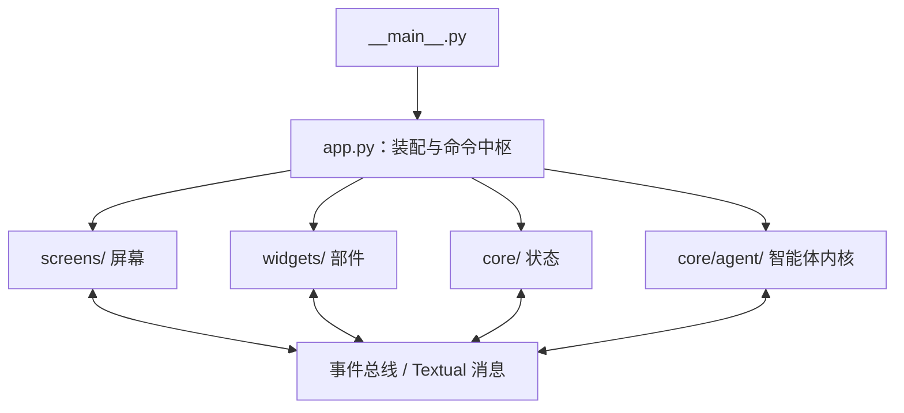
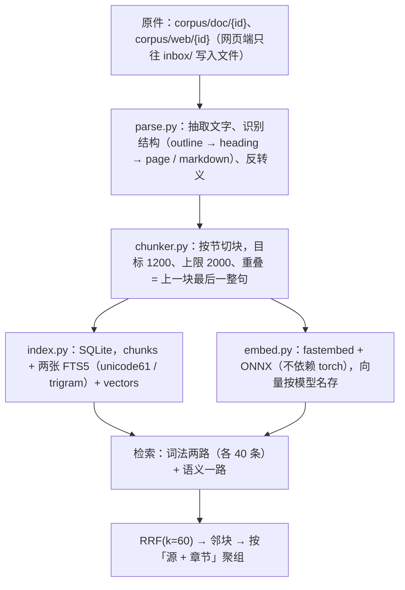

# CODEBUDDY.md

This file provides guidance to CodeBuddy Code when working with code in this repository.

## 强制规则

以下每一条都是强制性的，不存在例外与豁免：临时的、一次性的、命令行上的违反同样算违反。

### 语言

- 思考、回答、文档、注释一律遵守本节。
- 不使用「不是…而是…」「要…而不是…」这类对比句式；没有对比对象时不要写「不是」。
- 不在阅读代码或研究之前写「先做 x 再做 y，避免 z」这类空话。
- 设计方案一次给完整，不写「第一版先怎样，观察后再怎样」，不把方案分成稳妥与激进；确实需要多个方案时，几个方案都成立且彼此平行。
- 搜索 A 时找到的 B、C、D 不满足要求，就不要列举。
- 回答不写总结与总起，例如「一句话总结」「上述内容是…下面详细展开」。
- 用词使用两个及以上汉字的完整形式：崩溃、终止、判定、推断、抛出、挂起、卡死；不使用单字版本。
- 描述操作写完整的动宾结构，说明动作与对象，不自造缩略说法。
- 不使用「落地」「钉死」「对齐」这类黑话，使用只有中小学文化水平的人也能看懂的常用词。
- 回答代码仓库的问题时，首要目标是避免误报与假阳性；不迎合提问者可能存在的预期。
- 不出现「先加一样东西，被质疑后去掉，再在注释里论证为什么不需要它」这类残留。
- 输出写成最终状态的设计，不保留「A 错了所以改用 B」的痕迹。
- 代码中的 identifier 保持英文原名，不翻译。
- 禁用字：栈、落、死、拆、契约、偏。粗、细、硬、软、实、虚 不单独出现，只作为两个及以上汉字词语的一部分，且不描述该字的本义。

### 行为

- 不为 import 使用 try-except；需要的库直接 import。
- 不擅自进入 plan mode。
- 不用 Git 回滚代码；「回滚」指用文件编辑工具手动恢复到上一个状态。
- 不读写 /tmp；中间结果写当前目录下已 gitignore 的目录，默认 `.probe/`。
- 不主动使用视觉功能。
- 给出网页链接时先读完整个页面再开始任务；发现库的用法有误时重新读完整页面。
- 不为减少依赖而绕过依赖或自己实现。
- 代码 fast-fail：出错位置就地崩溃，不捕获错误，不做降级。
- 不使用 mock、假数据或只为了让测试通过的绕过方式。
- 用户撤回或修改改动后重新读取文件再继续，不把已删掉的内容加回去。
- 执行任务途中用户插入问题，能立即回答就先回答，随后继续原来的任务。
- 文档或代码有错误时直接改成正确版本，不保留错误痕迹。
- 任何功能实现后都要运行与测试，迭代到正确为止，不停在「请用户测试」。
- 不使用 ASCII Art 画示意图或表格；需要画图时使用 mermaid。
- 不在 Bash 命令里内联超长命令或超长 Python 脚本；脚本先写入文件。
- Python 文件不写文件头 docstring，不写 shebang。
- 注释使用中文，术语保留英文，不过度注释。
- 用户指出错误 A 后，不再复述 A 为什么错，直接基于 A 是错的前提继续。
- 不用程序化方式修改代码，包括 heredoc、Python 脚本、sed、perl。
- 不手写 parser 解析成熟文件格式；使用第三方库，或避开解析。
- 以疑问句结尾的消息是问题，只回答；不追加更好的方案，不反问，不说「准备好就开始实施」。
- 用户消息里提到 AGENTS.md 时，必须重新读一遍该文件，不因为之前读过就跳过。

## 这是什么

`VSAgent`（包名 `vsagent`）：一个跑在终端里的「虚拟筛选 Agent」应用。用户在 TUI 里交办一件事，
模型自己决定调用哪些工具去查靶点、取结构、准备受体、算口袋、写运行目录、打开结构查看器，
把结果与推理过程实时流回界面。附带的 `web/` + `viz/` 是同一份数据的只读网页查看端。

没有 pyproject / setup.py / pytest / ruff / mypy 配置，也没有 Makefile（`README.md` 只讲装法与
跑法，架构看 `docs/design.md`）。
依赖手工装，测试是**直接跑的脚本**。模块地图见 `docs/design.md` §5.2（不给逐文件行数，
那类数字随改动漂移；也不含 `web/` `viz/`）。

CI 只有一个 `.github/workflows/ci.yml`：Linux 上两个 job——内核 job 依次跑
`check_repo.py`（凭据扫描，不装依赖也能跑）、`test_agent.py`、`check_capabilities.py`、
`check_toolset.py`、`check_tool_descriptions.py`、`check_tools_doc.py`、`check_prefix.py`、`check_style.py`，界面 job 跑 `test_smoke.py`
（它是超集，末尾会重跑 `test_agent.py` 的全部断言）。**两份依赖都装**（叠合与先验口袋
那几条断言需要 gemmi，缺了会直接抛出 ToolError）。本地想一次跑完用 `tools/check_all.py`。
没有 Windows job——`verify_exe` 需要 pywinpty，那条路还没有人验证过。

代码注释与 docstring 一律用中文写，解释「为什么这么写」。新增代码跟随这一惯例。

## 命令

依赖：`pip install -r requirements.txt`（textual / httpx / python-dotenv / tomli-w / pypdf）。
可选化学依赖：`pip install -r requirements-chem.txt`（meeko/rdkit/gemmi/numpy/scipy + plip），
不装也能跑，只有 `prepare_receptor` 会返回一条带安装指令的错误。
`plip` 是这份文件里**唯一不进 `chemistry.CHEM_DEPS`** 的一项：它只给 `analyze_pose`
的 `interactions=true` 用，没装时那个开关退化成一句安装说明，接触/氢键/冲突照算。

**语义检索（S3）另有一份可选依赖**：`pip install -r requirements-embed.txt`
（fastembed + onnxruntime + tokenizers，约 78MB），再
`python -m vsagent.core.embed download` 拉模型（255MB，**显式下载，不自动**）。
不装时 `search_corpus` 只跑词法两路，其余功能一概不受影响。
要 GPU 时先 `pip uninstall onnxruntime`，再 `pip install -r requirements-embed-gpu.txt`：
`core/onnx_gpu.py` 在建会话之前把 `nvidia-*` 轮子里的库挂进进程，缺任何一个自动退回 CPU。
模型缓存 `~/.vsagent/models/`，**不进仓、不进 exe**——单模型就 255MB，
超过方案稿 §8.4 的 +80MB 预算，所以打包走「用户另装」这条路（与 DTA 同一种处理）。

**亲和力打分（`score_affinity`）另有一套环境**，在 `models/DTA/.venv`（Python 3.10 +
torch 2.2.1 + dgl 2.1.0），装法见 `models/DTA/README.md`。主仓一行都不 import torch——
工具是**起子进程**跑 `models/DTA/virtual_screen.py`，所以没装这套环境时应用照常启动，
只有那一个工具返回安装指引。别把它并进 `.venv`：主仓是 3.12，`pandas==1.5.3` 没有
cp312 轮子，且 MDAnalysis 要求 `numpy<2`。

`models/DTA/` **整个目录不进版本控制**（代码 54MB + venv 1.6GB + 权重 15GB），
`.gitignore` 里一行 `models/DTA/` 挡住。它不能放进 `vsagent/` 里面：
`check_chemistry_gate` 用 `rglob("*.py")` 扫整个包，DTA 有 45 处顶层
`import torch/rdkit`，放进去那条断言当场失败。

```bash
# 启动应用（唯一入口，无参数解析）
python -m vsagent            # 或 python __main__.py

# 测试：都是独立脚本
python tests/test_smoke.py        # 界面 + 内核的超集，末尾会重跑 test_agent 的全部检查
python tests/test_agent.py        # 只跑内核检查，打印「通过 N 项检查」
python tests/test_agent.py --list                 # 列出检查组名
python tests/test_agent.py --only permission      # 只跑名字含该子串的组（秒级）
python tests/test_agent.py --only hooks-in-loop
python tests/dump_layout.py       # 100x30 布局快照，写到 tests/output/

# 领域工具调试：唯一需要真实网络的脚本（真的打 UniProt/ChEMBL/RCSB/PubMed）
python debug_tools.py             # 全跑 24 模块 61 次调用（57 工具），顺序即依赖顺序，零参数
python debug_tools.py --clean     # 同上，跑完删掉本轮产物（只删 ~/.vsagent 下的）
# dock 需要外部 vina：PATH 里有 vina，或设置 VSA_VINA_BIN；没有时这一步直接失败
# score_affinity 需要 models/DTA/.venv：没有时同样直接失败并给安装指引
python debug_tools.py --list
python debug_tools.py structure fetch_structure pdb_id=4HJO        # 显式：单工具单参数
python debug_tools.py structure fetch_structure '{"pdb_id":"4HJO"}'
python -m vsagent.core.agent.domain.structure               # 单模块，同一套语义
# 参数支持 JSON / k=v / --file -；--reset 清登记表，--raw 跳过参数校验
# handle 写占位不写编号：{receptor:raw} / {artifact}，开跑前从登记表现取

# 网页端（会话与结构只读；语料可投递、改名、删除）
python -m vsagent.core.web     # 包内实现的独立进程壳，--port 优先于 .env 的 VSA_WEB_PORT
python tools/serve_web.py           # 同一个 WebServer 的 CLI 壳（--state/--runs/--web/--corpus/--port）

# 判据脚本
python tools/check_all.py           # 一条命令按顺序跑完下面全部判据；--list 列出，--only 过滤
python tools/check_web_api.py       # 在副本上起服务，验 API 形状 / 并发 / 写撕裂读 / 语料读写
python tools/check_retrieval.py     # 检索评测：词法单路 / 双词法 / 三路 + 组级指标，三条必须满足的条件
python tools/check_retrieval.py --list          # 只看评测集概况
python tools/build_demo_data.py     # 由 RCSB 1IEP 原始 PDB 生成 runs/1iep-demo（可复现）
python tools/check_demo_data.py     # 纯几何：口袋残基是否真的接触共晶配体（≤4.5Å、≥60%）
python tools/check_prefix.py        # 稳定前缀：token 预算 / 点名工具首步可见 / 枚举残留 / 字节稳定
python tools/check_style.py         # 样式：网页字号六档 / 间距八档 / 终端色值只在 palette.py / 变量有人用

# 上下文 / 记忆探针（手动，不进 CI）
python tools/eval_context.py --session ses_xxx   # 逐个截断点看装配估算与降级
python tools/eval_context.py --sweep             # 同一份会话扫多个窗口：前缀命中 / 清理 / 丢组
python tools/eval_context.py --evidence          # 证据探针：20 次工具运行，查关键行/重复/引用/artifact
python tools/eval_memory.py                      # 记忆台账健康度（重复、失效、常驻占用）
python tools/eval_memory.py --cases x.jsonl      # 人工标注集的 recall@k 与 stale 比例
python tools/seed_memory_eval.py                 # 造一份可复现的合成台账 + 22 条召回集（.probe/memory-eval）
python tools/eval_memory.py --root .probe/memory-eval --cases .probe/memory-eval/cases.jsonl
                                                 # 跑它：recall@5 100%、stale 1.3%，四类难例都在里面
python tools/replay_cost.py                      # 成本探针：同一份会话按当前装配器重放，与 trace 逐层对照
python tools/replay_cost.py --session ses_xxx --json .probe/cost.json
python tools/replay_cost.py --list               # 哪些会话有 trace

# 会话分析页（静态 HTML，双击就看，不联网）
python tools/report_session.py                   # 默认取最近改动的 trace，输出 .probe/report-<会话>.html
python tools/report_session.py --session ses_0023 --out .probe/report.html
python tools/report_session.py --list            # 列出状态文件里的会话与 trace 体量
                                                 # 逐轮耗时 / token / 缓存命中 / 分层占用 / 工具 / 主题 / 异常

# 本地语料（免费离线）
python -m vsagent.core.index reindex        # 按盘上原件重建索引，并顺手补向量
python -m vsagent.core.embed download       # 拉模型（255MB；直连不通自动走 hf-mirror）
python -m vsagent.core.embed index          # 只补向量（换模型后跑这条）

# 前端（viz/ 是唯一装 npm 包的地方）
cd viz && npm install && npm run build     # esbuild → viz/build/{viewer,markdown}-lib.js
NODE_PATH=viz/node_modules node tools/check_web_ui.js
                                           # playwright 装在 viz/node_modules，脚本在 tools 下
                                           # WEB_PORT，默认 8866；自己造夹具、自己 spawn serve_web.py
                                           # 含：数据驱动、口袋深链接、对接分数排序方向、
                                           # 三态主题（完成/失败/中断）与运行中卡片
python tools/seed_three_states.py --state .probe/web-ui-state/state.toml
                                           # 三条状态夹具，check_web_ui 自己会调；单独跑用于手工看

# 打包（Windows）
pip install -r requirements-pack.txt
pyinstaller --clean vsagent.spec      # → dist/VSAgent.exe
python tests/verify_exe.py                 # 先比对 AGENTS.md 与 dist/rules/ 的字节，再截图验证
python tests/verify_exe.py --source
python tests/verify_modal_transparency.py  # 模态居中/半透明，聊天透出
```

`verify_exe.py` / `verify_modal_transparency.py` 依赖 `pywinpty`，只能在 Windows 跑。
`tools/check_*.js` 依赖 `playwright` 与 `pngjs`，但它们**不在** `viz/package.json` 里，要自己装。

## 配置

`.env` 在仓库根（已 gitignore，没有 example 文件）。`env.py:load_env()` 用 `override=False`
——已存在的真实环境变量永远压过文件里的值。

**模型接口不走 `.env`**：地址、密钥与模型名由应用内的 `/model` 命令填写，写入与
`state.toml` 同目录的 `connection.toml`（`core/connection.py`，权限 0600，原子替换）。
没有这份文件时应用照常启动，发消息前提示先 `/model` 配置；`/model <名字>` 只换模型，
连接参数不动。`VSA_LLM_*` 这一组变量已经没有了。

| 变量 | 说明 |
| --- | --- |
| `VSA_MAX_STEPS` | 一轮步数上限，写错时按 24 处理 |
| `VSA_CONTEXT_BUDGET` | 上下文可用额度的上限（token）。设了之后取「窗口算出的额度」与它的较小值；没设、写错或非正数时不封顶 |
| `VSA_WEB_PORT` | 本地网页端口，默认 8860，不合法时同样按默认值处理 |
| `VSA_CORPUS_INDEX_WEB` | `0/1`，`search_web` 的摘要是否自动入库（默认开）。关掉后它退回纯查询，不给引用号 |
| `VSA_CORPUS_EMBED` | `0/1`，语义通道总开关（默认开）。关掉只跑词法两路 |
| `VSA_EMBED_MODEL` | 嵌入模型名，默认 `sentence-transformers/paraphrase-multilingual-MiniLM-L12-v2`（384 维）。**换模型要整表重建**：`python -m vsagent.core.embed index` |
| `VSA_EMBED_MIN_SCORE` | 余弦下限，默认 `0.30`。低于它不算命中——余弦没有「不相关」这个值，不设下限的话「本地没有」会变成「命中 29 组」 |
| `VSA_RERANK` | `0/1`，晚交互精排。代码默认关；GPU 上开着的代价是每次检索约 0.44 秒（p95），换来标注源命中 0.836 → 0.873、答案在片段里 0.741 → 0.833。CPU 上每次约 12 秒，那种机器上不要开 |
| `VSA_RERANK_MODEL` | 精排模型，默认 `lightonai/mLateOn`（1.25GB）。先显式下载：`python -m vsagent.core.knowledge.providers download` |
| `VSA_MEMORY_EXTRACT` | `0/1`，封存主题之后用本地模型抽取记忆（默认关）。端点见下三行 |
| `VSA_LOCAL_LLM_URL` / `VSA_LOCAL_LLM_MODEL` / `VSA_LOCAL_LLM_TIMEOUT` | 本地 OpenAI 兼容端点，默认 `http://127.0.0.1:8001` / `local` / 20 秒 |
| `HF_ENDPOINT` | 模型下载端点，**排第一**。不设时先试 `huggingface.co`，失败**自动退到 `hf-mirror.com`**（会打印实际用的端点，不悄悄换源）；镜像的 Xet 后端会回 401，所以下载子进程里固定 `HF_HUB_DISABLE_XET=1` |
| `VSA_VINA_BIN` | 外部 AutoDock Vina 可执行文件；不设时从 PATH 找 `vina`，缺失时 `dock` 返回安装指引。引擎**不随 exe 打包** |
| `VSA_AUTOGRID_BIN` | 外部 `autogrid4`；只有 `dock(scoring="ad4")` 用它（AD4 要先用它算亲和力图）。不设时从 PATH 找，缺失时只影响 ad4，vina / vinardo 不受影响 |
| `VSA_DTA_PYTHON` | 跑 `models/DTA/virtual_screen.py` 的解释器；不设时依次试 `models/DTA/.venv/bin/python` 与旧布局的 `<repo>/.venv-dta/bin/python`，都没有时 `score_affinity` 返回安装指引 |
| `VSA_DTA_ROOT` | `models/DTA`；不设时按**代码位置**定位到仓根下的 `models/DTA` |
| `VSA_DTA_DEVICE` | `cpu`（默认）/ `cuda`，写进 DTA 的 hydra 配置 |
| `VSA_DTA_WEIGHTS` | 预训练编码器目录，默认 `models/DTA/weights/`。可被更具体的 `VSA_ESM_CHECKPOINT` / `VSA_CHEMBERTA_CHECKPOINT` 单独覆盖 |
| `EDITOR` / `VISUAL` | `/editor` 外部编辑器往返 |
| `VSA_FILE_READ_LOG` | 设为 `0` / `off` / `false` 关掉文件读取日志。默认写**项目根**的 `logs/file-reads.jsonl`（已 gitignore），一行一次读取：`purpose`（`tool.read` / `tool.grep` / `import.structure` / `import.ligands` / `receptor.prepare` / `prompt.file_ref` / `state.load` / `rules.load` / `tools.load` / `memory.load` / `config.migrate`）、绝对路径、字节数、`ok`，失败时带 `detail`。`app.py` 启动时按 `root` 配置目录；没有应用可问的脚本与领域工具写入当前目录的 `logs/` |

测试不读 `.env`：`FakeModelServer` 起在 `127.0.0.1:0`，测试把地址写进
`.probe/connection.toml`（与测试用的 `state_path` 同目录），**全程离线**。

## 架构

四层，`app.py` 是唯一的装配根：



两条贯穿全仓的分界线，改代码前先确认自己在哪一侧：

1. **`core/` 不 import textual。** `session_manager.py` / `models.py` / `command_registry.py`
   都能被测试直接调用。往 `core/` 里加 `from textual...` 是破坏架构。
2. **`core/agent/` 不认识界面。** 内核只往 `EventBus` 发事件，`ChatScreen` 是唯一的
   翻译层。「把界面换成网页端」因此不需要动内核。

### 内核（`core/agent/`）

这一层按用途分五组，下文提到文件名时省略了组名：`planning/`（意图、任务编译、能力路由、
上下文装配）、`roles/`（能力与权限、角色说明书、每个角色的工具名单、系统提示、`contracts/` 协议）、
`execution/`（驱动、调度、派发、宿主、报告）、`state/`（事件流水、登记表、记忆、假设、主题）、
`research/`（科研对象与证据）。根上只留 `tools.py` / `coretools.py` /
`permission.py` / `provider.py` 与 `domain/`、`validators/` 两个包。

- `loop.py` — `AgentLoop` 是唯一的驱动，界面只认它的 `stream_reply / run_bash / cancel`。
  它**不维护第二份历史**：每一步从 `Session` 现场重建模型消息。上限
  `MAX_STEPS=24` / `MAX_STOP_RETRIES=2` / `MAX_RETRIES=2` / `MAX_TOOL_RETRIES=1` /
  `MAX_FAILED_STREAK=3`。剩 `CLOSING_STEPS=3` 步时进入收束阶段：只放行
  `write_run` / `close_topic` / `task` / `read_turn` / `recall_event` / `search_history`，
  其余工具直接返回「本轮步数快用完了」，这一阶段整步失败不计进 `MAX_FAILED_STREAK`。
  每轮开头按最后一条用户消息产出一次来源提示（`_intent_text`），并记一条 `intent.hint` 事件。
  当前主题走到 `TOPIC_STEP_LIMIT=20` 步且最近 4 步没有新产物时，内核自己封一次并
  以 `EXIT_TOPIC_FULL` 结束这一轮。**`RetryableToolError` 只在工具层重试 1 次**（模型请求那层是 2）：
  一次调用的超时就有几十秒，重试两次会把一次抖动拖成三倍等待。重试只包 `execute`，
  不重跑权限与钩子；重试用尽的文案要写清「参数没有错，也不要用 bash 自己实现」——
  否则模型会绕道自建客户端（实测一次误判烧掉 20 步）。domain 层不许用
  `except Exception` 把它包成永久失败，`tool-retry` 组盯着这一条。
- `tools.py` — `Tool` ABC + `ToolRegistry` + 五个内核文件工具（bash/read/write/patch/grep）
  + `read_turn`（按 `step N` 取回被归档/被移出的**一步**原文，会话由内核注入；
  默认不带思考过程，一次最多 4,000 token）
  与 `ToolSpec` / `ToolResult` / `ToolError` / `RetryableToolError` / `argument_error` 校验器。
  **依赖注入是声明式的**：工具在类属性上写 `primary_argument`（权限匹配用）、
  `context_argument`（登记表）、`task_argument`、`evidence_argument`、`viewer_argument`、
  `event_argument`（事件运行时），
  `Tool.execute` 在 `on_arguments` 记下模型原始参数之后注入它们；声明了却收到 `None`
  直接返回「内核装配问题」，不抛出。
- `context.py` — `ContextAssembler.build` 按
  `PREFIX → PROFILE_MEMORY → PROJECT_MEMORY → TASK → EVENT → RECENT → EVIDENCE → HISTORY`
  分层装配。`PREFIX`、`PROFILE_MEMORY` 与 `TASK` 是 `pinned`，压缩时永不驱逐
  （用户的约束与长期要求必须活过压缩）。习惯与项目情况分开两层：习惯只在记忆台账变化时变，
  单独一条 user 消息紧跟 `system`；项目情况随最后一条用户消息变，进 user 头。
  `TASK` 里除了任务状态还有**工作区索引**（`SessionLedger.digest()`，当前受体 +
  最近 5 个产物，≤10 行）与**运行环境**（`environment_block()`：日期、工作目录、
  状态目录）：handle 只在工具返回那一刻出现过，之后要么进证据层、
  要么被清走，模型要用时手里没有索引就只能凭记忆推断编号（实测推断错过三次）。
  另有 **FOCUS 复述**：把目标 / 前三条约束 / 下一步插成一条 user 消息，
  **紧贴在最后一条用户消息前面**（`_focus_block`，≤300 token）——任务状态在窗口最上面，
  RECENT 几万 token 之后模型早就看不到它了。
  预算先给固定上限（摘要 3000 / 证据 6000），剩下的全给 `RECENT`；
  `RECENT` 整 `Turn` 搬移，`tool_call` 与它的结果永远不分开。装不下时先清旧工具正文
  （`_take_recent` 里，最近 4 条与失败的除外），清不动才整组移出；清掉的原文用
  `read_turn` 取回。降级顺序
  `evidence_detail → history_summary → recent_tool_clear → event_step_detail →
  event_layer → memory → recent_turns → recent_reasoning → recent_output`。
  可用额度由窗口按 0.8 算出、扣掉预留与工具定义；`VSA_CONTEXT_BUDGET` 再封一道顶。
  装不下就抛出 `ContextAssemblyError` 明说，**不静默截断**。
- `event_log.py` — 事件层按 **Topic → Step 流水**记录：
  Task（一条用户消息）→ Topic（任务里的一个独立题目）→ Step（一次模型往返加它的
  工具调用）→ Event（一个 Topic 封存后的记录）。**内核每步自动记，主题结束立即封存**，
  所以记录不依赖任何模型判断。
  Step 全部本地从 Part 拼（工具名、参数、状态、handle），不读 reasoning、零请求；
  标题、结论与交接模型可以用 `close_topic` 顺手给，不给就用本地拼的那份并标
  `degraded=True`。
  **边界是位置 `(message_index, part_index)`，不是消息下标**：一条 assistant 消息
  装着一整轮的所有往返，按消息切不出轮中途的主题边界。切点记在 `Event.cut_message` /
  `cut_part` 上，装配时 RECENT 从最后一条事件的切点开始。
  `Turn.part_start`（`context.py`）是同一个口径：它由「按 `STEP_START` 分段、逐段
  `translate_parts`」得来。
  封存时机：模型调 `close_topic`（步末执行）、轮末、新用户消息、预算达到 120K
  （`TOPIC_SOFT_LIMIT`）、溢出 / `/compact` / 中断、当前主题走到 20 步且最近 4 步
  没有新产物（`TOPIC_STEP_LIMIT`，内核自己封，不靠模型判断）。模型侧的触发条件是
  尾部那一行「本主题已 N 步 · 本轮还剩 K 步 · 产物 … · 未决 …」（≥2 步出现，
  第 8 步换成「先收一次再继续」，放尾部是为了不碰前缀缓存），它同时也是运行中的本地摘要。
  **`seal_topic(force=True)` 与 `force=False` 的差别是覆盖**：轮末遇到纯聊天的一轮
  可以跳过，溢出 / `/compact` / 强行腾地方必须封，否则那一段原文两边都不在。
  `Event.actions` / `artifacts` / `issues` 是**从 steps 聚合的 property**，不写入磁盘——
  存两份必然漂移。`Event.step_start` / `step_end` 是会话内连号的步区间，只用于显示。
  封存之后那段原文不再随请求发出；
  所以自动封存**不推进 `compact_upto`**，只有手动 / 溢出那种明确的边界才推进。
  原文一条不删：`Step` 上的 `message_index` / `part_start` / `part_end` 就是取回它的地址。
  召回三级：`recall_event()` 列主题、`recall_event("evt_0003")` 读流水结论与原文、
  `recall_event("evt_0003", step=7)` 读那一步的工具输出原文。
  **取回默认不含推理**：`render_part` 的 `with_reasoning=False` 是三个取回入口的默认值，
  要当时的推演才显式打开。`read_turn` 按**步号**取（`Turn.step_no`，一段一个号），
  区间是 `(message_index, part_start..part_end)`；一次最多 4,000 token。
  三条不变式（连续覆盖、边界不收当前步、封存不花请求）见 `docs/design.md` §4.3。
  事件块超额裁掉最旧几个主题时要补一行「更早还有 N 个主题」——被裁事件覆盖的原文
  既不在事件里也不在 RECENT 里，不说就是无声消失。
  **摘要已退休**：它的三段分别由 TASK、Step 流水、主题结论覆盖；
  `_summarize` 只剩「首轮就溢出、连一段都封不出来」的兜底。
- `history.py` — 按内容查已封存的主题（`search_history`）。事件层只能按编号翻，
  用户说「上次那个」时模型手上没有编号；这个工具查标题、结论、产物、未决与每步的过程记录，
  返回主题号与原文位置，原文仍由 `recall_event` 取。默认只查当前会话；`scope="all"`
  查这台机器上的全部根会话（子 agent 的会话不查），每个会话最多 3 条。跨会话的命中行带
  `ses_0019 · evt_0007`，取回时 `recall_event` 要带同一个 `session_id`——`evt_0007`
  在每个会话里都有，单给编号会在当前会话里取错主题。会话表读 `SessionManager.sessions`，
  不另建索引；规模上限与升级顺序见 `docs/design.md` §4.3。
- `intent.py` — 来源提示（`detect` / `render`），纯字符串匹配、零请求。
  读最后一条用户消息，按关键词判断它在问任务进度、记忆、语料还是历史，
  在最后一条用户消息前面加一行「可能相关的来源」；没有命中就一个字都不加，
  系统提示逐字节不变。只点名来源、不点名工具。
- `roles/agents.toml` + `roles/agents.py` — 每个角色装哪些工具。全仓 72 个工具：
  常驻 18 个，领域 54 个（23 个模块）。三份配置按顺序读（包内、项目
  `.vsagent/agents.toml`、用户 `~/.vsagent/agents.toml`），同一个角色以靠后的整段为准；
  常驻那 18 个按三档装配（`orchestrator` 18 件 / `worker` 13 件 / `full` 全部）。
  会话建立时清单定稿，运行当中不变；换主题不改请求体，前缀缓存不会整段失效。
  注册表只装一份、含全部工具，`Registry.specs(only=…)` 按名单过滤。
  模型看不见某个工具时最容易直接叫它的名字，所以 `loop.missing_tool_reason` 会说
  「这个角色没有装配 X，要它请改 agents.toml，或把这件事派给装了它的角色」。
  名单与额度的判据在 `tools/check_capabilities.py`（逐角色 10,000 提示 / 12,000 判失败）
  与 `tools/check_toolset.py`（两档基础档 8,000 / 5,300）。
- `prompt.py` — `stable_prefix` 组装：身份 → **假设规则** → 工作方式 → shell → 登记表 →
  记忆 → 事件 →（派发）→ 项目规则。**前缀里不放时间不放进度**，否则每步都击穿 prompt cache。
  排序是语义：假设规则紧跟身份（它定义「产出长什么样」，先于所有操作纪律），确认点放最后。
  **固定那几段预算 1900 token（实测 1592），由 `tools/check_prefix.py` 守着**：超预算、
  点名了首步看不见的工具、出现「全库只有…」这类枚举，都会被检查出来。
  `AGENTS.md` 那一块**不设上限**：它是许可与判据的来源，少一条就可能让模型做一个本来
  被禁止的动作，判据只报它的体量（现 3527 token / 286 行）。
  `project_rules()` 每次发问重读 `AGENTS.md`（`RULES_FILE`），整份注入、不截断；
  编码坏了返回空串——`stable_prefix` 在装配之前调，那里没有 try，一个异常会掀掉一整轮。
  平台那句由 `platform_note()` 按 `sys.platform` 现取，**必须现取**：把「这套环境是
  Windows」固定写进代码的版本在 Linux 上跑就是在教模型写 `dir`，而且 `env-block` 判据盯着这一条。
  易变的环境信息（日期、工作目录、状态目录）走 `environment_block()`，由循环层塞进 user 头，
  **不进前缀**——日期每天变一次，进去了每天击穿一次缓存。
  摘要指令是八段（目标 / 改动 / 待办 / 约束 / 决定 / 错误 / 当前 / 关键数字），
  `summary_messages` 只喂 `[summary_upto, upto)` 新段 + 旧摘要，不再整段重喂。
- `permission.py` — `PermissionPolicy.check` 的判定顺序是有讲究的：取消 → 用户手打 bash →
  **会话 allow_all** → Plan 模式 `PLAN_DENY` → 项目规则 → **越界路径检查** → 计费配额 →
  单工具允许 → 默认 `{write, patch, bash, dock}` 要问。会话 allow_all 排在除中断之外一切之前：
  弹窗上按了 a 就是「这个会话别再问我」，Plan 限制、越界与计费都不再拦，切会话时清掉。
  询问那一步有两条兜底（`loop._ask_permission`）：`permission.ask` 没有任何订阅者时立刻拒绝
  （无人值守运行，等下去是等一个没人回答的 future），以及 300 秒无人答复时拒绝。两处都按
  **拒绝**处理——没人答复不等于用户同意。
  同模块的 `load_tool_switches` / `save_disabled` 管的是**另一件事**：`tools.toml` 里标关的工具
  根本不进注册表，模型连它存在都不知道（权限层是「装进来但拦下来」）。改开关用 `/tools` 面板，
  它写项目侧那份文件并当场重装注册表，不必重启。
- `hooks.py` — `hooks.toml` 里的外部命令，stdin 收一行 JSON。退出码 2 拦截（stderr 当原因），
  0 放行，30s 超时算拦截。
- `ledger.py` — 会话登记表，`receptor#1` / `ligandset#3` 这类 handle 的真相所在。
  `digest()` 是给模型看的那一小段索引（当前受体 + 最近几个产物），
  **不调 `reconcile()`**：那一步会把每个登记路径读一遍算指纹，而索引每一步都要算。
- `memory.py` — 工具层（`remember` / `recall`）与兼容导出；实现搬到 `core/memory/`
  （`models` / `store` / `lifecycle` / `retriever` / `extractor` / `vectors`）。
  记忆里写**文件路径不写 handle**（handle 只在本次会话有效）。
  三类：`FACT`、`PREFERENCE`（用户习惯，恒常驻 200 token、不进相关度）、`EXPERIENCE`（180 天衰减、分数乘 0.8）。
  写入做五件事：按「正文 + 类型」精确去重、**只有 `FACT`** 能被隐式取代
  （同类型且 refs 相交时按字符二元组重合度只取代最相近的一条，下限 0.20）、
  `remember(conflicts=[…])` 把矛盾写成双向标记（两条都保留，渲染带「冲突，未解决」）、
  agent 的引用必须存在（用户写入可不存在，标 `unverified`）、习惯最多 8 条。
  常驻注入是「习惯一段 + 项目情况一段」，合计 1200 token；`recall` 把字面与语义两张
  名次表按 `Σ 1/(60 + 名次)` 合并（`.vsmemory/vectors.db`，按内容指纹对账），
  只靠语义命中的条目要过「不低于最高分 0.8」这一关；条目引用贴着当前受体或当前产物时乘 1.2。
  详见 `docs/design.md` §4.6 与 `docs/history.md` §2.2。
- `hypothesis.py` — **产出单位**：这个 agent 交出的是一组可检验的判断。
  `Hypothesis` 对象存在 `TaskState.hypotheses` 里（数据在 `models.py`，工具在 `core/agent/`，
  分层理由与 `task.py` 相同），未结的按粒度分组渲染（策略 2 条、机制 3 条）进 `TASK` 层。
  六要素里 `test` 与 `expected` 是必须满足的条件，`expected` 还必须含数值、阈值或对照——
  没有可以判断真假的预期，实验数据回来也没法结案。**状态只由 `close` 与
  `record_assay(hypothesis=...)` 改**，`update` 改不了：否则模型能绕过证据把它标成 supported。
  `write_run` 把它们整份写进 `provenance.hypotheses`（不新增顶层键）。
- `provider.py` — 只实现了一种协议：`OpenAICompatProvider`，OpenAI 兼容的 SSE。
  模型**名字**决定 context window / 价格 / 是否支持 reasoning；`switch_model` 会连带重算上下文窗口。
- `trace.py` — 订阅 EventBus 的 `"*"`，把事件写成 `~/.vsagent/logs/<session>.jsonl`。
- `report.py` — 把状态文件与 trace 汇成一份会话分析（轮、步、token、工具、主题、异常）。
  `tools/report_session.py` 与网页的 `/api/sessions/<id>/analysis` 都从这里取，两处不会得出两套数。

一轮的流程：`_prepare_route`（根会话，`off/shadow/enforce`）→ 清证据表 → `stable_prefix` →
装配 context → 问模型 → 消费流（TEXT/REASONING/TOOL_CALL/REASONING_DELTA 分流到不同
`PartType`）→ 无工具调用则跑 STOP 钩子 →
逐个（**故意不并发**）执行工具：registry 查找 → 参数校验 → PreToolUse 钩子 → `policy.check`
→ 可选的 UI 询问（发 `permission.ask`，界面弹模态）→ 执行 → PostToolUse 钩子 → 收证据 →
连续 3 步整步全失败则 `EXIT_TOOL_FAILED`。任何非正常退出都会触发一次**不带工具的收尾总结**
（模型写，失败则本地兜底）。这份总结是四段简报：停在哪里、已经产出、还没做完、
下一轮从这里继续；要求不用 Markdown 语法、不向用户提问，整轮停因另记在
`Session.last_exit_reason` 上，下一轮由 FOCUS 复述带出来。

装配发现这一步新挤出了交互组时：没有事件 → 让模型写摘要；**已经有事件 → 补一条本地
`auto` 事件**（零请求），摘要从此冻结。上下文装不下时先强压一次再重试，
摘要连续失败 3 次熔断到下一轮。

### 领域工具（`core/agent/domain/`）

分界线按「需要知道什么」划：知道 UniProt 编号长什么样、口袋残基怎么算
→ 放这里；只需要知道「有个文件」→ 放内核那批。

- 每个登记工具的模块暴露一个模块级 `domain_tools() -> list[Tool]`，文件末尾带
  `if __name__ == "__main__": from debug_tools import main` 块。
- `all_tools.py:domain_tools()` 按**浏览 → 检索 → 改动**的顺序拼装
  （listing, uniprot, rsearch, structure, pockets, pocketcmp, chembl, pubchem,
  opentargets, literature, corpus, websearch, receptor, ligand, screen, docking,
  finetune, affinity, analysis, admet, sar, pharmacophore, research）。这个顺序同时
  决定了工具在请求体里的先后，靠前的更容易被模型选中——**顺序影响模型的选择**。
  哪些工具发给哪个角色不在这里定，见 `roles/agents.toml`。`write_run` / `open_viewer`
  由 `coretools.py` 装成常驻工具。
- 配体链路：`import_ligandset`（文件 → raw ligandset）→ `prepare_ligands`（ETKDGv3 +
  MMFF/UFF + Meeko → prepared ligandset）→ `dock`（Vina → docking artifact）。
  DTA 通道是另一条：`fit_affinity`（实测活性 → model artifact）→
  `score_affinity(model=…)`（同一批位姿 → affinity artifact）。
  `write_run(docking=…, affinity=…)` 把两路分数写进运行目录。
  `ligand.py` 与 `docking.py` 是配体这条链，`products.py` 是共用的产物目录/原子写盘。
- `dock` 有三个力场（`scoring="vina"|"vinardo"|"ad4"`），**分数互不可比**。前两个只要
  受体 + 盒子；`ad4` 要先 `autogrid4` 算亲和力图（`--maps`，不能给 `--receptor`），
  图缓存在 `~/.vsagent/grids/`（键是受体指纹 + 盒子 + 配体原子类型），盒子限 40 Å
  ——图的代价是边长的三次方。`Autodock4` 的**原程序**没有接：1–5 分钟/配体，
  与批量筛选的形态冲突，而 AD4 力场已经通过 vina 拿到了。
- `finetune.py` 是**唯一会训练模型的工具**：用某个靶点上已测的活性把预训练权重
  微调一遍（`fit_affinity`），产出登记成 artifact（`kind=model`），之后
  `score_affinity(model=…)` 用这份权重与它训练时的口袋推理。训练本身交给
  `domain/fit_train.py` 在 `models/DTA/.venv` 里跑（5–10 分钟，CPU），主仓一行
  torch 都不 import。**它只对这个口袋有效，换受体或换口袋要重训**；而且实测只与
  「ECFP4 + LightGBM」打平、不超越。DTA 通道固定走「微调 → 推理」，零样本不再是
  流程的一部分。依据见 `docs/review.md` §4.4。
- `affinity.py` 是**第二个调外部进程的工具**，外面是一个 Python 解释器，
  所以它比 `docking.py` 多两件事：`dta_python()` / `dta_root()` 两个环境变量入口，
  以及**现截口袋**（受体的 `box.txt` 只给中心，模型要的是中心 10Å 内的残基）。
  分数方向与 dock **相反**（pK 越高越好），两者不可比较——描述第一段必须写明这一句。
  它不 import torch，也**不能**：`check_chemistry_gate` 的黑名单与
  `test_smoke.walk_packages` 都会当场失败，PyInstaller 还会把 2GB 依赖拖进 exe。
- `analysis.py` 是「看完所有结果」这一层（模块 `analysis`，8 个工具）：
  `rank_candidates`（多路合并排序）、`analyze_pose`（接触 / 氢键 / 冲突 / 可选 PLIP 指纹）、
  `alternative_poses`（同一分子的多个对接模式按体积聚簇，报每簇分数与接触残基差异）、
  `contact_map`（一份产物里所有位姿的残基接触频次）、
  `analyze_hydrophobic`（HP/HM/脱水账）、`efficiency_profile`（LE/LELP/LLE）、
  `validate_docking`（重对接到晶体位姿的 RMSD）、`compare_poses`（两个位姿在同一参考系
  里逐原子比 RMSD 与接触 / 氢键差异）；对照组由 `rank_candidates(with_controls=true)`
  顺带挑（正向 / 阴性 / 背离三类，并写明每一条为什么算对照）。八个都**只读产物**，
  `rank_candidates` 只读候选表，但同样声明了 `context_argument`——它要沿 handle
  找到那张表，与 `analyze_pose` 同一个理由。
  要受体坐标的四个（`analyze_pose` / `alternative_poses` / `analyze_hydrophobic` / `contact_map`）
  共用 `_docking_entry()` 与 `_receptor_of()`：前三个经 `_resolve_pose()` 或自读 pdbqt 取位姿，
  `contact_map` 取一次受体再遍历全部位姿。不共用的话那段
  「handle → 产物 → 位姿 → 受体坐标」的校验必然复制错。
  `alternative_poses` 读的是 `pose_pdbqt` 里的全部模式：`pdbtext.parse` 只留第一套模型，
  所以先用 `_split_pdbqt_models` 按 `MODEL` / `ENDMDL` 切段再逐段解析；聚簇与
  `pick_diverse` 的位姿去重共用 `screen.pose_volume_cells` / `pose_jaccard` /
  `cluster_by_similarity`，两处各写一套的话同一对位姿在两边会被判成不同簇。
  `analyze_hydrophobic` 与 `efficiency_profile` 的口径里都写明「没有计算熵与脱水代价」：
  输出不能让读者以为算过。
- `pocketcmp.py` 是「口袋定下来之后」的两个问法：`compare_pockets`（同家族两个受体
  逐残基比 8 Å 内的差异，先做全局序列对齐再按对齐结果配对）、`similar_pockets`
  （按口袋窗口的局部序列同一性给候选受体排序，并给出各自的 ChEMBL 活性条数）。
  两者共用同一套 Needleman–Wunsch；选链按「同一性 × 覆盖」，只看同一性时一条 30 个
  残基的短链会以 70% 压过真同源链。窗口按 UniProt 编号取，给 `pocket` 时先对齐换算。
- `survey.py` 是结构全景 `survey_structures`（**常驻**——宽泛问题发生在第一轮，
  那时还没派发任何角色）。它把这个靶点的**全部**实验结构取回来，按 `chem_comp`
  代号分组，每组给套数、最佳分辨率与代表条目；产物写 `~/.vsagent/surveys/`，
  聊天里只给摘要，全表在 `#/survey/<id>`。**标题里点过名的配体排在最前**：膜蛋白
  结构里胆固醇与磷脂按套数永远最多（Nav1.7 的 44 套里胆固醇 26 套），按套数排序
  会把河豚毒素（9SR，3 套）挤到折叠行里。配体常用名来自 REST 的
  `rcsb_chem_comp_synonyms`——`chem_comp.name` 常常是一长串系统命名，
  「Tetrodotoxin」不在里面。它不下载坐标、不算口袋、不核对序列。
- 不登记工具的模块（`complexes` / `prankweb` / `align` / `chemistry` / `pdbtext` / `http` / `products` / `preprocess`）
  是库层，被 `WriteRunTool` 之类调用。口袋来源因此是四层叠合：共晶配体 → 复合物 → p2rank 预测 → 先验叠合。
  四层在聚簇之前都先剔掉脂质与去垢剂（`preprocess.screen_lipids`）：碳数 ≥ 8、极性原子
  （N/O/S）≤ 2 或含磷、重原子 ≥ 16、包围盒最长边 ≥ 16 埃，四条全中才算；最后那条是
  类固醇药物与膜成分的分界（睾酮、地塞米松四个并环只有 11–13 埃）。它**不进
  `screen_ligands`**——那个函数同时决定 `clean_structure` 留哪些杂原子，准备后的受体
  丢掉膜成分是另一回事，`prepare_receptor` 的 `keep_hetero` 管那一头。
  每处口袋带一份画像（`pockets.build_profile`）：配体的元素组成与伸展尺寸、壁按
  芳香/疏水/极性/带电分四类计数、最近残基与 3.5 埃内的个数、一句判断。**画像不给分**，
  与「实验定位没有打分」同一口径；`detect_pockets`、`write_run` 与网页端读的是同一份。
- `http.py` 是**全仓唯一的网络出口**，测试整体替换的就是它。4xx → `ToolError`，
  429/5xx/网络 → `RetryableToolError`。
- `chemistry.py` 是不许在顶层 import 可选依赖的守门人，测试用 AST 断言这一条
  （`test_agent.py:check_chemistry_gate`）。装依赖后要**重启会话**，探测只在进程启动后第一次调用时做一遍。

`domain/__init__.py` 顶部有**九条纪律**，是踩坑攒出来的经验。新加领域工具逐条对一遍，
其中最容易违反的三条：只收 handle（只有少数动作收路径，以工具 schema 为准，
不要在文档里列名单——列过两次都漂移了）、
纯查询不声明 `context_argument`、要算数就用代码算（RMSD / Tanimoto / 接触距离绝不交给模型心算）。

### 本地语料与检索（`core/` 里的五个纯库）



融合、聚组与检索入口在 `core/knowledge/`（`fusion.py` / `search.py` / `models.py`），
`domain/corpus.py` 只留工具与渲染，并保留 `fuse` / `_group` 两个模块级别名给
`tools/check_retrieval.py`；证据收集器在 `knowledge/evidence.py`，`context.py` 转出同名符号。
`knowledge/providers.py` 是晚交互精排，默认关闭（见配置表）。

**`corpus/` 与 `runs/` 的根由 `core/paths.py:project_root()` 定**：源码运行时是仓根，
打包后是**启动目录**（与 `logs/` 一样）。这两个都**不能按 `__file__` 算**——冻结之后它
指向 PyInstaller 解包出来的临时目录，写进去的文献、索引与运行目录在退出时一起消失，
而每一步都返回成功；表现是「网页上语料库空了、结构页也空了，但功能都正常」。

- **每路 40 条是量出来的**（`index.CHANNEL_LIMIT`）：30 → 40 让「标注源进前 8 组」
  从 0.927 升到 0.945、「答案在片段里」从 0.796 升到 0.815，50/80 不涨。RRF 权重、
  k、章节加权、References 过滤、邻块范围都扫过，均无增益（见 `docs/review.md` §3）。

- **解析与切块只有一条路**：`index.chunks_for`。入库与 `reindex` 各写一份的话，
  重建出来的块跟当初写进去的不一样，而「重建两次一致」的判据正好抓不到这种漂移。
- **网页保存当场入索引**（`websearch._index_pages` → `index.upsert_web_page`）：
  少了这一步，刚搜到的东西要等下一次 `reindex` 才查得到，而工具说明写的是「之后免费可查」。
- **向量是派生物**：`vectors` 与 `kv`（版本号）都在 `library.db` 里，删掉能重建。
  版本号由**触发器**维护，因为级联删除（删源、整源重建）也会清向量，那条路径没人会记得 bump。
  `embed._matrix` 的缓存按 `(库, 模型, 版本)` 做键——只按行数做键会拿旧 id 配新块。
- **可选依赖在函数体里导入**：`fastembed` 与 `pypdf` 都不在顶层。没装时应用照常起，
  `search_corpus` 静默降级成词法两路（技术细节只进 `meta`，不进正文），`import_documents`
  报一句带 `pip install` 的话。
- **模型不自动下载**：`embed.missing_reason()` 给一句能照着做的话，下载要人显式跑
  `python -m vsagent.core.embed download`。

### 界面（`screens/` + `widgets/`）

屏幕用单个层叠管理，没有 router。`on_mount` 进 `HomeScreen`，提交后 `switch_screen(ChatScreen)`；
`refresh_chat` 反向遍历 `screen_stack` 找到模态下面的 Chat。

- `ChatScreen` 是主表面，**唯一**订阅 EventBus 并翻译成 `MessagesPane` 改动的屏幕，
  退订用 `on_mount` 存下来的 unsubscribe 闭包。会话标题写在底部状态栏左端，
  没有单独的标题栏。
  **三栏**：左栏 `#chat-rail` 是会话树（子 agent 缩进挂在父会话下）与这一轮的主题清单，
  中间 `#chat-main` 同时装消息区与输入框（两块同宽同左边界），右栏是 `SidePanel`
  （产物 / 子 agent / 用量；引用文件与工具调用两段已删，那两份在消息区里各有一遍）。
  产物是一组可点条目，点一行走 `app.open_artifact()`：地址由
  `domain/export.viewer_address()` 算，与模型调 `open_viewer` 拿到的是同一个。
  三栏之间各有一条 1 列宽的 `Splitter`：按住拖动或聚焦后按左右键调宽，宽度存进
  `state.toml` 的 `rail_width` / `side_width`；画的时候按终端宽度
  再夹一次（左栏 16–60、右栏 20–60，放得下时给中间栏留 40 列），夹的只是画面，不改设定。
  左栏的两份清单来自 `widgets/session_list.py` 与 `widgets/topic_list.py`；主题清单读
  `MessagesPane.topics`，不另算一遍边界，点一条走 `focus_topic()` 打开并滚过去
  （不在挂载窗口里时先把窗口挪到那个主题的第一条消息）。
  宽度不到 92 列时左栏与它的界线一起收起，80 列终端里消息区才有地方放正文。
  分节标题带条数（`运行中 2` / `全部任务 5` / `主题 3 · 12 步`），主题行的标题补齐到
  栏宽、状态字形停在最右列；两个列表都按内容签名跳过重建，每一步的刷新不会把滚动
  位置推回顶部，主题多出来时才跟着滚到底。
  **侧栏可见性只有 `set_sidebar()` 一个入口**——`/sidebar`、点按钮、子 agent 刚建出来时
  自动打开，三条路都走它；各写一份的话按钮上的字会跟实际状态对不上。
- `HomeScreen` 只有一栏：字标、输入框与「最近任务」都在中间，左栏已经删掉。
  最近任务最多 6 条，运行中的排最前，其余按更新时间；标题行右端是「+ 新建任务」
  （`NewTaskRow`）：清空输入框、焦点归位，会话等提交时再建。点任意一行走
  `app.open_session()`（与 `/sessions` 选择器同一个入口）。
  顶部一条 1 行高的 `TopBar`：左边应用名，右边「模型 / 工具 / 主题 / 帮助」四格，
  点一下走对应的斜杠命令；聊天界面没有顶栏。
  输入框内部最后一行是四格操作提示（`HomeAction`）：`@ 文件` / `/model 模型` /
  `/tools 工具` / `Enter 发送`。附件在光标处插 `@` 并打开文件候选（与聊天界面同一个
  `FileAutocomplete`；回车采纳后写成 `@路径 `，提交时由 `resolve_file_refs` 读成
  文件引用），模型与工具走各自的命令打开面板（草稿留着），发送与回车同一条路。
  输入框下面紧跟一行快捷键提示（`tab 切换 Agent · ctrl+p 命令面板 · / 列出命令`），
  再下面是「快速开始」三个模板（`QuickTask`：研究 / 结构 / 知识）：点一下整段填进
  输入框、光标停在末尾、不提交；终端不足 26 行时整行收起。
  最近任务每行写标题、状态、`N 主题 · M 产物 · 时间` 与最近一次结果（结论 → 失败原因 →
  状态说明），结果按剩余宽度截断；`SessionRow` 的预留把状态词前后的空隙算了进去。
- 消息区按主题卡组织。**用户消息是任务的头，永远显示；主题挂在它下面**：一轮里有几个
  主题就排几行标题，点开一个才展开它的过程。三层：主题头（标题、状态、步数与工具数、
  一句结论）→ 步行（序号、做了什么、耗时、成败）→ 工具卡，缩进依次加深。思考过程属于
  某一步，缩进与步行一致：左边那条竖线与步行的「▸」同列，正文与步行的文字同列。
  主题头与步行由 `core/agent/state/topics.py` 从 `session.messages` 与 `session.events` 算出来，
  边界是 `Event.cut` 的 (消息, Part) 位置，与装配器读的是同一组数。主题可以从一条
  助手消息中间开始（`close_topic` 的切点就在同一条消息里），所以位置 0 的头挂在消息
  外面，消息中间的头插在 `parts_box` 里；`-pane-row` 让两种挂法从同一列开始。
  **主题的结局在封存之前就定**（`topics._stopped_status`）：取消的一轮画成中断、停在
  失败上的一段画成失败，不必等事件写完；进行中失败过的主题，第二行第一句就是「失败：」，
  颜色按红色。中断时界面自己调 `messages.set_running(False)`——取消不走 `turn.done`。
  运行中的那一步还没记成步，由 `TopicView.live_step` 从 Part 现折，状态取
  `topics.step_status()`（失败 → 等确认 → 执行中 → 未开始 → 完成），记成步前后是同一行。
  主题头下面还有一行 `ArtifactRow`：列前三件产物，收起主题时仍在，点名字走
  `app.open_artifact()` 在浏览器里打开。
  工具卡的输入与输出**默认收起**（`ToolCard._show_output=False`），主题与步默认展开，
  所以一眼看到的是「这一轮做了几件事、每步调了什么工具」。
  三个层级各有开关：主题头切整段、步行切这一步、主题头末尾的 `▾ 收起全部工具` 一次
  展开或收起本主题全部工具输出（`/details` 就是它对最后一个主题做一次）。
  **没有全局展开**：`show_details` 已从状态文件里去掉，卡片不会跨会话保持展开。
  卡片展开后依次是参数（全部键值）、输出、产物（`tool_meta` 的 handle/ref/run_id，
  与 `event_log.artifact_refs` 同一份口径）；失败那一刻卡片自己展开。
  用户消息不随主题收起，`_message_hidden` 与 `_apply_classes` 都先跳过它。
  展开状态只在消息区里，不写盘、不回写事件；下一条用户消息进来时，封存过且带步的
  主题自动收起，用户点开过的不收。`part.update` 只刷新进行中主题的第二行，不触发折叠。
- `MessagesPane` 是虚拟化的：只维护一个 `[mounted_start, mounted_end)` 可见窗口，
  滚动时裁剪/扩展。**收起主题里整段落在其中的消息不建视图**，但窗口端点仍按消息下标算，
  所以补挂与裁剪的算术不变。它有 `on_removed` 回调让 ChatScreen 在移除前先退订（注释里记着一次真实的 `NoMatches` 竞态）。
  多个 handler `prevent_default()` 之后要调 `stylesheet.update_nodes([self])`，否则整棵子树重排要 2.6–3.9 秒。
- `EditorPane` 有三种模式 `mode-chat` / `mode-command` / `mode-bash`（CSS 类切换），配三个自动补全弹窗。
  两个界面的输入框共用 `ComposerInput`（`widgets/editor_pane.py`）：焦点进出不重画整块，
  滚动跟着光标走；启动界面只多一个 `shift+enter`。焦点那条竖条由外层的
  `on_descendant_focus` / `on_descendant_blur` 加类点亮，不写 `:focus-within`。
- 命令表 `core/command_registry.py` 有 32 个斜杠命令。**命令刻意没有键位**，键位单独放
  `core/keybind_manager.py`，且那两个表只用于渲染帮助——smoke 测试会比对它们和 `HomeScreen.BINDINGS`。
- `app.py:execute_command` 解析 `/name args`，查表，然后按约定分发到 `self._command_<name>`。
  只有 `ARGUMENT_COMMANDS = {"remember","forget","task","model"}` 会拿到参数尾巴。
  命令加了但没接处理器，会显示「尚未接入」。

### 状态与持久化

真相在 `~/.vsagent/state.toml`（`session_manager.py:default_state_path()`），TOML + `STATE_VERSION=2`。
同目录还有 `connection.toml`（模型接口，权限 0600）、`ledgers/`（按会话 id 隔离），traces 在 `logs/`，运行产物在仓库根的 `runs/`。

写入是**原子替换**：同目录临时文件 → flush → `os.fsync` → `_replace_with_retry`（40 次 × 5ms 重试 `PermissionError`）。
读回来调 `sync_sequences` 把 ID 计数器推进到已加载 ID 之前。网页端**每个请求都重新从磁盘读**，
所以网页看到的永远和 `state.toml` 一致——这是它跟 TUI 之间唯一的数据通路，没有 SSE、没有 websocket。

会话标题的来源记在 `Session.title_source` 上：`default`（占位）/ `placeholder`（首句截断）/
`auto`（模型按主题起）/ `user`（`/rename`）。提交时先写占位，第一条主题封存时用
`close_topic` 的 `session_title`（没给就用那一条的标题）替换一次，之后不再改；
`user` 的名字谁也覆盖不了。旧状态文件没有这个字段，非默认标题按 `user` 读回来。

同目录的 `live/<sid>.json` 是唯一一份不在这条通路上的数据：当前主题的实时快照，
原子替换但**不做 fsync**，只给网页端补「状态文件还没写进去的那一截」。它不参与恢复，
进程退出时丢掉也不影响任何东西；状态文件仍然是唯一真相。

### 网页端

`core/web/routes.py` 的 `SPEC` 是路由的**唯一真相**，包内常驻服务和 `tools/serve_web.py`
都从它拿，别在第二处写路由。会话与运行仍是纯 GET：`GET /api/sessions`、
`GET /api/sessions/<id>`、`GET /api/runs`，外加 `/runs/...` 静态与 `web_root` 静态。
结构全景另有一条 `GET /api/survey/<id>`（只认目录名，不认路径），
根目录由 `--surveys` 注入，判据因此不必往家目录里写东西。
路径逃逸用 `resolve_within` 拒绝（403）。

会话在网页上有五个视图，**正文不再随详情整份发**：`/events` 给主题清单与任务状态
（几十 KB）、`/segment?event=<id|all>` 按事件切点取一段原文、`/artifacts` 给登记表里的
产物与这个会话产出的运行、`/live` 给当前主题的实时快照、`/analysis` 给轮次与 token 的
统计。切点用的是 `Event.cut_message` / `cut_part`，与装配器同一组数，所以页面上的分段
不会跟模型看到的对不上。

`/analysis` 与 `tools/report_session.py` 共用 `core/agent/execution/report.py`：轮按用户消息切，
token 与费用取助手消息自带的数，缓存命中、逐步耗时与分层占用取 trace 的
`context.metrics`，工具失败与主题未决项汇总成异常清单。trace 在状态文件旁边的 `logs/`，
没有它时照常给轮与主题的统计，`hasTrace` 为 false。原话与正文各截到 600 字。

**`/live` 不读状态文件**：页面两秒拉一次，而 `state.toml` 有几 MB。快照是
`core/live.py` 写的 `live/<sid>.json`（与状态文件同目录），只装当前主题的序号与标题、
已完成的步、当前工具与状态、首行结果、是否在等确认。`AgentHost` 在 `_start` 时写
`running=true`，订阅 `part.add` / `part.update` 按 500 ms 节流更新，`_run` 的 `finally`
里**先存状态文件、再写 `running=false`**——顺序反了，页面会拿到还不含刚封存那一段的旧状态。
快照不写 reasoning、不写完整输出：它每两秒被拉一次，放多了等于把工具正文复制出第二份。
超过 15 秒没更新由读取侧标 `stale`，页面显示「可能已断开」。进程被强杀时只丢最后一帧。

**主题的显示状态（完成 / 失败 / 中断）存在 `Event.exit_reason` 上**：轮末封存时由循环层
把 `EXIT_*` 写进去。不存这一项的话，取消之后照常封存，事后分不出「做完的」与「被停下的」。
整轮停因另存一份 `Session.last_exit_reason`：事件上那一份回答「这一段是怎么结束的」，
会话上那一份回答「上一轮为什么停」，下一轮开头由 FOCUS 复述带出来。
取值到显示状态的换算是 `Event.status`：`cancelled` 是中断，`error` / `tool_failed` 是失败，
其余看最后一步有没有未决项（中间失败、后面做成了的仍然算完成）。

产物下载走一条 `RawRoute`（`/api/sessions/<id>/artifact/<kind>%23<seq>`）：它发字节，
不能落到「返回对象再编码成 JSON」那条路上；路径取自服务自己读的登记表，
请求里的字符串只用来对 handle，**不做路径解析**。登记表根由 `--ledgers` 注入，默认
`~/.vsagent/ledgers/`。
`GET /api/search?q=` 按标题、主题的标题与结论、产物摘要搜三类，**不搜工具正文**
（状态文件里几 MB，逐字匹配既慢又吵），正文检索归语料那条链。

**网页端从 S2 起能投递与管理语料，知识中心把这组入口补全**：`GET /api/library` 带
`q` / `kind` / `status` / `sort` / `offset` / `limit`，`GET /api/library/<kind>:<id>` 给
元数据、标签与目录文件，`.../chunks?q=` 分页给索引里的切块，`GET /api/corpus/stats` 给
整库读数。写入口是 `upload` / `ingest` / `rename` / `delete` / `labels` / `batch/delete`
与 `GET|POST /api/library/folders`：`rename` 与 `labels` 只写 `labels.json`（显示名、标签、
收藏、文件夹），`delete` 只把目录挪进 `.trash/`，`batch/delete` 一次最多 50 份且只认
`web:` 源（文献由用户显式导入，删掉之后恢复要重新导入，代价不对等）。网页端**从不直接写
索引**，索引只以 `mode=ro` 打开，取块数、向量覆盖与切块正文。

**切块面板给的是索引里那一份**：用户要看的就是「检索实际看到的东西」，
按原件重切出来的那份解释不了「为什么命中了别的小节」。一份长文献几百块，所以
`offset` / `limit` 分页（默认 40、上限 100，客户端说什么都夹到上限）；索引还没建时
回空表加一句 `reason`，不返回 500。

**「入库」是转交**：应用里网页服务就是 TUI 进程里的一个线程，
`/api/library/ingest` 把 inbox 里的文件交给装配时注入的 `ingest` 回调（应用传
`ingest_files`，与模型调 `import_documents` 同一个入口），回 202 带 `jobId`，
任务在后台线程里跑，阶段按解析 → 切块 → 写索引 → 向量报进 `JobStore`，
页面轮询 `GET /api/ingestion/jobs/<id>`。`POST .../retry` 只接 `failed` / `interrupted`
的任务，并从 inbox 里重新取那几个文件名；原件已经不在时回 400。独立运行的服务
（`serve_web.py`、`python -m vsagent.core.web`）没有这个回调，明确回 503——
否则就有两个进程同时改 `sources` / `chunks`。同进程内两处写由 `index.WRITE_LOCK`
串行化，索引库开 WAL，读列表不会被入库挡住。
**只有能起任务的进程对账**：独立服务用 `WebServer(reconcile_jobs=False)`，
否则它会把应用进程正在跑的那一条标成 `interrupted`。

**记忆与检索评测各有一组入口**：`GET /api/memory` 与 `/api/memory/<id>` 只读，归档与恢复
`POST /api/memory/<id>/{archive,restore}` 走 `memory_action` 回调（与 `submit` / `ingest`
同一种形状），独立服务回 503。`POST /api/knowledge/evaluation/runs` 起子进程跑
`tools/check_retrieval.py --json`，报告原样进任务结果；**门禁没过不算任务失败**，
只有子进程没吐出 JSON 才记 `failed`。`POST /api/knowledge/usage` 追加一行到
`corpus/.usage/search.jsonl`（超过 5 MB 改名 `search.jsonl.1`），
`GET /api/knowledge/analytics` 读回次数、p95、通道分布与空结果率。
`GET /api/knowledge/<type>/<id>/relations` 给文档与记忆之间的引用，路径换算在
`core/knowledge_refs.py`（记忆存文件路径，索引认 `doc:<哈希>`），找不到的引用标
`missing` 而不报错。

本地服务不做鉴权，所以写入口都要求 `X-VSA-Request: 1`（逼出 CORS 预检）并校验
`Origin`——`multipart` 是简单请求，少了这一道，任何网页都能往 `127.0.0.1` 投文件。
入库还额外只认 **inbox 里已有的文件名**（不认路径），避免这个入口变成「让索引读任意路径」。

**`POST /api/tasks` 是提交任务，同样是转交**：请求体 `{"text": "...", "sessionId": "..."}`
（省略 `sessionId` 就新建）。真正的动作在应用进程的事件循环里做——`SessionManager`
不是线程安全的，HTTP 线程只等一个 `Future`。`WebServer.submit` 与 `ingest` 是同一种形状，
`app.py` 传 `self._submit_task`：`call_soon_threadsafe` 把活交回循环，`_submit_in_loop`
依次检查模型已配置、取或建会话（标题先由 `set_placeholder_title` 取正文第一行前 40 字
占位）、`host.prompt`、`save_state`。
**最后那一步不能省**：页面提交完立刻跳 `#/history/<id>`，那个接口读的是状态文件。
返回 200 带 `sessionId` / `created`；这一轮没结束 409、没有模型 400、会话不存在 404、
独立运行的服务没有回调 503。`on_mount` 里先记 `self._loop` 再 `web_service.start()`，
否则服务起来的第一秒就可能收到一个没法调度的提交。

`web/` 无构建步骤，`app.js` 是 hash router（`#/home`、`#/history`、`#/structure/<run_id>`、
`#/survey/<id>`、`#/knowledge`），vendored 大包（3MB Mol\*）按页懒加载。
旧地址 `#/library` 由 `PAGE_ALIAS` 换成 `#/knowledge`：语料页已经并进知识中心，
留着不换会落到会话历史。
挂载是**串行**的（`mountQueue`），
同一地址再次触发 hashchange 不重挂：页面模块把状态放在自己的闭包里，两个挂载同时跑会
互相清掉 `loadToken`，中间栏停在「正在读取会话…」。挂载结束时给 `#app-view` 打
`data-ready`，判据靠它区分「这一页画完了」与「上一页的元素还在」。

字号六档、间距八档、内容宽度三档、动效两档都写在 `web/app.css` 的 `:root`：页面里不再写
字号与大于 3px 的间距，`tools/check_style.py` 守着这一条。

默认页是 `#/home`（工作空间）：
左栏是运行中与全部任务，主区是输入框与最近任务表，一行给出标题、状态、主题数、产物数与最近一个
主题；点一行进 `#/history/<id>?event=<最近主题>`。**首页不轮询整表**——`/api/sessions`
要解析几 MB 的状态文件（本机 23 个会话 515ms），运行中的行只拉 `/live`（几 KB），
某一行不再是运行中时才重取一次整表。`artifactCount` 与 `lastEvent` 由服务端在
`session_summary` 里拼好，页面不为每一行再发请求。

输入框是 `pages/composer.js` 一个组件，两页共用：多行、默认 120px（会话页 64px）、
随内容长到 320px 之后内部滚动、最大宽 800px，`Ctrl/Cmd + Enter` 发送。工作空间的四个
快捷入口只往框里填模板，不直接提交。提交成功跳会话页；失败把服务端原文照登
（503 与 409 的原因完全不同，页面自己编一句会抹平）。

历史页是三栏工作台：左栏会话树 + 主题列表、中间按主题分章的对话、右栏产物。
右栏**默认收起**（它是一份索引，不是正文），头部的「产物」按钮在
「收起 / 240 / 300 / 380」之间循环，宽度记在 `vsa.history.artifacts`，换会话不重置。
「专注」按钮把三栏一起收起、只留正文，Esc 退出，状态记在 `vsa.history.focus`；
专注时两个抽屉按钮禁用——打开抽屉等于退出专注，而退出有专门的入口。
1200px 以下右栏改成盖在正文上的一层（宽度固定 320），1000px 以下左栏同理。
760px 以下顶部导航折成两行、搜索独占一行，工作空间的左栏缩到 200px、表里先收掉
「主题」「产物」两列；560px 以下左栏缩到 168px，侧栏标题换行显示、说明行限两行。
会话历史页的左栏保持 240px。页面按上下两段排（`body` 是 flex 列，`#app-view` 吃掉
剩余高度），导航折行时不用再改一个写死的 52px。

**中间那栏是三层的**：主题卡（标题、状态、一句话结论）→ 工具执行（步时间线）→
单个工具（参数、原始输出、错误）。主题标题吸顶，卡与卡之间靠留白与左边那道状态色分开。
默认只展开最后一个主题，且它的工具过程收着；用户点开某个主题时工具过程跟着打开。
步与工具卡都只在自己那一层展开，正文里的文字不混进工具输出。工具按步分组之后，
`close_topic` 这类不进流水的记账调用单独排成末行——它们不在任何步里，丢掉就是无声消失。
展开状态存 `localStorage`（主题、工具块、单步四组键，只存用户点过的），深链接 `?event=`
优先于它，自动展开只在后两者都没有时生效；新主题出现时上一条自然收起。步的时长从
`STEP_START` 的时间戳算到下一个，含模型生成与工具执行，页面上写明这个口径。
整栏重建之前先记下 `scrollTop` 与「是不是贴着底部」，画完再放回去——不加这一步，
点开一个主题、点一次刷新都会跳回顶部。

详情区顶上还有「对话 / 分析」两个标签。分析按会话算：概览卡片、逐轮总览（点一行展开
该轮的步与工具、上下文六层的分段条）、主题、异常与口径；数据来自
`/api/sessions/<id>/analysis`。左栏每一行的元信息右侧有「分析」，切到分析之后点别的
会话，看到的也是分析。分析按会话缓存，跑完一轮之后刷新按钮会清掉重取。

**主题尾部列出本主题的产物**：从 `event.artifacts` 里的 handle 去登记表对，对上的给
下载链接，对不上的只写名字与「目录」。这是「这一段做出了什么」的就地回答，
右栏那份是全任务的总表。

页面每两秒拉一次 `/live`（标签页不可见时停），运行中的主题画成同一套章节卡的实时版：
已完成的步、当前工具、等待确认的提示。这一轮结束时重取 `/events` 与列表，新封的那一段
直接接上去。

知识中心在 `#/knowledge`，一页三标签。语料标签是筛选栏加表格，多选之后批量删除；点一行
开右侧抽屉，里面是元数据、标签、目录文件与分页的切块，底部的「改显示名」只写
`labels.json`。批量动作在工具栏，单条改名在抽屉里，两处入口各自对着一类操作。检索标签给
每一路的名次、诊断行与使用记录汇总，下面挂着评测区（起子进程、看历次报告）。记忆标签按
类型分组，抽屉里显示引用、版本与冲突。两个共用组件在 `web/components/`（抽屉
`detail-panel.js`、状态标签 `status-badge.js`），请求封装在 `web/services/api.js`：
自定义头、错误文本与超时只在那里定义一次。切标签时才拉数据，三个标签各自按请求序号
丢弃过期响应。

右侧产物名点进结构页之前，先看 `runs/<id>/meta.json` 的 `provenance.session_id`——
`write_run` 写这一项，历史页靠它把运行目录挂回会话。
`viz/` 是唯一装 npm 包的地方，
用 esbuild 把 Mol\* 和 marked 打成 IIFE 全局 `vsViewer` / `vsMarkdown`——页面代码不
import 任何 npm 包，换 3D 库只动 `viz/`。

`vsagent/palette.py` 是终端配色的唯一来源：`app.tcss` 用 `$vsa-*` 变量，
widget 的 `DEFAULT_CSS` 用 `palette.css("""…""")` 包一层，Rich 标记用 `palette.TEXT_1`
这类常量。变量由 `VSAgentApp.get_css_variables` 注入——Textual 的变量按样式表隔离，
只在 `app.tcss` 里声明的话 widget 的 `DEFAULT_CSS` 看不见。前缀与 Textual 自带的
`$surface` / `$accent` 分开：那批变量跟着 `/themes` 变，应用自己的区块不跟着变。
`tools/check_style.py` 守着这条与网页端那套档位。
主题切换走的是 Textual 自带的 `available_themes`。

## 约定

- **新增领域工具**：在模块里加 `domain_tools()` 返回值 → 需要的话在 `domain/__init__.py` 的
  `__all__` 补名字 → 在 `roles/agents.toml` 里把它加进要用的角色名单 →
  在 `debug_tools.py` 的 `CALLS` 补一行（顺序是依赖顺序）→ 过一遍 `domain/__init__.py`
  的九条纪律。忘了写名单会被 `tools/check_capabilities.py` 抓出来：领域工具必须
  至少出现在一个角色名单里，否则没有任何会话能调它。
- **依赖注入通道是声明式的**：工具靠 `Tool` 的类属性声明要什么，不要在 `run()` 里
  `assert ledger is not None` 然后自己抛出——内核统一返回「内核装配问题」。
- **失败返回 `ToolResult(failed=True)`，不抛出异常**：错误文本要能回灌给模型自纠。
- **返回值要么有预算要么别返回**：长清单按条数截断并在末尾写明「还剩多少、怎么取到」。
- **截断口径只能有一份**：像 `domain/listing.py:render_entries` 这种中间层要公开出去共用，
  各写一份的话改了其中一处会在长会话里把上下文吃干，而看上去完全正常。
- **`.probe/` 是所有测试与脚本的临时产物目录**，已 gitignore，可以放心写。
- `dist/AGENTS.md` **已纳入版本控制**，与 `dist/rules/` 一起（仓根不再保留副本）：
  `prompt.py:rules_directory()` 按**代码位置**定位——源码运行时是仓库根的 `dist/`，
  打包后**优先读 exe 旁边**，旁边没有才退回解包目录（`sys._MEIPASS`）。
  `vsagent.spec` 从 `dist/` 取这两份打进包；换 `--distpath` 时会一并复制到新目录。
  早先靠人工复制，实测落后八天、`dist/rules/` 整个没复制（P-68）。
  `tests/verify_exe.py::check_rules_bundle()` 两处都开出来逐字节比对。
  它在每个 step 注入系统提示的「项目规则」段，改完下一个 step 即生效；**不设大小上限**，
  整份注入（编码坏了才返回空串）。它装着**确认点、许可与判据**，操作细则是 `dist/rules/`
  四档——改流程写那里，`AGENTS.md` 只放「什么算数、什么不许做」。

## CodeBuddy Added Memories
- VSAgent 多 Agent 架构重新设计方案

我建议不要简单地把现有工具族拆成多个 Agent，而是重新定义每个 Agent 的科研职责、任务边界、输入输出、决策权限和协作关系。

这里有一个核心设计原则：

> Principal Agent 负责理解研究问题、分解任务和协调 Agent；专业 Agent 负责特定科研领域的分析与执行；底层工具负责确定性的计算和数据操作；共享工作区负责保存状态、证据和产物；交互 Agent 负责将科研结果转化为用户需要的可视化形式。

这样设计后，VSAgent 就不再是一个拥有大量工具的单体 Agent，而是一个面向药物发现的多 Agent 协作系统。

我建议整体划分为以下十个 Agent：

# Principal Agent

科研任务总控与多 Agent 协调中心

意图理解 · 任务分解 · 路由 · 状态管理 · 结果整合

Research Agent

靶点 / 受体 / 配体调研

Pocket Agent

口袋识别与画像

Ligand Agent

配体发现与化学空间分析

Prepare Agent

受体与配体准备

Docking Agent

分子对接与构象搜索

Affinity Agent

亲和力预测与模型微调

Analysis Agent

结果整合与 ADMET 分析

Interaction Agent

构象关系与作用机制解析

Interaction / Visualization Agent

用户交互、可视化需求识别、唯一 open_view 持有者

共享基础设施（不是 Agent）

工具注册与权限 · Session / TaskState · Memory · Corpus · Event · Ledger · Evidence · Workspace

这里有一个特别重要的调整：你原来设计的「交互 Agent」可以保留，但我建议正式命名为 `Visualization Agent` 或 `Interaction Agent`，不要与负责蛋白质—配体相互作用分析的 Agent 混淆。因此，下面将两者分别定义为：

- `Visualization Agent`：负责用户交互和可视化。
- `Mechanism Agent`：负责构象关系和作用机制分析。

最终实际上是一个 Principal Agent 加九个专业 Agent。

# 一、Principal Agent：科研任务总控 Agent

最高级协调者

## 1.1 核心定位

Principal Agent 是整个系统唯一的顶层协调者，不直接承担所有专业计算，而是负责把用户的自然语言科研需求转换为可以执行、可以验证的任务。

它需要理解用户真正想解决的科研问题，而不仅仅是识别用户提到了哪个工具。

例如：

用户提出：

「帮我寻找 EGFR 的潜在抑制剂，优先考虑已有活性数据的化合物，并分析其与结合口袋的相互作用。」

Principal Agent 应当理解：

1. 研究对象是 EGFR。
2. 需要先调查靶点及其已知结构。
3. 需要寻找已知活性配体和类似物。
4. 需要识别适合虚拟筛选的结合口袋。
5. 需要准备受体和配体。
6. 需要开展虚拟筛选。
7. 需要分析候选分子的结合模式。
8. 最终需要给出具有证据支持的候选分子及研究假设。

它不应该直接生成一套固定工作流，而是根据调研结果决定后续任务。

## 1.2 具体职责

| 职责       | 详细说明                        |
| -------- | --------------------------- |
| 意图理解     | 判断用户是在调研、结构分析、配体发现、筛选还是机制研究 |
| 任务分解     | 将复杂问题分解为独立的科研子任务            |
| Agent 路由 | 根据任务需求选择专业 Agent            |
| 依赖管理     | 确定哪些任务必须串行，哪些可以并行           |
| 状态管理     | 维护当前目标、约束、已完成工作和阻塞项         |
| 用户确认     | 对结构选择、准备策略、计算参数等关键决策征求确认    |
| 结果整合     | 整合各 Agent 的结论、证据和计算产物       |
| 质量控制     | 检查证据是否充分、结果是否完整、是否满足交付标准    |

## 1.3 不应该承担的职责

Principal Agent 不应该：

- 自己计算口袋几何特征。
- 自己生成配体三维构象。
- 自己执行对接。
- 自己决定未经用户确认的受体准备参数。
- 自己编造结构编号、化合物信息和实验活性。
- 绕过专业 Agent 直接拼接科研结果。

它可以决定调用谁，但不应该替代专业 Agent 的工作。

## 1.4 与现有代码的对应

| 当前模块            | 未来职责              |
| --------------- | ----------------- |
| `loop.py`       | 保留为底层 Agent 执行循环  |
| `intent.py`     | 升级为任务意图识别与分类      |
| `task.py`       | 维护研究任务状态          |
| `spawn.py`      | 提供专业 Agent 派发能力   |
| `host.py`       | 管理各 Agent 会话和后台运行 |
| `hypothesis.py` | 管理科研假设            |
| `ledger.py`     | 共享科研产物索引          |

需要强调：这些模块不是应该全部搬进 Principal Agent，而是应该由 Principal Agent 调用和协调。

# 二、Research Agent：靶点、受体与配体调研 Agent

科研信息入口

## 2.1 核心定位

Research Agent 是整个药物发现任务的信息调研入口。

它的工作不是简单地搜索蛋白质、结构和化合物，而是围绕用户的研究目标建立一份有证据支持的靶点研究档案。

我建议它同时管理三个关联对象：

- Target：研究靶点及其生物学背景。
- Receptor：靶点对应的实验或预测三维结构。
- Ligand：已知活性配体、抑制剂、激动剂和相关化合物。

三者不是独立的信息列表，而是需要建立关联。

例如：

\\[ \text{Disease} \rightarrow \text{Target} \rightarrow \text{Structure} \rightarrow \text{Pocket} \rightarrow \text{Ligand} \\]

## 2.2 功能模块

### A. 靶点调研（Target Investigation）

负责：

1. 查询蛋白基本信息、UniProt 编号和蛋白功能。
2. 检索疾病与靶点之间的关联。
3. 检查靶点的成药性（Druggability）。
4. 调研已知作用机制和信号通路。
5. 查询已知抑制剂、激动剂和临床药物。
6. 分析靶点的竞争研究方向和潜在研究空白。

重点工具：

- `search_targets`
- `check_druggability`
- `disease_target`

其中，`check_druggability` 和 `disease_target` 应该作为重要的靶点评估能力，而不是普通网页搜索的附属功能。

### B. 受体调研（Receptor Investigation）

负责：

1. 查询该靶点已公开的 PDB 结构。
2. 检索 AlphaFold 预测结构。
3. 评估实验结构的分辨率和完整性。
4. 检查结构中的链、缺失残基和共晶配体。
5. 比较不同结构之间的差异。
6. 根据研究目标推荐适合后续对接的结构。

这里不负责真正准备受体，只负责调研、比较和推荐。

### C. 配体调研（Ligand Investigation）

负责：

1. 检索靶点已知活性分子。
2. 收集 ChEMBL 活性数据。
3. 查询已知抑制剂和激动剂。
4. 调研已知配体的结合模式。
5. 整理相关 SAR 研究。
6. 建立参考活性化合物集合。

特别需要注意：Research Agent 与 Ligand Agent 的边界是：

- Research Agent：回答「已知有什么配体、哪些有实验依据、研究进展如何」。
- Ligand Agent：回答「如何进一步发现、扩展、筛选和组织这些配体」。

## 2.3 检索策略：本地优先，外部补充

你提出的检索策略非常合理，我建议将其定义为明确的检索协议。

\#chatgpt-mermaid-\_r_1ge\_{font-family:-apple-system-body,ui-sans-serif,-apple-system,system-ui,"Segoe UI",Helvetica,"Apple Color Emoji",Arial,sans-serif,"Segoe UI Emoji","Segoe UI Symbol";font-size:16px;fill:rgb(13, 13, 13);}@keyframes edge-animation-frame{from{stroke-dashoffset:0;}}@keyframes dash{to{stroke-dashoffset:0;}}#chatgpt-mermaid-\_r_1ge\_ .edge-animation-slow{stroke-dasharray:9,5!important;stroke-dashoffset:900;animation:dash 50s linear infinite;stroke-linecap:round;}#chatgpt-mermaid-\_r_1ge\_ .edge-animation-fast{stroke-dasharray:9,5!important;stroke-dashoffset:900;animation:dash 20s linear infinite;stroke-linecap:round;}#chatgpt-mermaid-\_r_1ge\_ .error-icon{fill:rgb(243, 243, 243);}#chatgpt-mermaid-\_r_1ge\_ .error-text{fill:rgb(13, 13, 13);stroke:rgb(13, 13, 13);}#chatgpt-mermaid-\_r_1ge\_ .edge-thickness-normal{stroke-width:1px;}#chatgpt-mermaid-\_r_1ge\_ .edge-thickness-thick{stroke-width:3.5px;}#chatgpt-mermaid-\_r_1ge\_ .edge-pattern-solid{stroke-dasharray:0;}#chatgpt-mermaid-\_r_1ge\_ .edge-thickness-invisible{stroke-width:0;fill:none;}#chatgpt-mermaid-\_r_1ge\_ .edge-pattern-dashed{stroke-dasharray:3;}#chatgpt-mermaid-\_r_1ge\_ .edge-pattern-dotted{stroke-dasharray:2;}#chatgpt-mermaid-\_r_1ge\_ .marker{fill:rgb(143, 143, 143);stroke:rgb(143, 143, 143);}#chatgpt-mermaid-\_r_1ge\_ .marker.cross{stroke:rgb(143, 143, 143);}#chatgpt-mermaid-\_r_1ge\_ svg{font-family:-apple-system-body,ui-sans-serif,-apple-system,system-ui,"Segoe UI",Helvetica,"Apple Color Emoji",Arial,sans-serif,"Segoe UI Emoji","Segoe UI Symbol";font-size:16px;}#chatgpt-mermaid-\_r_1ge\_ p{margin:0;}#chatgpt-mermaid-\_r_1ge\_ .label{font-family:-apple-system-body,ui-sans-serif,-apple-system,system-ui,"Segoe UI",Helvetica,"Apple Color Emoji",Arial,sans-serif,"Segoe UI Emoji","Segoe UI Symbol";color:rgb(13, 13, 13);}#chatgpt-mermaid-\_r_1ge\_ .cluster-label text{fill:rgb(13, 13, 13);}#chatgpt-mermaid-\_r_1ge\_ .cluster-label span{color:rgb(13, 13, 13);}#chatgpt-mermaid-\_r_1ge\_ .cluster-label span p{background-color:transparent;}#chatgpt-mermaid-\_r_1ge\_ .label text,#chatgpt-mermaid-\_r_1ge\_ span{fill:rgb(13, 13, 13);color:rgb(13, 13, 13);}#chatgpt-mermaid-\_r_1ge\_ .node rect,#chatgpt-mermaid-\_r_1ge\_ .node circle,#chatgpt-mermaid-\_r_1ge\_ .node ellipse,#chatgpt-mermaid-\_r_1ge\_ .node polygon,#chatgpt-mermaid-\_r_1ge\_ .node path{fill:rgb(222, 234, 251);stroke:rgb(83, 154, 248);stroke-width:1px;}#chatgpt-mermaid-\_r_1ge\_ .rough-node .label text,#chatgpt-mermaid-\_r_1ge\_ .node .label text,#chatgpt-mermaid-\_r_1ge\_ .image-shape .label,#chatgpt-mermaid-\_r_1ge\_ .icon-shape .label{text-anchor:middle;}#chatgpt-mermaid-\_r_1ge\_ .node .katex path{fill:#000;stroke:#000;stroke-width:1px;}#chatgpt-mermaid-\_r_1ge\_ .rough-node .label,#chatgpt-mermaid-\_r_1ge\_ .node .label,#chatgpt-mermaid-\_r_1ge\_ .image-shape .label,#chatgpt-mermaid-\_r_1ge\_ .icon-shape .label{text-align:center;}#chatgpt-mermaid-\_r_1ge\_ .node.clickable{cursor:pointer;}#chatgpt-mermaid-\_r_1ge\_ .root .anchor path{fill:rgb(143, 143, 143)!important;stroke-width:0;stroke:rgb(143, 143, 143);}#chatgpt-mermaid-\_r_1ge\_ .arrowheadPath{fill:rgb(143, 143, 143);}#chatgpt-mermaid-\_r_1ge\_ .edgePath .path{stroke:rgb(143, 143, 143);stroke-width:1px;}#chatgpt-mermaid-\_r_1ge\_ .flowchart-link{stroke:rgb(143, 143, 143);fill:none;}#chatgpt-mermaid-\_r_1ge\_ .edgeLabel{background-color:rgb(252, 252, 252);text-align:center;}#chatgpt-mermaid-\_r_1ge\_ .edgeLabel p{background-color:rgb(252, 252, 252);}#chatgpt-mermaid-\_r_1ge\_ .edgeLabel rect{opacity:0.5;background-color:rgb(252, 252, 252);fill:rgb(252, 252, 252);}#chatgpt-mermaid-\_r_1ge\_ .labelBkg{background-color:rgba(252, 252, 252, 0.5);}#chatgpt-mermaid-\_r_1ge\_ .cluster rect{fill:rgb(243, 243, 243);stroke:rgba(0, 0, 0, 0.1);stroke-width:1px;}#chatgpt-mermaid-\_r_1ge\_ .cluster text{fill:rgb(13, 13, 13);}#chatgpt-mermaid-\_r_1ge\_ .cluster span{color:rgb(13, 13, 13);}#chatgpt-mermaid-\_r_1ge\_ div.mermaidTooltip{position:absolute;text-align:center;max-width:200px;padding:2px;font-family:-apple-system-body,ui-sans-serif,-apple-system,system-ui,"Segoe UI",Helvetica,"Apple Color Emoji",Arial,sans-serif,"Segoe UI Emoji","Segoe UI Symbol";font-size:12px;background:rgb(243, 243, 243);border:1px solid rgba(0, 0, 0, 0.1);border-radius:2px;pointer-events:none;z-index:100;}#chatgpt-mermaid-\_r_1ge\_ .flowchartTitleText{text-anchor:middle;font-size:18px;fill:rgb(13, 13, 13);}#chatgpt-mermaid-\_r_1ge\_ rect.text{fill:none;stroke-width:0;}#chatgpt-mermaid-\_r_1ge\_ .icon-shape,#chatgpt-mermaid-\_r_1ge\_ .image-shape{background-color:rgb(252, 252, 252);text-align:center;}#chatgpt-mermaid-\_r_1ge\_ .icon-shape p,#chatgpt-mermaid-\_r_1ge\_ .image-shape p{background-color:rgb(252, 252, 252);padding:2px;}#chatgpt-mermaid-\_r_1ge\_ .icon-shape .label rect,#chatgpt-mermaid-\_r_1ge\_ .image-shape .label rect{opacity:0.5;background-color:rgb(252, 252, 252);fill:rgb(252, 252, 252);}#chatgpt-mermaid-\_r_1ge\_ .label-icon{display:inline-block;height:1em;overflow:visible;vertical-align:-0.125em;}#chatgpt-mermaid-\_r_1ge\_ .node .label-icon path{fill:currentColor;stroke:revert;stroke-width:revert;}#chatgpt-mermaid-\_r_1ge\_ .node .neo-node{stroke:rgb(83, 154, 248);}#chatgpt-mermaid-\_r_1ge\_ [data-look="neo"].node rect,#chatgpt-mermaid-\_r_1ge\_ [data-look="neo"].cluster rect,#chatgpt-mermaid-\_r_1ge\_ [data-look="neo"].node polygon{stroke:url(#chatgpt-mermaid-\_r_1ge\_-gradient);filter:drop-shadow( 1px 2px 2px rgba(185,185,185,1));}#chatgpt-mermaid-\_r_1ge\_ [data-look="neo"].swimlane.cluster rect{filter:none;}#chatgpt-mermaid-\_r_1ge\_ [data-look="neo"].node path{stroke:url(#chatgpt-mermaid-\_r_1ge\_-gradient);stroke-width:1px;}#chatgpt-mermaid-\_r_1ge\_ [data-look="neo"].node .outer-path{filter:drop-shadow( 1px 2px 2px rgba(185,185,185,1));}#chatgpt-mermaid-\_r_1ge\_ [data-look="neo"].node .neo-line path{stroke:rgb(83, 154, 248);filter:none;}#chatgpt-mermaid-\_r_1ge\_ [data-look="neo"].node circle{stroke:url(#chatgpt-mermaid-\_r_1ge\_-gradient);filter:drop-shadow( 1px 2px 2px rgba(185,185,185,1));}#chatgpt-mermaid-\_r_1ge\_ [data-look="neo"].node circle .state-start{fill:#000000;}#chatgpt-mermaid-\_r_1ge\_ [data-look="neo"].icon-shape .icon{fill:url(#chatgpt-mermaid-\_r_1ge\_-gradient);filter:drop-shadow( 1px 2px 2px rgba(185,185,185,1));}#chatgpt-mermaid-\_r_1ge\_ [data-look="neo"].icon-shape .icon-neo path{stroke:url(#chatgpt-mermaid-\_r_1ge\_-gradient);filter:drop-shadow( 1px 2px 2px rgba(185,185,185,1));}#chatgpt-mermaid-\_r_1ge\_ .node text{font-size:14px;font-weight:600;letter-spacing:normal;fill:rgb(0, 79, 153);}#chatgpt-mermaid-\_r_1ge\_ .edgeLabels text{font-size:13px;font-weight:600;letter-spacing:-0.08px;fill:rgb(0, 79, 153);}#chatgpt-mermaid-\_r_1ge\_ .node tspan[font-weight="normal"],#chatgpt-mermaid-\_r_1ge\_ .edgeLabels tspan[font-weight="normal"]{font-weight:600;}#chatgpt-mermaid-\_r_1ge\_ .edgeLabel .label rect{opacity:1;rx:13px;ry:13px;fill:rgb(245, 250, 255);stroke:rgb(206, 219, 229);stroke-width:1px;}#chatgpt-mermaid-\_r_1ge\_ .node rect,#chatgpt-mermaid-\_r_1ge\_ .node circle,#chatgpt-mermaid-\_r_1ge\_ .node ellipse,#chatgpt-mermaid-\_r_1ge\_ .node polygon,#chatgpt-mermaid-\_r_1ge\_ .node path{fill:rgb(229, 243, 255);stroke:rgba(0, 0, 0, 0.1);stroke-width:1px;}#chatgpt-mermaid-\_r_1ge\_ .node rect{rx:16px;ry:16px;}#chatgpt-mermaid-\_r_1ge\_ .mermaid-decision .label-container{fill:rgb(245, 250, 255);stroke:rgb(206, 219, 229);stroke-dasharray:2,2;}#chatgpt-mermaid-\_r_1ge\_ .edgePaths .flowchart-link{stroke:rgb(143, 143, 143);stroke-width:1px;stroke-linecap:round;stroke-linejoin:round;}#chatgpt-mermaid-\_r_1ge\_ .marker{fill:rgb(143, 143, 143);stroke:rgb(143, 143, 143);}#chatgpt-mermaid-\_r_1ge\_ :root{--mermaid-font-family:-apple-system-body,ui-sans-serif,-apple-system,system-ui,"Segoe UI",Helvetica,"Apple Color Emoji",Arial,sans-serif,"Segoe UI Emoji","Segoe UI Symbol";}用户提出调研需求解析靶点、受体、配体实体本地语料库检索本地历史与项目记忆检索本地证据是否充分？证据整理与交叉核验文献检索是否需要最新信息或补充证据？网页及数据库检索抓取全文或结构化数据原始资料入库重新执行本地检索形成调研报告与引用更新项目知识档案向 Principal Agent 返回结果是否是否

这里我建议区分两个动作：

资料入库和知识结论生成不是一回事。

例如，搜索到一篇关于 EGFR 抑制剂的论文后：

1. 先保存论文原文、摘要、DOI、PMID 等来源信息。
2. 建立本地索引。
3. 再从本地语料库检索相关章节。
4. 提取其中的实验条件、化合物结构和活性数据。
5. 形成带引用的调研结论。

不能把模型生成的总结直接当作原始文献入库，否则以后检索到的可能只是模型自己的推断。

建议入库数据分成三类：

| 数据类型           | 内容                   |
| -------------- | -------------------- |
| Source         | 原始论文、网页、数据库记录        |
| Fact           | 结构编号、实验活性、靶点信息等结构化事实 |
| Interpretation | Agent 对事实的归纳和解释      |

三者分别保存来源、数据和推理过程。

## 2.4 输出结果

Research Agent 最终输出一个统一的 `Research Dossier`：

- 靶点基本信息。
- 疾病关联与成药性。
- 已知结构及质量评价。
- 推荐受体结构。
- 已知活性配体。
- 相关文献与 SAR 证据。
- 已有研究的不足。
- 建议开展的下一步研究。

这个档案是 Pocket Agent、Ligand Agent 和 Principal Agent 的共同信息基础。

# 三、Pocket Agent：结合口袋识别与画像 Agent

结构生物信息分析

## 3.1 核心定位

Pocket Agent 负责研究蛋白质结构中的潜在结合位点，解决三个问题：

1. 这个蛋白有哪些潜在结合口袋？
2. 每个口袋有什么结构和理化特征？
3. 哪个口袋更适合当前研究目标？

它不是简单调用 P2Rank 预测几个口袋，而是整合实验复合物、预测结果和结构先验，形成多来源口袋画像。

## 3.2 核心功能

### A. 多来源口袋识别

建议使用三个主要来源：

| 来源 | 识别依据                  | 证据性质   |
| -- | --------------------- | ------ |
| P0 | 实验复合物中的共晶配体           | 实验结构证据 |
| P1 | P2Rank / PrankWeb 等预测 | 计算预测证据 |
| P2 | 已知配体或文献提供的结合位点        | 先验结构证据 |

当前项目的 `pockets.py` 已经实现了这一设计的核心框架：

- 从实验复合物识别口袋。
- 使用 P2Rank 进行预测。
- 将已有配体和结构先验转化为口袋位置。
- 合并不同结构中的同源口袋。
- 标记不同口袋来源。

我建议保留 P0、P1、P2 的证据分层，不要把所有口袋统一当作同等可信的预测结果。

### B. 口袋画像（Pocket Profiling）

每个口袋需要形成标准化画像。

| 画像维度 | 分析内容              |
| ---- | ----------------- |
| 几何特征 | 口袋中心、半径、体积、深度、表面积 |
| 残基组成 | 氨基酸种类、关键残基、保守性    |
| 理化特征 | 疏水性、电荷分布、氢键供体和受体  |
| 结构特征 | 二级结构、柔性区域、局部结构置信度 |
| 配体特征 | 共晶配体、已知配体、配体占据情况  |
| 可信度  | 实验来源、预测分数、跨结构一致性  |

注意：当前项目已经有一部分几何、残基和来源分析能力，但不能认为所有上述画像指标都已经实现。特别是空腔体积、溶剂可及性、残基保守性和动态柔性分析，需要根据实际工具能力补充。

### C. 多口袋结构比较

当一个蛋白存在多个结合口袋时，Pocket Agent 应当支持：

- 同一蛋白不同口袋比较。
- 不同晶体结构中相同口袋对齐。
- 不同口袋的残基组成比较。
- 口袋形状和空间特征比较。
- 结合位点保守性分析。
- 已知配体与口袋的对应关系。

最终形成 `Pocket Atlas`，即靶点的多口袋结构地图。

## 3.3 与其他 Agent 的关系

- Research Agent 提供受体结构和已知复合物信息。
- Pocket Agent 负责识别、定义和比较口袋。
- Ligand Agent 根据口袋特征寻找合适配体。
- Prepare Agent 使用选定口袋生成受体准备参数。
- Mechanism Agent 分析配体与口袋之间的结合模式。

Pocket Agent 只负责口袋的识别与定义，不负责生成最终用于对接的受体 PDBQT。

# 四、Ligand Agent：配体发现与化学空间分析 Agent

配体发现与 SAR

## 4.1 核心定位

Ligand Agent 负责从已知活性分子出发，发现、扩展和组织具有潜在研究价值的候选化合物。

它不是单纯的 PubChem 搜索工具，而是一个围绕配体化学空间和构效关系开展工作的专业 Agent。

需要区分两类工作：

- 已知配体调研：由 Research Agent 负责。
- 新配体发现、扩展与筛选：由 Ligand Agent 负责。

## 4.2 功能模块

### A. 已知活性配体搜索

- 根据靶点 UniProt 或 ChEMBL Target ID 检索活性分子。
- 根据 IC50、Ki、Kd、EC50 等指标整理活性数据。
- 根据实验类型、单位、物种和测定条件过滤。
- 建立高活性参考集合。
- 识别不同实验之间的活性数据差异。

对应现有 `search_actives`。

### B. 类似物搜索（Analog Discovery）

- 根据已知活性配体搜索类似物。
- 基于 Morgan/ECFP 指纹计算 Tanimoto 相似度。
- 分析骨架相似性。
- 识别 R-group 替换模式。
- 评估类似物的已知活性。
- 扩展新的化学空间。

对应现有 `find_analogs`。

### C. PubChem 化合物发现

- 按名称、CID、SMILES 等检索化合物。
- 获取标准化 SMILES 和分子结构。
- 补充分子基本信息。
- 建立候选化合物集合。
- 对外部化合物进行去重和身份核验。

对应 `pubchem.py`。

### D. 结构与药效团分析

- 配体二维结构分析。
- 配体三维构象生成。
- 共同骨架分析。
- 配体结构叠合。
- 共识药效团提取。
- 基于药效团的候选分子筛选。

对应 `chemistry.py`、`pharmacophore.py` 和相关配体工具。

### E. SAR 分析与化学空间扩展

- Scaffold 分析。
- Maximum Common Substructure（MCS）。
- Matched Molecular Pairs（MMP）。
- R-group 替换。
- 类似物枚举。
- 实验活性回填。

这里建议把 SAR 作为 Ligand Agent 的核心能力，而不是简单的附加工具。

例如，某个化合物的 IC50 为 100 nM，另一个仅仅在一个取代基上不同的化合物 IC50 为 2 μM，那么这种匹配分子对就能提供比单纯相似度更直接的 SAR 证据。

## 4.3 建议的五个核心工具族

你提到的「Ligand 5 个工具」，我建议将它定义为五类功能接口，而不是限定为恰好五个 Python 工具：

| 功能接口                | 主要工具             | 主要输出         |
| ------------------- | ---------------- | ------------ |
| Active Search       | `search_actives` | 已知活性配体集      |
| Analog Search       | `find_analogs`   | 类似物集合        |
| Compound Search     | PubChem 检索       | 新化合物集合       |
| Structure Analysis  | RDKit、结构叠合、MCS   | 结构特征与共同骨架    |
| SAR & Pharmacophore | SAR、药效团工具        | SAR 规律和药效团模型 |

这里还有一个设计重点：

Ligand Agent 不应该负责最终决定哪些分子进入正式对接。

它提供配体发现和筛选建议，Prepare Agent 负责结构准备，Docking Agent 负责实际对接。

## 4.4 输出

统一输出：

`Ligand Dossier`

包括：

- 配体来源及其证据。
- 标准化结构和唯一标识。
- 实验活性及其条件。
- 相似性和骨架信息。
- SAR 规律。
- 药效团特征。
- 候选分子集合及推荐理由。

# 五、Prepare Agent：受体与配体准备 Agent

计算任务入口

## 5.1 核心定位

Prepare Agent 负责将调研和发现阶段获得的原始受体结构、结合口袋及配体集合，转换为可以直接用于计算的标准化输入。

它是整个虚拟筛选流程中非常关键的一个 Agent。

因为上游得到的结构并不意味着可以直接进行分子对接。受体结构可能存在缺失残基、非目标链、共晶配体、水分子和金属离子；配体也可能缺少合理的三维构象、氢原子和力场参数。

Prepare Agent 的职责是：

根据用户指定的准备策略，完成受体与配体的结构处理，并保证所有计算输入具有明确的来源和参数记录。

## 5.2 功能模块

### A. 受体准备（Receptor Preparation）

负责：

1. 选择蛋白质链。
2. 处理缺失残基和异常残基。
3. 处理水分子、离子和杂原子。
4. 提取或保留共晶配体。
5. 定义对接盒子。
6. 生成受体 PDBQT。
7. 检查受体参数化是否成功。

对应现有 `receptor.py` 中的 `prepare_receptor`。

### B. 配体准备（Ligand Preparation）

负责：

1. SMILES 结构解析。
2. 分子去重。
3. 结构标准化。
4. 添加氢原子。
5. 生成三维构象。
6. 能量优化。
7. 生成 PDBQT。
8. 检查分子准备失败情况。

对应 `ligand.py` 中的 `prepare_ligands`。

### C. 配体库预处理

这里还需要整合：

- PAINS / Brenk 过滤。
- 理化性质过滤。
- 重复分子清理。
- 无效 SMILES 检查。
- 配体库分批处理。
- 原始库和处理后配体库的版本管理。

对应 `curate_ligands` 等工具。

## 5.3 关键设计：必须让用户指定准备策略

我非常赞同你提出的这一点。

Prepare Agent 不应该默认替用户决定所有结构处理参数。

例如，面对一个含有金属离子、共晶配体和多条链的受体，简单地删除所有杂原子可能会破坏真实的结合环境。

因此，建议采用两阶段准备机制：

\#chatgpt-mermaid-\_r_1gm\_{font-family:-apple-system-body,ui-sans-serif,-apple-system,system-ui,"Segoe UI",Helvetica,"Apple Color Emoji",Arial,sans-serif,"Segoe UI Emoji","Segoe UI Symbol";font-size:16px;fill:rgb(13, 13, 13);}@keyframes edge-animation-frame{from{stroke-dashoffset:0;}}@keyframes dash{to{stroke-dashoffset:0;}}#chatgpt-mermaid-\_r_1gm\_ .edge-animation-slow{stroke-dasharray:9,5!important;stroke-dashoffset:900;animation:dash 50s linear infinite;stroke-linecap:round;}#chatgpt-mermaid-\_r_1gm\_ .edge-animation-fast{stroke-dasharray:9,5!important;stroke-dashoffset:900;animation:dash 20s linear infinite;stroke-linecap:round;}#chatgpt-mermaid-\_r_1gm\_ .error-icon{fill:rgb(243, 243, 243);}#chatgpt-mermaid-\_r_1gm\_ .error-text{fill:rgb(13, 13, 13);stroke:rgb(13, 13, 13);}#chatgpt-mermaid-\_r_1gm\_ .edge-thickness-normal{stroke-width:1px;}#chatgpt-mermaid-\_r_1gm\_ .edge-thickness-thick{stroke-width:3.5px;}#chatgpt-mermaid-\_r_1gm\_ .edge-pattern-solid{stroke-dasharray:0;}#chatgpt-mermaid-\_r_1gm\_ .edge-thickness-invisible{stroke-width:0;fill:none;}#chatgpt-mermaid-\_r_1gm\_ .edge-pattern-dashed{stroke-dasharray:3;}#chatgpt-mermaid-\_r_1gm\_ .edge-pattern-dotted{stroke-dasharray:2;}#chatgpt-mermaid-\_r_1gm\_ .marker{fill:rgb(143, 143, 143);stroke:rgb(143, 143, 143);}#chatgpt-mermaid-\_r_1gm\_ .marker.cross{stroke:rgb(143, 143, 143);}#chatgpt-mermaid-\_r_1gm\_ svg{font-family:-apple-system-body,ui-sans-serif,-apple-system,system-ui,"Segoe UI",Helvetica,"Apple Color Emoji",Arial,sans-serif,"Segoe UI Emoji","Segoe UI Symbol";font-size:16px;}#chatgpt-mermaid-\_r_1gm\_ p{margin:0;}#chatgpt-mermaid-\_r_1gm\_ .label{font-family:-apple-system-body,ui-sans-serif,-apple-system,system-ui,"Segoe UI",Helvetica,"Apple Color Emoji",Arial,sans-serif,"Segoe UI Emoji","Segoe UI Symbol";color:rgb(13, 13, 13);}#chatgpt-mermaid-\_r_1gm\_ .cluster-label text{fill:rgb(13, 13, 13);}#chatgpt-mermaid-\_r_1gm\_ .cluster-label span{color:rgb(13, 13, 13);}#chatgpt-mermaid-\_r_1gm\_ .cluster-label span p{background-color:transparent;}#chatgpt-mermaid-\_r_1gm\_ .label text,#chatgpt-mermaid-\_r_1gm\_ span{fill:rgb(13, 13, 13);color:rgb(13, 13, 13);}#chatgpt-mermaid-\_r_1gm\_ .node rect,#chatgpt-mermaid-\_r_1gm\_ .node circle,#chatgpt-mermaid-\_r_1gm\_ .node ellipse,#chatgpt-mermaid-\_r_1gm\_ .node polygon,#chatgpt-mermaid-\_r_1gm\_ .node path{fill:rgb(222, 234, 251);stroke:rgb(83, 154, 248);stroke-width:1px;}#chatgpt-mermaid-\_r_1gm\_ .rough-node .label text,#chatgpt-mermaid-\_r_1gm\_ .node .label text,#chatgpt-mermaid-\_r_1gm\_ .image-shape .label,#chatgpt-mermaid-\_r_1gm\_ .icon-shape .label{text-anchor:middle;}#chatgpt-mermaid-\_r_1gm\_ .node .katex path{fill:#000;stroke:#000;stroke-width:1px;}#chatgpt-mermaid-\_r_1gm\_ .rough-node .label,#chatgpt-mermaid-\_r_1gm\_ .node .label,#chatgpt-mermaid-\_r_1gm\_ .image-shape .label,#chatgpt-mermaid-\_r_1gm\_ .icon-shape .label{text-align:center;}#chatgpt-mermaid-\_r_1gm\_ .node.clickable{cursor:pointer;}#chatgpt-mermaid-\_r_1gm\_ .root .anchor path{fill:rgb(143, 143, 143)!important;stroke-width:0;stroke:rgb(143, 143, 143);}#chatgpt-mermaid-\_r_1gm\_ .arrowheadPath{fill:rgb(143, 143, 143);}#chatgpt-mermaid-\_r_1gm\_ .edgePath .path{stroke:rgb(143, 143, 143);stroke-width:1px;}#chatgpt-mermaid-\_r_1gm\_ .flowchart-link{stroke:rgb(143, 143, 143);fill:none;}#chatgpt-mermaid-\_r_1gm\_ .edgeLabel{background-color:rgb(252, 252, 252);text-align:center;}#chatgpt-mermaid-\_r_1gm\_ .edgeLabel p{background-color:rgb(252, 252, 252);}#chatgpt-mermaid-\_r_1gm\_ .edgeLabel rect{opacity:0.5;background-color:rgb(252, 252, 252);fill:rgb(252, 252, 252);}#chatgpt-mermaid-\_r_1gm\_ .labelBkg{background-color:rgba(252, 252, 252, 0.5);}#chatgpt-mermaid-\_r_1gm\_ .cluster rect{fill:rgb(243, 243, 243);stroke:rgba(0, 0, 0, 0.1);stroke-width:1px;}#chatgpt-mermaid-\_r_1gm\_ .cluster text{fill:rgb(13, 13, 13);}#chatgpt-mermaid-\_r_1gm\_ .cluster span{color:rgb(13, 13, 13);}#chatgpt-mermaid-\_r_1gm\_ div.mermaidTooltip{position:absolute;text-align:center;max-width:200px;padding:2px;font-family:-apple-system-body,ui-sans-serif,-apple-system,system-ui,"Segoe UI",Helvetica,"Apple Color Emoji",Arial,sans-serif,"Segoe UI Emoji","Segoe UI Symbol";font-size:12px;background:rgb(243, 243, 243);border:1px solid rgba(0, 0, 0, 0.1);border-radius:2px;pointer-events:none;z-index:100;}#chatgpt-mermaid-\_r_1gm\_ .flowchartTitleText{text-anchor:middle;font-size:18px;fill:rgb(13, 13, 13);}#chatgpt-mermaid-\_r_1gm\_ rect.text{fill:none;stroke-width:0;}#chatgpt-mermaid-\_r_1gm\_ .icon-shape,#chatgpt-mermaid-\_r_1gm\_ .image-shape{background-color:rgb(252, 252, 252);text-align:center;}#chatgpt-mermaid-\_r_1gm\_ .icon-shape p,#chatgpt-mermaid-\_r_1gm\_ .image-shape p{background-color:rgb(252, 252, 252);padding:2px;}#chatgpt-mermaid-\_r_1gm\_ .icon-shape .label rect,#chatgpt-mermaid-\_r_1gm\_ .image-shape .label rect{opacity:0.5;background-color:rgb(252, 252, 252);fill:rgb(252, 252, 252);}#chatgpt-mermaid-\_r_1gm\_ .label-icon{display:inline-block;height:1em;overflow:visible;vertical-align:-0.125em;}#chatgpt-mermaid-\_r_1gm\_ .node .label-icon path{fill:currentColor;stroke:revert;stroke-width:revert;}#chatgpt-mermaid-\_r_1gm\_ .node .neo-node{stroke:rgb(83, 154, 248);}#chatgpt-mermaid-\_r_1gm\_ [data-look="neo"].node rect,#chatgpt-mermaid-\_r_1gm\_ [data-look="neo"].cluster rect,#chatgpt-mermaid-\_r_1gm\_ [data-look="neo"].node polygon{stroke:url(#chatgpt-mermaid-\_r_1gm\_-gradient);filter:drop-shadow( 1px 2px 2px rgba(185,185,185,1));}#chatgpt-mermaid-\_r_1gm\_ [data-look="neo"].swimlane.cluster rect{filter:none;}#chatgpt-mermaid-\_r_1gm\_ [data-look="neo"].node path{stroke:url(#chatgpt-mermaid-\_r_1gm\_-gradient);stroke-width:1px;}#chatgpt-mermaid-\_r_1gm\_ [data-look="neo"].node .outer-path{filter:drop-shadow( 1px 2px 2px rgba(185,185,185,1));}#chatgpt-mermaid-\_r_1gm\_ [data-look="neo"].node .neo-line path{stroke:rgb(83, 154, 248);filter:none;}#chatgpt-mermaid-\_r_1gm\_ [data-look="neo"].node circle{stroke:url(#chatgpt-mermaid-\_r_1gm\_-gradient);filter:drop-shadow( 1px 2px 2px rgba(185,185,185,1));}#chatgpt-mermaid-\_r_1gm\_ [data-look="neo"].node circle .state-start{fill:#000000;}#chatgpt-mermaid-\_r_1gm\_ [data-look="neo"].icon-shape .icon{fill:url(#chatgpt-mermaid-\_r_1gm\_-gradient);filter:drop-shadow( 1px 2px 2px rgba(185,185,185,1));}#chatgpt-mermaid-\_r_1gm\_ [data-look="neo"].icon-shape .icon-neo path{stroke:url(#chatgpt-mermaid-\_r_1gm\_-gradient);filter:drop-shadow( 1px 2px 2px rgba(185,185,185,1));}#chatgpt-mermaid-\_r_1gm\_ .node text{font-size:14px;font-weight:600;letter-spacing:normal;fill:rgb(0, 79, 153);}#chatgpt-mermaid-\_r_1gm\_ .edgeLabels text{font-size:13px;font-weight:600;letter-spacing:-0.08px;fill:rgb(0, 79, 153);}#chatgpt-mermaid-\_r_1gm\_ .node tspan[font-weight="normal"],#chatgpt-mermaid-\_r_1gm\_ .edgeLabels tspan[font-weight="normal"]{font-weight:600;}#chatgpt-mermaid-\_r_1gm\_ .edgeLabel .label rect{opacity:1;rx:13px;ry:13px;fill:rgb(245, 250, 255);stroke:rgb(206, 219, 229);stroke-width:1px;}#chatgpt-mermaid-\_r_1gm\_ .node rect,#chatgpt-mermaid-\_r_1gm\_ .node circle,#chatgpt-mermaid-\_r_1gm\_ .node ellipse,#chatgpt-mermaid-\_r_1gm\_ .node polygon,#chatgpt-mermaid-\_r_1gm\_ .node path{fill:rgb(229, 243, 255);stroke:rgba(0, 0, 0, 0.1);stroke-width:1px;}#chatgpt-mermaid-\_r_1gm\_ .node rect{rx:16px;ry:16px;}#chatgpt-mermaid-\_r_1gm\_ .mermaid-decision .label-container{fill:rgb(245, 250, 255);stroke:rgb(206, 219, 229);stroke-dasharray:2,2;}#chatgpt-mermaid-\_r_1gm\_ .edgePaths .flowchart-link{stroke:rgb(143, 143, 143);stroke-width:1px;stroke-linecap:round;stroke-linejoin:round;}#chatgpt-mermaid-\_r_1gm\_ .marker{fill:rgb(143, 143, 143);stroke:rgb(143, 143, 143);}#chatgpt-mermaid-\_r_1gm\_ :root{--mermaid-font-family:-apple-system-body,ui-sans-serif,-apple-system,system-ui,"Segoe UI",Helvetica,"Apple Color Emoji",Arial,sans-serif,"Segoe UI Emoji","Segoe UI Symbol";}接收原始受体和配体检查结构完整性生成准备方案展示将执行的修改用户是否确认？修改准备策略正式准备生成受体 PDBQT生成配体 PDBQT质量检查登记 prepared 产物返回 Docking Agent否是

建议将以下参数纳入准备策略：

| 受体侧      | 配体侧     |
| -------- | ------- |
| Chain 选择 | 质子化策略   |
| 水分子保留或删除 | 互变异构体处理 |
| 共晶配体处理   | 立体化学处理  |
| 金属离子处理   | 构象生成方法  |
| 缺失残基处理   | 力场和能量优化 |
| 对接盒子定义   | 失败分子处理  |

这里要特别注意：当前项目的受体准备实现默认只生成刚性受体，并没有完整实现质子化态预测、侧链重建和受体柔性处理。这些不能作为现有能力直接对外宣称。

## 5.4 输出数据

Prepare Agent 需要输出两个核心对象：

- `PreparedReceptor`
- `PreparedLigandSet`

每个对象都应该记录：

- 原始输入 handle。
- 处理参数。
- 处理时间。
- 软件版本。
- 文件路径。
- 内容指纹。
- 质量检查结果。
- 处理失败记录。

这两种对象是 Docking Agent 和 Affinity Agent 的标准输入。

# 六、Docking Agent：分子对接 Agent

结构基础虚拟筛选

## 6.1 核心定位

Docking Agent 负责根据已经准备好的受体和配体库，开展分子对接、构象搜索和候选分子初步筛选。

它的核心任务不是单纯运行 AutoDock Vina，而是根据研究目标组织对接计算，并确保结果在正确的物理和计算条件下进行比较。

## 6.2 功能模块

### A. 对接任务配置

输入：

- PreparedReceptor。
- Pocket 定义。
- PreparedLigandSet。

负责：

- 确定对接盒子。
- 设置对接参数。
- 选择打分函数。
- 设置 exhaustiveness。
- 设置输出构象数量。
- 设置分批计算策略。

需要明确：Docking Agent 使用 Prepare Agent 已经确认的受体和配体，不应重新进行受体准备。

### B. 分子对接执行

当前项目使用 AutoDock Vina，支持：

- Vina scoring。
- Vinardo scoring。
- AutoDock4 scoring。

需要保留当前代码中的约束：

- 不同力场的分数不能直接比较。
- Docking Score 越低越好。
- 分数不是实验结合自由能。
- 对接结果首先用于结合姿势与结构合理性过滤。

### C. 结果处理

负责：

1. 汇总每个配体的对接分数。
2. 整理不同结合构象。
3. 记录计算失败分子。
4. 统计成功率。
5. 对候选分子进行初步排序。
6. 保存对接结构和日志。

### D. 结果质量控制

建议增加：

- 共晶配体 redocking。
- 重复运行稳定性。
- 不同构象的一致性。
- 对接盒子覆盖情况。
- 对接失败率。
- 结构异常检测。

其中，redocking RMSD 等可以作为质量门禁，而不是只看分数。

## 6.3 输出

`DockingResult`

包括：

- 对接结果表。
- 分子构象文件。
- Docking Score。
- 对接参数。
- 失败记录。
- 对接质量评估。
- 结果与输入受体、配体集的关联。

Docking Agent 不负责最终确定药物候选物，也不负责解释所有相互作用。它提供可靠的结构计算结果，交给 Analysis Agent 和 Mechanism Agent 进一步处理。

# 七、Affinity Agent：结合亲和力预测与模型优化 Agent

机器学习计算

## 7.1 核心定位

Affinity Agent 负责基于蛋白质—配体结构和相关实验数据，对候选分子的结合亲和力进行预测、评估和模型优化。

它与 Docking Agent 最大的区别在于：

- Docking Agent：搜索可能的结合构象，并通过物理或经验打分函数评价。
- Affinity Agent：通过训练好的机器学习模型预测蛋白质—配体结合亲和力。

两者可以相互补充，但不能把两种分数直接混在一起比较。

## 7.2 功能模块

### A. 亲和力预测

输入：

- 已准备受体。
- 已准备配体。
- 对接构象（可选）。
- 已训练的亲和力模型。

输出：

- pKd。
- pKi。
- pIC50。
- 预测置信度或适用性信息（模型实际支持时）。

这里需要严格区分模型预测值与实验值。

### B. 靶点特异性模型微调

当目标靶点拥有足够的实验活性数据时，可以开展：

1. 收集靶点相关实验数据。
2. 统一活性单位。
3. 处理重复实验。
4. 进行骨架划分。
5. 建立训练集和测试集。
6. 微调预训练模型。
7. 比较微调前后的性能。
8. 与传统机器学习基线对比。
9. 保存模型版本。

对应当前项目：

- `fit_affinity`
- `fit_train.py`
- `finetune.py`
- `affinity.py`

但需要保留项目现有实测结论：此前的 VCrossFormer 微调路线没有稳定超过 ECFP4 + LightGBM。因此，Affinity Agent 应当具有模型评估和路线选择能力，而不是默认每个靶点都需要微调。

### C. 模型适用性评估

建议加入：

- 训练集化学空间覆盖率。
- 测试集骨架独立性。
- 预测误差。
- 排序相关性。
- 域外分布检测。
- 不同构象来源造成的分布偏移。
- 不同靶点和口袋的适用性。

### D. 预测结果与对接结果交叉分析

例如：

| 化合物 | Docking | Affinity | 初步判断     |
| --- | ------- | -------- | -------- |
| A   | 较好      | 较好       | 两路证据一致   |
| B   | 较好      | 较差       | 需要进一步核查  |
| C   | 较差      | 较好       | 可能存在评分差异 |
| D   | 较差      | 较差       | 优先级较低    |

以上只是示意，不代表两种分数能够直接进行数值比较。

## 7.3 输出

`AffinityResult`

- 预测亲和力表。
- 模型版本。
- 输入结构来源。
- 预测条件。
- 模型训练和验证记录。
- 适用性分析。
- 失败和不确定性说明。

Affinity Agent 与 Docking Agent 是并列的计算 Agent，而不是上下级关系。

# 八、Analysis Agent：筛选结果与 ADMET 综合分析 Agent

候选分子决策层

## 8.1 核心定位

Analysis Agent 负责将多个计算 Agent 产生的结果进行整理、交叉验证、统计分析和候选分子优先级评估。

它回答的是：

经过不同计算方法评价后，哪些分子值得进一步研究？

它不应该重新执行对接或亲和力预测，而是消费已有的计算产物。

## 8.2 功能模块

### A. 多来源结果整合

输入：

- DockingResult。
- AffinityResult。
- Ligand Dossier。
- 实验活性数据。
- Pocket Profile。

负责：

- 不同结果的分子 ID 匹配。
- 不同评分方向统一。
- 多路排序整合。
- 结果一致性分析。
- 异常分子识别。

当前项目 `analysis.py` 已经有比较好的基础：通过来源元数据确定分数方向，并采用平均秩等方法合并不同来源，而不是直接把 kcal/mol 和 pK 相加。

### B. ADMET 分析

负责：

- 分子溶解度。
- 脂溶性。
- 分子量。
- TPSA。
- 氢键供体与受体。
- 可旋转键。
- BBB 相关性质。
- CYP 相关风险。
- 毒性预测（接入可信模型时）。

这里需要区分规则计算与机器学习预测。

当前项目 `admet.py` 实际支持的是部分规则层性质计算，并不等于完整的药代动力学和毒性预测系统。

### C. 候选分子优先级排序

建议采用多目标评价：

\\[ \max \left( f\_{\mathrm{activity}}, f\_{\mathrm{binding}}, f\_{\mathrm{druglikeness}} \right) \\]

\\[ \min \left( f\_{\mathrm{toxicity}}, f\_{\mathrm{ADMET\ risk}} \right) \\]

可以采用 Pareto 最优性保留不同目标之间的有效权衡，而不是把所有指标简单加权成一个分数。

### D. 候选分子对照分析

建议支持：

- 已知活性分子对照。
- 已知弱活性分子对照。
- 结构相似但活性不同的分子。
- 不同骨架之间的性能比较。
- 正负对照分析。
- 候选分子的结构多样性分析。

## 8.3 输出

`CandidateAssessment`

每个候选分子都需要包含：

- 分子结构。
- 实验活性（如有）。
- Docking 结果。
- Affinity 预测结果。
- ADMET 结果。
- SAR 证据。
- 综合优先级。
- 不确定性和限制。
- 推荐进一步验证的理由。

Analysis Agent 最终将候选集合交回 Principal Agent，并可触发 Mechanism Agent 对优先候选开展深入研究。

# 九、Mechanism Agent：构象关系与作用机制解析 Agent

科学假设生成

我认为这个 Agent 是你整个系统中非常值得单独建立的模块。

因为传统虚拟筛选系统往往只回答：

「哪个分子分数最高？」

但科研真正需要进一步回答：

「为什么这个分子可能具有活性？它与其他分子的结合方式有什么不同？这些差异是否能形成可验证的机制假设？」

## 9.1 核心定位

Mechanism Agent 负责研究蛋白质—配体之间的结构关系和分子作用机制。

它需要将受体结构、口袋信息、对接构象、已知复合物和实验活性结合起来，分析不同配体的结合模式及其可能的功能影响。

## 9.2 功能模块

### A. 受体—配体构象关系分析

- 配体与共晶配体叠合。
- 多个配体结合姿势比较。
- 配体 RMSD 计算。
- 关键残基空间关系分析。
- 不同受体结构之间的结合模式比较。
- 不同配体在同一口袋中的空间占据情况。

### B. 分子相互作用分析

- 氢键。
- 疏水相互作用。
- 盐桥。
- π–π 堆积。
- 阳离子–π 相互作用。
- 金属配位。
- 水桥。
- 位阻冲突。

对应现有 `interactions.py`、`analysis.py` 和 PLIP 相关功能。

### C. 结合机制解释

根据结构和实验数据分析：

1. 哪些残基可能是关键结合残基？
2. 不同配体是否具有共同的结合锚点？
3. 哪些官能团可能决定结合差异？
4. 口袋构象变化是否影响配体识别？
5. 可能存在什么竞争性结合模式？
6. 是否可能影响蛋白质的功能状态？

### D. 机制假设生成

例如：

假设 A：候选分子通过与关键残基形成氢键提高结合稳定性。

假设 B：候选分子的疏水基团占据额外的亚口袋，从而形成不同于已知抑制剂的结合模式。

这两条假设应该具有不同的实验预期。

Mechanism Agent 需要给出：

- 主张。
- 作用机制。
- 现有结构证据。
- 验证实验。
- 定量预期。
- 否证条件。
- 与其他竞争性假设的区分标准。

这部分直接复用当前 `hypothesis.py` 的假设管理能力，而不是重新开发另一套假设存储机制。

## 9.3 输出

`MechanismReport`

包括：

- 结合构象比较。
- 关键残基。
- 相互作用网络。
- 可能的结合机制。
- 竞争性机制假设。
- 可验证的突变或生化实验建议。

需要明确：单一静态对接构象只能支持结构层面的机制假设，不能直接证明真实结合机制。必要时还需要分子动力学、突变实验或生物物理实验进一步验证。

# 十、Visualization Agent：交互与科研可视化 Agent

交互和展示专属 Agent

## 10.1 核心定位

这个 Agent 不参与科研结论的计算，而是负责判断用户需要查看什么、如何展示，以及何时调用可视化工具。

你提出的 `open_view` 唯一持有者设计，我建议作为系统级硬约束。

只有 Visualization Agent 可以调用 `open_view`，其他 Agent 均不具备直接打开可视化界面的权限。

这样能够避免多个 Agent 同时操作界面、重复打开结构、覆盖用户当前正在查看的内容。

## 10.2 功能模块

### A. 用户可视化需求理解

例如：

- 「帮我看一下这个蛋白的结合口袋。」
- 「把前十个候选分子展示出来。」
- 「比较两个配体的结合构象。」
- 「把氢键和疏水作用标出来。」
- 「展示不同结构之间的口袋差异。」

Visualization Agent 负责将自然语言转换为具体的可视化请求。

### B. 可视化类型选择

| 科研对象      | 可视化形式         |
| --------- | ------------- |
| 蛋白质结构     | 三维结构展示        |
| 多个结合口袋    | 口袋空间分布图       |
| 蛋白质—配体复合物 | 结合构象          |
| 分子相互作用    | 氢键、疏水作用等      |
| 候选分子集合    | 2D 分子结构网格     |
| SAR       | R-group 和骨架比较 |
| Docking   | 对接姿势和排名       |
| Affinity  | 亲和力分布图        |
| ADMET     | 多维性质图         |
| 多结构比较     | 结构叠合和 RMSD    |

### C. 唯一 Viewer 控制

建议将 Viewer 的控制抽象为一个独立接口：

- `open_view`
- `update_view`
- `close_view`
- `get_view_state`

以上是建议的接口划分，不代表当前项目都已经实现。

其他 Agent 可以生成可视化数据，但不能直接操作 Viewer。

例如：

Docking Agent 产生 docking pose。

Mechanism Agent 产生 interaction records。

Pocket Agent 产生 pocket coordinates。

这些结果全部登记到共享工作区，再由 Visualization Agent 根据用户需求调用 Viewer。

### D. 可视化与科学证据关联

每张图都应该能够关联：

- 原始结构。
- 配体编号。
- 计算产物。
- 分析参数。
- 对应的证据来源。

避免出现图片能够看，但不知道它来自哪个计算结果的情况。

# 十一、九个专业 Agent 的职责边界总表

这里把最容易产生职责冲突的部分集中整理。

| Agent         | 核心问题             | 主要输入             | 主要输出                |
| ------------- | ---------------- | ---------------- | ------------------- |
| Principal     | 整个研究任务怎么完成？      | 用户需求、所有 Agent 结果 | 研究计划、最终交付           |
| Research      | 已知靶点、受体、配体信息是什么？ | 靶点、疾病、文献需求       | Research Dossier    |
| Pocket        | 蛋白有哪些结合口袋？       | 原始结构、复合物         | Pocket Atlas        |
| Ligand        | 有哪些值得研究的化合物？     | 靶点、活性数据、已知配体     | Ligand Dossier      |
| Prepare       | 如何把结构变成可计算输入？    | 受体、口袋、配体集        | Prepared Objects    |
| Docking       | 配体如何与受体结合？       | Prepared Objects | DockingResult       |
| Affinity      | 结合亲和力如何？         | 受体、配体、模型         | AffinityResult      |
| Analysis      | 哪些候选物综合表现更好？     | 多路计算结果           | CandidateAssessment |
| Mechanism     | 为什么可能结合？         | 构象、残基、实验数据       | MechanismReport     |
| Visualization | 如何展示科研结果？        | 结构、产物、用户需求       | 可视化界面               |

注意：表格中是九个专业 Agent，加上一个 Principal Agent；Visualization 是专业 Agent 之一。

# 十二、Agent 之间的关系：不是简单串行，而是依赖驱动的协作网络

这是整个设计最重要的部分。

我不建议将十个 Agent 设计成一个固定的流水线：

Research → Pocket → Ligand → Prepare → Docking → Affinity → Analysis。

因为真实科研任务并不总是按照这个顺序进行。

例如：

- 用户只想了解某个靶点的成药性，不需要准备受体。
- 用户已经有受体结构和配体库，不需要 Research Agent。
- 用户只想分析两个配体的结合构象，不需要 Docking Agent。
- 用户已经有对接结果，只需要 ADMET 分析，不需要重新对接。
- 用户发现口袋不适合当前配体时，可能需要重新调研和寻找新的配体。

因此，应该采用：

Principal Agent 统一调度 + 专业 Agent 按需协作 + 共享状态与产物驱动任务流转。

## 12.1 整体协作关系

\#chatgpt-mermaid-\_r_1h5\_{font-family:-apple-system-body,ui-sans-serif,-apple-system,system-ui,"Segoe UI",Helvetica,"Apple Color Emoji",Arial,sans-serif,"Segoe UI Emoji","Segoe UI Symbol";font-size:16px;fill:rgb(13, 13, 13);}@keyframes edge-animation-frame{from{stroke-dashoffset:0;}}@keyframes dash{to{stroke-dashoffset:0;}}#chatgpt-mermaid-\_r_1h5\_ .edge-animation-slow{stroke-dasharray:9,5!important;stroke-dashoffset:900;animation:dash 50s linear infinite;stroke-linecap:round;}#chatgpt-mermaid-\_r_1h5\_ .edge-animation-fast{stroke-dasharray:9,5!important;stroke-dashoffset:900;animation:dash 20s linear infinite;stroke-linecap:round;}#chatgpt-mermaid-\_r_1h5\_ .error-icon{fill:rgb(243, 243, 243);}#chatgpt-mermaid-\_r_1h5\_ .error-text{fill:rgb(13, 13, 13);stroke:rgb(13, 13, 13);}#chatgpt-mermaid-\_r_1h5\_ .edge-thickness-normal{stroke-width:1px;}#chatgpt-mermaid-\_r_1h5\_ .edge-thickness-thick{stroke-width:3.5px;}#chatgpt-mermaid-\_r_1h5\_ .edge-pattern-solid{stroke-dasharray:0;}#chatgpt-mermaid-\_r_1h5\_ .edge-thickness-invisible{stroke-width:0;fill:none;}#chatgpt-mermaid-\_r_1h5\_ .edge-pattern-dashed{stroke-dasharray:3;}#chatgpt-mermaid-\_r_1h5\_ .edge-pattern-dotted{stroke-dasharray:2;}#chatgpt-mermaid-\_r_1h5\_ .marker{fill:rgb(143, 143, 143);stroke:rgb(143, 143, 143);}#chatgpt-mermaid-\_r_1h5\_ .marker.cross{stroke:rgb(143, 143, 143);}#chatgpt-mermaid-\_r_1h5\_ svg{font-family:-apple-system-body,ui-sans-serif,-apple-system,system-ui,"Segoe UI",Helvetica,"Apple Color Emoji",Arial,sans-serif,"Segoe UI Emoji","Segoe UI Symbol";font-size:16px;}#chatgpt-mermaid-\_r_1h5\_ p{margin:0;}#chatgpt-mermaid-\_r_1h5\_ .label{font-family:-apple-system-body,ui-sans-serif,-apple-system,system-ui,"Segoe UI",Helvetica,"Apple Color Emoji",Arial,sans-serif,"Segoe UI Emoji","Segoe UI Symbol";color:rgb(13, 13, 13);}#chatgpt-mermaid-\_r_1h5\_ .cluster-label text{fill:rgb(13, 13, 13);}#chatgpt-mermaid-\_r_1h5\_ .cluster-label span{color:rgb(13, 13, 13);}#chatgpt-mermaid-\_r_1h5\_ .cluster-label span p{background-color:transparent;}#chatgpt-mermaid-\_r_1h5\_ .label text,#chatgpt-mermaid-\_r_1h5\_ span{fill:rgb(13, 13, 13);color:rgb(13, 13, 13);}#chatgpt-mermaid-\_r_1h5\_ .node rect,#chatgpt-mermaid-\_r_1h5\_ .node circle,#chatgpt-mermaid-\_r_1h5\_ .node ellipse,#chatgpt-mermaid-\_r_1h5\_ .node polygon,#chatgpt-mermaid-\_r_1h5\_ .node path{fill:rgb(222, 234, 251);stroke:rgb(83, 154, 248);stroke-width:1px;}#chatgpt-mermaid-\_r_1h5\_ .rough-node .label text,#chatgpt-mermaid-\_r_1h5\_ .node .label text,#chatgpt-mermaid-\_r_1h5\_ .image-shape .label,#chatgpt-mermaid-\_r_1h5\_ .icon-shape .label{text-anchor:middle;}#chatgpt-mermaid-\_r_1h5\_ .node .katex path{fill:#000;stroke:#000;stroke-width:1px;}#chatgpt-mermaid-\_r_1h5\_ .rough-node .label,#chatgpt-mermaid-\_r_1h5\_ .node .label,#chatgpt-mermaid-\_r_1h5\_ .image-shape .label,#chatgpt-mermaid-\_r_1h5\_ .icon-shape .label{text-align:center;}#chatgpt-mermaid-\_r_1h5\_ .node.clickable{cursor:pointer;}#chatgpt-mermaid-\_r_1h5\_ .root .anchor path{fill:rgb(143, 143, 143)!important;stroke-width:0;stroke:rgb(143, 143, 143);}#chatgpt-mermaid-\_r_1h5\_ .arrowheadPath{fill:rgb(143, 143, 143);}#chatgpt-mermaid-\_r_1h5\_ .edgePath .path{stroke:rgb(143, 143, 143);stroke-width:1px;}#chatgpt-mermaid-\_r_1h5\_ .flowchart-link{stroke:rgb(143, 143, 143);fill:none;}#chatgpt-mermaid-\_r_1h5\_ .edgeLabel{background-color:rgb(252, 252, 252);text-align:center;}#chatgpt-mermaid-\_r_1h5\_ .edgeLabel p{background-color:rgb(252, 252, 252);}#chatgpt-mermaid-\_r_1h5\_ .edgeLabel rect{opacity:0.5;background-color:rgb(252, 252, 252);fill:rgb(252, 252, 252);}#chatgpt-mermaid-\_r_1h5\_ .labelBkg{background-color:rgba(252, 252, 252, 0.5);}#chatgpt-mermaid-\_r_1h5\_ .cluster rect{fill:rgb(243, 243, 243);stroke:rgba(0, 0, 0, 0.1);stroke-width:1px;}#chatgpt-mermaid-\_r_1h5\_ .cluster text{fill:rgb(13, 13, 13);}#chatgpt-mermaid-\_r_1h5\_ .cluster span{color:rgb(13, 13, 13);}#chatgpt-mermaid-\_r_1h5\_ div.mermaidTooltip{position:absolute;text-align:center;max-width:200px;padding:2px;font-family:-apple-system-body,ui-sans-serif,-apple-system,system-ui,"Segoe UI",Helvetica,"Apple Color Emoji",Arial,sans-serif,"Segoe UI Emoji","Segoe UI Symbol";font-size:12px;background:rgb(243, 243, 243);border:1px solid rgba(0, 0, 0, 0.1);border-radius:2px;pointer-events:none;z-index:100;}#chatgpt-mermaid-\_r_1h5\_ .flowchartTitleText{text-anchor:middle;font-size:18px;fill:rgb(13, 13, 13);}#chatgpt-mermaid-\_r_1h5\_ rect.text{fill:none;stroke-width:0;}#chatgpt-mermaid-\_r_1h5\_ .icon-shape,#chatgpt-mermaid-\_r_1h5\_ .image-shape{background-color:rgb(252, 252, 252);text-align:center;}#chatgpt-mermaid-\_r_1h5\_ .icon-shape p,#chatgpt-mermaid-\_r_1h5\_ .image-shape p{background-color:rgb(252, 252, 252);padding:2px;}#chatgpt-mermaid-\_r_1h5\_ .icon-shape .label rect,#chatgpt-mermaid-\_r_1h5\_ .image-shape .label rect{opacity:0.5;background-color:rgb(252, 252, 252);fill:rgb(252, 252, 252);}#chatgpt-mermaid-\_r_1h5\_ .label-icon{display:inline-block;height:1em;overflow:visible;vertical-align:-0.125em;}#chatgpt-mermaid-\_r_1h5\_ .node .label-icon path{fill:currentColor;stroke:revert;stroke-width:revert;}#chatgpt-mermaid-\_r_1h5\_ .node .neo-node{stroke:rgb(83, 154, 248);}#chatgpt-mermaid-\_r_1h5\_ [data-look="neo"].node rect,#chatgpt-mermaid-\_r_1h5\_ [data-look="neo"].cluster rect,#chatgpt-mermaid-\_r_1h5\_ [data-look="neo"].node polygon{stroke:url(#chatgpt-mermaid-\_r_1h5\_-gradient);filter:drop-shadow( 1px 2px 2px rgba(185,185,185,1));}#chatgpt-mermaid-\_r_1h5\_ [data-look="neo"].swimlane.cluster rect{filter:none;}#chatgpt-mermaid-\_r_1h5\_ [data-look="neo"].node path{stroke:url(#chatgpt-mermaid-\_r_1h5\_-gradient);stroke-width:1px;}#chatgpt-mermaid-\_r_1h5\_ [data-look="neo"].node .outer-path{filter:drop-shadow( 1px 2px 2px rgba(185,185,185,1));}#chatgpt-mermaid-\_r_1h5\_ [data-look="neo"].node .neo-line path{stroke:rgb(83, 154, 248);filter:none;}#chatgpt-mermaid-\_r_1h5\_ [data-look="neo"].node circle{stroke:url(#chatgpt-mermaid-\_r_1h5\_-gradient);filter:drop-shadow( 1px 2px 2px rgba(185,185,185,1));}#chatgpt-mermaid-\_r_1h5\_ [data-look="neo"].node circle .state-start{fill:#000000;}#chatgpt-mermaid-\_r_1h5\_ [data-look="neo"].icon-shape .icon{fill:url(#chatgpt-mermaid-\_r_1h5\_-gradient);filter:drop-shadow( 1px 2px 2px rgba(185,185,185,1));}#chatgpt-mermaid-\_r_1h5\_ [data-look="neo"].icon-shape .icon-neo path{stroke:url(#chatgpt-mermaid-\_r_1h5\_-gradient);filter:drop-shadow( 1px 2px 2px rgba(185,185,185,1));}#chatgpt-mermaid-\_r_1h5\_ .node text{font-size:14px;font-weight:600;letter-spacing:normal;fill:rgb(0, 79, 153);}#chatgpt-mermaid-\_r_1h5\_ .edgeLabels text{font-size:13px;font-weight:600;letter-spacing:-0.08px;fill:rgb(0, 79, 153);}#chatgpt-mermaid-\_r_1h5\_ .node tspan[font-weight="normal"],#chatgpt-mermaid-\_r_1h5\_ .edgeLabels tspan[font-weight="normal"]{font-weight:600;}#chatgpt-mermaid-\_r_1h5\_ .edgeLabel .label rect{opacity:1;rx:13px;ry:13px;fill:rgb(245, 250, 255);stroke:rgb(206, 219, 229);stroke-width:1px;}#chatgpt-mermaid-\_r_1h5\_ .node rect,#chatgpt-mermaid-\_r_1h5\_ .node circle,#chatgpt-mermaid-\_r_1h5\_ .node ellipse,#chatgpt-mermaid-\_r_1h5\_ .node polygon,#chatgpt-mermaid-\_r_1h5\_ .node path{fill:rgb(229, 243, 255);stroke:rgba(0, 0, 0, 0.1);stroke-width:1px;}#chatgpt-mermaid-\_r_1h5\_ .node rect{rx:16px;ry:16px;}#chatgpt-mermaid-\_r_1h5\_ .mermaid-decision .label-container{fill:rgb(245, 250, 255);stroke:rgb(206, 219, 229);stroke-dasharray:2,2;}#chatgpt-mermaid-\_r_1h5\_ .edgePaths .flowchart-link{stroke:rgb(143, 143, 143);stroke-width:1px;stroke-linecap:round;stroke-linejoin:round;}#chatgpt-mermaid-\_r_1h5\_ .marker{fill:rgb(143, 143, 143);stroke:rgb(143, 143, 143);}#chatgpt-mermaid-\_r_1h5\_ :root{--mermaid-font-family:-apple-system-body,ui-sans-serif,-apple-system,system-ui,"Segoe UI",Helvetica,"Apple Color Emoji",Arial,sans-serif,"Segoe UI Emoji","Segoe UI Symbol";}User Research QuestionPrincipal AgentResearch AgentPocket AgentLigand AgentPrepare AgentDocking AgentAffinity AgentAnalysis AgentMechanism AgentVisualization AgentShared WorkspaceLedger / Memory /Evidence / Corpus

这里需要注意：

图中的专业 Agent 之间的连接表示数据依赖和协作关系，并不意味着它们可以绕过 Principal Agent 随意创建任务或相互调用。

例如，Research Agent 可以向共享工作区登记受体结构，但是否进一步执行 Pocket Agent，需要由 Principal Agent 根据用户目标和当前任务状态决定。

## 12.2 三类任务关系

我建议把 Agent 之间的关系分成三种。

第一类：前置依赖（Dependency）

某些任务必须获得前一个任务的产物才能执行。

例如：

\\[ \text{Pocket}\rightarrow\text{Prepare} \rightarrow\text{Docking} \\]

没有确定的口袋定义，就不能按照口袋约束准备受体和设置对接盒子。

第二类：并行协作（Parallelism）

多个 Agent 可以同时执行相互独立的任务。

例如，研究 EGFR 时：

- Research Agent 调研靶点和已知结构。
- Ligand Agent 收集 ChEMBL 活性分子。
- Pocket Agent 根据已有结构分析潜在口袋。

这三个任务可以并行，但如果 Pocket Agent 尚未获得结构，则需要等待 Research Agent 提供结构输入。

第三类：反馈迭代（Feedback）

当后续计算结果不符合预期时，可以返回上游重新调整。

例如：

- Docking 结果不理想，返回 Ligand Agent 扩展类似物。
- 多数配体无法进入口袋，返回 Pocket Agent 检查口袋定义。
- Affinity 与 Docking 排名明显背离，交给 Mechanism Agent 分析构象差异。
- ADMET 风险过高，返回 Ligand Agent 重新寻找替代骨架。
- 机制假设无法通过现有结构解释，重新调用 Research Agent 搜索文献和其他实验结构。

这才是一个科研 Agent 系统与普通固定工作流的主要区别。

# 十三、一次完整任务应该如何运行？

以用户提出：

「研究 EGFR 的某个结合口袋，寻找潜在抑制剂，并通过虚拟筛选和相互作用分析提出值得验证的候选分子。」

为例。

\#chatgpt-mermaid-\_r_1hc\_{font-family:-apple-system-body,ui-sans-serif,-apple-system,system-ui,"Segoe UI",Helvetica,"Apple Color Emoji",Arial,sans-serif,"Segoe UI Emoji","Segoe UI Symbol";font-size:16px;fill:rgb(13, 13, 13);}@keyframes edge-animation-frame{from{stroke-dashoffset:0;}}@keyframes dash{to{stroke-dashoffset:0;}}#chatgpt-mermaid-\_r_1hc\_ .edge-animation-slow{stroke-dasharray:9,5!important;stroke-dashoffset:900;animation:dash 50s linear infinite;stroke-linecap:round;}#chatgpt-mermaid-\_r_1hc\_ .edge-animation-fast{stroke-dasharray:9,5!important;stroke-dashoffset:900;animation:dash 20s linear infinite;stroke-linecap:round;}#chatgpt-mermaid-\_r_1hc\_ .error-icon{fill:rgb(243, 243, 243);}#chatgpt-mermaid-\_r_1hc\_ .error-text{fill:rgb(13, 13, 13);stroke:rgb(13, 13, 13);}#chatgpt-mermaid-\_r_1hc\_ .edge-thickness-normal{stroke-width:1px;}#chatgpt-mermaid-\_r_1hc\_ .edge-thickness-thick{stroke-width:3.5px;}#chatgpt-mermaid-\_r_1hc\_ .edge-pattern-solid{stroke-dasharray:0;}#chatgpt-mermaid-\_r_1hc\_ .edge-thickness-invisible{stroke-width:0;fill:none;}#chatgpt-mermaid-\_r_1hc\_ .edge-pattern-dashed{stroke-dasharray:3;}#chatgpt-mermaid-\_r_1hc\_ .edge-pattern-dotted{stroke-dasharray:2;}#chatgpt-mermaid-\_r_1hc\_ .marker{fill:rgb(143, 143, 143);stroke:rgb(143, 143, 143);}#chatgpt-mermaid-\_r_1hc\_ .marker.cross{stroke:rgb(143, 143, 143);}#chatgpt-mermaid-\_r_1hc\_ svg{font-family:-apple-system-body,ui-sans-serif,-apple-system,system-ui,"Segoe UI",Helvetica,"Apple Color Emoji",Arial,sans-serif,"Segoe UI Emoji","Segoe UI Symbol";font-size:16px;}#chatgpt-mermaid-\_r_1hc\_ p{margin:0;}#chatgpt-mermaid-\_r_1hc\_ .label{font-family:-apple-system-body,ui-sans-serif,-apple-system,system-ui,"Segoe UI",Helvetica,"Apple Color Emoji",Arial,sans-serif,"Segoe UI Emoji","Segoe UI Symbol";color:rgb(13, 13, 13);}#chatgpt-mermaid-\_r_1hc\_ .cluster-label text{fill:rgb(13, 13, 13);}#chatgpt-mermaid-\_r_1hc\_ .cluster-label span{color:rgb(13, 13, 13);}#chatgpt-mermaid-\_r_1hc\_ .cluster-label span p{background-color:transparent;}#chatgpt-mermaid-\_r_1hc\_ .label text,#chatgpt-mermaid-\_r_1hc\_ span{fill:rgb(13, 13, 13);color:rgb(13, 13, 13);}#chatgpt-mermaid-\_r_1hc\_ .node rect,#chatgpt-mermaid-\_r_1hc\_ .node circle,#chatgpt-mermaid-\_r_1hc\_ .node ellipse,#chatgpt-mermaid-\_r_1hc\_ .node polygon,#chatgpt-mermaid-\_r_1hc\_ .node path{fill:rgb(222, 234, 251);stroke:rgb(83, 154, 248);stroke-width:1px;}#chatgpt-mermaid-\_r_1hc\_ .rough-node .label text,#chatgpt-mermaid-\_r_1hc\_ .node .label text,#chatgpt-mermaid-\_r_1hc\_ .image-shape .label,#chatgpt-mermaid-\_r_1hc\_ .icon-shape .label{text-anchor:middle;}#chatgpt-mermaid-\_r_1hc\_ .node .katex path{fill:#000;stroke:#000;stroke-width:1px;}#chatgpt-mermaid-\_r_1hc\_ .rough-node .label,#chatgpt-mermaid-\_r_1hc\_ .node .label,#chatgpt-mermaid-\_r_1hc\_ .image-shape .label,#chatgpt-mermaid-\_r_1hc\_ .icon-shape .label{text-align:center;}#chatgpt-mermaid-\_r_1hc\_ .node.clickable{cursor:pointer;}#chatgpt-mermaid-\_r_1hc\_ .root .anchor path{fill:rgb(143, 143, 143)!important;stroke-width:0;stroke:rgb(143, 143, 143);}#chatgpt-mermaid-\_r_1hc\_ .arrowheadPath{fill:rgb(143, 143, 143);}#chatgpt-mermaid-\_r_1hc\_ .edgePath .path{stroke:rgb(143, 143, 143);stroke-width:1px;}#chatgpt-mermaid-\_r_1hc\_ .flowchart-link{stroke:rgb(143, 143, 143);fill:none;}#chatgpt-mermaid-\_r_1hc\_ .edgeLabel{background-color:rgb(252, 252, 252);text-align:center;}#chatgpt-mermaid-\_r_1hc\_ .edgeLabel p{background-color:rgb(252, 252, 252);}#chatgpt-mermaid-\_r_1hc\_ .edgeLabel rect{opacity:0.5;background-color:rgb(252, 252, 252);fill:rgb(252, 252, 252);}#chatgpt-mermaid-\_r_1hc\_ .labelBkg{background-color:rgba(252, 252, 252, 0.5);}#chatgpt-mermaid-\_r_1hc\_ .cluster rect{fill:rgb(243, 243, 243);stroke:rgba(0, 0, 0, 0.1);stroke-width:1px;}#chatgpt-mermaid-\_r_1hc\_ .cluster text{fill:rgb(13, 13, 13);}#chatgpt-mermaid-\_r_1hc\_ .cluster span{color:rgb(13, 13, 13);}#chatgpt-mermaid-\_r_1hc\_ div.mermaidTooltip{position:absolute;text-align:center;max-width:200px;padding:2px;font-family:-apple-system-body,ui-sans-serif,-apple-system,system-ui,"Segoe UI",Helvetica,"Apple Color Emoji",Arial,sans-serif,"Segoe UI Emoji","Segoe UI Symbol";font-size:12px;background:rgb(243, 243, 243);border:1px solid rgba(0, 0, 0, 0.1);border-radius:2px;pointer-events:none;z-index:100;}#chatgpt-mermaid-\_r_1hc\_ .flowchartTitleText{text-anchor:middle;font-size:18px;fill:rgb(13, 13, 13);}#chatgpt-mermaid-\_r_1hc\_ rect.text{fill:none;stroke-width:0;}#chatgpt-mermaid-\_r_1hc\_ .icon-shape,#chatgpt-mermaid-\_r_1hc\_ .image-shape{background-color:rgb(252, 252, 252);text-align:center;}#chatgpt-mermaid-\_r_1hc\_ .icon-shape p,#chatgpt-mermaid-\_r_1hc\_ .image-shape p{background-color:rgb(252, 252, 252);padding:2px;}#chatgpt-mermaid-\_r_1hc\_ .icon-shape .label rect,#chatgpt-mermaid-\_r_1hc\_ .image-shape .label rect{opacity:0.5;background-color:rgb(252, 252, 252);fill:rgb(252, 252, 252);}#chatgpt-mermaid-\_r_1hc\_ .label-icon{display:inline-block;height:1em;overflow:visible;vertical-align:-0.125em;}#chatgpt-mermaid-\_r_1hc\_ .node .label-icon path{fill:currentColor;stroke:revert;stroke-width:revert;}#chatgpt-mermaid-\_r_1hc\_ .node .neo-node{stroke:rgb(83, 154, 248);}#chatgpt-mermaid-\_r_1hc\_ [data-look="neo"].node rect,#chatgpt-mermaid-\_r_1hc\_ [data-look="neo"].cluster rect,#chatgpt-mermaid-\_r_1hc\_ [data-look="neo"].node polygon{stroke:url(#chatgpt-mermaid-\_r_1hc\_-gradient);filter:drop-shadow( 1px 2px 2px rgba(185,185,185,1));}#chatgpt-mermaid-\_r_1hc\_ [data-look="neo"].swimlane.cluster rect{filter:none;}#chatgpt-mermaid-\_r_1hc\_ [data-look="neo"].node path{stroke:url(#chatgpt-mermaid-\_r_1hc\_-gradient);stroke-width:1px;}#chatgpt-mermaid-\_r_1hc\_ [data-look="neo"].node .outer-path{filter:drop-shadow( 1px 2px 2px rgba(185,185,185,1));}#chatgpt-mermaid-\_r_1hc\_ [data-look="neo"].node .neo-line path{stroke:rgb(83, 154, 248);filter:none;}#chatgpt-mermaid-\_r_1hc\_ [data-look="neo"].node circle{stroke:url(#chatgpt-mermaid-\_r_1hc\_-gradient);filter:drop-shadow( 1px 2px 2px rgba(185,185,185,1));}#chatgpt-mermaid-\_r_1hc\_ [data-look="neo"].node circle .state-start{fill:#000000;}#chatgpt-mermaid-\_r_1hc\_ [data-look="neo"].icon-shape .icon{fill:url(#chatgpt-mermaid-\_r_1hc\_-gradient);filter:drop-shadow( 1px 2px 2px rgba(185,185,185,1));}#chatgpt-mermaid-\_r_1hc\_ [data-look="neo"].icon-shape .icon-neo path{stroke:url(#chatgpt-mermaid-\_r_1hc\_-gradient);filter:drop-shadow( 1px 2px 2px rgba(185,185,185,1));}#chatgpt-mermaid-\_r_1hc\_ .node text{font-size:14px;font-weight:600;letter-spacing:normal;fill:rgb(0, 79, 153);}#chatgpt-mermaid-\_r_1hc\_ .edgeLabels text{font-size:13px;font-weight:600;letter-spacing:-0.08px;fill:rgb(0, 79, 153);}#chatgpt-mermaid-\_r_1hc\_ .node tspan[font-weight="normal"],#chatgpt-mermaid-\_r_1hc\_ .edgeLabels tspan[font-weight="normal"]{font-weight:600;}#chatgpt-mermaid-\_r_1hc\_ .edgeLabel .label rect{opacity:1;rx:13px;ry:13px;fill:rgb(245, 250, 255);stroke:rgb(206, 219, 229);stroke-width:1px;}#chatgpt-mermaid-\_r_1hc\_ .node rect,#chatgpt-mermaid-\_r_1hc\_ .node circle,#chatgpt-mermaid-\_r_1hc\_ .node ellipse,#chatgpt-mermaid-\_r_1hc\_ .node polygon,#chatgpt-mermaid-\_r_1hc\_ .node path{fill:rgb(229, 243, 255);stroke:rgba(0, 0, 0, 0.1);stroke-width:1px;}#chatgpt-mermaid-\_r_1hc\_ .node rect{rx:16px;ry:16px;}#chatgpt-mermaid-\_r_1hc\_ .mermaid-decision .label-container{fill:rgb(245, 250, 255);stroke:rgb(206, 219, 229);stroke-dasharray:2,2;}#chatgpt-mermaid-\_r_1hc\_ .edgePaths .flowchart-link{stroke:rgb(143, 143, 143);stroke-width:1px;stroke-linecap:round;stroke-linejoin:round;}#chatgpt-mermaid-\_r_1hc\_ .marker{fill:rgb(143, 143, 143);stroke:rgb(143, 143, 143);}#chatgpt-mermaid-\_r_1hc\_ :root{--mermaid-font-family:-apple-system-body,ui-sans-serif,-apple-system,system-ui,"Segoe UI",Helvetica,"Apple Color Emoji",Arial,sans-serif,"Segoe UI Emoji","Segoe UI Symbol";}User: EGFR 抑制剂发现Principal Agent解析目标与约束Research AgentPocket AgentLigand AgentTarget / Receptor DossierPocket AtlasLigand DossierPrincipal 汇总与研究方案用户确认结构、口袋和配体策略Prepare AgentPrepared ReceptorPrepared LigandSetDocking AgentAffinity AgentAnalysis Agent候选分子集合Mechanism Agent竞争性科学假设Visualization AgentPrincipal Agent 整合交付科研报告与可追溯产物调整确认

这里有几个值得特别设计的地方。

### 1. Research、Pocket、Ligand 可以并行，但不要求全部启动

Principal Agent 首先检查已有数据。

例如，用户已经提供了 PDB ID、口袋坐标和化合物库，那么它可以跳过部分调研任务。

### 2. Prepare 是明确的确认节点

正式准备前，必须展示受体和配体处理方案。

这是具有实际计算影响的操作，不能仅凭模型的默认判断执行。

### 3. Docking 与 Affinity 可以并行

只要双方获得了相同来源、适配的受体和配体输入，就可以并行计算。

但如果 Affinity 需要针对该靶点微调模型，则应该先检查数据量和基线性能，再决定是否启动训练。

### 4. Analysis 和 Mechanism 不能混为一谈

Analysis 负责回答候选物综合表现如何。

Mechanism 负责回答候选物为什么可能有效。

一个是候选物决策，一个是科学机制解释。

### 5. Visualization 不应该被固定在最后

用户可能在 Research 阶段就要求查看结构，也可能在 Docking 阶段要求查看某个结合姿势。

所以 Visualization Agent 应当是一个可以随时被 Principal Agent 调用的服务，而不是工作流的最后一步。

# 十四、结合当前 VSAgent 源码，应该如何落地？

这里不建议推翻目前项目的 Agent 内核。

实际上，当前项目已经有不少适合多 Agent 架构的基础设施。

但有一个关键区别：

当前项目已经实现了通用子 Agent 派发机制，不等于已经实现了上述专业 Agent。

目前的 `spawn.py` 支持子会话创建、上下文复制、后台运行和结果汇总；`host.py` 管理会话循环，并让同一根会话下的子 Agent 共享 Ledger。

但它仍然是通用子 Agent，而不是具有明确专业边界、工具白名单和输入输出契约的 Research Agent、Docking Agent 等。

因此，应该在现有内核之上增加专业 Agent 定义层。

## 14.1 现有代码与新架构的对应关系

| 现有文件            | 建议定位          | 是否需要改造                        |
| --------------- | ------------- | ----------------------------- |
| `loop.py`       | 通用 Agent 执行引擎 | 保留                            |
| `host.py`       | Agent 生命周期管理  | 扩展                            |
| `spawn.py`      | 子 Agent 派发    | 扩展                            |
| `context.py`    | 上下文装配         | 扩展专业上下文                       |
| `intent.py`     | 意图提示          | 升级                            |
| `task.py`       | 任务状态          | 扩展                            |
| `tools.py`      | 工具执行抽象        | 保留                            |
| `toolset.py`    | 工具注册          | 增加 Agent 工具权限                 |
| `permission.py` | 执行权限          | 增加角色权限                        |
| `ledger.py`     | 共享产物管理        | 扩展产物类型和元数据                    |
| `memory.py`     | 长期记忆          | 保留                            |
| `event_log.py`  | 事件记录          | 增加 Agent 标识                   |
| `hypothesis.py` | 科学假设管理        | 交给 Mechanism / Principal 协同使用 |
| `domain/`       | 专业计算工具        | 按 Agent 重新组织工具权限              |
| `export.py`     | 结构产物和 Viewer  | 保留计算逻辑，隔离 Viewer 权限           |

## 14.2 建议新增的目录结构

不要将每个 Agent 都做成一套独立的 Python 运行时。建议先实现逻辑隔离、独立上下文和独立工具权限。

目录可以设计为：

```
vsagent/
├── core/
│   ├── agent/
│   │   ├── loop.py
│   │   ├── host.py
│   │   ├── spawn.py
│   │   ├── context.py
│   │   ├── ledger.py
│   │   ├── permission.py
│   │   └── ...
│   │
│   └── multi_agent/
│       ├── registry.py
│       ├── router.py
│       ├── orchestrator.py
│       ├── contracts.py
│       ├── dependency.py
│       └── agents/
│           ├── principal/
│           │   ├── agent.py
│           │   ├── prompt.py
│           │   └── policy.py
│           │
│           ├── research/
│           │   ├── agent.py
│           │   ├── prompt.py
│           │   └── policy.py
│           │
│           ├── pocket/
│           ├── ligand/
│           ├── prepare/
│           ├── docking/
│           ├── affinity/
│           ├── analysis/
│           ├── mechanism/
│           └── visualization/
│
└── core/agent/domain/
    ├── survey.py
    ├── pockets.py
    ├── ligand.py
    ├── receptor.py
    ├── docking.py
    ├── affinity.py
    ├── analysis.py
    ├── interactions.py
    └── ...
```

这里的关键是：

- `multi_agent/agents/` 定义专业 Agent。
- `domain/` 继续保留实际计算工具。
- 专业 Agent 通过注册表获得允许使用的工具。
- Principal Agent 通过 Router 和 Orchestrator 组织任务。
- 不需要为每个 Agent 复制一份底层计算代码。

## 14.3 每个 Agent 必须具有统一的接口

我建议所有专业 Agent 都遵循统一的定义：

| 属性                    | 作用         |
| --------------------- | ---------- |
| `agent_id`            | Agent 唯一标识 |
| `description`         | 专业职责       |
| `capabilities`        | 能够完成的任务    |
| `tool_families`       | 可以使用的工具族   |
| `input_schema`        | 输入任务格式     |
| `output_schema`       | 输出结果格式     |
| `permissions`         | 可以执行的操作    |
| `dependencies`        | 前置依赖       |
| `context_policy`      | 上下文装配策略    |
| `completion_criteria` | 任务完成判据     |

例如，Docking Agent 的定义：

```
DockingAgent:    agent_id = "docking"    capabilities = [        "molecular_docking",        "pose_search",        "docking_result_evaluation"    ]    tool_families = [        "docking",        "listing",        "export"    ]    input_schema = {        "receptor": "ReceptorHandle",        "ligands": "LigandSetHandle",        "pocket": "PocketReference"    }    output_schema = {        "result": "DockingResult",        "artifacts": "list[ArtifactHandle]",        "quality_report": "DockingQC"    }
```

这是建议的接口示意，不是当前项目已有的类定义。

## 14.4 Agent 之间应该传递结构化任务，而不是直接传递聊天记录

这是我认为多 Agent 改造中最值得重视的一点。

目前 `spawn.py` 主要通过复制父会话消息，将任务书交给子 Agent。

这种方式适合通用子任务，但专业 Agent 不应该仅依赖聊天记录理解自己的任务。

建议引入统一的 `AgentTask`：

```
AgentTask = {    "task_id": "task_001",    "agent_id": "docking",    "goal": "对指定配体集执行分子对接",    "inputs": {        "receptor": "receptor#2",        "ligands": "ligandset#3",    },    "constraints": {        "scoring": "vina",        "limit": 100    },    "dependencies": [],    "expected_outputs": [        "DockingResult",        "DockingQC"    ],    "completion_criteria": [        "计算产物已登记",        "输入与输出血缘完整",        "失败分子已统计"    ]}
```

实际实现时需要使用严格的 JSON Schema 或 Pydantic 模型，而不是仅靠上述字典示意。

这样做有三个好处：

1. 每个 Agent 清楚知道自己应该完成什么。
2. Principal Agent 能检查子任务是否真正完成。
3. Agent 之间不需要传递大量无关聊天历史。

# 十五、共享工作区：所有 Agent 的共同科研记忆

这里建议保留你当前项目的核心设计：所有专业 Agent 共享一个科研工作区，但每个 Agent 拥有独立上下文。

可以把共享工作区分为六个部分：

## Shared Scientific Workspace

1\. Research Knowledge

靶点、受体、配体、文献、疾病和 SAR 知识

2\. Scientific Artifacts

原始结构、口袋、配体集、对接结果、亲和力模型

3\. Evidence Store

文献引用、数据库记录、计算结果、实验数据

4\. Task State

当前目标、用户约束、执行进度、任务依赖

5\. Event History

每个 Agent 的任务、工具调用、执行结果和错误

6\. Hypothesis Registry

科研假设、竞争假设、实验预期和验证状态

不过需要增加一条原则：

共享数据不等于共享写入权限。

例如：

- Research Agent 可以新增文献和靶点信息，但不能修改 DockingResult。
- Pocket Agent 可以新增口袋定义，但不能直接覆盖已经准备的受体。
- Prepare Agent 可以生成新的 prepared receptor，但不能修改原始结构。
- Docking Agent 可以新增对接产物，但不能修改配体原始数据。
- Visualization Agent 只能读取数据和执行 Viewer 操作，不能修改科研计算产物。

尤其建议将现有 `ledger.py` 的三类 handle 保留下来：

- `receptor`
- `ligandset`
- `artifact`

不要急于为每一种科研对象创建新的 handle 类型。口袋、模型、报告等可以先通过 `artifact.meta.kind` 和类型化的对象 Schema 区分。

同时增加 Agent 产物血缘：

\\[ A_i \xrightarrow{\text{derived from}} A_j \\]

例如：

\\[ \text{Raw Receptor} \rightarrow \text{Prepared Receptor} \rightarrow \text{Docking Result} \rightarrow \text{Mechanism Report} \\]

这样更换受体、口袋或者配体集时，系统就可以判断哪些下游结果需要重新计算。

# 十六、最重要的几个系统级规则

为了避免多 Agent 只是把一个大 Agent 拆成十个小 Agent，我建议在架构中加入以下硬约束。

| 规则         | 具体要求                                    |
| ---------- | --------------------------------------- |
| 统一任务入口     | 所有用户需求首先由 Principal Agent 接收            |
| 专业边界       | 专业 Agent 不越权执行其他领域的任务                   |
| 工具白名单      | 每个 Agent 只能使用自己获授权的工具族                  |
| Viewer 唯一性 | 只有 Visualization Agent 可以执行 `open_view` |
| 产物登记       | 所有重要计算结果必须登记                            |
| 证据来源       | 所有科研事实必须能追溯到来源                          |
| 参数确认       | 高影响结构处理和计算策略必须经过用户确认                    |
| 任务验收       | 不能只根据 Agent 自己说完成了就认定任务完成               |
| 假设约束       | 科研假设必须有验证方法、预期结果和否证条件                   |
| 失败透明       | 工具失败、数据缺失和预测不确定性不能被隐藏                   |

还有两个需要特别强调的工程细节：

1\. 多 Agent 并行写入。

当前项目的 Ledger 是根会话共享的，后续多个 Agent 并行执行时，需要确保编号分配、文件写入和登记操作具有原子性，不能因为两个 Agent 同时登记而发生冲突。

2\. 任务完成与任务派发分离。

当前 `spawn_agent` 是后台派发，立即返回，结果需要通过状态查询获得。因此 Principal Agent 必须具有依赖等待、失败处理和最终验收机制，不能在子 Agent 刚派发后就向用户宣布整个科研任务完成。

# 十七、建议的实际开发顺序

我不建议一次性开发十个 Agent。应该先建立专业 Agent 的统一规范，再逐步迁移现有工具。

1. 第一阶段：建立专业 Agent 基础框架

   新建 Agent Registry、Agent Specification、Task Contract 和专业工具白名单。

   目标：让每个 Agent 有明确的职责和能力边界。
2. 第二阶段：实现 Principal Agent

   完成任务理解、任务分解、路由、依赖管理和结果验收。

   目标：让一个用户请求可以被分解为多个专业子任务。
3. 第三阶段：实现 Research Agent

   整合本地语料、文献、网页、UniProt、Open Targets、PDB 和 ChEMBL。

   目标：完成靶点、受体、配体调研，并形成可检索的 Research Dossier。
4. 第四阶段：实现 Pocket 与 Ligand Agent

   将口袋识别、口袋画像、活性搜索、类似物发现和 SAR 工具分配给对应 Agent。

   目标：建立受体口袋和配体两个独立的科研分析能力。
5. 第五阶段：实现 Prepare Agent

   接入受体与配体准备工具，增加准备策略预演和用户确认机制。

   目标：建立标准化计算输入。
6. 第六阶段：实现 Docking 与 Affinity Agent

   分别管理对接和亲和力预测，允许独立运行与并行计算。

   目标：形成两条相互独立的计算评价通道。
7. 第七阶段：实现 Analysis Agent

   统一候选分子排序、ADMET 和多来源证据分析。

   目标：形成候选分子的综合评价。
8. 第八阶段：实现 Mechanism Agent

   接入结构叠合、相互作用、关键残基和假设管理。

   目标：从候选分子排序转向可验证的机制假设。
9. 第九阶段：实现 Visualization Agent

   统一 Viewer 的调用权限，支持不同 Agent 的结果可视化。

   目标：形成统一的科研交互入口。
10. 第十阶段：系统级协作评测

    测试并行执行、Agent 路由、失败恢复、证据追溯、产物一致性和完整任务成功率。

    目标：证明多 Agent 架构相比单 Agent 工具调用或固定工作流具有实际优势。

# 十八、最终建议：VSAgent 应该形成什么样的系统？

我建议将 VSAgent 的最终定位确定为：

A Multi-Agent Scientific Discovery System for Structure-Based Drug Discovery

它不是简单地让多个 LLM 分别执行任务，而是建立一个具有明确科研分工、统一状态管理和可验证交付机制的协作系统。

从方法学上，可以归纳成四个核心设计：

1. Specialized Agents： 通过专业 Agent 实现靶点研究、口袋分析、配体发现、结构准备、计算筛选和机制解释的职责分离。
2. Evidence-driven Orchestration： Principal Agent 根据证据和任务状态动态选择研究路径，而不是执行预定义的固定工作流。
3. Shared Scientific State： 通过共享记忆、证据库、任务状态和产物血缘，保证多 Agent 协作的一致性和可追溯性。
4. Hypothesis-oriented Discovery： 将科研假设作为重要交付对象，进一步连接计算分析与实验验证。

## 我认为还需要特别确定的三个架构决策

1\. Agent 的协调模式

中央协调：所有专业 Agent 由 Principal Agent 统一派发（推荐）

多 Agent 自主协商：专业 Agent 之间可以互相派发任务

混合模式：Principal 管理主任务，专业 Agent 可以申请协作

2\. Research Agent 的组织方式

统一 Research Agent：同时负责靶点、受体、配体调研（推荐）

拆分为 Target、Receptor、Ligand 三个独立 Agent

3\. Agent 的运行模式

每个 Agent 独立模型、独立运行环境

共享模型与运行环境，只隔离上下文和工具权限

共享基础模型，按任务难度和计算需求选择模型及运行环境（推荐）

按照上述选择继续设计

我的总体建议是：先采用中央协调、统一 Research Agent、共享基础模型的混合架构。 这最符合当前 VSAgent 的代码基础，也能最大限度复用现有的 `AgentLoop`、`AgentHost`、`spawn_agent`、`Ledger` 和领域工具，避免多 Agent 改造演变成一次大规模重写。  理解这个设计方案，根据项目当前情况，对这个方案进行细微修改，但大体上不要动
