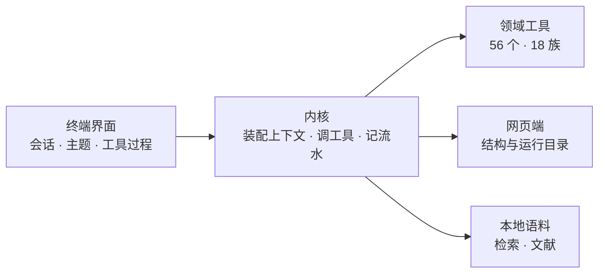

# VSAgent

跑在终端里的虚拟筛选 Agent。用户交办一件事，模型自己决定查靶点、取结构、准备受体、算口袋、
准备配体、对接、打分、写运行目录、打开结构查看器，过程与推理实时流回界面。

产出单位是**一组能被实验检验的判断**：每条带主张、机制、证据、检验方法、预期与否证条件。
分子排名是原料，排名之后必须写清「这批为什么活」。



## 要求

- Python 3.12
- 一个 OpenAI 兼容的模型接口（地址、密钥、模型名在应用里填）
- 可选：AutoDock Vina（对接）、AutoGrid4（AD4 力场）、`models/DTA` 环境（亲和力打分）

## 安装

```bash
python -m venv .venv
. .venv/bin/activate
pip install -r requirements.txt
```

主依赖只有五个：textual、httpx、python-dotenv、tomli-w、pypdf。另外三份按需安装：

| 文件 | 装什么 | 不装的后果 |
| --- | --- | --- |
| `requirements-chem.txt` | meeko、rdkit、gemmi、numpy、scipy、plip | 准备受体与配体、位姿转换不可用，其余功能照常 |
| `requirements-embed.txt` | fastembed、onnxruntime、tokenizers | 检索只跑两路词法，语义召回不可用 |
| `requirements-pack.txt` | pyinstaller、pywinpty、pyte | 打不出 exe，也跑不了打包验证 |

语义检索还要显式下载模型（约 250 MB，不会自动下）：

```bash
python -m vsagent.core.embed download
python -m vsagent.core.embed index     # 给已有语料补向量
```

亲和力打分（`score_affinity` / `fit_affinity`）用单独一套环境，装法见 `models/DTA/README.md`；
没装时应用照常启动，只有这两个工具返回一条安装指引。

## 配置模型

模型接口不读 `.env`。启动应用后先用 `/model` 填地址、密钥与模型名，写进
`~/.vsagent/connection.toml`（权限 0600）。没有这份文件时应用照常启动，发消息前会提示先配置。

`/model <名字>` 只换模型，连接参数不动。模型名决定上下文窗口与价格，换模型要重开一轮。

## 运行

```bash
python -m vsagent          # 或 python __main__.py
```

进入工作空间后，输入框里写任务，`Enter` 发送；`/` 打开 32 个斜杠命令，`@` 选文件。
左栏是会话与主题，右栏是产物、子 agent 与用量，三条界线可拖动调宽。

网页端是同一份数据的只读视图，语料可以在那里投递与整理：

```bash
python -m vsagent.core.web     # 默认端口 8860，VSA_WEB_PORT 可改
```

## 目录

运行时会在项目根或启动目录下用到这几处：

| 路径 | 内容 |
| --- | --- |
| `~/.vsagent/` | 会话状态、模型连接、登记表、trace、口袋网格缓存 |
| `runs/` | 运行目录，一份筛选的全部产物与 `meta.json` |
| `corpus/` | 本地文献与网页，检索的数据来源 |
| `logs/` | 项目根的文件读取日志；会话 trace 在 `~/.vsagent/logs/` |
| `.probe/` | 脚本与测试的临时产物，已 gitignore |

## 测试

测试是直接跑的脚本，没有 pytest：

```bash
python tests/test_agent.py        # 内核判据，打印通过项数
python tests/test_agent.py --list # 列出检查组
python tests/test_agent.py --only loop   # 只跑名字含该子串的组，秒级
python tests/test_smoke.py        # 界面加内核超集
```

几个独立判据，CI 跑前三条（`check_prefix.py` 与内核判据同一个 job，界面判据单独一个 job）：

```bash
python tools/check_prefix.py      # 前缀预算、首步可见性、字节稳定
python tools/check_web_api.py     # 网页 API 形状、并发、边写边读
python tools/check_retrieval.py   # 检索三路与组级指标
python tools/check_demo_data.py   # 口袋残基是否真的接触共晶配体
```

`tests/test_smoke.py` 会重跑 `test_agent` 的全部检查，改内核之后跑它一个就够。

## 打包

```bash
pip install -r requirements-pack.txt
pyinstaller --clean vsagent.spec   # 产出 dist/VSAgent.exe
python tests/verify_exe.py         # ConPTY 截图验证，需要 Windows
```

## 文档

四份，按读法分工：

| 文件 | 内容 |
| --- | --- |
| `docs/design.md` | 系统现在是什么样：分层、内核、上下文、事件层、工具族、界面、网页、状态 |
| `docs/screening-playbook.md` | 筛选流程的细则：四个确认点、口袋、对接、打分、开工盘点 |
| `docs/history.md` | 每个决定当时的约束、做法与依据 |
| `docs/review.md` | 实测读数与失败模式 |
| `docs/reference.md` | 判据来源、外部服务与本机路径、环境变量 |

`AGENTS.md` 是给模型看的项目规则与判据，每个确认点末尾指向细则的一节。

## 边界

- 对接分数只在本受体、本盒子、本力场、本参数内可比，不是结合自由能。
- 亲和力模型只对训练时的口袋有效，换受体或换口袋要重训。
- 无实验结构时可以用 AlphaFold 顶替，口袋位置的解读要降一档。
- 化合物库来源只有用户文件与 ChEMBL 邻域，没有 ZINC / Enamine。
- 评测目前只有实现正确性，任务级成功率与脚本化基线还没有建。
