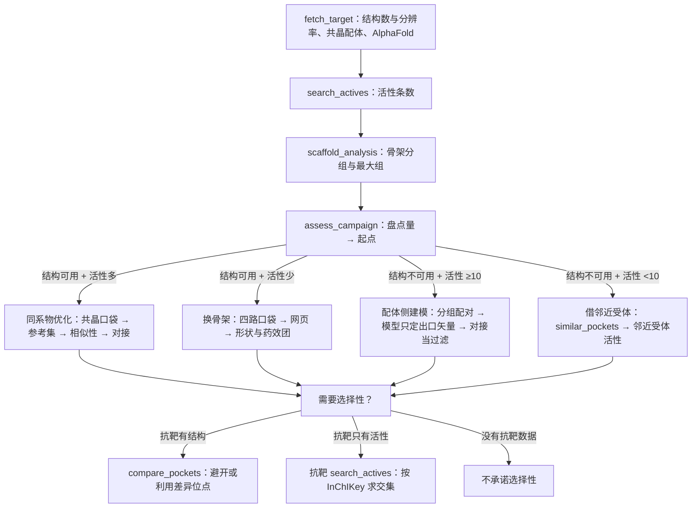

# 开工前的盘点与起点判定

> 承接 [`screening-workflow-plan.md`](screening-workflow-plan.md)。那份写的是「一轮怎么走」，
> 这份写的是「走之前怎么判断该走哪条」。
> 2026-10-30。

---

## 一、要解决的问题

上一轮会话（`ses_0005`）226 次工具调用里，`bash` 71 次、`analyze_pose` 22 次，
`sar` / `screen` / `pharmacophore` 三族一次没装，`write_run` 0 次，`spawn_agent` 0 次。
它不缺工具，缺的是开工时的一次判断：拿到 1M17 就直接准备受体、对接、看位姿，
而受体与配体两侧的实际条件——有没有共晶、活性有多少条、化学型有几组、
抗靶有没有数据——从来没有被一起看过。

单看一侧会选错起点，三种错法都能在论文里找到：

| 只看什么 | 会做错什么 | 论文里的对应 |
| --- | --- | --- |
| 只看结构 | 有共晶就做位姿优化，而活性数据只有几条，优化出来的方向没有化合物能验证 | DPP-IV 在拿到共晶之前靠随机修饰改活性，全部失败；拿到之后才知道该往间位加 |
| 只看配体 | 活性条数多就做骨架分组与匹配对，而结构分辨率不足，配对得到的趋势没法与口袋对上 | L-CPT1 有约 2200 个命中、没有结构，团队停在形状包络，没有往下建定量模型 |
| 两侧都不看 | 直接找同源结构做对接，而邻近受体早有一批配体可以直接借 | SST5R 没有任何已知小分子拮抗剂，靠邻近受体的配体库起家 |

盘点的产出是四类起点之一，以及一条能判真假的假设。它不写成一段介绍：
判定由代码给，理由与阈值一起返回，模型不必凭印象选路线。

---

## 二、盘点在流程里的位置

盘点在意图确认之后、结构确认点之前跑一次。它不替代确认点：确认点是用户点头，盘点是路线选择。

| 时机 | 动作 |
| --- | --- |
| 用户交代了靶点，但没说要做什么 | 第 0 关的检索与追问先走完，意图不清不盘点 |
| 意图明确，开始选结构 | `assess_campaign(accession=…)` 一次调用：它自己查 UniProt 与 ChEMBL、自己分组，返回起点；随后 `survey_structures` 把该靶点的实验结构按配体分组铺开，供用户挑 |
| 用户换了靶点、加了抗靶、改了选择性要求 | 重盘一次，旧起点作废，讲清哪些产物跟着作废 |
| 对接确认点通过之后 | 不重盘。此时只改参数 |

盘点不依赖先装族：`assess_campaign` 常驻，取数与分组在它内部完成。装族发生在盘点之后，
按它给的起点装——这也是它常驻的理由（§6.1）。

一次盘点的代价是两次网络请求（UniProt 一次、ChEMBL 一次，后者单页一千条约 5–11 秒），
命中缓存时只读盘。它比一次失败的对接便宜：一次对接要准备受体、准备配体、跑 vina、
再看一堆位姿，而盘点只回答一个问题。

盘点的产出是三样：一条 `kind=strategy` 假设、四类起点之一、要装哪几族的清单。
第三样最容易被忽略——起点定了，每个阶段要哪几族是提前知道的，不必像上一轮那样
装 23 次、每次现想该装什么；每装一次，下一步的 prompt cache 就整段失效。

---

## 三、盘点量

受体侧三项，配体侧五项。每一项都能从已有的工具产物里数出来，不需要新的数据源。

### 3.1 受体侧

| 量 | 定义 | 从哪来 | 阈值 | 为什么是这个阈值 |
| --- | --- | --- | --- | --- |
| 结构可用性 | 实验结构数、最佳分辨率 | `fetch_target` 的 `pdb_count` / `pdb_structures[].resolution` | ≤3.0 Å 算可用；3.0–3.5 Å 只用来定口袋轮廓；>3.5 Å 或没有结构算不可用 | 3.0 Å 是侧链与配体位置能解释的下限。更差的密度能看出口袋在哪，看不出配体怎么摆 |
| 共晶配体 | 结构里带的、非脂质非去垢剂的配体数 | `fetch_structure` 的返回、`detect_pockets(sources=ligand)` | ≥1 个算有 | 共晶配体是唯一能直接定口袋的证据，比预测和复合物检索都可靠 |
| 口袋唯一性 | `detect_pockets` 返回几处、来源分布 | `detect_pockets` 的口袋集 | ≥3 处，或 `ligand` 来源为空，算不唯一 | 一处到两处还能在聊天里说清；三处以上必须上网页让用户看 |

3.0–3.5 Å 归入「可用」，但结论只到口袋与位姿的轮廓，不解释具体接触。

无实验结构时，用 AlphaFold 顶替，但要多看一项：口袋 8 Å 内的残基 pLDDT。
过半低于 70 时，这套模型只能回答「哪一侧更亲脂」，不能回答「配体怎么摆」
（`fetch_alphafold` 的描述里已经写了这一条，盘点把它变成一个可判定的数）。

### 3.2 配体侧

| 量 | 定义 | 从哪来 | 阈值 | 为什么是这个阈值 |
| --- | --- | --- | --- | --- |
| 活性条数 | pChEMBL ≥7 的分子数，按 InChIKey 去重、同一分子取最强 | `search_actives` 的产物 | ≥20 条算多；10–19 条算少，够做参考集与骨架分组；<10 条不够 | 10 是 `build_reference_set` 标 `too_small` 的线；20 条才够在骨架之间做比较 |
| 最大骨架组 | 组内分子数最多的那一组有几个 | `scaffold_analysis`（组内 ≥3 才计一组） | ≥5 个算有成型系列，<5 个算还没有 | 一个系列要能拿出五个同骨架的分子，才谈得上在它里面做优化；两三个只能算偶遇 |
| 骨架组数 | 组内 ≥3 个的组一共有几组 | 同上 | ≥3 组算化学型分散 | 分散时换骨架从组内最大的那一组起手 |
| SAR 密度 | 匹配分子对里 ΔpChEMBL ≥2 的对数 | `matched_pairs` | ≥5 对算密 | 2 个对数单位是 100 倍差值，这种对子才有信息；5 对才看得出趋势 |
| 抗靶数据 | 抗靶的活性条数、两靶共有分子的条数、选择性比 ≥10 的条数 | 抗靶的 `search_actives`，按 InChIKey 求交集 | 有 ≥1 个共有分子才算有选择性数据 | 没有共有分子就没有选择性比，任何选择性主张都不可检验 |

`search_actives` 的产物是配体集，里面带着 `pchembl_value`，但 `sar._ligandset_rows`
（`sar.py:99-108`）把它丢了，`score` 固定写成 0.0。`matched_pairs` 拿到这份配体集时
每个对子的活性差都是 0，全被 `min_delta` 滤掉——SAR 密度这一项今天算不出来。
这一处要一起修，见第七节。

---

## 四、起点判定

### 4.1 四类起点

| 盘点结果 | 起点 | 第一步 | 这一轮要写下的假设 | 改道条件 |
| --- | --- | --- | --- | --- |
| 结构可用、活性 ≥20 条、最大骨架组 ≥5 个 | 同系物优化 | `detect_pockets(sources=ligand)` → `define_pocket` → `write_run(view=pockets)` → `build_reference_set` → `screen_similarity` → `dock` | narrow：主张「已知活性共享 X 骨架，S1 壁上以疏水接触为主」；检验「在最大骨架组内算匹配分子对」；预期「ΔpChEMBL ≥2 的对子 ≥5，且这些对子改的是同一处基团」 | 参考集 <10 条，或最大骨架组 <5 个 |
| 结构可用、活性 <20 条，或最大骨架组 <5 个 | 换骨架 | `detect_pockets(sources=ligand,complex,prior,predicted)` → `write_run(view=pockets)` → `screen_shape` / `screen_pharmacophore` | expand：主张「存在已知骨架之外的可结合化学型」；检验「形状与药效团筛一个库，看命中出现在哪些骨架」；预期「前 100 个里 ≥20 个不在已知骨架上」 | 四路叠合后口袋仍不唯一，交用户选；四路都空，转「借邻近受体」 |
| 结构不可用、活性 ≥10 条 | 配体侧建模 | `scaffold_analysis` → `matched_pairs` → `fetch_alphafold` → `define_pocket(residues=…)` → `dock` 只当过滤 | mechanism：主张「活性由 X 骨架锚在 Y 残基上决定」；检验「去掉该锚定基团的类似物实测」；预期「活性下降 ≥10 倍」 | 口袋残基 pLDDT 过半 <70，只留「哪一侧更亲脂」这一层 |
| 结构不可用、活性 <10 条 | 借邻近受体 | `similar_pockets` → 邻近受体的 `search_actives` → `build_reference_set` → `screen_similarity` | expand：主张「邻近受体 Z 的配体库里有本靶点的起点」；检验「借来的配体测一批」；预期「≥1 个实测 <10 μM」 | 邻近受体也没有小分子配体，停在文献结论 |

### 4.2 选择性要求

用户提出要选择性，或者抗靶是同家族且有数据时，起点先按上表定，再叠这两条之一。

**抗靶有结构**：`compare_pockets(target, anti, pocket)`，逐残基比对，
只报口袋 8 Å 内的位置。选口袋时两条路——避开差异位点（做选择性），
或者刻意利用（做双抑制，CatS/L 走的这条）。

假设写成 mechanism：「抗靶在该处更小，加大取代基会撞上」；预期「抗靶 Ki 上升 ≥10 倍，
本靶活性不降」。

抗靶对接只用来回答「这个分子在抗靶里能不能摆下」，判据是位姿是否成立
（有冲突、出盒子、锚定距离不够）。**两个靶点的对接分数不能互相比较**：
蛋白不同，分数没有共同零点。选择性比只能从实测活性算。

**抗靶只有活性**：`search_actives(anti)` → 按 InChIKey 求交集 → 挑选择性比最高、
且与本靶共享骨架的那条当起点，`screen_similarity` 用它做参考集。

改道：口袋内残基在两靶之间相同的比例 ≥90%（差异残基 <10%）时，位阻这条路不成立，
转抗靶反筛。

### 4.3 三条修饰规则

叠在任意起点上，不单独成起点。

**化学型多、悬崖多**：骨架 ≥3 组且 ΔpChEMBL ≥2 的对子 ≥5 个时，先做热点图
（`contact_map` 接多套结构 + 各自共晶配体），再定口袋。没有多套结构就停在骨架层面，
不往定量药效团走——L-CPT1 那次「再建一层定量模型」是论文明确反对的。

**已知活性全是共价或自杀底物**：参考集只留可逆的那部分，否则会把弹头当成结合模板。
HSL 起步时的已知抑制剂全是自杀性底物，团队的做法是换一个可逆起点（磺酰基哌啶），
不从共价系列里归纳结合模式。

**口袋不唯一**：≥3 处、或 `ligand` 来源为空时，全部口袋上网页，聊天给地址、
一句差别、一个问题。候选结构 ≥3 份、或要读文献确认已知位点时，同一轮派子 agent 做普查。

### 4.4 判定流程



---

## 五、每一类起点的完整动作序列

序列里凡是「取前 N 个」的动作，都先过 `pick_diverse`（[`screening-workflow-plan.md`](screening-workflow-plan.md) §6）：
位姿去重、MaxMin、骨架配额，同一骨架最多三个。

### 5.1 同系物优化

1. `assess_campaign` 给出起点，写成一条 `kind=strategy, mode=narrow` 的假设。
2. 按阶段装族：口袋与受体阶段 `pocket`、`receptor`；配体与对接阶段 `ligand`、`screen`、`docking`；看结果时 `analysis`、`sar`。
3. `detect_pockets(sources=ligand)`，拿共晶配体圈出的口袋。
4. `write_run(receptor=receptor#N, view=pockets)` 写运行目录，聊天给结构页地址与一句判断。
5. `define_pocket(pockets=…, index=…)`，把选定的那处登记成口袋。
6. `prepare_receptor(confirm=false)` 预演，把会删掉的杂原子、盒子尺寸摆给用户，再 `confirm=true`。
7. `build_reference_set` 生成参考活性集，少于 10 条就转 5.2。
8. `screen_similarity` 给库排序。
9. `pick_diverse(source=…, limit=20)` 从排序结果里挑出彼此不像的 20 个。
10. `dock` 这 20 个。
11. `rank_candidates` 合成候选表，`analyze_pose` 逐条看锚定几何，`contact_map` 看这批是不是挤在同一个亚口袋。
12. `matched_pairs` 找下一轮该改哪个基团，作为下一条假设的输入。

判据：参考集 ≥10 条、最大骨架组 ≥5 个、每一条通过的分子有一句几何理由。
改道：参考集不足或最大骨架组不足时，说明同系物优化的前提不成立，转 5.2。

### 5.2 换骨架

1. 按阶段装族：口袋与受体阶段 `pocket`、`receptor`；配体与筛库阶段 `ligand`、`screen`、`pharmacophore`；对接与看结果 `docking`、`analysis`。
2. `detect_pockets(sources=ligand,complex,prior,predicted)` 四路叠合，脂质与去垢剂已经先被剔掉。
3. `write_run(receptor=receptor#N, view=pockets)` 全部上网页；口袋 ≥3 处时派子 agent 同时做结构普查。
4. 用户在看板上选一处，`define_pocket` → `prepare_receptor` 两步照 5.1。
5. 配体侧 `curate_ligands` → `prepare_ligands`。
6. `screen_shape` 与 `screen_pharmacophore` 做第一道筛，留前 100 个。
7. `pick_diverse(source=…, limit=30)` 在这 100 个里挑 20–30 个，同一骨架最多 3 个。
8. `dock` 只在这 20–30 个上跑，不跑全库。
9. 通过集合交给 `rank_candidates` 与 `analyze_pose`，看它们是不是挤在同一处亚口袋。

判据：前 100 个里 ≥20 个不在已知骨架上；对接通过的分子里至少有一组不属于已知化学型。
改道：四路口袋都空，转 5.4。

### 5.3 配体侧建模

1. 按阶段装族：配体分析阶段 `sar`；结构与口袋阶段 `structure`、`pocket`、`receptor`；对接与看位姿 `docking`、`analysis`。
2. `scaffold_analysis` 分组，看最大一组占多少。
3. `matched_pairs` 找活性悬崖，记下每对改了哪个基团。
4. `fetch_alphafold`，看口袋区 pLDDT。
5. `define_pocket(residues=…)`，只圈高置信的残基。
6. `prepare_receptor` → `dock`，盒子可以比常规大一些，取前 30% 看位姿。
7. `analyze_pose` 只看锚定几何（铰链距离、角度、冲突），不看分数高低。

判据：假设能压到一对化合物上——去掉锚定基团的类似物活性下降 ≥10 倍，
或对映体里只有一个有活性。
改道：口袋区 pLDDT 过半低于 70 时，把结论收在「哪一侧更亲脂、往哪个方向加极性」，
不解释具体位姿。

### 5.4 借邻近受体

1. 先装 `pocket`（`similar_pockets`）与 `chembl`；借到配体后再装 `ligand`、`screen`。
2. `similar_pockets` 按口袋窗口的局部序列相似性给候选受体排序，同时给出每个候选在 ChEMBL 的活性条数。
3. 挑相似度最高、且有 ≥20 条活性的那一个；都没有 20 条时取活性最多的那个，并在结论里写明参考集不足。`search_actives` 取它的配体。
4. `build_reference_set` → `screen_similarity`，用邻近受体的配体给本靶点的库排序。
5. `pick_diverse(source=…, limit=20)` 挑 20 个做实测建议，不直接进大规模对接——跨受体的相似性排序误差比同受体大。

判据：借来的配体里 ≥1 个实测 <10 μM。
改道：邻近受体也没有小分子配体时，写一条「没有可用起点」的结论，
把文献里的已知位点与突变数据整理出来，停在文献层面。

### 5.5 选择性（抗靶有结构）

1. 装 `pocket` 与 `docking`，看抗靶位姿时加 `analysis`。
2. 先定口袋：`define_pocket` 用靶点已有的口袋或用户报的残基。
3. `compare_pockets(target, anti, pocket)`，只报口袋 8 Å 内的差异残基。
4. 按比对结果调口袋：避开差异位点，或刻意利用。
5. `dock` 本靶与抗靶，用同一批配体、同一套参数。
6. 抗靶那一边只判「能不能摆下」：有冲突、出盒子、锚定距离不够，都算摆不下。
7. 选择性比从实测活性算，不从分数算。

判据：抗靶 Ki 上升 ≥10 倍，本靶活性不降。
改道：差异残基占比 <10%，位阻不成立，转 5.6。

### 5.6 选择性（抗靶只有活性）

1. 装 `chembl`；筛库时再装 `ligand`、`screen`。
2. `search_actives(anti)`。
3. 按 InChIKey 与本靶活性集求交集。
4. 在交集里挑选择性比 ≥10 的分子，看它们共享哪个骨架。
5. 用这批共享骨架的分子做参考集，`screen_similarity` 排序。

判据：挑出的骨架能解释选择性比，且本靶活性不低。
改道：交集为空时，先扩参考集（放宽 `min_pchembl`），仍为空就不承诺选择性。

---

## 六、工具：`assess_campaign`

### 6.1 为什么常驻

它决定这一轮装哪几族。一个「决定装哪族」的工具本身要先装族才看得见，
顺序就反了：模型得先猜该装哪族，才能问该装哪族。

代价是每一步的请求体多一份工具定义，约 350–450 token。核心工具现在 15 个，
加它变 16 个。与「先装错族、下一步再换」相比——装错一次，下一步的 prompt cache 整段失效，
代价远大于 400 token。

常驻工具**不登记进 `FAMILIES`**：`hidden_names` 只藏登记过的族，登记了反而会被藏起来。
注册位置在 `app.py:_build_registry`，与 `HypothesisTool` 同一段。

### 6.2 参数

```python
assess_campaign(
    accession: str,           # 必填，UniProt 编号
    actives: str | None,      # search_actives 的配体集 handle
    receptor: str | None,     # 已取的受体，有它才能算缺口与交替构象
    anti_target: str | None,  # 抗靶 UniProt
    anti_actives: str | None,
    pocket: str | None,       # detect_pockets 的口袋集
)
```

`actives` 没给时自己去 ChEMBL 取一份摘要，复用 `chembl` 里现成的取数与缓存，
**不登记配体集**——盘点不该在登记表里留下模型没打算用的产物。

### 6.3 返回

四段文本，全部是数，不带评价词；另附一份 `meta`，字段与文本一一对应，给网页端与后续工具读。

**受体侧**：实验结构数、最佳分辨率、共晶配体数、口袋区缺口长度、交替构象数。
没有实验结构时换成：AlphaFold 编号、口袋区 pLDDT 均值与四档占比。

**配体侧**：pChEMBL ≥7 的去重条数、Murcko 骨架组数（组内 ≥3 才计）、
最大一组占比、最强 pChEMBL、有没有上市药、ΔpChEMBL ≥2 的匹配对数。

**选择性**：抗靶条数、两靶共有分子数、选择性比 ≥10 的分子数。
没给抗靶时这一整段不出现，也不写 0。

**判定**：四类起点之一、一句理由（引用上面哪几个数）、建议的下一步工具、
一条假设草稿（`kind` / `mode` / `claim` / `test` / `expected` 都填好，模型可以改，但不必从零想）。

返回的第一行写明这一版用的阈值，例如
「阈值：结构 ≤3.0 Å、活性 ≥20 条、最大骨架组 ≥5 个、SAR 密度 ≥5 对」，
复核时不用翻代码。

### 6.4 内部实现

不新写取数与解析，全部复用：

| 需要的东西 | 现成的在哪 |
| --- | --- |
| 结构数与分辨率、共晶配体、AlphaFold 编号 | `uniprot._entry_meta`（登记表条目的 `meta`） |
| 缺口、交替构象 | `structure` 里 `assess_structure` 用的同一份计算 |
| ChEMBL 活性条数与最强活性 | `chembl` 里 `search_actives` 用的取数与缓存 |
| 骨架分组 | `sar.scaffold_of` 与 `sar._ligandset_rows` |
| 两靶交集 | `chembl` 行里的 `inchikey` 字段，按 InChIKey 求交 |
| 口袋数 | 口袋集的条目数 |

阈值写成模块级的一张表，每项带一句理由：

```python
THRESHOLDS = {
    "resolution": 3.0,        # 侧链与配体位置能解释的下限
    "actives_many": 20,       # 够在骨架之间做比较的量
    "actives_few": 10,        # build_reference_set 标 too_small 的线
    "largest_scaffold": 5,    # 一个系列要能拿出五个同骨架的分子
    "scaffold_groups": 3,     # 三组以上算化学型分散
    "cliff_pairs": 5,         # 100 倍差值的对子攒到五对才看得出趋势
    "selectivity": 10.0,      # 十倍是项目常见的起点
    "plddt": 70,              # 低于它只能定方向，不能定构象
}
```

### 6.5 空值与失败

不报 0。ChEMBL 里查不到这个靶点的定量活性时，写「ChEMBL 没有该靶点的定量活性记录」，
判定按「活性 <10 条」处理，并在理由里写明这一条是「没有记录」，记录为零会另算。

抗靶编号给了但查不到，整段选择性留空，判定里写「抗靶没有可用数据，本轮不承诺选择性」。

`actives` 给了但那条产物读不出来（文件被删、stage 不对），直接 `failed=True` 并把原因写清，
不降级成「没有活性数据」——两者对起点的影响完全不同。

### 6.6 归族

`assess_campaign` 常驻，不登记族。

`compare_pockets` 与 `similar_pockets` 进 `pocket` 族。这一族现在管「口袋从哪来、选哪一处」，
加上「和别的靶点的口袋比一比」是同一条判断的延伸；用户说口袋不确定时，装一次 `pocket`
就把三件事一起装齐。改族只动 `FAMILIES` 一处，`catalog()`、`hidden_names` 与 `load_tools`
的清单都从那里展开。

---

## 七、配套修正

### 7.1 `sar._ligandset_rows` 丢掉 pChEMBL

`sar.py:99-108` 把配体集的每一行写成 `{"id", "name", "smiles", "score": 0.0}`，
`pchembl_value` 不往里带。`matched_pairs` 从配体集取对子时，两侧的 `score` 都是 0，
活性差恒为 0，全被 `min_delta` 滤掉，返回「没有对子」——看上去像这个库里没有匹配对，
实际是活性列被扔了。

改成把 `pchembl_value` 写进 `score`，方向按「越大越好」。
`_rows_of`（`sar.py:111-116`）对配体集已经返回 `higher_is_better=True`，
两边正好对上。`scaffold_analysis` 的代表分子也会因此从「按出现顺序」变成「按活性最强」，
这符合它的描述。

### 7.2 `toolset.py` 的模块说明与实际不符

`toolset.py:3-10` 写「38 个工具」「12 个族」「核心 14 个」，实际是 68 个工具、
21 个族、核心 15 个。这段说明是给改代码的人看的，数字对不上会让人以为藏工具的
机制只覆盖了一部分。按实际数改。

---

## 八、前缀改动

### 8.1 新增的一段

位置：`HYPOTHESIS_CONTRACT` 之后、`WORK_DISCIPLINE` 之前。它回答「这一轮走哪条路」，
比操作纪律更靠前；放在假设段之后，是因为它的产出就是一条假设。

```
**开工前把两侧查清**：受体侧看实验结构、最佳分辨率、共晶配体、缺口；
配体侧看 pChEMBL ≥7 的条数、骨架分组、抗靶有没有活性数据。
查完调 assess_campaign，按它给的起点走。
结构可用、活性 ≥20 条 → 同系物优化（共晶口袋、参考集、相似性、对接）；
结构可用、活性 <20 条 → 换骨架（口袋上网页、形状、邻近受体的配体）；
结构不可用、活性 ≥10 条 → 配体侧建模（先分组配对，模型只定出口矢量，对接只当过滤）；
结构不可用、活性 <10 条 → 借邻近受体，先回答值不值得做。
口袋不唯一、候选结构 ≥3、要查文献位点时派子 agent；一次调用能做完的、或要用到这一步推理的不派，派完不要自己再做一遍。
```

最后一句把 `SPAWN_DISCIPLINE` 并了进来。派发的触发条件本来就是盘点结果的一部分，
两处分开写会各自漂移。

### 8.2 预算账

现在前缀 1852 token（预算 1900），其中 `AGENTS.md` 848 token（预算 850）。

| 动作 | 变化 |
| --- | --- |
| 新增盘点段 | +259 |
| 删 `SPAWN_DISCIPLINE`（派发条件并入盘点段） | −115 |
| `EVENT_DISCIPLINE` 压成两句 | −36 |
| `SHELL_DISCIPLINE` 压掉举例与重复的平台说明 | −55 |
| `HYPOTHESIS_CONTRACT` 删「分数只是证据的一种；只给分数不给方向，等于没做」 | −24 |
| `LEDGER_DISCIPLINE` 删「不要凭记忆写 handle」（`AGENTS.md` 已有一句） | −9 |
| `MEMORY_DISCIPLINE` 压掉重复的「这个项目」与「查一次」 | −12 |
| 挑选与停止那一句，进 `HYPOTHESIS_CONTRACT` 的对照句之后 | +29 |
| 合计 | 1852 + 259 + 29 − 251 = **1889** |

留 11 token 余量给后续微调。挑选句放在 `HYPOTHESIS_CONTRACT`：它管每一批怎么挑，
与开工前的路线判断无关，措辞见
[`screening-workflow-plan.md`](screening-workflow-plan.md) §8。

`EVENT_DISCIPLINE` 压缩后的样子：

```
**阶段（Phase）**由内核在轮末自动封存。走到第 3 步之后，最后一条消息里会多一行
「本阶段已 N 步」——看到它，在收尾之前调 close_phase，给这一大步起名字、写一句结论。
回看原文用 recall_event。
```

`SHELL_DISCIPLINE` 压缩后的样子：

```
bash 每次调用都是新的解释器：cd、set、export 不留到下一次，换目录要在同一条命令里写全。
命令按下面那句说的平台语法写。
```

### 8.3 `AGENTS.md` 不动

`AGENTS.md` 的四个确认点讲的是「用户点头」，盘点讲的是「走哪条路」，两件事分开。
盘点段已经在前缀里每一步都可见，再往确认点里加一句，等于用 30 token 换一次重复；
而 `AGENTS.md` 只剩 2 token 余量，要加就得先压第 0 关，那一段是意图确认的前置，
比盘点更早生效，不适合动。

---

## 九、判据

**前缀**：`python tools/check_prefix.py` 仍然通过，固定段 ≤1900；`AGENTS.md` 不设上限，
判据只报它的体量。点名清单里出现 `assess_campaign`，且不在「首步不可见」那一行——它是常驻工具。

**会话**：`dock` 之前 `assess_campaign` 至少调用一次；它的判定与这一轮实际走的路线一致；
这一轮的假设里至少一条的 `expected` 用了盘点得到的数（例如「抗靶 Ki 上升 ≥10 倍」
来自选择性比那一行）。上一轮那种「拿到结构就直接准备受体」的路径，
在 trace 里应当看不到。

**工具回测**：拿四套真实数据跑，判错一类就说明阈值表还没定对。

| 回测对象 | 应当判出 |
| --- | --- |
| FABP4 与 FABP3 | 需要选择性、抗靶有结构，起点同系物优化或换骨架，叠 `compare_pockets` |
| HSL（起步时） | 无结构、活性多、已知活性全是共价底物，起点配体侧建模，参考集只留可逆 |
| SST5R | 两侧都缺，起点借邻近受体 |
| PDE10A | 结构可用、活性多、多套结构，起点同系物优化，叠热点图修饰 |

**回归**：`python tests/test_agent.py` 全跑；`assess_campaign` 常驻之后，
`--only tools` 那一组要确认它出现在注册表里、且没有被 `tools.toml` 关掉。

---

## 十、不做的

**不自动执行判定结果**。起点写进假设、摆给用户看，四个确认点照旧。
盘点只回答「该走哪条」，不替用户点头。

**不用分类模型**。判定是一张阈值表，每个数都能复核。换成模型打分之后，
「为什么判成同系物优化」就答不上来，而这张表的全部价值在于理由可查。

**不自动发现抗靶**。同家族推荐需要另外的数据源（UniProt 家族注释、ChEMBL 靶点分类），
本轮只接受用户给的抗靶编号。没有抗靶编号时，选择性整段留空。

**不改 `dock` 的参数**。盘点不碰 scoring、exhaustiveness、seed。

**不做跨靶点的分数比较**。抗靶对接只判位姿能否成立，选择性比只从实测活性算。

---

## 十一、待确认

- 「活性多」的线定在 20 条、最大骨架组定在 5 个、化学型分散定在 3 组，
  需要在 3–5 个真实靶点上校准一次；校准数据写进 `tools/` 下的一个脚本，不进会话。
- `assess_campaign` 返回的假设草稿要不要直接登记成 `hypothesis`，
  还是只作为文本交给模型改写。前者的风险是盘点阶段就写下一堆没人看的假设。
- 抗靶只有活性、且交集里没有一个分子同时有本靶数据时，选择性比算不出来，
  这时是否允许用「抗靶活性 < 本靶活性」这种单向证据，需要在实现时定。
- `similar_pockets` 的编号映射：UniProt 编号与结构编号之间有错位（1M17 比 UniProt 少 24），
  口袋窗口按哪一套编号取，要等那个工具动工时先定。

---

## 十二、实施结果（2026-10-31）

三个工具与五项配套改动全部写进代码。

| 位置 | 实际做法 | 量到的数 |
| --- | --- | --- |
| `domain/campaign.py` | `assess_campaign`，阈值表写死、四类起点、假设草稿；常驻不登记族 | P00533：922 个分子、58 个骨架组、最大一组 80、匹配对 13 对 → 同系物优化 |
| `domain/pocketcmp.py` | `compare_pockets`（全局对齐 + 8 埃内逐残基）、`similar_pockets`（窗口同一性 + 活性条数），归 `pocket` 族 | 4HJO 对 1M17：同一性 100%、覆盖 278/278、差异 0；对 6N4Q：同一性 28%，判「不可用」 |
| `sar._ligandset_rows` | 保留 `pchembl_value`，写进 `score` | `matched_pairs` 从配体集取对子时不再恒为 0 |
| `toolset.py` 说明 | 改成 73 个工具 / 18 族 / 19 常驻 | 领域 54 个，定义合计 23K token |
| 前缀 | 新增盘点段，删 `SPAWN_DISCIPLINE`，压四段 | 1891 token（计划 1889） |
| `AGENTS.md` | 确认点 2 加 `write_run` 与结构页地址，压掉 20 token 冗词 | 843 token（当时预算 850，见 §12.4） |

### 12.1 取数偏置（计划里没有预料到）

ChEMBL 的活性接口按 `-pchembl_value` 排序，取前 N 条就是「最强的那一段」。
P00533 取回 325 个分子，pChEMBL 全在 9.49–11.00，匹配对的活性差最大 1.3，
Δ≥2 的对子恒为 0——看上去像这个库没有悬崖，实际是窗口取窄了。

`activity_snapshot` 因此加了 `spread` 开关：额外取回最弱的 `want` 条，
与最强的合在一起。同一靶点变成 922 个分子、7.00–11.00，匹配对 13 对。
`assess_campaign` 用它，`search_actives` 不用——后者要的是「最强的那些」。

### 12.2 比对的两个坑

- **短链压过真同源链。** 按同一性选链时，6N4Q 里一条 30 个残基的链以 70% 同一性
  压过 278 个残基里对上 246 个的真同源链。改成按「同一性 × 覆盖」选，
  并报出覆盖数。
- **残基清单按质心筛会全灭。** 用户报的残基可能横跨十几埃（两端各取一个），
  按 8 埃筛会把它们全部排除。改成：口袋产物按中心筛，残基清单不筛。

### 12.3 编号映射（§十一 待确认的第一条）

窗口一律按 **UniProt 编号**。给 `pocket` 时，先把该口袋所属受体的链序列与 UniProt
序列做一次全局对齐，把结构编号换算过去；换算不出来就报错并让调用方改用 `residues`。
`similar_pockets` 的判据是窗口同一性 ≥40%，低于它不建议借配体——不同家族随便取一段
也能撞到 20% 上下，P36544 与 Q9NZQ7 实测 19% / 17%。

判据：`tests/test_agent.py` 通过 3608 项；`tests/test_smoke.py` 退出码 0。

### 12.4 规则文件不再设上限（2026-10-31）

`docs/molecular-design-principles.md` 的判据写进了 `AGENTS.md`：两条效用判据、五条原则、
明确不做的五类建模、三个案例留下的做法。规则文件因此从 843 token 涨到 2818 token / 117 行。

大小上限同时取消：

- `prompt.py` 的 `RULES_LIMIT`（32KB）与 `OVERSIZE_NOTICE` 删除。原先超限整份不注入、
  只留一句「用 read 分段读」，那句话默认模型会照做，实际它常常直接动手，确认点等于不存在。
- `tools/check_prefix.py` 的 `RULES_BUDGET` / `RULES_LINES` 删除。固定段仍按 1900 卡住
  （现 1472），规则文件只报体量。
- `tests/test_agent.py` 的超限断言换成「40KB 的规则从第一行注入到最后一行」。
