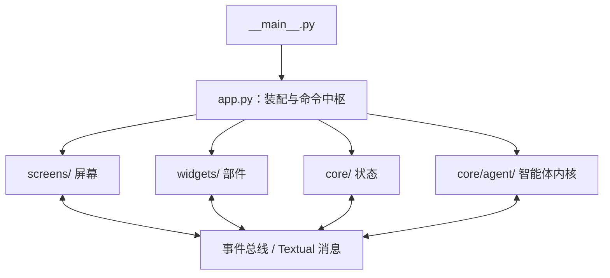
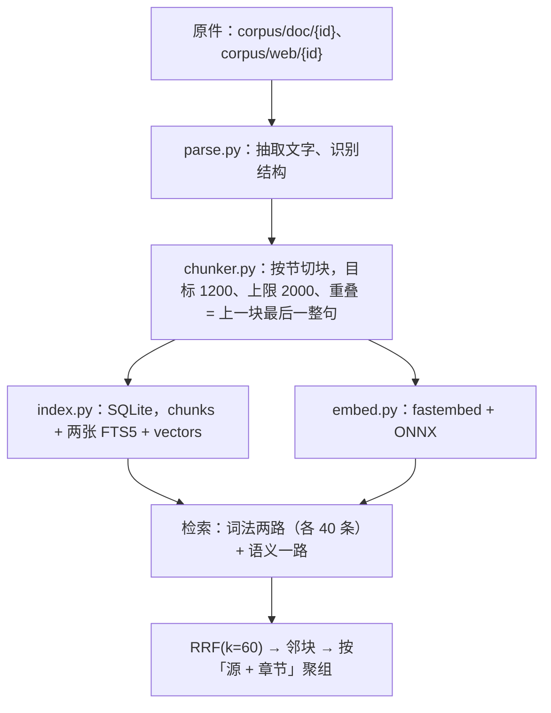

# 现行设计

> 角色：现行设计（这个系统现在是什么样）
> 状态：随代码更新，最后核对 2026-11-06
> 配套：`history.md`（为什么这么定）、`review.md`（实测读数）、`reference.md`（判据与外部资料）、
> `screening-playbook.md`（`AGENTS.md` 确认点的展开）

这份文件描述当前实现的形状与不变式。改代码之前先读它；知道「为什么」去看 `history.md`，
要数字去看 `review.md`。文中的数字都来自代码或判据脚本，代码一动就该复核一次。

---

## 一、定位与产出

`VSAgent`（包名 `vsagent`）是一个跑在终端里的虚拟筛选 Agent。用户在聊天界面里交办一件事，
模型自己决定查靶点、取结构、准备受体、算口袋、备配体、对接、打分、写运行目录、打开结构查看器，
过程与推理实时流回界面。`web/` 与 `viz/` 是同一份数据的只读网页端，外加语料投递。

**产出的单位是假设，而不是一张分子排名。** 排名是原料。`Hypothesis` 对象带六要素：
主张、机制、证据、检验方法、预期、否证条件；`test` 与 `expected` 必填，`expected` 必须含
数值、阈值或对照，否则这条假设没法判真假。状态只由 `close` 与 `record_assay` 改动，
`update` 改不了它——否则模型可以绕过证据把一条假设标成 supported。未结的假设按粒度
分组渲染进 `TASK` 层，`write_run` 把它们整份写进 `provenance.hypotheses`。

判据来源与筛选流程的确认点在 `AGENTS.md`，展开的操作细则见 `screening-playbook.md`。

---

## 二、分层

四层，`app.py` 是唯一的装配根。



两条贯穿全仓的分界线：

1. **`core/` 不 import textual。** 会话管理、数据模型、命令表都能被测试直接调用。
2. **`core/agent/` 不认识界面。** 内核只往 `EventBus` 发事件，`ChatScreen` 是唯一的翻译层。
   「把界面换成网页端」因此不需要动内核。

---

## 三、内核

### 3.1 一轮的流程

清空证据表 → 组稳定前缀 → 装配上下文 → 请求模型 → 消费流（正文、推理、工具调用分流到
不同 `PartType`）→ 无工具调用则跑 STOP 钩子 → 逐个执行工具（故意不并发）→ 记录这一步。

一次工具执行的固定顺序：查注册表 → 校验参数 → PreToolUse 钩子 → 权限判定 → 可选的界面询问
→ 执行 → PostToolUse 钩子 → 提炼证据。顺序换一个语义就变：钩子放到权限之前就绕过权限，
权限放到执行之后就没有意义。

`AgentLoop` 不维护第二份历史：每一步从 `Session` 现场重建模型消息。任何非正常退出都会触发
一次不带工具的收尾总结，模型写，失败时用本地兜底文案。

### 3.2 上限与重试

| 常量 | 值 | 含义 |
| --- | --- | --- |
| `MAX_STEPS` | 24 | 一轮步数上限，`VSA_MAX_STEPS` 可改；写错按 24 处理 |
| `MAX_STOP_RETRIES` | 2 | STOP 钩子未通过时的重试次数 |
| `MAX_RETRIES` | 2 | 模型请求的重试次数 |
| `MAX_TOOL_RETRIES` | 1 | 工具调用的重试次数 |
| `MAX_FAILED_STREAK` | 3 | 连续三步整步失败则退出（`tool_failed`） |
| `PERMISSION_TIMEOUT` | 300 s | 权限询问无人答复的时间上限，超时按拒绝处理 |
| `MAX_SUMMARY_FAILURES` | 3 | 摘要连续失败三次，这一轮不再试 |
| `RETRY_DELAYS` | 1 s / 3 s | 两次重试的间隔 |

工具层只重试一次（模型请求是两次）：一次工具调用本身要几十秒，重试两次会把一次抖动拖成
三倍等待，而工具失败之后模型还有别的路可走。重试只包 `execute`，不重跑权限与钩子。
重试用尽的文案写明「参数没有错，也不要用 bash 自己实现」——模型绕道自建客户端，实测一次
误判烧掉 20 步。

退出原因有四种：`exhausted`（步数用尽）、`cancelled`（用户中断）、`error`（模型或装配出错）、
`tool_failed`（连续失败）。轮末写进 `Event.exit_reason`，界面的完成 / 失败 / 中断三态由它换算。

### 3.3 工具协议

`Tool` 是抽象基类，`ToolRegistry` 管注册与禁用，`ToolSpec` 是给模型看的 schema，
`ToolResult` 是返回值，失败的返回 `failed=True` 而不是抛出异常——错误文本要能回灌给模型自纠。

依赖注入是声明式的。工具在类属性上声明要什么，内核在 `execute` 里注入：

| 类属性 | 注入什么 | 用途 |
| --- | --- | --- |
| `primary_argument` | 参数名 | 权限判定按这个参数匹配 |
| `context_argument` | `SessionLedger` | 沿 handle 找产物 |
| `task_argument` | `TaskState` | 读改写任务状态 |
| `evidence_argument` | `EvidenceStore` | 把关键行放进证据层 |
| `viewer_argument` | 查看器入口 | 拼结构页地址 |
| `event_argument` | 事件运行时 | 封存主题 |
| `registry_argument` | 注册表（只读） | `load_tools` 读禁用清单 |

子 agent 的入口不走上面这些通道：`spawn_agent` 从参数里拿 `session` 与 `spawner`，由装配处直接
提供。4b 的子代理上下文隔离只有设计。

声明了某一类却收到 `None`，返回「内核装配问题」，措辞要让模型知道重试无用：这一路只可能是
内核漏传。

`ReadTurnTool` 按 `turn N` 取回被移出上下文的原文；`Tool.status` 的五种值是
`PENDING / AWAITING / RUNNING / COMPLETED / FAILED`，界面工具卡用 `○ ◐ ● ✓ ✕` 一档一个。

### 3.4 权限

`PermissionPolicy.check` 的判定顺序：

1. 取消；
2. 用户手打的 bash；
3. 会话 `allow_all`（在弹窗上按了 a）；
4. Plan 模式的 `PLAN_DENY`；
5. 项目规则（`.vsagent/permissions.toml` 一类）；
6. 越界路径（工作目录之外）；
7. 计费配额；
8. 单工具允许清单；
9. 默认：`write` / `patch` / `bash` / `dock` 需要询问。

会话 `allow_all` 排在除中断之外的一切之前：按下 a 就是「这个会话别再问我」，Plan 限制、
越界与计费都不再拦，切换会话时清掉。

询问那一步有两条保底：`permission.ask` 没有任何订阅者时立刻拒绝（无人值守），
300 秒无人答复时拒绝。两处都按拒绝处理——没人答复不等于同意。

同模块的 `load_tool_switches` / `save_disabled` 管另一件事：`tools.toml` 里标关的工具根本不进
注册表，模型连它存在都不知道。改开关走 `/tools` 面板，当场重装注册表，不必重启。

### 3.5 钩子

`hooks.toml` 里的外部命令，stdin 收一行 JSON。退出码 2 拦截（stderr 当原因），0 放行，
30 秒超时算拦截。

### 3.6 登记表

`SessionLedger` 是 `receptor#1` / `ligandset#3` 这类 handle 的真相所在，按会话 id 隔离在
`~/.vsagent/ledgers/`。`digest()` 给模型看的那一小段索引（当前受体 + 最近 5 个产物，≤10 行），
每一步现算，不调 `reconcile()`——那一步会把每个登记路径读一遍算指纹。

`reconcile()` 只读：它更新条目的 `file_state`（`ok` / `stale` / `missing`），不删条目、
不改路径。「文件没了」在列表里可见，存档仍保留原始信息。

### 3.7 子 agent

`host.py` 管会话宿主，`spawn.py` 管派发。子 agent 从父会话继承工具族，会话树上缩进挂在父会话
下面。4b（子代理上下文隔离）只有设计，没有实现：`subagent_argument` 这个注入通道在代码里
不存在。

---

## 四、上下文装配

### 4.1 分层与顺序

`ContextAssembler.build` 按固定顺序装配七层：

```
PREFIX → MEMORY → TASK → EVENT → RECENT → EVIDENCE → HISTORY
```

| 层 | 内容 | 淘汰策略 |
| --- | --- | --- |
| `PREFIX` | 身份、工作纪律、平台、登记表说明、事件说明、`AGENTS.md` | pinned，字节稳定 |
| `MEMORY` | 跨会话的项目事实，`MemoryStore.resident_text()` | 受 1200 token 限制，按核心 / 相关 / 最近三段填 |
| `TASK` | 任务状态、工作区索引、运行环境、未结假设 | pinned |
| `EVENT` | 已封存主题的流水（标题、逐步、结论、未决） | 超额度时从最旧的主题裁起 |
| `RECENT` | 最近若干个完整交互组 | 整组进出，组内不切开 |
| `EVIDENCE` | 本步相关证据，带引用 | 先给摘要，正文按预算展开 |
| `HISTORY` | 摘要与被移出交互组的引用清单 | 只留引用 |

`PREFIX` 与 `TASK` 永不驱逐：用户的约束必须活过压缩。

输出布局：`system` 只放 `PREFIX`；一条 user 头装运行环境、常驻记忆、任务状态、工作区索引、
摘要与引用清单；中间是 `RECENT`；最后一条 user 是 FOCUS 复述加证据。易变内容一律不进
`system`——日期每天变一次，进去就每天击穿一次 prompt cache。

### 4.2 预算与降级

```
tools_tokens = estimate(json(tools))
available    = context_window - OUTPUT_RESERVE(4096) - PROTOCOL_OVERHEAD(256) - tools_tokens
```

装不下就按固定顺序降级，直到装得下：

```
evidence_detail → history_summary → recent_tool_clear → event_step_detail
→ event_layer → memory → recent_turns → recent_reasoning → recent_output
```

`RECENT` 装不下时先清旧工具正文（最近 4 条 `RECENT_TOOL_KEEP` 与失败的除外），清不动才整组移出；
清掉的原文用 `read_turn` 取回。到最后一档仍装不下就抛出 `ContextAssemblyError` 并带上各层用量，
不静默截断。

固定上限：`MEMORY_LIMIT` 1200、`HISTORY_MAX` 3000、`EVIDENCE_MAX` 6000、`EVENT_LIMIT` 200–6000
（按剩余预算伸缩）、`EVIDENCE_LIMIT` 24 条、引用清单 20 组 / 600 token；剩下的全给 `RECENT`。
`ratio` 默认 0.8（`CONTEXT_RATIO`），是装配时的目标比例。

被软配额削过的层同样记进 `degraded`，按降级链的顺序排列——顺序本身就是「先削谁」这件事。

### 4.3 事件层

事件层按 **Topic → Step 流水**记录：

| 层级 | 边界 | 谁产生 |
| --- | --- | --- |
| Task | 一条用户消息 | 用户 |
| Topic | 任务里的一个独立题目 | 内核按位置切，模型可命名 |
| Step | 一次模型往返加它的工具调用 | 内核每步自动记 |
| Event | 一个 Topic 封存后的记录 | 内核自动封存 |

**Step 全部本地拼，零请求**：从 `Part` 取工具名、参数、状态、handle，不读 reasoning。
标题、结论与交接可以由 `close_topic` 顺手给，不给就用本地拼的那份并标 `degraded=True`。

**边界是位置 `(message_index, part_index)`，不是消息下标**：一条 assistant 消息装着一整轮
所有往返，按消息切不出轮中途的主题边界。切点记在 `Event.cut_message` / `cut_part` 上，
装配时 `RECENT` 从最后一条事件的切点开始；`Turn.part_start` 用同一个口径。

封存时机：模型调 `close_topic`（步末执行）、轮末、新用户消息、当前主题原文超过
`TOPIC_SOFT_LIMIT`（120K token）、溢出、`/compact`、中断。模型侧的触发条件是尾部那一行
「本主题已 N 步 · 产物 … · 未决 …」，`CLOSE_TOPIC_AFTER` 为 3，放尾部是为了不碰前缀缓存。

`seal_topic(force=True)` 与 `force=False` 的差别是覆盖：轮末遇到纯聊天的一轮可以跳过，
溢出与 `/compact` 必须封，否则那一段原文两边都不在。自动封存不推进 `compact_upto`，
只有手动与溢出那种明确边界才推进。原文一条不删：`Step` 上的 `message_index` /
`part_start` / `part_end` 就是取回它的地址。

`Event.actions` / `artifacts` / `issues` 是从 steps 聚合的 property，不写入磁盘。

召回三级：`recall_event()` 列主题、`recall_event("evt_0003")` 读流水与结论、
`recall_event("evt_0003", step=7)` 读那一步的工具输出原文。

事件块超额裁掉最旧主题时补一行「更早还有 N 个主题」；被裁事件覆盖的原文既不在事件里也不在
`RECENT` 里，不说就是无声消失。摘要已经退休：它的三段分别由 `TASK`、Step 流水、主题结论覆盖，
`_summarize` 只剩「首轮就溢出、连一段都封不出来」的兜底。

### 4.4 前缀

`stable_prefix` 的顺序：身份 → 假设规则 → 工作方式 → shell → 登记表 → 记忆 → 事件 → 派发 →
项目规则。排序是语义：假设规则紧跟身份（它定义产出长什么样），确认点放最后。

固定那几段预算 1900 token，实测 1592（`tools/check_prefix.py` 守着），整段前缀 4499 token，
其中 `AGENTS.md` 占 2890 token / 120 行且不设上限——它是许可与判据的来源，少一条就可能放行
一个本来被禁止的动作。平台那句由 `platform_note()` 按 `sys.platform` 现取。

易变信息走 `environment_block()`，由循环层放进 user 头：今天日期（只到天）、工作目录、状态目录。

### 4.5 FOCUS 复述

把目标、前三条约束、下一步插成一条 user 消息，紧贴在最后一条用户消息前面，上限 300 token。
任务状态在窗口最上面，`RECENT` 几万 token 之后模型早就看不到它了。

### 4.6 记忆

跨会话的项目事实落在 `<工作目录>/.vsmemory/`：`memory.md` 给人读，`entries.json` 给程序读
（带引用路径与指纹），以 `entries.json` 为真相。

写入做四件事：精确去重；同 refs 加更新词（改为 / 改成 / 现在 / 不再 / 替换 / 已经换）时把旧条目
标 `superseded_by`；agent 的引用必须存在（用户写入可以不存在，标 `unverified` 排在后面）；
单条最多 500 字。记忆里写文件路径不写 handle——handle 只在本次会话有效，写入时就拦。

常驻注入三段：核心（有引用且近 30 天被显式 `recall` 命中，最多 5 条）、相关（用最后一条用户消息
加任务目标检索，最多 5 条）、最近（最多 3 条），总额 1200 token。`recall` 按
`(正文命中 × 2 + 引用命中 × 1) × exp(-age/90天)` 打分，中文按 bigram 切词；命中结果同时进
`EVIDENCE` 层，否则 `RECENT` 一压这段知识就没了。

容量上限 500 条，超出按「先失效、再最旧」移进 `archive.json`，归档不删也不注入。

---

## 五、领域工具

### 5.1 分族与装载

全仓 75 个工具：19 个核心（文件、登记表、任务、假设、事件、记忆、`load_tools`、
`assess_campaign`、`survey_structures`、`write_run`、`open_viewer` 等）常驻，56 个领域工具分成
18 族，由 `load_tools` 现装现用。

| 族 | 工具数 | 族 | 工具数 |
| --- | --- | --- | --- |
| listing | 3 | corpus | 3 |
| uniprot | 2 | websearch | 2 |
| structure | 5 | receptor | 1 |
| pocket | 4 | ligand | 5 |
| chembl | 2 | screen | 3 |
| pubchem | 2 | scoring | 3 |
| opentargets | 2 | analysis | 8 |
| literature | 3 | admet | 1 |
| sar | 5 | pharmacophore | 2 |

族记在 `Session.tool_families` 上，不记在注册表上（注册表按根 / 子 agent 共享两份，记在那里
会让一个会话装过的工具漏到另一个）；子 agent 从父会话继承。

装载会随轮次结束而失效：`prune_families()` 把这一轮没用过的族卸掉。两条边界——这一轮一个
工具都没用过就不卸；这一轮刚装的族也不卸（`Session.family_topic` 记着装载时的主题号），
否则模型先装后用的那条路会被自己踩断。

`hidden_names(session)` 给的是排除集：没登记族的工具默认常驻，新工具忘了登记族时坏处只是
白占额度，不会「写了却没装、模型看不见」。模型看不见某个工具时最容易直接叫它的名字，
`loop.missing_tool_reason` 认族，回「属于 scoring 族，先 `load_tools family=scoring`」。

`load_tools` 说明里那张「族 → 工具」表由 `catalog_text()` 从模块现数，并减去
`registry.disabled`——对着被关掉的工具说「已装入」，模型下一步就会去调，撞墙之后转去 bash
自己实现。

### 5.2 口袋

口袋来源四层叠合：共晶配体 → 复合物 → p2rank 预测 → 先验叠合。四层在聚簇之前都先剔掉脂质与
去垢剂（`preprocess.screen_lipids`）：碳数 ≥ 8、极性原子（N/O/S）≤ 2 或含磷、重原子 ≥ 16、
包围盒最长边 ≥ 16 埃，四条全中才算。最后那条是类固醇药物与膜成分的分界（睾酮、地塞米松四个
并环只有 11–13 埃）。

每处口袋带一份画像（`pockets.build_profile`）：配体的元素组成与伸展尺寸、壁按芳香 / 疏水 /
极性 / 带电四类计数、最近残基与 3.5 埃内的个数、一句判断。画像不给分，与「实验定位没有打分」
同一口径；`detect_pockets`、`write_run`、网页端读的是同一份。

### 5.3 配体与对接

配体链路：`import_ligandset`（文件 → 原始配体集）→ `prepare_ligands`（ETKDGv3 + MMFF/UFF +
Meeko → 已准备配体集）→ `dock`（Vina → 对接产物）。

`dock` 有三个力场：`vina` / `vinardo` / `ad4`，**分数互不可比**。前两个只要受体与盒子；
`ad4` 要先用 `autogrid4` 算亲和力图（`--maps`，不能给 `--receptor`），图缓存在
`~/.vsagent/grids/`，键是受体指纹 + 盒子 + 配体原子类型，盒子限 40 Å——图的代价是边长的三次方。
AutoDock4 原程序没有接：1–5 分钟一个配体，与批量筛选的形态冲突，而 AD4 力场已经通过 vina 拿到。

`dock` 的签名里没有盒子参数：换盒子要回 `prepare_receptor` 重跑，盒子从已准备受体的
`box.txt` 读。

### 5.4 亲和力

DTA 通道是另一条：`fit_affinity`（实测活性 → 模型产物）→ `score_affinity(model=…)`
（同一批位姿 → 亲和力产物）。

`finetune.py` 是唯一会训练模型的工具，用某个靶点上已测的活性把预训练权重微调一遍，
训练交给 `domain/fit_train.py` 在 `models/DTA/.venv` 里跑（5–10 分钟，CPU），主仓一行 torch
都不 import。它只对这个口袋有效，换受体或换口袋要重训。实测与「ECFP4 + LightGBM」打平、
不超越。DTA 通道固定走「微调 → 推理」，零样本不再是流程的一部分。

`score_affinity` 的分数方向与 `dock` 相反（pK 越高越好），描述第一段必须写明这一句。
它会现截口袋：受体的 `box.txt` 只给中心，模型要的是中心 10 Å 内的残基。

两个工具都起外部进程，所以有环境变量入口：`VSA_DTA_PYTHON` 指定解释器，`VSA_DTA_ROOT`
指定代码根。`VSA_VINA_BIN` / `VSA_AUTOGRID_BIN` 指定对接引擎。

### 5.5 分析与对照

`analysis` 族的 8 个工具只读产物：

| 工具 | 做什么 |
| --- | --- |
| `rank_candidates` | 多路合并排序 |
| `analyze_pose` | 接触 / 氢键 / 冲突 / 可选 PLIP 指纹 |
| `alternative_poses` | 同一分子的多个对接模式按体积聚簇，报每簇分数与接触残基差异 |
| `contact_map` | 一份产物里所有位姿的残基接触频次 |
| `analyze_hydrophobic` | HP / HM / 脱水账 |
| `efficiency_profile` | LE / LELP / LLE |
| `validate_docking` | 重对接到晶体位姿的 RMSD |
| `pick_controls` | 正向 / 阴性 / 背离三类对照，并写明每一条为什么算对照 |

`analyze_hydrophobic` 与 `efficiency_profile` 的输出里写明「没有计算熵与脱水代价」，不能让读者
以为算过。`alternative_poses` 读 `pose_pdbqt` 里的全部模式，与 `screen` 的位姿去重共用
`pose_volume_cells` / `pose_jaccard` / `cluster_by_similarity`。

### 5.6 开工盘点与结构全景

两个常驻工具，因为它们各自发生在「一族都还没装」的时候。

`assess_campaign` 定这一轮从哪条路起手。它自己查 UniProt 与 ChEMBL，四条起点逐条判适用
（条件不互斥），返回全部四条加一条推荐，每条带成本档与「这条能区分什么」，走不通的也列出来
并写原因。每条可行起点各一份假设草稿，`meta.strategies` 按成本排。阈值与理由见
`screening-playbook.md` §5。

`survey_structures` 把一个靶点全部实验结构按共晶配体分组，每组给套数、最佳分辨率与代表条目；
产物写 `~/.vsagent/surveys/`，聊天里给摘要，全表在 `#/survey/<id>`。标题里点过名的配体排在
最前：膜蛋白结构里胆固醇与磷脂按套数永远最多（Nav1.7 的 44 套里胆固醇 26 套），按套数排会把
河豚毒素（9SR，3 套）挤进折叠行。它不下载坐标、不算口袋、不核对序列。

### 5.7 网络出口

`domain/http.py` 是全仓唯一的网络出口，测试整体替换的就是它。4xx → `ToolError`，
429/5xx/网络故障 → `RetryableToolError`。

---

## 六、本地语料与检索



- 解析与切块只有一条路（`index.chunks_for`）：入库与重建各写一份的话，重建出来的块与当初
  写进去的不一样。
- 网页保存当场入索引：少了这一步，刚搜到的东西要等下一次重建才查得到。
- 向量是派生物，版本号由触发器维护（级联删除也会清向量）；`embed._matrix` 的缓存按
  （库、模型、版本）做键。
- 可选依赖在函数体里导入：没装 fastembed 时静默降级成词法两路，技术细节只进 `meta`。
- 模型不自动下载：`embed.missing_reason()` 给一句能照着做的话。

---

## 七、终端界面

### 7.1 屏幕与三栏

`on_mount` 进 `HomeScreen`，提交后切到 `ChatScreen`；屏幕用单个层叠管理，没有 router。

`ChatScreen` 三栏：左栏 `#chat-rail` 是会话树与主题清单，中间 `#chat-main` 同时装消息区与输入框
（两块同宽同左边界），右栏是产物 / 子 agent / 用量。栏间各有一条 1 列宽的 `Splitter`，
按住拖动或聚焦后按左右键调宽，宽度存进 `state.toml`（`rail_width` / `side_width` /
`home_rail_width`）。画的时候按终端宽度再夹一次：左栏 16–60、右栏 20–60，放得下时给中间栏
留 40 列；夹的只是画面，不改设定。

宽度不到 92 列时左栏与它的界线一起收起。两个列表按内容签名跳过重建，每一步的刷新不会把滚动
位置推回顶部。

`HomeScreen` 也是两段：左栏 `SessionList`，中间是字标、输入框、「快速开始」三个模板与
「最近任务」四行；顶部一条 1 行高的 `TopBar`（应用名 + 模型 / 工具 / 主题 / 帮助四格，
点一下走对应斜杠命令）。输入框内部最后一行是四格提示：`@ 文件` / `/model 模型` /
`/tools 工具` / `Enter 发送`。

100x30 实测：聊天界面输入框聚焦时消息区 26 行、输入区块 3 行、状态栏 1 行；失焦时消息区 28 行、
输入区块 1 行。主界面顶栏占 y=0，快速开始占 2 行且终端不足 26 行时收起。

### 7.2 主题卡三层

消息区按主题卡组织。用户消息是任务的头，永远显示；主题挂在它下面，数量等于这一轮封出来的
主题数。

| 层 | 内容 | 展开开关 |
| --- | --- | --- |
| 主题头 | 标题、状态、步数与工具数、一句结论、产物行 | 点标题行收起整段（用户消息不跟着收） |
| 步行 | 序号、做了什么、耗时、成败 | 点步行收起这一步的工具卡 |
| 工具卡 | 参数、输出、产物 | 主题头末尾的「展开全部工具」作用于整段，卡片标题行作用于单张 |

工具卡的输入与输出默认收起，主题与步默认展开。失败那一刻卡片自己展开。主题收起后仍留一行
`ArtifactRow` 列前三件产物，点名字在浏览器里打开——收起的是过程，产物是结果。

折叠之后的滚动位置按锚点补偿：补偿量取被点的主题头、被点的步行或视口最上面那一块的屏幕行差，
改完放回原来的行。补偿之后不再贴底就把跟随关掉，下一次流式输出不会把视口拽回底部。

主题头与步行由 `core/agent/topics.py` 从 `session.messages`、`session.events`、
`session.pending_steps`、`live.snapshot` 算出，边界是 `Event.cut` 的（消息, Part）位置，
与装配器读的是同一组数。

### 7.3 状态的来源

| 层级 | 真相来源 | 界面读哪里 |
| --- | --- | --- |
| Task | `session.status` | 左栏任务行、最近任务、子 agent 面板、状态栏「生成中」 |
| Topic | 已封存看 `Event.status`，未封存看 `topics._stopped_status` | 主题头第一行、左栏主题行 |
| Step | `topics.step_status()` 从 Part 现场算 | 步行 |
| Tool | `Part.tool_status` | 工具卡字形 |

`_stopped_status` 的顺序：取消 → 已中断；失败 → 失败；最后一步有未决项 → 失败；有步 →
未封存；没有步 → 已完成。前三条不必等轮末封存。

等待确认是运行中的一个相位，不算第六种结局：主题头与左栏都换成 `◐`，说明行写
「<工具> 等你答复」，状态值仍是 `running`。两处读同一个 `topic_card.topic_state()`。

`TopicView.live_step` 是尾部主题里运行中的那一步：从最后一条助手消息的最后一个 `STEP_START`
之后现折，位置取法与 `loop._record_step` 一样。它不放进 `steps`，记成步之后原地换数据。
停下之后按原文回填，否则那一步会从流水里消失、而它的工具卡还在画面上。

### 7.4 配色与字形

一条九级灰阶（`#000000` 屏幕底、`#0A0A0A` 栏底、`#1A1A1A` 分层底、`#2A2A2A` 未聚焦指示线、
`#333333` 框线、`#4A4A4A` 四级字、`#5A5A5A` 三级字、`#8B949E` 次要字、`#E0E0E0` 主文字）
加五个语义色：蓝 `#4A9EFF` 焦点与选中、绿 `#4CAF50` 完成、橙 `#FFB300` 等待与中断、
红 `#C62828` 失败、灰 `#5A5A5A` 空闲与未封存。

工具卡与步行的完成标记保持灰白，每个工具都挂一个绿勾的话绿色就不再表示「这一段完成了」。
`STATUS_MARK` / `STATUS_LABEL` / `STATUS_COLOR` 在 `widgets/topic_card.py` 一处定义，主题头与
左栏都从那里取。

### 7.5 命令与按键

`core/command_registry.py` 有 32 个斜杠命令，`app.py:execute_command` 解析 `/name args` 后按约定
分发到 `_command_<name>`。只有 `remember` / `forget` / `task` / `model` 会拿到参数尾巴。
命令刻意没有键位，键位单独放在 `keybind_manager.py`，两张表只用于渲染帮助。

---

## 八、网页端

路由的真相只有一处：`core/web/routes.py` 的 `SPEC`，包内服务与 `tools/serve_web.py` 都从它取。

会话与运行是纯 GET：`/api/sessions`、`/api/sessions/<id>`、`/api/runs`，外加 `/runs/...`
静态与 `web_root` 静态。路径逃逸用 `resolve_within` 拒绝（403）。

会话在网页上有四个视图，正文不随详情整份发：

| 地址 | 给什么 |
| --- | --- |
| `/events` | 主题清单与任务状态（几十 KB） |
| `/segment?event=<id\|all>` | 按事件切点取一段原文 |
| `/artifacts` | 登记表里的产物与这个会话产出的运行 |
| `/live` | 当前主题的实时快照 |

`/live` 不读状态文件：页面两秒拉一次，而 `state.toml` 有几 MB。快照是 `core/live.py` 写的
`live/<sid>.json`，只装当前主题的序号与标题、已完成的步、当前工具与状态、首行结果、是否在等
确认。`AgentHost` 在启动时写 `running=true`，按 500 ms 节流更新，`finally` 里先存状态文件、
再写 `running=false`。超过 15 秒没更新由读取侧标 `stale`。

**主题的显示状态存在 `Event.exit_reason` 上**，轮末封存时由循环层写入。取值到显示状态的换算
是 `Event.status`：`cancelled` 是中断，`error` / `tool_failed` 是失败，其余看最后一步有没有
未决项。

产物下载走一条 `RawRoute`（`/api/sessions/<id>/artifact/<kind>%23<seq>`）：路径取自服务自己读的
登记表，请求里的字符串只用来对 handle，不做路径解析。

### 8.1 语料入口

`GET /api/library`、`GET /api/library/<kind>:<id>/chunks`、`POST /api/library/upload`、
`POST /api/library/ingest`、`POST /api/library/<kind>:<id>/{rename,delete}`。

章程是「查看只读 + 语料投递与管理」：网页端只往 `corpus/inbox/` 写文件、只写 `labels.json`
的显示名、只把目录挪进 `corpus/.trash/`，从不直接写索引；索引以 `mode=ro` 打开。
「入库」是转交：应用进程里把 inbox 的文件交给装配时注入的 `ingest` 回调，回 202 后在后台线程
跑，页面轮询 `GET /api/library` 的 `ingest` 字段收进度。独立运行的服务没有这个回调，明确回 503。

本地服务不做鉴权，写入口都要求 `X-VSA-Request: 1`（逼出 CORS 预检）并校验 `Origin`；
multipart 是简单请求，少了这一道，任何网页都能往 `127.0.0.1` 投文件。入库还额外只认 inbox 里
已有的文件名，不认路径。

`POST /api/tasks` 同样是转交：`{"text": "...", "sessionId": "..."}`，真正的动作在应用进程的
事件循环里做，HTTP 线程只等一个 `Future`。返回 200 带 `sessionId` / `created`；这一轮没结束 409、
没有模型 400、会话不存在 404、独立服务没有回调 503。

### 8.2 页面

`web/` 无构建步骤，`app.js` 是 hash router（`#/home`、`#/history`、`#/structure/<run_id>`、
`#/library`），vendored 大包（3 MB Mol\*）按页懒加载。挂载是串行的，同一地址再次触发
hashchange 不重挂；挂载结束时给 `#app-view` 打 `data-ready`。

- **工作空间**：左栏运行中与全部任务，主区是输入框与最近任务表。首页不轮询整表
  （`/api/sessions` 要解析几 MB 状态文件，本机 23 个会话 515 ms），运行中的行只拉 `/live`，
  某一行不再是运行中时才重取一次整表。
- **历史页**：三栏工作台，左栏会话树与主题列表、中间按主题分章的对话、右栏产物（默认收起，
  宽度在「收起 / 240 / 300 / 380」之间循环）。中间那栏三层：主题卡 → 步时间线 → 单个工具。
  展开状态存 `localStorage`，深链接 `?event=` 优先。
- **结构页**：`viz/` 用 esbuild 把 Mol\* 与 marked 打成 IIFE 全局 `vsViewer` / `vsMarkdown`，
  页面代码不 import 任何 npm 包。

响应式断点：1200 px 以下右栏盖在正文上，1000 px 以下左栏同理，760 px 以下顶部导航折两行，
560 px 以下左栏缩到 168 px。

---

## 九、状态与持久化

真相在 `~/.vsagent/state.toml`（`session_manager.py:default_state_path()`），TOML 加
`STATE_VERSION = 2`。同目录还有 `connection.toml`（模型接口，权限 0600）、`ledgers/`
（按会话 id 隔离）；trace 在 `logs/`，运行产物在仓库根的 `runs/`。

写入是原子替换：同目录临时文件 → flush → `os.fsync` → `_replace_with_retry`（40 次 × 5 ms
重试 `PermissionError`）。读回来调 `sync_sequences` 把 ID 计数器推进到已加载 ID 之前。
网页端每个请求都重新从磁盘读，这是它跟终端之间唯一的数据通路，没有 SSE、没有 websocket。

`live/<sid>.json` 是唯一不在这条通路上的数据：当前主题的实时快照，原子替换但不做 fsync，
只给网页端补「状态文件还没写进去的那一截」，进程退出时丢掉不影响任何东西。

`corpus/` 与 `runs/` 的根由 `core/paths.py:project_root()` 定：源码运行时是仓根，打包后是启动目录。
这两个都不能按 `__file__` 算——冻结之后它指向解包出来的临时目录，写进去的东西退出时一起消失，
而每一步都返回成功。

---

## 十、模块地图

| 目录 / 文件 | 管什么 |
| --- | --- |
| `app.py` | 装配根与命令中枢，唯一把注册表、宿主、网页服务接起来的地方 |
| `__main__.py`、`env.py` | 入口与 `.env` 装载（`override=False`） |
| `core/models.py` | `Session` / `Message` / `Part` / `TaskState` / `Hypothesis` 等数据 |
| `core/session_manager.py` | 状态文件读写、原子替换、ID 计数 |
| `core/command_registry.py`、`keybind_manager.py` | 命令表与键位表（只用于渲染帮助） |
| `core/live.py` | 实时快照 |
| `core/paths.py` | 项目根、语料根、运行目录根 |
| `core/parse.py`、`chunker.py`、`index.py`、`embed.py`、`corpus.py` | 语料解析、切块、索引、向量、检索 |
| `core/web/{routes,service}.py` | 网页服务与路由表 |
| `core/agent/loop.py` | 唯一驱动，`stream_reply` / `run_bash` / `cancel` |
| `core/agent/context.py` | 七层装配、预算、降级、证据收集 |
| `core/agent/event_log.py` | 主题与步的流水、封存、召回 |
| `core/agent/prompt.py` | 稳定前缀、规则注入、平台说明、压缩原语 |
| `core/agent/tools.py` | `Tool` / `ToolRegistry` / 内核文件工具 / 参数校验 |
| `core/agent/toolset.py` | 按族装载、轮末卸载、看不见工具时的解释 |
| `core/agent/permission.py`、`hooks.py` | 权限判定与外部钩子 |
| `core/agent/ledger.py`、`memory.py` | handle 登记表、跨会话记忆 |
| `core/agent/hypothesis.py`、`task.py` | 假设对象与任务状态工具 |
| `core/agent/topics.py` | 主题视图、步状态、运行中的那一步 |
| `core/agent/host.py`、`spawn.py` | 会话宿主与子 agent 派发 |
| `core/agent/trace.py`、`provider.py` | 事件日志与模型协议（OpenAI 兼容 SSE） |
| `core/agent/domain/` | 56 个领域工具、18 族，外加 `http.py`（唯一网络出口）与库层模块 |
| `screens/`、`widgets/`、`styles/app.tcss` | 屏幕、部件与样式 |
| `web/`、`viz/` | 网页前端与三维查看器的构建产物 |
| `tests/test_agent.py`、`tests/test_smoke.py` | 内核判据与界面判据（直接跑的脚本） |
| `tools/` | 判据脚本与探针 |

内核文件工具五个：`bash` / `read` / `write` / `patch` / `grep`，外加 `read_turn`。
领域工具里有八个模块（`complexes` / `prankweb` / `align` / `chemistry` / `pdbtext` / `http` /
`products` / `preprocess`）是库层，不登记工具。

---

## 十一、筛选细则

四个确认点与开工盘点怎么讲、阈值多大、哪一步要用户点头，单独成文：`screening-playbook.md`
（§1 结构 / §2 口袋 / §3 准备 / §4 对接 / §5 盘点）。`AGENTS.md` 的「细则 §N」指向那一份。

---

## 十二、打包与平台

Windows 上 `pyinstaller --clean vsagent.spec` 产出 `dist/VSAgent.exe`，`tests/verify_exe.py`
用 ConPTY 加 pyte 截图验证。`models/DTA/` 整个目录不进版本控制（代码 54 MB + 环境 1.6 GB +
权重 15 GB），也不能放进 `vsagent/` 里面：`check_chemistry_gate` 用 `rglob("*.py")` 扫整个包，
DTA 有 45 处顶层 `import torch/rdkit`，放进去那条判据当场失败。

CI 只有 `.github/workflows/ci.yml`：Linux 上跑两个判据脚本，两份依赖都装。没有 Windows job，
`verify_exe` 需要 pywinpty，那条路还没有人验证过。
