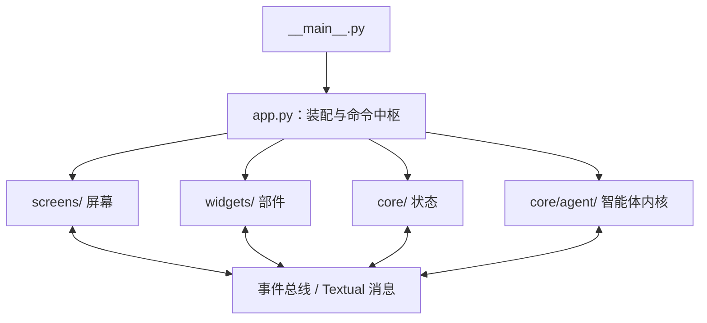
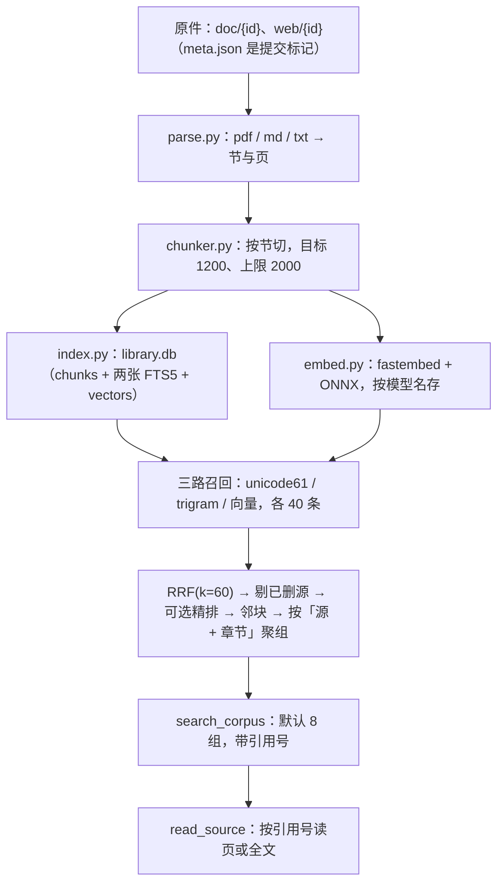

# 现行设计

> 角色：现行设计（这个系统现在是什么样）
> 状态：随代码更新，最后核对 2026-11-18
> 配套：`history.md`（为什么这么定）、`review.md`（实测读数）、`reference.md`（判据与外部资料）、
> `tools.md`（工具清单，由 `tools/gen_tools_doc.py` 生成）、
> `ten-agent-design.md`（十个角色的职责与边界）、
> `dist/rules/`（四档规则：全局、角色、阶段、参考）、
> `archive/progress.md`（多 Agent 重构的逐阶段验收与问题台账）

这份文件描述当前实现的形状与不变式。改代码之前先读它；知道「为什么」去看 `history.md`，
要数字去看 `review.md`。文中的数字都来自代码或判据脚本，代码一动就该复核一次。

---

## 一、定位与产出

`VSAgent`（包名 `vsagent`）是一个跑在终端里的虚拟筛选 Agent。用户在聊天界面里交办一件事，
模型自己决定查靶点、取结构、准备受体、算口袋、备配体、对接、打分、写运行目录、打开结构查看器，
过程与推理实时流回界面。`web/` 与 `viz/` 是同一份数据的只读网页端，外加语料投递。

**产出的单位是假设，而不是一张分子排名。** 排名是原料。`Hypothesis` 对象带六要素：
主张、机制、证据、检验方法、预期、否证条件；`test` 与 `expected` 必填，`expected` 必须含
数值、阈值或对照，否则这条假设没法判真假。状态只由 `close` 与 `record_assay` 改动，
`update` 改不了它——否则模型可以绕过证据把一条假设标成 supported。未结的假设按粒度
分组渲染进 `TASK` 层，`write_run` 把它们整份写进 `provenance.hypotheses`。

判据来源与筛选流程的确认点在 `dist/rules/agents/principal.md`，展开的操作细则在 `dist/rules/`：
操作要点在 `global/`、`agents/`、`stages/`，方法与阈值在 `references/`。`dist/AGENTS.md`
不再进模型上下文，只留给 `/init` 与人工查阅。

---

## 二、分层

四层，`app.py` 是唯一的装配根。



两条贯穿全仓的分界线：

1. **`core/` 不 import textual。** 会话管理、数据模型、命令表都能被测试直接调用。
2. **`core/agent/` 不认识界面。** 内核只往 `EventBus` 发事件，`ChatScreen` 是唯一的翻译层。
   「把界面换成网页端」因此不需要动内核。

---

## 三、内核

### 3.1 一轮的流程

模型请求之前还有一段前置流程（`_prepare_route`，只在根会话跑）：取这一轮的用户原话 →
上下文解析 → 意图解析 → 意图验证 → 任务关系 → 规格编译 → 角色路由 → 定下派哪几个角色、谁等谁。档位由 `.vsagent/route.toml`
的 `[route] mode` 控制（`VSA_ROUTE` 只做临时覆盖），取 `off / shadow / enforce`：
`off` 什么都不做；`shadow` 与 `enforce`
都写出计划与过程记录，`shadow` 不拦截派发，`enforce` 先问或拒绝；两者都不改工具清单——每个角色装哪些工具由 `agents.toml` 决定，
会话建立时就定稿。路由出错时 trace 照写，但**一个会话字段都不改**——宁可退回
原来的路径，也不把一份半成品计划写进会话，下一轮再按它继续。

前置流程的结果同时落成消息开头的 `PartType.ROUTE`：`route_adapter.describe` 把意图、任务规格
与角色计划写成一段纯文本（第一行是标题），TUI 与网页各画一个默认收起的折叠块。它只在
`off` 时不写；解析失败也写，写明这一轮为什么退回原路径。关键词提示（`intent.detect`，
按词面猜「该看哪几类来源」）也放在这一块里，带命中的词——它与模型解析是两条独立的通道，
写在一起才能对照。它**不进模型上下文**——`translate_message` 只认正文、推理与工具，
子会话复制时也跳过（`spawn.SKIPPED_PARTS`）。

之后才是模型侧的一轮：清空证据表 → 组稳定前缀 → 装配上下文 → 请求模型 → 消费流（正文、推理、工具调用分流到
不同 `PartType`）→ 无工具调用则跑 STOP 钩子 → 逐个执行工具（故意不并发）→ 记录这一步。

一次工具执行的固定顺序：查注册表 → 校验参数 → PreToolUse 钩子 → 权限判定 → 可选的界面询问
→ 执行 → PostToolUse 钩子 → 提炼证据。顺序换一个语义就变：钩子放到权限之前就绕过权限，
权限放到执行之后就没有意义。

`AgentLoop` 不维护第二份历史：每一步从 `Session` 现场重建模型消息。任何非正常退出都会触发
一次不带工具的收尾总结，模型写，失败时用本地兜底文案。四段固定：停在哪里、已经产出、
还没做完、下一轮从这里继续；不要求用户做决定，也不用 Markdown 语法。

### 3.2 上限与重试

| 常量 | 值 | 含义 |
| --- | --- | --- |
| `MAX_STEPS` | 24 | 一轮步数上限，`VSA_MAX_STEPS` 可改；写错按 24 处理 |
| `CLOSING_STEPS` | 3 | 剩这么多步进入收束阶段，只放行交付动作（按层级与角色算） |
| `TOPIC_STEP_LIMIT` | 20 | 根会话的主题走满这么多步且最近 4 步没有新产物，由内核封存并结束这一轮；子 agent 不适用 |
| `MAX_STOP_RETRIES` | 2 | STOP 钩子未通过时的重试次数 |
| `MAX_RETRIES` | 2 | 模型请求的重试次数 |
| `MAX_TOOL_RETRIES` | 1 | 工具调用的重试次数 |
| `MAX_FAILED_STREAK` | 3 | 连续三步整步失败则退出（`tool_failed`） |
| `PERMISSION_TIMEOUT` | 300 s | 权限询问无人答复的时间上限，超时按拒绝处理 |
| `MAX_SUMMARY_FAILURES` | 3 | 摘要连续失败三次，这一轮不再试 |
| `RETRY_DELAYS` | 1 s / 3 s | 两次重试的间隔 |

工具层只重试一次（模型请求是两次）：一次工具调用本身要几十秒，重试两次会把一次抖动拖成
三倍等待，而工具失败之后模型还有别的路可走。重试只包 `execute`，不重跑权限与钩子。
重试用尽的文案写明「参数没有错，也不要用 bash 自己实现」——模型绕道自建客户端，实测一次
误判烧掉 20 步。

剩 `CLOSING_STEPS` 步时进入收束，放行的是**交付动作**，不放行新计算与新取数。
名单按层级与角色算：

- 子 agent：`write` / `patch` / `read` / `grep` / `registry` / `workspace` /
  `add_evidence` / `close_topic` / `task` / `recall_event`；`prepare`、`docking`、
  `visualization` 另加 `write_run`。`bash` 与领域计算、取数工具一律拦下。
- 根会话：`read` / `grep` / `write` / `patch` / `registry` / `read_turn` /
  `search_history` / `recall_event` / `close_topic` / `task`。
  `dispatch_campaign` 与 `bash` 拦下。

名单分开的理由是 2026-11-18 的实测：旧名单只有 `write_run` / `close_topic` / `task` /
`read_turn` / `recall_event` / `search_history`，而子 agent 最后三步要做的是登记证据、
登记产物、核对文件，全部被拦；`write_run` 则是把受体与口袋写成运行目录的工具，
三个子 agent 一次都没用过。拒绝时按层级给出不同的说明，不再统一指向 `write_run`。

这一阶段的整步失败不计进 `MAX_FAILED_STREAK`——拒绝由内核自己发出，模型并没有卡住。
尾部提示同时给出「最多还能做 K 步（不是必须用完）」；还剩 6 步时另给一次交付检查，
让模型先对照任务书的验收条件，齐了就写结论并停止。

子 agent 不显示「这一段已经很长，先调 close_topic」那一句，也不由内核按主题预算主动
封存：它整个任务就是一个主题。实测中这句话让三个子 agent 在第 9–13 步提前封存，
再花 3–5 步用 `recall_event` 或重读把细节捞回来，最后全部在 24 步用满。装不下时由
装配层按需封存（`context.dropped` 那条路）。

子 agent 另有两级时限（2026-11-13）：

- **每个角色的安全网**（`profiles.TIMEOUT_MINUTES`）：research / mechanism 30 分钟，
  ligand / analysis 40，pocket 45，prepare 60，affinity 90，docking 120，
  visualization 20；principal 不派发，没有时限。
  到点由调度器 `host.cancel` 打断，记 `failed` 并写清「超过时限（N 分钟），产物可能只写了
  一半」。这不是性能指标，是把卡住的子会话从「一直在跑」变成可决策的失败。
- **整场上限**：`dispatch_campaign(timeout=分钟)`，1–720 分钟。到期不再等剩下的人，
  未完成的任务记失败。

角色时限刻意放宽了 `docking`：对接是真在算，不是卡住；要更紧的场合用整场上限。

退出原因有五种：`exhausted`（步数用尽）、`cancelled`（用户中断）、`error`（模型或装配出错）、
`tool_failed`（连续失败）、`topic_full`（主题预算用满）。整轮停因写在 `Session.last_exit_reason`
上，轮末封存的那一段另把 `EXIT_*` 写进 `Event.exit_reason`；界面的完成 / 失败 / 中断三态
由后者换算，下一轮开头的复述用前者。

### 3.3 工具协议

`Tool` 是抽象基类，`ToolRegistry` 管注册与禁用，`ToolSpec` 是给模型看的 schema，
`ToolResult` 是返回值，失败的返回 `failed=True` 而不是抛出异常——错误文本要能回灌给模型自纠。

依赖注入是声明式的。工具在类属性上声明要什么，内核在 `execute` 里注入：

| 类属性 | 注入什么 | 用途 |
| --- | --- | --- |
| `primary_argument` | 参数名 | 权限判定按这个参数匹配 |
| `context_argument` | `SessionLedger` | 沿 handle 找产物 |
| `task_argument` | `TaskState` | 读改写任务状态 |
| `evidence_argument` | `EvidenceStore` | 把关键行放进证据层 |
| `viewer_argument` | 查看器入口 | 拼结构页地址 |
| `event_argument` | 事件运行时 | 封存主题 |
| `registry_argument` | 注册表（只读） | 查某个名字有没有装 |

子 agent 的入口不走上面这些通道：`dispatch_campaign` 从参数里拿 `session`
与 `spawner`，由装配处直接提供。4b 的子代理上下文隔离只有设计。

声明了某一类却收到 `None`，返回「内核装配问题」，措辞要让模型知道重试无用：这一路只可能是
内核漏传。

`ReadTurnTool` 按 `step N` 取回被移出上下文的**一步**原文，默认不带思考过程；`Tool.status`
的五种值是 `PENDING / AWAITING / RUNNING / COMPLETED / FAILED`，界面工具卡用
`○ ◐ ● ✓ ✕` 一档一个。

### 3.4 权限

`PermissionPolicy.check` 的判定顺序：

1. 取消；
2. 用户手打的 bash；
3. 会话 `allow_all`（在弹窗上按了 a）；
4. Plan 模式的 `PLAN_DENY`；
5. 项目规则（`.vsagent/permissions.toml` 一类）；
6. 越界路径（工作目录之外）；
7. 计费配额；
8. 单工具允许清单；
9. 默认：`write` / `patch` / `bash` / `dock`、准备受体 / 准备配体、切换当前受体需要询问。

最后一条里那三个共享状态动作是 2026-11-13 定的：主 agent 改成纯编排之后，它们只能由角色做
（`prepare` 的名单里有准备受体与准备配体，`pocket` 的名单里有切换当前受体），但「改登记表里的
当前受体」影响整个会话家族，所以执行前问一次。

会话 `allow_all` 排在除中断之外的一切之前：按下 a 就是「这个会话别再问我」，Plan 限制、
越界与计费都不再拦，切换会话时清掉。

询问那一步有两条保底：`permission.ask` 没有任何订阅者时立刻拒绝（无人值守），
300 秒无人答复时拒绝。两处都按拒绝处理——没人答复不等于同意。

权限询问是应用层模态，按到达顺序**排队**而不是叠着弹（两个子 agent 同时要权限时，下面那个
会看不见也点不到）。第二行写清是谁在问：子会话是「配体情报（ligand）· 会话标题」——标题会
被 `close_topic` 改名，光看标题认不出角色；根会话仍写 agent 名。

同模块的 `load_tool_switches` / `save_disabled` 管另一件事：`tools.toml` 里标关的工具根本不进
注册表，模型连它存在都不知道。改开关走 `/tools` 面板，当场重装注册表，不必重启。

### 3.5 钩子

`hooks.toml` 里的外部命令，stdin 收一行 JSON。退出码 2 拦截（stderr 当原因），0 放行，
30 秒超时算拦截。

### 3.6 登记表

`SessionLedger` 是 `receptor#1` / `ligandset#3` 这类 handle 的真相所在，按会话 id 隔离在
`~/.vsagent/ledgers/`。`digest()` 给模型看的那一小段索引（当前受体 + 最近 5 个产物，≤10 行），
每一步现算，不调 `reconcile()`——那一步会把每个登记路径读一遍算指纹。

`reconcile()` 只读：它更新条目的 `file_state`（`ok` / `stale` / `missing`），不删条目、
不改路径。「文件没了」在列表里可见，存档仍保留原始信息。

### 3.7 子 agent 与派发

`host.py` 管会话宿主，`spawn.py` 管派发。模型只有一条派发入口：
`dispatch_campaign` 按计划派给专业角色，任务号形如 `计划号:角色`，同一任务号只建一次
子会话；任务号相同但角色不同直接拒绝。界面不再提供手动建子会话的入口——
`/agent` 已在 2026-11-13 删除，`host.spawn` 只由调度器调用。

派出去的东西由四个模块分工：`dispatcher.py` 建会话并判重，`scheduler.py` 按依赖分层、
只让失败卡住下游，`coordinator.py` 把角色计划翻成任务、把角色依赖换成任务号，
`reports.py` 从子会话里机械抽取报告。子 agent 的报告随**派发结果**一起回到父会话：
`dispatch_campaign` 等全部子会话结束后，逐条列出「完成 / 失败 + 结论 + 合格或不合格
（缺什么）+ 产物句柄 + 证据」。结论预览只留 800 字，整场结果压到 1500 token；每份
报告的全文写到 `runs/reports/<父会话>/<子会话>.md`，正文与收尾总结各成一段；同目录的
`index-<计划号>.md` 列出全部绝对路径，父会话用 `read` 取细节。索引按计划号分文件，
同一父会话再跑另一场不会盖掉上一场。路径写绝对值：`read` 的相对路径按应用启动目录
解释，源码运行与打包运行不是同一个根。用户中断或战役出错时同样把已有报告写下来，
结果里附索引路径；目录在开跑前先建，写不进去在派发之前暴露。

子会话的上下文隔离没有实现：`subagent_argument` 这个注入通道在代码里不存在。子 agent 的
工具清单按角色配置裁剪；准备受体/配体与切换受体不再对子 agent 一律拒绝，而是按角色给
（`prepare` 有准备工具，`pocket` 有登记表与换受体），准备类动作在
权限层问一次用户（`DEFAULT_ASK`）。2026-11-13 之前这三条是 `WORKER_DENY`，主 agent 改成
纯编排之后等于没有任何会话能做，所以改成「谁有权改」有据可依。

派发时的四条约定（2026-11-13）：

- **`roles` 可以加**：计划里没有的角色按角色目录直接补进这次派发，缺的前置
  一起补；任务号仍是 `计划号:角色`。用于「跑到一半发现还要结构盘点」。
- **`roles` 也可以减**：按子集派发时，预览会点名「计划里还有没派的角色：…」，
  `Campaign.pending` 进 `campaign.done` 事件并写进待办——不说的话，父会话会以为整场跑完了。
- **自定义任务书只给一个角色**：`roles` 恰好一个时替换它的任务书，自动补的上游仍用模板；
  指定多个就报错。以前按「补完上游后的任务数」判，下游角色永远换不了任务书。
- **自带输入不重复派**：`available_inputs` 里有 `pocket` / `ligand_set` / `structure` /
  `receptor` 时，对应角色记进 `plan.provided_agents`，不再派角色，缺前置判据也认它。

---

## 四、上下文装配

### 4.1 分层与顺序

`ContextAssembler.build` 按固定顺序装配八层：

```
PREFIX → PROFILE_MEMORY → PROJECT_MEMORY → TASK → EVENT → RECENT → EVIDENCE → HISTORY
```

| 层 | 内容 | 淘汰策略 |
| --- | --- | --- |
| `PREFIX` | 身份、工作纪律、平台、登记表说明、事件说明、全局规则、角色规则 | pinned，字节稳定 |
| `PROFILE_MEMORY` | 用户的长期要求（习惯），`MemoryStore.profile_text()` | pinned，只在台账变化时变 |
| `PROJECT_MEMORY` | 跨会话的项目事实与经验，`MemoryStore.project_text()` | 受 1000 token 限制，按核心 / 相关 / 最近三段填 |
| `TASK` | 任务状态、意图摘要、工作区索引、运行环境、未结假设 | pinned |
| `EVENT` | 已封存主题的流水（标题、逐步、结论、未决） | 超额度时从最旧的主题裁起 |
| `RECENT` | 最近若干个完整交互组 | 整组进出，组内不切开 |
| `EVIDENCE` | 本步相关证据，带引用 | 先给摘要，正文按预算展开 |
| `HISTORY` | 摘要与被移出交互组的引用清单 | 只留引用 |

`PREFIX`、`PROFILE_MEMORY` 与 `TASK` 永不驱逐：用户的约束与长期要求必须活过压缩。
习惯与项目情况分开装，是因为习惯只在用户改口时变，项目情况随最后一条用户消息变；
合成一段的话，问题一换整段就变，装不下时还会把习惯与事实一起砍半。

意图摘要是系统对用户原话的解析：目标、对象、角色、约束、禁止项、交付、验收与确认点。
它由 `planning/intent_summary.py` 压到 500 个文字单位以内，放在 `TASK` 层，让主控在
派发前能核对；与用户原话不符时，`principal.md` 要求先说明差异再问用户，不直接派发。

输出布局：`system` 只放 `PREFIX`；紧跟着一条 user 消息放 `PROFILE_MEMORY`；再一条 user 头装
运行环境、`PROJECT_MEMORY`、任务状态、意图摘要、工作区索引、摘要与引用清单；中间是 `RECENT`；
最后一条 user 前面是 FOCUS 复述、来源提示与证据。易变内容一律不进 `system`——
日期每天变一次，进去就每天击穿一次 prompt cache。

### 4.2 预算与降级

```
tools_tokens = estimate(json(tools))
reserve      = min(OUTPUT_RESERVE(4096) + PROTOCOL_OVERHEAD(256), window // 4)
available    = int(window * 0.8) - reserve - tools_tokens
available    = min(available, VSA_CONTEXT_BUDGET)   # 设了且为正数时
```

`VSA_CONTEXT_BUDGET` 是花费上限：128K 窗口按比例算出九万多 token，装得下就全装；
设了它之后可用额度取两者中较小的一个，没设或写错按不封顶处理。

装不下就按固定顺序降级，直到装得下：

```
evidence_detail → history_summary → recent_tool_clear → event_step_detail
→ event_layer → memory → recent_turns → recent_reasoning → recent_output
```

`RECENT` 装不下时先清旧工具正文（最近 4 条 `RECENT_TOOL_KEEP` 与失败的除外），清不动才整组移出；
清掉的原文用 `read_turn` 取回。到最后一档仍装不下就抛出 `ContextAssemblyError` 并带上各层用量，
不静默截断。

固定上限：`MEMORY_LIMIT` 1200、`HISTORY_MAX` 3000、`EVIDENCE_MAX` 6000、`EVENT_LIMIT` 200–6000
（按剩余预算伸缩）、`EVIDENCE_LIMIT` 24 条、引用清单 20 组 / 600 token；剩下的全给 `RECENT`。
`ratio` 默认 0.8（`CONTEXT_RATIO`），是装配时的目标比例。

被软配额削过的层同样记进 `degraded`，按降级链的顺序排列——顺序本身就是「先削谁」这件事。

### 4.3 事件层

事件层按 **Topic → Step 流水**记录：

| 层级 | 边界 | 谁产生 |
| --- | --- | --- |
| Task | 一条用户消息 | 用户 |
| Topic | 任务里的一个独立题目 | 内核按位置切，模型可命名 |
| Step | 一次模型往返加它的工具调用 | 内核每步自动记 |
| Event | 一个 Topic 封存后的记录 | 内核自动封存 |

**Step 全部本地拼，零请求**：从 `Part` 取工具名、参数、状态、handle，不读 reasoning。
标题、结论与交接可以由 `close_topic` 顺手给，不给就用本地拼的那份并标 `degraded=True`。

**边界是位置 `(message_index, part_index)`，不是消息下标**：一条 assistant 消息装着一整轮
所有往返，按消息切不出轮中途的主题边界。切点记在 `Event.cut_message` / `cut_part` 上，
装配时 `RECENT` 从最后一条事件的切点开始；`Turn.part_start` 用同一个口径。

封存时机：模型调 `close_topic`（步末执行）、轮末、新用户消息、当前主题原文超过
`TOPIC_SOFT_LIMIT`（120K token）、溢出、`/compact`、中断、当前主题走到 `TOPIC_STEP_LIMIT`
（20 步）且最近 4 步没有新产物。模型侧的触发条件是尾部那一行「本主题已 N 步 · 最多还能做
K 步 · 产物 … · 未决 …」，`CLOSE_TOPIC_AFTER` 为 2；第 8 步只在最近 4 步没有新产物时
换成条件提示（目标完成就收，没完成就继续），步数多本身不构成收主题的理由。放尾部是为了
不碰前缀缓存。

`seal_topic(force=True)` 与 `force=False` 的差别是覆盖：轮末遇到纯聊天的一轮可以跳过，
溢出与 `/compact` 必须封，否则那一段原文两边都不在。自动封存不推进 `compact_upto`，
只有手动与溢出那种明确边界才推进。原文一条不删：`Step` 上的 `message_index` /
`part_start` / `part_end` 就是取回它的地址。

`Event.actions` / `artifacts` / `issues` 是从 steps 聚合的 property，不写入磁盘。

召回三级：`recall_event()` 列主题、`recall_event("evt_0003")` 读流水与结论、
`recall_event("evt_0003", step=7)` 读那一步的工具输出原文。取回按**步**：`read_turn(step=N)`
的编号来自 `Turn.step_no`（`split_turns` 在每一段上递增），区间是
`(message_index, part_start..part_end)`。三个取回入口默认不带思考过程（`with_reasoning=False`），
要当时的推演才显式打开；`read_turn` 与 `recall_event` 共用 `page_lines()`，单次 4,000 token。
推理不进结论之外的上下文，是因为跨轮之后它由 `TASK` 与主题结论承载，铺出来只是重复。

按内容找主题用 `search_history`：标题（权重 4）、结论（3）、产物（2）、交接（1.5）、
每步过程（1）。默认只查当前会话；`scope="all"` 查这台机器上的全部根会话（子 agent 的会话
不查），每个会话最多占 3 条命中，避免一个长会话把名额占满。跨会话的命中行带
`ses_0019 · evt_0007`，原文用 `recall_event(session_id="ses_0019", event="evt_0007")` 取回：
`evt_0007` 在每个会话里都存在，单给编号会在当前会话里取错主题。会话表来自
`SessionManager.sessions`（内存里那一份），不另建索引。两个工具都只读这张表；
`scope="all"` 与带 `session_id` 的取回在没有装配会话管理器时直接失败并写明原因，
不退回本会话——退回去会让模型以为别的会话里没有内容。

**规模。** 本机 23 个根会话、94 条主题、可查正文 135 K 字，`scope=all` 一次 1.3 ms；
同一份状态文件 7.5 MB，读入 547 ms。检索耗时与可查正文成正比：每条主题都要把标题、
结论、产物与每步结果拼起来再做子串匹配，1 万条约 140 ms。会话多了以后先出问题的是
状态文件——每轮整份重写、启动整份读入；检索在几千条主题时还只是几十毫秒。这一层因此
不建索引。量到上限之后按这个顺序加：`since` 时间窗与扫描会话数上限（被挡掉的在末尾写
一行「还有 N 个更早的会话没有查」）→ 按状态文件版本失效的「主题 → 可查文字」缓存 →
派生索引（SQLite FTS5 一张 `events(session_id, event_id, title, body)`，封存时写一条，
启动时按 `state.toml` 的 mtime 对账重建，取回仍按会话编号走）。触发条件是 1000 个会话、
5000 条主题时 `scope=all` 的 p95 超过 100 ms。状态文件读写先成为瓶颈时，按会话分成
多个文件，主文件只留元数据。

事件块超额裁掉最旧主题时补一行「更早还有 N 个主题」；被裁事件覆盖的原文既不在事件里也不在
`RECENT` 里，不说就是无声消失。摘要已经退休：它的三段分别由 `TASK`、Step 流水、主题结论覆盖，
`_summarize` 只剩「首轮就溢出、连一段都封不出来」的兜底。

### 4.4 前缀

`stable_prefix` 的顺序：身份 → 假设规则 → 工作方式 → shell → 登记表 → 记忆 → 事件 → 派发 →
全局不变式 → 角色规则 → 项目规则。排序是语义：假设规则紧跟身份（它定义产出长什么样），
确认点放最后。

规则按「变不变」分层，只有前两档与项目规则在前缀里：

| 档位 | 来源 | 何时加载 | 为什么在这一层 |
| --- | --- | --- | --- |
| 全局不变式 | `dist/rules/global/`（3 份） | 每一轮 | 所有角色都遵守，且整场会话不变 |
| 角色规则 | `dist/rules/agents/<角色>.md`（10 份） | 每一轮，只取自己那份 | 按 `agent_role` 取，一次会话内不变 |
| 项目规则 | `dist/AGENTS.md` | 不注入 | 只留给 `/init` 与人工查阅；主控行为以 `principal.md` 为准 |
| 阶段规则 | `dist/rules/stages/`（5 份） | 任务层（动态） | 随子目标推进而变，放进前缀会每步击穿缓存 |
| 参考材料 | `dist/rules/references/`（5 份） | 不注入，只列名字 | 需要时模型自己读 |

阶段由任务规格里的子目标推导（`stages.stage_for`），不由模型自述决定；跨阶段的工作
（`research` 的靶点与文献工作、`visualization` 的视图页）不给阶段，不硬塞进相邻一步。

固定那几段预算 1900 token，实测 1634（`tools/check_prefix.py` 守着），整段前缀 3714 token。
`dist/AGENTS.md` 不再注入，只留在磁盘上供 `/init` 与人工查阅；主控的交付、禁止与检查清单
迁到了 `dist/rules/agents/principal.md`（1130 token）。领域约束按角色分到了
`dist/rules/agents/`，全局不变式仍在 `dist/rules/global/`。每一步最多加载的规则是
2395 token（全局 + 一份角色 + 一份阶段）。平台那句由 `platform_note()` 按 `sys.platform` 现取。

易变信息走 `environment_block()`，由循环层放进 user 头：今天日期（只到天）、工作目录、状态目录。

### 4.5 FOCUS 复述

把目标、前三条约束、下一步插成一条 user 消息，紧贴在最后一条用户消息前面，上限 300 token。
任务状态在窗口最上面，`RECENT` 几万 token 之后模型早就看不到它了。

同一段还带两行接续信息：上一轮的停因（`Session.last_exit_reason`，换算成中文说法）与
最后一个事件的 `handoff`。用户回一句「继续」时，模型不必先 `read_turn` 找上一轮做到哪。

### 4.6 记忆

跨会话的项目事实落在 `<工作目录>/.vsmemory/`：`memory.md` 给人读，`entries.json` 给程序读
（带引用路径与指纹），以 `entries.json` 为真相。

写入做五件事：按「正文 + 类型」精确去重；**只有 `FACT`** 在同类型且 refs 相交、文本含更新词时，
按字符二元组重合度**只取代最相近的一条**（下限 0.20，判定依据记在旧条目的 `superseded_rule` 上）；
`remember(conflicts=[…])` 把矛盾写成双向标记，两条都保持有效、渲染时带「冲突，未解决」；
agent 的引用必须存在（用户写入可以不存在，标 `unverified` 排在后面）；单条最多 500 字。
记忆里写文件路径不写 handle——handle 只在本次会话有效，写入时就拦。

类型有三类，行为各不相同：`FACT` 按相关度注入、90 天衰减、需要引用；`PREFERENCE` 是用户明确的
长期做法，不要求引用、恒常驻且单独占 200 token、不进相关度检索、最多 8 条；`EXPERIENCE` 是带条件
与结果的负结果，180 天衰减、分数乘 0.8。事件层、任务状态与 `AGENTS.md` 已经各自承担情景、
任务与流程，这三类不再存一份记忆。

常驻注入两段：先装习惯（最多 200 token，装不下时末尾写明还有几条），剩下的额度给事实与经验——
核心（有引用且近 30 天被显式 `recall` 命中，最多 5 条）、相关（用最后一条用户消息加任务目标检索，
最多 5 条）、最近（最多 3 条），合计 1200 token。`recall` 把字面与语义两张名次表按
`Σ 1/(60 + 名次)` 合并，中文按 bigram 切词；两路都靠前的排最前。只靠语义命中的条目，
余弦分不能低于这一问最高分的 0.8——余弦没有「不相关」这个值，台账小的时候随便一句都有
不低的相似度。条目引用与当前受体、当前产物的路径相同或互为上级时乘 1.2。
命中结果同时进 `EVIDENCE` 层，否则 `RECENT` 一压这段知识就没了。

容量上限 500 条，超出按「先失效、再最旧」移进 `archive.json`，归档不删也不注入。
封存主题之后，可选的本地抽取（`VSA_MEMORY_EXTRACT`，默认关）只写 `FACT` 与 `EXPERIENCE`。

---

## 五、领域工具

### 5.1 配置决定清单

全仓 71 个工具：17 个常驻（文件、登记表、任务、假设、事件、记忆、
`write_run`、`open_viewer`、`dispatch_campaign` 等），54 个领域工具。每个角色装哪些
写在 `vsagent/core/agent/roles/agents.toml`：三份配置按顺序读（包内、项目
`.vsagent/agents.toml`、用户 `~/.vsagent/agents.toml`），同一个角色以靠后的整段为准。
会话建立时清单定稿，运行当中不变；换主题不改请求体，前缀缓存不会整段失效。

注册表只装一份、含全部工具。哪一步发哪些名字由 `roles/agents.py` 算出来：
根会话取 `core.orchestrator`（18 件），子会话取 `core.worker`（13 件）加本角色的
工具。`Registry.specs(only=...)` 按这份名单过滤；模型真去调名单外的工具时，
`tool_guard` 按同一份名单拒绝，文案指向 `agents.toml`。

每个角色一步的清单开销由 `tools/check_agents.py` 量：超过 10,000 提示、
超过 12,000 判失败。基础档的额度由 `tools/check_toolset.py` 量（主 8,000、子 5,300）。

### 5.2 装配清单

根目录的模块与它们各管什么：

| 文件 | 内容 |
| --- | --- |
| `core/paths.py` | 项目根、语料根、运行目录根 |
| `core/parse.py`、`chunker.py`、`index.py`、`embed.py`、`corpus.py` | 语料解析、切块、索引、向量、检索 |
| `core/web/{routes,service}.py` | 网页服务与路由表 |
| `core/agent/tools.py` | `Tool` / `ToolRegistry` / 内核文件工具 / 参数校验 |
| `core/agent/roles/agents.py` | 读三份配置、算每个角色的工具清单 |
| `core/agent/permission.py` | 权限判定（外部钩子在 `execution/hooks.py`） |
| `core/agent/coretools.py` | 常驻核心工具的装配清单 |
| `core/agent/provider.py` | 模型协议（OpenAI 兼容 SSE） |
| `core/agent/validators/` | 四层运行时校验：工具守卫、任务前置、输出合同、交付验收 |
| `core/agent/domain/` | 54 个领域工具、23 个模块，外加 `http.py`（唯一网络出口）与库层模块 |
| `core/agent/{planning,roles,execution,state,research}/` | 其余模块按用途分五组，见下一张表 |
| `core/agent/search_reasoning/` | 检索触发的搜索增强：先验答案、证据适配与评估、选择性整合、交付前核对；由 `VSA_SAR` 接入主循环 |
| `dist/rules/` | 四档规则：`global/` 3、`agents/` 10、`stages/` 5、`references/` 5 |
| `screens/`、`widgets/`、`styles/app.tcss`、`palette.py` | 屏幕、部件与样式；终端色值只在 `palette.py` |
| `web/`、`viz/` | 网页前端与三维查看器的构建产物 |
| `tests/test_agent.py`、`tests/test_smoke.py` | 内核判据与界面判据（直接跑的脚本） |
| `tools/` | 判据脚本与探针 |

### 5.3 模块分组

`core/agent/` 原来三十来个文件平铺在一个目录里，「谁能改计划」「谁在跑」「谁只是数据」
全靠记文件名。现在按**一个模块被谁用、什么时候被调**分五组，根上只留跨组的基础设施
（`tools.py` / `coretools.py` / `permission.py` / `provider.py`）和两个
本来就成包的目录（`domain/` 领域工具、`validators/` 运行时校验）。

| 组 | 模块 | 管什么 |
| --- | --- | --- |
| `planning/` | `intent.py`、`intent_prompt.py`、`route_tool.py`、`context_resolver.py`、`intent_validator.py`、`task_context.py`、`decision.py`、`notes.py`、`task_compiler.py`、`agent_router.py`、`route_adapter.py`、`stages.py`、`context.py` | 一句话怎么变成计划：主控第一步用 `route_intent` 给出 `IntentSpec`，再编译成 `TaskSpec`、路由角色；`decision.py` 是意图、任务关系与最终计划合在一起的唯一对象，`notes.py` 是带机器码的提示；`context.py` 是装配用的八层模型 |
| `roles/` | `catalog.py`、`templates.py`、`profiles.py`、`agents.py`、`agents.toml`、`prompt.py`、`contracts/` | 角色本身：工作与权限、角色模板（子目标／交付物／验收条件／确认点）、说明书与报告必填、每个角色的工具名单、系统提示与规则注入、五类协议 |
| `execution/` | `projection.py`、`coordinator.py`、`scheduler.py`、`dispatcher.py`、`dependency.py`、`spawn.py`、`host.py`、`campaign_state.py`、`reports.py`、`report.py`、`loop.py`、`hooks.py` | 跑起来的那一层：唯一投影（`TaskSpec → AgentTask`）、计划调度、建会话与判重、分层调度、子 agent 派发、会话宿主、状态机、报告抽取、唯一驱动与外部钩子 |
| `state/` | `event_log.py`、`ledger.py`、`memory.py`、`hypothesis.py`、`hypothesis_review.py`、`history.py`、`task.py`、`topics.py`、`trace.py` | 落在磁盘上的东西：主题与步的流水、handle 登记表、跨会话记忆、假设与假设评审、任务状态、主题视图、追踪 |
| `research/` | `research_objects.py`、`research_workspace.py`、`workspace.py`、`evidence_registry.py` | 科研对象与工作区、证据分级 |

`search_reasoning/` 单独成包：它处理的是「查询结果怎么进入答案」，与五组里的
计划、角色、执行、状态、科研对象都不同类。包内按阶段分文件：`jsonio.py`、
`answer_state.py`、`evidence.py`、`integrator.py`、`verifier.py`，适配器在
`adapters/`，阈值与权重在 `policy.py`。它不持有会话，也不改工具权限。

分组只影响 import 路径，不改变任何调用顺序。移动时把**搬过的文件和指向它们的 import**
改成绝对形式（其余相对 import 原地不动，免得整仓 diff 都是 `..` 换全路径）。顺带修了
`roles/prompt.py` 里算仓根的 `parents[3]`：搬一层目录它就静默指到别处，规则文件读不到而
程序照常启动——现在改走 `core/paths.py:project_root()`，与层数无关。

内核文件工具五个：`bash` / `read` / `write` / `patch` / `grep`，外加 `read_turn`
（按 `step N` 取回一步原文，默认不含思考过程，一次最多 4,000 token）。
领域工具里有八个模块（`complexes` / `prankweb` / `align` / `chemistry` / `pdbtext` / `http` /
`products` / `preprocess`）是库层，不登记工具。

### 5.4 口袋

口袋来源四层叠合：共晶配体 → 复合物 → p2rank 预测 → 先验叠合。四层在聚簇之前都先剔掉脂质与
去垢剂（`preprocess.screen_lipids`）：碳数 ≥ 8、极性原子（N/O/S）≤ 2 或含磷、重原子 ≥ 16、
包围盒最长边 ≥ 16 埃，四条全中才算。最后那条是类固醇药物与膜成分的分界（睾酮、地塞米松四个
并环只有 11–13 埃）。

每处口袋带一份画像（`pockets.build_profile`）：配体的元素组成与伸展尺寸、壁按芳香 / 疏水 /
极性 / 带电四类计数、最近残基与 3.5 埃内的个数、一句判断。画像不给分，与「实验定位没有打分」
同一口径；`detect_pockets`、`write_run`、网页端读的是同一份。

### 5.5 配体与对接

配体链路：`import_ligandset`（文件 → 原始配体集）→ `prepare_ligands`（ETKDGv3 + MMFF/UFF +
Meeko → 已准备配体集）→ `dock`（Vina → 对接产物）。

`dock` 有三个力场：`vina` / `vinardo` / `ad4`，**分数互不可比**。前两个只要受体与盒子；
`ad4` 要先用 `autogrid4` 算亲和力图（`--maps`，不能给 `--receptor`），图缓存在
`~/.vsagent/grids/`，键是受体指纹 + 盒子 + 配体原子类型，盒子限 40 Å——图的代价是边长的三次方。
AutoDock4 原程序没有接：1–5 分钟一个配体，与批量筛选的形态冲突，而 AD4 力场已经通过 vina 拿到。

`dock` 的签名里没有盒子参数：换盒子要回 `prepare_receptor` 重跑，盒子从已准备受体的
`box.txt` 读。

`write_run` 写的是运行目录（`#/structure/<run_id>`）：同名分两种。**同一会话**重写同一个
`run_id` 是更新那一份（旧位姿会被清掉）；**别的会话**写同名目录时改存 `-2` 并在返回里说明，
不覆盖前一份留档。归属看 `meta.json` 的 `provenance.session_id`，与登记表判会话同源。

### 5.6 亲和力

DTA 通道是另一条：`fit_affinity`（实测活性 → 模型产物）→ `score_affinity(model=…)`
（同一批位姿 → 亲和力产物）。

`finetune.py` 是唯一会训练模型的工具，用某个靶点上已测的活性把预训练权重微调一遍，
训练交给 `domain/fit_train.py` 在 `models/DTA/.venv` 里跑（5–10 分钟，CPU），主仓一行 torch
都不 import。它只对这个口袋有效，换受体或换口袋要重训。实测与「ECFP4 + LightGBM」打平、
不超越。DTA 通道固定走「微调 → 推理」，零样本不再是流程的一部分。

`score_affinity` 的分数方向与 `dock` 相反（pK 越高越好），描述第一段必须写明这一句。
它会现截口袋：受体的 `box.txt` 只给中心，模型要的是中心 10 Å 内的残基。

两个工具都起外部进程，所以有环境变量入口：`VSA_DTA_PYTHON` 指定解释器，`VSA_DTA_ROOT`
指定代码根。`VSA_VINA_BIN` / `VSA_AUTOGRID_BIN` 指定对接引擎。

### 5.7 分析与对照

分析模块的 8 个工具只读产物：

| 工具 | 做什么 |
| --- | --- |
| `rank_candidates` | 多路合并排序；`with_controls=true` 时按正向 / 阴性 / 背离三类挑对照，并写明每一条为什么算对照 |
| `analyze_pose` | 接触 / 氢键 / 冲突 / 可选 PLIP 指纹 |
| `alternative_poses` | 同一分子的多个对接模式按体积聚簇，报每簇分数与接触残基差异 |
| `contact_map` | 一份产物里所有位姿的残基接触频次 |
| `analyze_hydrophobic` | HP / HM / 脱水账 |
| `efficiency_profile` | LE / LELP / LLE |
| `validate_docking` | 重对接到晶体位姿的 RMSD |
| `compare_poses` | 两个位姿逐原子比，给 RMSD 与接触差异 |

`analyze_hydrophobic` 与 `efficiency_profile` 的输出里写明「没有计算熵与脱水代价」，不能让读者
以为算过。`alternative_poses` 读 `pose_pdbqt` 里的全部模式，与 `screen` 的位姿去重共用
`pose_volume_cells` / `pose_jaccard` / `cluster_by_similarity`。

### 5.8 开工盘点与结构全景

`survey_structures` 常驻。宽泛的问题发生在第一轮，那时还没有派发任何角色，所以它不能挂在某个
角色的名单里。

它把一个靶点全部实验结构按共晶配体分组，每组给套数、最佳分辨率与代表条目；产物写
`~/.vsagent/surveys/`，聊天里给摘要，全表在 `#/survey/<id>`。标题里点过名的配体排在最前：
膜蛋白结构里胆固醇与磷脂按套数永远最多（Nav1.7 的 44 套里胆固醇 26 套），按套数排会把
河豚毒素（9SR，3 套）挤进折叠行。它不下载坐标、不算口袋、不核对序列。

「这一轮从哪条路起手」由 `research` 与 `pocket` 两个角色判断，各自在报告里写清适用条件与
成本，不再由一个常驻工具代答。

### 5.9 网络出口

`domain/http.py` 是全仓唯一的网络出口，测试整体替换的就是它。4xx → `ToolError`，
429/5xx/网络故障 → `RetryableToolError`。

---

## 六、本地语料与检索



### 6.1 原件与目录

`corpus/` 挂在项目根下（`core/paths.py:project_root()`：源码运行时是仓库根，打包后是
启动目录）。布局：

- `doc/<id>/`：`source.pdf|md|txt`、`text.jsonl`（逐页文字，供按页读）、`meta.json`；
- `web/<id>/`：`content.md`、`meta.json`；
- `inbox/`：网页端投递的文件，入库之后删掉；
- `.trash/`：删除是改名进来，不删盘；
- `labels.json`：网页端改的显示名；
- `.index/library.db`：索引与向量，删掉能重建。

源 id 是十位十六进制：文献取内容 sha256 的前 10 位，同一份文件导两次算重复；网页取
规范化 URL 的 sha256 前 10 位，同一页的不同写法（大小写、默认端口、fragment）归成一个源。
真相在原件，索引与向量都是派生物。写入只有一个写者：TUI 与入库线程写索引，网页端只写
`inbox/`、`labels.json` 与 `.trash/`。

### 6.2 解析与切块

- 只收 `.pdf` / `.md` / `.txt`。PDF 的结构按三级判定：书签目录 → 行首编号或常见章节词
  → 页码；Markdown 按标题层级。
- 参考文献、致谢、补充材料不进检索（`SKIP_SECTIONS`），正文仍留在 `text.jsonl`，
  `read_source` 读得到。它们常占论文三到五成篇幅，信息密度接近零。
- 切块按节：目标 1200 字；再加一段会超过 1500 且已经够 900 就在这一段之前收尾；
  超过 2000 强制切；一节末尾不足 300 字的块并回上一块（仍受 2000 字约束）。
- 重叠取上一块最后**一整句**，超过 180 字就不要：半句开头读起来像乱码，而且它会出现在
  每一次检索结果里。重叠只在同一节内加，跨节会把上一节的话带进新节，引用页码就错位了。
- 一段文字过长、需要切开时，表格按行装箱、正文按句切，都不切在词中间。
- 入库与重建共用 `index.chunks_for`：两条路各写一份的话，重建出来的块与当初写进去的
  不一样，而「重建两次一致」的判据正好抓不到这种漂移。

### 6.3 索引

`library.db` 用 WAL：网页读列表与入库写块不互相挡住。四张表：`sources`、`chunks`、
`vectors`、`kv`，加两张 FTS5——`unicode61` 管英文词与标识符，`trigram` 管中文子串。
FTS 由触发器跟着 `chunks` 增删改；向量表的写入、删除、更新都让 `kv` 里的版本号加一，
进程内的矩阵缓存按「库 + 模型 + 版本」失效。只按行数做键不够：`reindex` 会删了再插，
行数不变而 chunk id 已经换了人。

写入口用 `WRITE_LOCK` 串行化，网页端以 `mode=ro` 打开，只读块数、向量覆盖与切块正文；
库不存在或被写锁住时返回空读数，不返回 500。`reindex` 按盘上原件重建，目录没了的源顺手
删行，结束之后补向量。网页搜到的页面**保存时当场入索引**（`upsert_web_page`）：少了这一步，
刚搜到的东西要等下一次重建才查得到，而工具说明写的是「之后免费可查」。

### 6.4 检索

三路各取 40 条：`unicode61`、`trigram`（查询少于 3 个字符时这一路不跑，两个字在 trigram
里没有 token）、语义向量（装了模型才跑，余弦下限 0.30）。三张名次表按 RRF `Σ 1/(60+名次)`
融合；BM25 分与余弦分不能直接相加，量纲不同。

融合后取前 40 个块：按目录存在性剔掉已删除的源，可选精排，前后各带一块邻块（同源同节），
再按「源 + 章节」聚组。组内单块最多 400 字，整组最多 600 字；8 组约 4800 字，在压缩线以内。
引用号写成 `doc#ab12cd34ef §2.1 In vitro assay p.2`：节取路径最后一段，页码给命中的范围。
工具默认返回 8 组、上限 20；没显示完的在末尾写「还有 N 组」。

精排默认关：`lightonai/mLateOn` 把组级源命中从 0.836 提到 0.873、答案在片段里从 0.741
提到 0.833，GPU 上每次约 0.44 秒，CPU 上约 12 秒。CPU 机器上不要开。

### 6.5 工具

- `import_documents`：收文件或目录（只收目录**直接**包含的文献，不递归），一次最多 50 个；
  按内容哈希去重；逐条报「新增 / 重复 / 失败」。扫描件（没有文本层）照实失败，需要 OCR。
- `search_corpus`：免费、离线，所以是「先查这里」的那一个。没有命中与「索引里有命中但源
  已经被删」两种说明分开写，后一种不能让人以为本地没有这篇文献。
- `read_source`：只认 `doc#…` / `web#…`，不收路径。`page` 只对文献有效；单次默认 3000 字、
  最多 8000 字；网页只存了摘要时直说「只有摘要」，要全文用 `fetch_webpage`。

### 6.6 评测

`tools/check_retrieval.py` 读 `corpus/eval/questions.jsonl`，55 条：中文问英文答 35、
精确标识符 5、中文问中文答 15。三条门禁：

- 三路 recall@5 比双词法高 8 个百分点（实测 +0.364）；
- 精确标识符的 recall@5 掉幅不超过 2%（实测 0）；
- 单次检索低于 1 秒（热态 p95 436 ms；首次 4898 ms，含加载模型）。

组级读数：源命中 0.836、答案在片段里 0.741、平均每组 2773 字。评测跑的是线上同一套
`index.lexical` / `embed.search` / `fusion.fuse`，不另写一份；另写一份测的就是评测脚本。
评测集不进版本控制，它与用户手上那批文献绑定。

### 6.7 网页端与知识中心

`GET /api/library?q=&kind=&status=&sort=&offset=&limit=` 给源列表，不传 `limit` 时返回全部；
`GET /api/library/<kind>:<id>` 给一份源的元数据、标签、块数与目录里的文件；
`GET /api/library/<kind>:<id>/chunks?q=` 按 `offset` / `limit` 分页给**索引里那一份**切块
（默认 40、上限 100），`q` 是块内关键词过滤，用户要看的就是检索实际看到的东西；
`GET /api/corpus/stats` 给整库读数。`POST /api/library/upload` 只往 `inbox/` 写文件；
`POST /api/library/ingest` 把 inbox 里的文件交给应用线程入库，回 202 之后在后台跑；
`rename` 只写 `labels.json`，`delete` 只把目录挪进 `.trash/`；`labels` 写标签、收藏与文件夹，
`batch/delete` 一次最多 50 份且只认 `web:` 源。独立运行的服务没有入库回调，明确回 503，
否则会有两个进程同时改索引。写入口要求 `X-VSA-Request: 1` 并校验 `Origin`，入库只认
inbox 里已有的文件名。

`GET /api/knowledge/search?q=&mode=&limit=&source=` 同时给语料与记忆两段结果：每条命中带
`ranks`（`fts` / `cjk` / `vec` 三路各自的名次）与 `diagnostics`（各通道取回条数、向量覆盖、
分组数、候选总数）。融合分是 `Σ 1/(60+名次)`，页面上只显示名次，不把它折算成百分比。
`mode` 只认 `hybrid` / `lexical` / `semantic`，写错回 400 而不退回默认值。

记忆的只读接口是 `GET /api/memory?kind=&state=&q=` 与 `GET /api/memory/<id>`，归档与恢复
`POST /api/memory/<id>/{archive,restore}` 走应用进程的回调。文献与记忆之间的引用换算在
`core/knowledge_refs.py`：记忆的 `refs` 是文件路径，索引认的是 `doc:<哈希>`，它按
`corpus/doc/*/meta.json` 的 `file` / `origin` / `locator` 建映射，进程内按目录 mtime 缓存。

### 6.8 降级

- 没装 fastembed 或没下载模型：只跑词法两路，`vector_coverage` 报 0，正文不提安装指令。
- 没装 pypdf：`import_documents` 返回一条带安装指令的错误。
- 索引还没建：网页的切块面板回空表加一句 `reason`，检索侧报「本地没有」。
- 源被删：检索时按目录存在性剔除；命中全被剔除时说明「索引里有命中，但源已经删了」。

---

## 七、终端界面

### 7.1 屏幕与三栏

`on_mount` 进 `HomeScreen`，提交后切到 `ChatScreen`；屏幕用单个层叠管理，没有 router。

`ChatScreen` 三栏：左栏 `#chat-rail` 是会话树与主题清单，中间 `#chat-main` 同时装消息区与输入框
（两块同宽同左边界），右栏是产物 / 子 agent / 用量。栏间各有一条 1 列宽的 `Splitter`，
按住拖动或聚焦后按左右键调宽，宽度存进 `state.toml`（`rail_width` / `side_width`）。
画的时候按终端宽度再夹一次：左栏 16–60、右栏 20–60，放得下时给中间栏
留 40 列；夹的只是画面，不改设定。

宽度不到 92 列时左栏与它的界线一起收起。两个列表按内容签名跳过重建，每一步的刷新不会把滚动
位置推回顶部。

`HomeScreen` 只有一栏：字标、输入框、「快速开始」三个模板与「最近任务」都在中间；
顶部一条 1 行高的 `TopBar`（应用名 + 模型 / 工具 / 主题 / 帮助四格，
点一下走对应斜杠命令）。输入框内部最后一行是四格提示：`@ 文件` / `/model 模型` /
`/tools 工具` / `Enter 发送`，紧跟一行快捷键提示（`tab` / `ctrl+p` / `/`）。

最近任务承接会话入口：运行中单独一段排最前，其余最多 4 条；标题行右端是「+ 新建任务」。
终端不足 26 行时「快速开始」整行收起。

100x30 实测：聊天界面输入框聚焦时消息区 26 行、输入区块 3 行、状态栏 1 行；失焦时消息区 28 行、
输入区块 1 行。主界面顶栏占 y=0，快速开始占 2 行且终端不足 26 行时收起。

### 7.2 主题卡三层

消息区按主题卡组织。用户消息是任务的头，永远显示；主题挂在它下面，数量等于这一轮封出来的
主题数。

| 层 | 内容 | 展开开关 |
| --- | --- | --- |
| 主题头 | 标题、状态、步数与工具数、一句结论、产物行 | 点标题行收起整段（用户消息不跟着收） |
| 步行 | 序号、做了什么、耗时、成败 | 点步行收起这一步的工具卡 |
| 工具卡 | 参数、输出、产物 | 主题头末尾的「展开全部工具」作用于整段，卡片标题行作用于单张 |

工具卡的输入与输出默认收起，主题与步默认展开。失败那一刻卡片自己展开。主题收起后仍留一行
`ArtifactRow` 列前三件产物，点名字在浏览器里打开——收起的是过程，产物是结果。

折叠之后的滚动位置按锚点补偿：补偿量取被点的主题头、被点的步行或视口最上面那一块的屏幕行差，
改完放回原来的行。补偿之后不再贴底就把跟随关掉，下一次流式输出不会把视口拽回底部。

主题头与步行由 `core/agent/state/topics.py` 从 `session.messages`、`session.events`、
`session.pending_steps`、`live.snapshot` 算出，边界是 `Event.cut` 的（消息, Part）位置，
与装配器读的是同一组数。

### 7.3 状态的来源

| 层级 | 真相来源 | 界面读哪里 |
| --- | --- | --- |
| Task | `session.status` | 左栏任务行、最近任务、子 agent 面板、状态栏「生成中」 |
| Topic | 已封存看 `Event.status`，未封存看 `topics._stopped_status` | 主题头第一行、左栏主题行 |
| Step | `topics.step_status()` 从 Part 现场算 | 步行 |
| Tool | `Part.tool_status` | 工具卡字形 |

`_stopped_status` 的顺序：取消 → 已中断；失败 → 失败；最后一步有未决项 → 失败；有步 →
未封存；没有步 → 已完成。前三条不必等轮末封存。

等待确认是运行中的一个相位，不算第六种结局：主题头与左栏都换成 `◐`，说明行写
「<工具> 等你答复」，状态值仍是 `running`。两处读同一个 `topic_card.topic_state()`。

`TopicView.live_step` 是尾部主题里运行中的那一步：从最后一条助手消息的最后一个 `STEP_START`
之后现折，位置取法与 `loop._record_step` 一样。它不放进 `steps`，记成步之后原地换数据。
停下之后按原文回填，否则那一步会从流水里消失、而它的工具卡还在画面上。

### 7.4 配色、排版与动效

一条十一级灰阶（`#000000` 屏幕底、`#0A0A0A` 栏底、`#101010` 下沉底、`#1A1A1A` 分层底、
`#2A2A2A` 未聚焦指示线、`#333333` 框线、`#3A3A3A` 折叠块左边线、`#4A4A4A` 四级字、
`#5A5A5A` 三级字、`#8B949E` 次要字、`#E0E0E0` 主文字）加五个语义色：蓝 `#4A9EFF`
焦点与选中、绿 `#4CAF50` 完成、橙 `#FFB300` 等待与中断、红 `#C62828` 失败、灰
`#5A5A5A` 空闲与未封存。绿色的实底（提示条）用 `#2E7D32`：白字压在 `#4CAF50` 上
对比不够。

工具卡与步行的完成标记保持灰白，每个工具都挂一个绿勾的话绿色就不再表示「这一段完成了」。
`STATUS_MARK` / `STATUS_LABEL` / `STATUS_COLOR` 在 `widgets/topic_card.py` 一处定义，主题头与
左栏都从那里取。

两端的配色分工：终端一套深色，网页端一套浅色，各自完整，互不跟随。

终端默认 `textual-dark`，色值写在 `vsagent/palette.py` 一处：`app.tcss` 用 `$vsa-*`
变量（由 `VSAgentApp.get_css_variables` 注入），widget 的 `DEFAULT_CSS` 用
`palette.css()` 包一层，Rich 标记用 `palette.TEXT_1` 这类常量。这套变量不取 Textual
的主题变量。`/themes` 换的是 Textual 自带主题，只影响少数仍用默认色的部件，区块本身
不跟着变。网页端的颜色写在 `web/app.css` 的 `:root`，固定浅色，不跟
`prefers-color-scheme`。

同一组语义在两边的色值不同：蓝在终端是 `#4A9EFF`、在网页是 `#2563eb`，橙是 `#FFB300` 与
`#b45309`。对比度的方向相反，一套值照抄到另一边总有一边读不清。

网页端的字号六档：26 字标与主标题、16 页面与区块标题、14 正文里的小节标题、13.5 正文、
12 说明与按钮、11 序号与元信息。小节标题只比正文大 0.5，层级靠字重分开；正文与小字差 1.5。

间距八档：4 / 6 / 8 / 12 / 16 / 24 / 32 / 48。1–3px 留给描边与胶囊标签的上下沿，不进这套档位。
内容宽度三档：正文 780、用户消息 640、工具输出 1100——工具输出要放下分列的 PDB 与表格。

动效两档：状态色过渡 120ms、展开与滑入 180ms，共用一条缓动曲线。`prefers-reduced-motion`
把两者压到 1ms，状态照样切换，只是没有过程。

两边的差异是有意为之：给任一端加第二套配色要另写一整份并逐处对照，而现在没有哪个界面元素
依赖两端底色一致。所以两端各只有一套配色；动效不再加第三档；字号与间距写死像素，不随视口
缩放；终端不加界面动画——工具卡已有秒表，旋转会与滚动锚点互相干扰。

### 7.5 命令与按键

`core/command_registry.py` 有 32 个斜杠命令，`app.py:execute_command` 解析 `/name args` 后按约定
分发到 `_command_<name>`。只有 `remember` / `forget` / `task` / `model` 会拿到参数尾巴。
命令刻意没有键位，键位单独放在 `keybind_manager.py`，两张表只用于渲染帮助。

---

## 八、网页端

路由的真相只有一处：`core/web/routes.py` 的 `SPEC`，包内服务与 `tools/serve_web.py` 都从它取。

会话与运行是纯 GET：`/api/sessions`、`/api/sessions/<id>`、`/api/runs`，外加 `/runs/...`
静态与 `web_root` 静态。路径逃逸用 `resolve_within` 拒绝（403）。

会话在网页上有五个视图，正文不随详情整份发：

| 地址 | 给什么 |
| --- | --- |
| `/events` | 主题清单与任务状态（几十 KB） |
| `/segment?event=<id\|all>` | 按事件切点取一段原文 |
| `/artifacts` | 登记表里的产物与这个会话产出的运行 |
| `/live` | 当前主题的实时快照 |
| `/analysis` | 轮、步、token、工具、上下文分层、主题与异常 |

`/analysis` 把状态文件与 trace 合在一起算：轮按用户消息切，token 与费用取助手消息自带的
数，缓存命中、逐步耗时与分层占用取 trace 的 `context.metrics`，工具失败与主题未决项汇总成
异常清单。trace 按会话分文件写在状态文件旁边的 `logs/` 下，没有这一份时仍然给轮与主题的
统计，响应里的 `hasTrace` 为 false，页面据此说明逐步读数缺失。原话与正文各截到 600 字，
整份正文不随分析发出去。这一份统计与 `tools/report_session.py` 共用
`core/agent/execution/report.py`，命令行与网页不会得出两套数。

`/live` 不读状态文件：页面两秒拉一次，而 `state.toml` 有几 MB。快照是 `core/live.py` 写的
`live/<sid>.json`，只装当前主题的序号与标题、已完成的步、当前工具与状态、首行结果、是否在等
确认。`AgentHost` 在启动时写 `running=true`，按 500 ms 节流更新，`finally` 里先存状态文件、
再写 `running=false`。超过 15 秒没更新由读取侧标 `stale`。

**主题的显示状态存在 `Event.exit_reason` 上**，轮末封存时由循环层写入。取值到显示状态的换算
是 `Event.status`：`cancelled` 是中断，`error` / `tool_failed` 是失败，其余看最后一步有没有
未决项。

产物下载走一条 `RawRoute`（`/api/sessions/<id>/artifact/<kind>%23<seq>`）：路径取自服务自己读的
登记表，请求里的字符串只用来对 handle，不做路径解析。

### 8.1 语料入口

`GET /api/library`、`GET /api/library/<kind>:<id>`、`GET /api/library/<kind>:<id>/chunks`、
`GET /api/corpus/stats`、`POST /api/library/upload`、`POST /api/library/ingest`、
`POST /api/library/<kind>:<id>/{rename,delete,labels}`、`POST /api/library/batch/delete`、
`GET|POST /api/library/folders`、`GET /api/knowledge/search`、
`GET /api/memory`、`GET /api/memory/<id>`、`POST /api/memory/<id>/{archive,restore}`、
`GET /api/ingestion/jobs`、`GET /api/ingestion/jobs/<id>`、`POST /api/ingestion/jobs/<id>/retry`、
`GET|POST /api/knowledge/evaluation/runs`、`GET /api/knowledge/evaluation/runs/<id>`、
`POST /api/knowledge/usage`、`GET /api/knowledge/analytics`、
`GET /api/knowledge/<type>/<id>/relations`。

章程是「查看只读 + 语料投递与管理」：网页端只往 `corpus/inbox/` 写文件、只写 `labels.json`
与 `folders.json`、只把目录挪进 `corpus/.trash/`，从不直接写索引；索引以 `mode=ro` 打开。
索引与记忆只由应用进程写，网页通过装配时注入的回调转交（`ingest` / `submit` /
`memory_action`），HTTP 线程只等一个 `Future`；独立运行的服务没有这三个回调，明确回 503。

**辅助数据不进 `library.db`**：任务台账在 `corpus/.jobs/<id>.json`，搜索记录在
`corpus/.usage/search.jsonl`（超过 5 MB 改名成 `search.jsonl.1`）。索引库按设计可以删掉
重建，这两份与它无关，混在一起时用户删掉 `.index` 会把「上次入库失败的原因」一起丢掉。

「入库」是转交：应用进程里把 inbox 的文件交给 `ingest_files`，回 202 后在后台线程跑。
任务台账按阶段推进（解析 / 切块 / 写索引 / 向量），页面轮询 `GET /api/ingestion/jobs` 收
阶段与每个文件的结果；服务停止时把本进程还在跑的任务标成 `interrupted`，下次启动时按 pid
把别的进程留下的 `running` 也标成中断。评测同样在子进程里跑（`tools/check_retrieval.py
--json`），门禁没过不算任务失败：JSON 交得回来就是一份有效报告，结论在 `result.ok` 里。

本地服务不做鉴权，写入口都要求 `X-VSA-Request: 1`（逼出 CORS 预检）并校验 `Origin`；
multipart 是简单请求，少了这一道，任何网页都能往 `127.0.0.1` 投文件。入库还额外只认 inbox 里
已有的文件名，不认路径。判据按 `SPEC` 里标了 `writes` 的路由逐条验「缺头回 403」。

`POST /api/tasks` 同样是转交：`{"text": "...", "sessionId": "..."}`，真正的动作在应用进程的
事件循环里做，HTTP 线程只等一个 `Future`。返回 200 带 `sessionId` / `created`；这一轮没结束 409、
没有模型 400、会话不存在 404、独立服务没有回调 503。

### 8.2 页面

`web/` 无构建步骤，`app.js` 是 hash router（`#/home`、`#/history`、`#/structure/<run_id>`、
`#/survey/<id>`、`#/knowledge`），vendored 大包（3 MB Mol\*）按页懒加载。
挂载是串行的，同一地址再次触发 hashchange 不重挂；挂载结束时给 `#app-view` 打 `data-ready`。
旧地址 `#/library` 在 `PAGE_ALIAS` 里换成 `#/knowledge`：语料页已经并进知识中心，
留着不换会落到会话历史，看起来像「语料没了」。

- **工作空间**：左栏运行中与全部任务，主区是输入框与最近任务表。首页不轮询整表
  （`/api/sessions` 要解析几 MB 状态文件，本机 23 个会话 515 ms），运行中的行只拉 `/live`，
  某一行不再是运行中时才重取一次整表。
- **历史页**：三栏工作台，左栏会话树与主题列表、中间按主题分章的对话、右栏产物（默认收起，
  宽度在「收起 / 240 / 300 / 380」之间循环）。中间那栏三层：主题卡 → 步时间线 → 单个工具。
  展开状态存 `localStorage`，深链接 `?event=` 优先。收尾总结（`summary`）按 Markdown 渲染并
  默认展开——它写的是这一轮停在哪里，用户最先读它。`?tab=analysis` 直接打开分析标签。
  详情区顶上「对话 / 分析」两个标签：分析里是概览卡片、逐轮总览（点一行展开该轮的步与工具、
  上下文六层的分段条）、主题与异常，口径写在最后一节。左栏每一行的元信息右侧有「分析」，
  直接打开那一条的分析；切到分析之后点别的会话，看到的也是分析。
- **结构页**：`viz/` 用 esbuild 把 Mol\* 与 marked 打成 IIFE 全局 `vsViewer` / `vsMarkdown`，
  页面代码不 import 任何 npm 包。
- **知识中心**：`#/knowledge` 一页三标签（语料 / 检索 / 记忆）。语料标签是筛选栏加表格，
  多选之后批量删除；点一行开右侧抽屉，里面是元数据、标签、目录文件与分页的切块，底部
  「改显示名」只写 `labels.json`，原件与索引不动。检索标签给每一路的名次、诊断行与使用
  记录汇总，下面挂着评测区（起子进程、看历次报告）。
  记忆标签按类型分组，抽屉里显示引用、版本与冲突，归档与恢复走应用进程的回调。
  两个共用组件在 `web/components/`：抽屉 `detail-panel.js`、状态标签 `status-badge.js`；
  请求封装在 `web/services/api.js`，自定义头、错误文本与超时只在那里定义一次。

响应式断点：1200 px 以下右栏盖在正文上，1000 px 以下左栏同理，760 px 以下顶部导航折两行，
560 px 以下左栏缩到 168 px。

---

## 九、状态与持久化

真相在 `~/.vsagent/state.toml`（`session_manager.py:default_state_path()`），TOML 加
`STATE_VERSION = 2`。同目录还有 `connection.toml`（模型接口，权限 0600）、`ledgers/`
（按会话 id 隔离）；trace 在 `logs/`，运行产物在仓库根的 `runs/`。

全部原子写入只有一份实现：`core/atomic.py` 的 `write_text` / `write_bytes`，同目录临时文件 →
flush → `os.fsync` → `replace_with_retry`（40 次 × 5 ms 重试 `PermissionError`）。读回来调 `sync_sequences` 把 ID 计数器推进到已加载 ID 之前。
网页端每个请求都重新从磁盘读，这是它跟终端之间唯一的数据通路，没有 SSE、没有 websocket。

会话标题的来源记在 `Session.title_source`：`default`（占位）、`placeholder`（首句截断）、
`auto`（模型按主题起）、`user`（`/rename`）。封存时只替换前两种，之后不再改；
旧状态文件没有这一项，非默认标题按 `user` 读回。整轮停因记在 `Session.last_exit_reason`，
与 `Event.exit_reason` 分工：前者回答「上一轮为什么停」，后者回答「这一段是怎么结束的」。

战役走到哪一步记在三个字段上：`campaign_state`（九步之一或三个终态）、`campaign_task_id`
（这一场对应的计划号）、`campaign_revision`（计划版本）。状态迁移表在
`campaign_state.py`，`soft_advance` 只在合法时前进，非法时发一条 `campaign.state_error`
事件并保持原状——状态记录不该成为流程的硬性限制。计划是否作废由 `PlanStamp`
（任务号 + 版本号）判：任务号变了或版本号涨了，旧计划就不能再用。
这三个字段随状态文件往返；**战役本身不跨进程恢复**。载入时把「还在跑」的三格
（`delegating` / `research` / `integration`）归一成 `failed`，并在 `TaskState.blockers` 写
「多角色执行随上次退出中断，需要重新派发」；`planning` 保留原样——只做过预演也会停在那格，
它不代表有人在跑。

`live/<sid>.json` 是唯一不在这条通路上的数据：当前主题的实时快照，原子替换但不做 fsync，
只给网页端补「状态文件还没写进去的那一截」，进程退出时丢掉不影响任何东西。

`corpus/` 与 `runs/` 的根由 `core/paths.py:project_root()` 定：源码运行时是仓根，打包后是启动目录。
这两个都不能按 `__file__` 算——冻结之后它指向解包出来的临时目录，写进去的东西退出时一起消失，
而每一步都返回成功。

---

## 十、筛选细则

四个确认点与开工盘点怎么讲、阈值多大、哪一步要用户点头，按角色与阶段拆在 `dist/rules/` 四档：
`global/` 放不变式，`agents/` 放每个角色交什么，`stages/` 放每一步做到什么算完成，
`references/` 放方法与阈值（不默认注入）。全局规则的索引指向具体文件；`AGENTS.md`
只留给 `/init` 与人工查阅，不参与装配。

---

## 十一、打包与平台

Windows 上 `pyinstaller --clean vsagent.spec` 产出 `dist/VSAgent.exe`，`tests/verify_exe.py`
用 ConPTY 加 pyte 截图验证。`models/DTA/` 整个目录不进版本控制（代码 54 MB + 环境 1.6 GB +
权重 15 GB），也不能放进 `vsagent/` 里面：`check_chemistry_gate` 用 `rglob("*.py")` 扫整个包，
DTA 有 45 处顶层 `import torch/rdkit`，放进去那条判据当场失败。

规则的唯一一份在 `dist/`：`AGENTS.md` 与 `rules/` 跟打包产物放在一起，仓根不保留副本，
两份必然有一份先过期。`vsagent.spec` 从 `dist/` 取这两份打进包；换 `--distpath` 时
再复制到新目录，保证 exe 旁边也有。`prompt.rules_directory()` 源码运行时读仓库根的
`dist/`，冻结后**旁边优先、包里兜底**：旁边有一份就改规则不必重新打包；只把 exe 单独
拷走时，退回 `sys._MEIPASS` 里那一份。早先靠人工复制，实测 `dist/AGENTS.md` 落后八天、
`rules/` 整个没复制，而程序照常运行，只是模型少了三档规则。
`verify_exe.py` 在截图之前开包比对 `AGENTS.md` 与 21 份规则，exe 旁边那一份也一起比；
`tests/test_agent.py --only packaging` 在 Linux 上守接线：spec 的 `datas` 与复制步骤都在，
两条读取路径都读得出四档规则。

CI 只有 `.github/workflows/ci.yml`：Linux 上跑两个判据脚本，两份依赖都装。没有 Windows job，
`verify_exe` 需要 pywinpty，那条路还没有人验证过。

---

## 十二、多 Agent 层

这一层解决的是「一句话怎么变成一份有分工、有验收、有证据的任务」。逐阶段的验收与踩过的问题
在 `archive/progress.md`，这里只写现在的形状与不变式。

### 12.1 五类对象各管什么

| 对象 | 回答的问题 | 什么时候产生 |
| --- | --- | --- |
| `IntentSpec` | 这一句话要什么：目标、对象、操作、约束、期望交付；与当前任务什么关系 | 每一轮开头解析 |
| `TaskSpec` | 这件事怎么算做完：子目标、交付物、验收条件 | 由意图编译，纯规则 |
| `AgentPlan` | 要哪几个角色、谁等谁、哪些能并行 | 由任务规格路由 |
| `AgentTask` | 派给某个角色的一份活 | 协调器按计划生成 |
| `AgentReport` | 它交回来什么：结论、产物、证据、局限 | 子会话结束时抽取 |

边界是硬的：`contracts/` 不许 import 运行期模块（有判据扫源码）；`AgentTask` 只读，
执行结果记在 `Schedule.outcomes`；`IntentSpec` 标了要澄清就必须写出问什么，反过来允许
一句补充提问而不降级成「没解析出来」。

### 12.2 十个角色与九项操作

九个专业角色加一个 `principal`（根会话的身份）。每个角色的工作说明写在 `catalog.py`，
只用于意图提示词与角色身份段，不参与路由。操作就是九个子 Agent 名；一个职责单元
对应一个角色，角色内部不再分成两个运行实体。

| 角色 | 负责的工作 | 备注 |
| --- | --- | --- |
| `research` | 靶点身份、临床与文献证据 | 跨阶段，不加载阶段规则 |
| `pocket` | 结构检索、口袋发现、口袋画像 | 三步在同一个会话里先后做 |
| `ligand` | 已知配体、活性、骨架与化学空间 | 含化学空间与实验回填 |
| `prepare` | 受体准备、配体准备 | 两段准备，各自有产物 |
| `docking` | 对接与位姿检查 | 含重对接验证 |
| `affinity` | 模型微调与亲和力预测 | 单独一步，不并进候选分析 |
| `analysis` | 结果整合、候选评价与一致性检查 | 多路合成与效率体检 |
| `mechanism` | 结合模式、关键残基、假设审查 | 常驻 `hypothesis` 工具 |
| `visualization` | 把已登记对象做成视图页 | 常驻 `open_viewer` 工具 |

科研对象那组工具跟着报告要求走，不跟着「谁做计算」走：凡报告要求 `evidence_refs` 的角色，
名单里都有 `workspace`、`add_evidence`、`review_hypothesis`。
状态文件里的角色名必须是当前名字；改名前的旧会话不再恢复，兼容映射表已删除。

### 12.3 一句话到一次派发

```
原话 → 主控第一步 route_intent → task_context（合并新旧约束）→ task_compiler → agent_router
     → coordinator（角色 → 任务号）→ dispatcher（建会话、判重）→ scheduler（按依赖分层）
```

三个必须记住的约定：

- **任务号可复现**：`计划号:角色`。随机号会让派发器的幂等判定形同虚设。
- **同号不同角色要拒绝**：任务号是「这一份任务」的标识，角色是它的一部分。
- **交付物挂给汇点**：只有一个终点时它领全部交付物；多个终点时不硬分，只告警。

两条同样必须记住的（2026-11-13）：

- **计划要自己可执行**。路由把「没有输入就开不了跑」的前置角色补成节点
  （`AUTO_PREREQUISITES`：`prepare` ← `pocket` + `ligand`；`docking` ← `prepare`；
  `affinity` ← `prepare`），用户已经给出对应输入时改记 `plan.provided_agents` 而不补。
  否则 2026-11-13 的 HA2 会话会重演：计划只有配体与对接，主 agent 想派结构角色被拒，
  而纯编排之后它自己也没有那些工具。
- **派发只能从计划里减角色**（2026-11-19 起）。`roles` 只能选子集，上游自动补回，
  计划里剩下的角色要点名；计划外角色直接拒绝，要加角色先改任务规格、下一轮重新解析。
  自定义任务书只给被点名的那一个角色。
  计划在一轮里是只读的，跨轮靠 `continue` 沿用；中途发现要补一步，先让用户把
  新子目标说清楚，下一轮重新解析后再派。

### 12.4 战役状态机

```
UNDERSTANDING → CLARIFICATION → SPECIFICATION → PLANNING → DELEGATING
→ RESEARCH → INTEGRATION → CRITICAL_REVIEW → DELIVERY
```

另外允许 `CRITICAL_REVIEW → REPLANNING → DELEGATING`、任意进行中状态 → `BLOCKED` /
`CANCELLED` / `FAILED`、`BLOCKED` 回到任意可继续的状态、`INTEGRATION → RESEARCH`
（用户看完结果说「再查一个」，不必先走完交付）。终态之间互跳一律拒绝；终态回到进行中算
新的一轮。

记录用 `soft_advance`：非法迁移只发事件、不改状态，不让状态机成为流程的硬性限制。
计划作废由 `PlanStamp`（任务号 + 版本号）判，派发前先问一次。

**重启之后不会一直「研究进行中」**：调度器是内存对象，进程退出就没有执行者了。
`load_from_state` 把 `delegating` / `research` / `integration` 归一成 `failed`，并往待办里写
「多角色执行随上次退出中断，需要重新派发」；`planning` 不动——只做过预演也会停在这一格。
留着旧状态只会让界面报一个不会动的进度，模型据此不去重新派发。

### 12.5 验收与证据

四层校验，越靠后越晚：工具守卫（这一步能不能用这个工具）→ 任务前置（输入齐不齐）→
输出合同（交付物有没有对应的验证方式）→ 交付验收（轮末有没有少交）。被拦一律写成
「工具失败」并把原因回灌给模型，不抛异常中断整轮。

交付物合同分三种：`handle`（登记表里有没有这类条目）、`path`（工作区里有没有这个目录）、
`manual`（无法机械验证，交给评审）。`handle` 还带 `meta_kind`：结构全景要
`artifact(kind=survey)`、口袋集要 `artifact(kind=pockets)`、配体清单要 `ligandset`。
现在能机械验的有五件（候选集、评分报告、结构全景、口袋集、配体清单），其余六件是报告类，
标成 `manual`——这是当前交付验收抓得住的范围。

证据分七级，只有 `experimental_activity` 与 `experimental_structure` 能让假设变成
`supported` / `refuted`；计算预测最多给 `defer` 或 `inconclusive`。实测类证据必须带出处
（数据库编号、DOI/PMID、产物句柄、数据文件路径），拿不出出处的只能按预测或推断记。

### 12.6 系统评测

`tools/eval_system.py`：四份标注规格 × 八条结构不变量（约束分派、排除项保留、子目标覆盖、
交付物落位、依赖无环、不重复派发、工具暴露、未决输入有交代），32/32。这八条能离线判。

设计稿列的另外五项（意图准确率、用户意图保真、证据覆盖率、产物可追溯率、成本/延迟/token）
需要真实模型或真实运行，脚本只打印「去哪儿测」，**不编数字**。Agent 数量、工具调用次数、
输出长度明确不作为成功指标。
