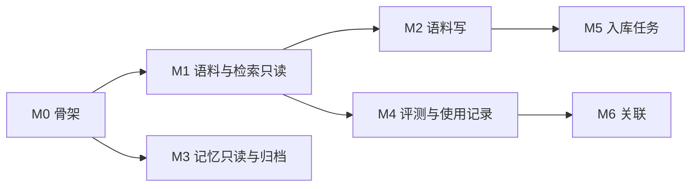

# 知识中心改造计划

## 一、这份文件管什么

本文件写三件事：语料、检索、记忆三个模块在网页端的管理界面，支撑它们的接口，以及每个里程碑的判据。

机制细节以 `docs/design.md` 第六节（本地语料与检索）与第九节（状态与持久化）为准。本文件只写任务、要改的文件与验收条件，不重复描述已经写在那里的机制。

## 二、现状

### 2.1 规模

| 项 | 数值 |
| --- | --- |
| 源 | 213（文献 2、网页 211） |
| 块 | 783 |
| 索引正文 | 71 万字 |
| 向量 | 783 块全部有 |
| 记忆条目 | 2 |

界面按这个规模设计。上千份文献、几百条记忆才用得上的页面（审核队列、关系图谱、参数对比工作台）放进第七节的「不做」。

### 2.2 已有接口

| 方法 | 路径 | 现在做什么 |
| --- | --- | --- |
| GET | `/api/library` | 全部源，外加当前入库进度 |
| GET | `/api/library/<kind>:<id>/chunks` | 索引里的块，按 offset / limit 分页 |
| POST | `/api/library/upload` | 文件写进 `corpus/inbox/`，不写索引 |
| POST | `/api/library/ingest` | 转交应用进程入库，独立服务回 503 |
| POST | `/api/library/<kind>:<id>/rename` | 写 `labels.json` 的显示名 |
| POST | `/api/library/<kind>:<id>/delete` | 目录挪进 `corpus/.trash/` |
| GET | `/api/search?q=` | 会话标题、主题结论、产物摘要 |
| POST | `/api/tasks` | 转交应用进程跑一轮任务 |
| GET | `/api/sessions`、`/api/runs`、`/api/survey/<id>` | 会话、运行目录、结构全景 |

### 2.3 已有代码

| 职责 | 文件 |
| --- | --- |
| 路由与响应形状 | `vsagent/core/web/routes.py`（`SPEC` 是唯一真相） |
| 网页服务生命周期 | `vsagent/core/web/service.py`（`WebService`） |
| 原件与 `labels.json` | `vsagent/core/corpus.py` |
| 解析 | `vsagent/core/parse.py` |
| 切块 | `vsagent/core/chunker.py`，入口是 `index.chunks_for()` |
| 索引 | `vsagent/core/index.py`（`SCHEMA_VERSION`、`open_readonly`、`stats`、`reindex`、`writing()`） |
| 向量 | `vsagent/core/embed.py` |
| 检索入口 | `vsagent/core/knowledge/search.py:search()`，参数是 `KnowledgeQuery` |
| 融合与聚组 | `vsagent/core/knowledge/fusion.py`（`fuse`、`group`） |
| 记忆读写 | `vsagent/core/memory/store.py`（`MemoryStore`） |
| 记忆条目 | `vsagent/core/memory/models.py`（`MemoryEntry`） |
| 记忆工具层 | `vsagent/core/agent/memory.py`（`remember` / `recall` 与兼容导出） |
| 前端外壳 | `web/app.js`（hash 路由、`mountQueue`）、`web/index.html`（显式加载脚本） |

## 三、四条约束

这四条决定后面每个文件怎么改。

1. **写者按数据分。** `labels.json`、`folders.json`、`.trash/` 由网页进程写，章程已经允许；索引与记忆只由应用进程写，网页通过回调转交。独立服务下这两类接口回 503。
2. **响应保持平铺。** 新接口与 `/api/library` 一致，直接给字段。`success` / `data` / `meta` 这一层不引入：现有判据按平铺断言，两种形状并存之后，每个页面都要记两套读法。
3. **路由分开。** 语料与检索的新能力走 `/api/knowledge/*`。`/api/search` 保持现有语义（会话、主题、产物），顶部搜索不换意思。
4. **辅助数据不进 `library.db`。** 搜索记录写 `corpus/.usage/search.jsonl`，后台任务写 `corpus/.jobs/<id>.json`。索引库按设计可重建，用户删掉 `.index` 重建时不该连使用记录一起丢。

## 四、里程碑

### M0 骨架

目标：把业务从 `routes.py` 分出来，前端有一层请求封装与两个共用组件。这一阶段不加页面。

新增文件：

| 文件 | 内容 |
| --- | --- |
| `vsagent/core/web/services/__init__.py` | 空包 |
| `vsagent/core/web/services/library.py` | 列表、详情、块、统计的只读函数 |
| `vsagent/core/web/services/search.py` | 调 `knowledge.search`，拼诊断读数 |
| `vsagent/core/web/services/memory.py` | 只读地载入 `MemoryStore`，列条目 |
| `vsagent/core/web/jobs.py` | `JobStore`：`corpus/.jobs/<id>.json` 的增改查，`status` / `stage` / `progress` / `error` 等字段 |
| `web/services/api.js` | `request(path, {method, body})`，统一带 `X-VSA-Request`、统一错误文本、统一超时 |
| `web/components/detail-panel.js` | 右侧抽屉 |
| `web/components/status-badge.js` | 状态字形与颜色 |

修改文件：

| 文件 | 改动 |
| --- | --- |
| `vsagent/core/web/routes.py` | `_library` / `_library_chunks` 改成调 service，参数校验留在原处 |
| `vsagent/core/web/service.py` | 启动时建 `JobStore`，关闭时停掉在跑的任务 |
| `web/app.css` | 抽屉与状态标签的样式，字号与间距用现有六档八档 |

判据：

- `tools/check_web_api.py` 增加一条通用断言：所有写路由在缺 `X-VSA-Request` 与 `Origin` 不对时都回 403。
- `tools/check_web_ui.js` 增加抽屉与状态标签的冒烟。

### M1 语料与检索（只读）

接口：

| 方法 | 路径 | 说明 |
| --- | --- | --- |
| GET | `/api/library?q=&kind=&status=&sort=&offset=&limit=` | 在现接口上加筛选与分页，默认仍返回全部 |
| GET | `/api/library/<kind>:<id>` | 详情：`meta.json`、`labels.json`、索引里的块数与向量数 |
| GET | `/api/library/<kind>:<id>/chunks?offset=&limit=&q=` | 现接口加关键词过滤 |
| GET | `/api/corpus/stats` | 源数、块数、向量覆盖、`bad-meta` 条数、总体字节数 |
| GET | `/api/knowledge/search?q=&mode=&limit=` | 语料与记忆两段结果 |

`/api/knowledge/search` 的返回：

```json
{
  "query": "KRAS G12C",
  "corpus": [
    {
      "ref": "doc#ab12cd34ef §2.1 p.7",
      "sourceId": "doc:ab12cd34ef",
      "title": "…",
      "section": "…",
      "page": 7,
      "text": "…",
      "rrf": 0.0328,
      "ranks": {"fts": 1, "cjk": 3, "vec": 5}
    }
  ],
  "memory": [
    {"id": "mem_…", "kind": "fact", "text": "…", "score": 0.42}
  ],
  "diagnostics": {"channels": {"fts": 40, "cjk": 40, "vec": 40}, "vectorCoverage": 1.0}
}
```

`rrf` 是 `Σ 1/(60+名次)`，页面显示名次，不把它折算成百分比。

改动：

- `vsagent/core/knowledge/fusion.py` 增加 `fuse_with_channels`，返回分数与每个块的通道名次；`fuse` 的签名与返回值不动，`tools/check_retrieval.py` 依赖它。
- `vsagent/core/index.py` 的 `lexical` 增加可选 `source_ids` 过滤，供按语料范围检索。语义那一路先按 `CHANNEL_LIMIT` 取回再按源筛，筛完可能一条不剩，所以过滤生效时这一路要多取一些。
- `vsagent/core/knowledge/models.py` 的 `KnowledgeQuery` 增加 `source_ids`，`search()` 把它同时传给词法与语义两路。
- `vsagent/core/web/services/search.py` 里的记忆那一段用 `MemoryStore.recall(..., touch=False)`：网页打开一次不能算一次真实使用。
- 新增 `web/pages/knowledge.js`，单页三标签（语料 / 检索 / 记忆），`#/knowledge`。
- `web/app.js` 挂载，`web/index.html` 加脚本，`web/app.css` 加三栏与标签样式。

判据：

- `tools/check_retrieval.py` 三项门禁的数值与改动前一致。
- `tools/check_web_api.py` 断言上面五个接口的形状与分页边界（`limit` 上限、非法 `kind`、不存在的 id 回 404）。
- `tools/check_style.py` 通过。

### M2 语料写（三个动作）

接口：

| 方法 | 路径 | 说明 |
| --- | --- | --- |
| POST | `/api/library/<kind>:<id>/labels` | 写 `tags`、`favorite`、`folderId` 到 `labels.json` |
| POST | `/api/library/batch/delete` | 一次最多 50 个 `web:` 源，逐个挪进 `.trash/` |
| GET | `/api/library/folders` | 读 `corpus/folders.json` |
| POST | `/api/library/folders` | 新建一个文件夹 |

`folders.json` 的形状：

```json
{"folders": [{"id": "research", "name": "论文", "order": 0}]}
```

只做一层，不做层级与拖拽。`folderId` 写在每份语料的 `labels.json` 里，挪文件夹不改目录名。

改动：

- `vsagent/core/corpus.py` 增加 `read_labels` / `write_labels` / `read_folders` / `write_folders`，都用现有的原子写。
- `vsagent/core/web/routes.py` 增加四个路由，全部走 `_guard_write`；请求体上限沿用 `MAX_JSON_BYTES`。
- `web/pages/knowledge.js` 的语料标签加筛选栏、多选与批量删除。

约束：

- 标签、收藏、文件夹只写 `labels.json`，不进 `sources` 表，索引版本号不变。
- 批量删除只认 `web:` 源。文献由用户显式导入，批量删掉之后恢复要重新导入，代价不对等。
- 删除只挪目录，索引行留给 `reindex` 对账；检索侧 `_alive` 已经会跳过目录不在的源。

判据：

- 删除之后跑 `python -m vsagent.core.index reindex`，索引里对应的行消失，块与向量无孤儿。
- `.trash/` 里重名不覆盖。
- 写标签前后 `kv` 里的版本号不变。
- 四个写接口在缺头与坏 `Origin` 时 403。

### M3 记忆（只读 + 归档）

接口：

| 方法 | 路径 | 说明 |
| --- | --- | --- |
| GET | `/api/memory?kind=&state=&q=` | 读 `entries.json` 与 `archive.json` |
| GET | `/api/memory/<id>` | 单条：正文、引用、`superseded_by`、`conflicts`、`state`、`last_used_at` |
| POST | `/api/memory/<id>/archive` | 单条归档，走回调 |
| POST | `/api/memory/<id>/restore` | 从归档恢复，走回调 |

改动：

- `vsagent/core/memory/store.py` 增加 `archive(entry_id)` 与 `restore(entry_id)`。现有归档只在容量超限时由 `_archive_overflow` 自动做，单条归档是新方法，两个方法都要保持 `entries.json` 与 `archive.json` 的一致性。
- `vsagent/app.py` 增加一个记忆动作回调，形状与 `submit` / `ingest` 相同：HTTP 线程只等 `Future`，动作在应用的事件循环里做。
- 新增 `web/pages/knowledge.js` 的记忆标签：列表按类型分组，详情抽屉显示引用与冲突。

不做编辑。直接改 `text` 会绕开 `remember` 的去重、取代、冲突、引用校验四道逻辑，`supersedes` 链与 `fingerprint` 当场对不上。要做得先在记忆层加一个走同一套校验的 `revise()`，单独一轮。

判据：

- 归档后 `entries.json` 少一条、`archive.json` 多一条，恢复之后两者回到原状。
- 网页列出 2 条记忆与文件内容一致。
- 独立服务下调这两个写接口回 503。

### M4 检索评测与使用记录

接口：

| 方法 | 路径 | 说明 |
| --- | --- | --- |
| POST | `/api/knowledge/evaluation/runs` | 起子进程跑评测，回 `jobId` |
| GET | `/api/knowledge/evaluation/runs` | 历次运行与指标 |
| GET | `/api/knowledge/evaluation/runs/<id>` | 单次报告 |
| POST | `/api/knowledge/usage` | 追加一行搜索记录 |
| GET | `/api/knowledge/analytics` | 次数、p95、通道分布、空结果率 |

改动：

- `tools/check_retrieval.py` 增加 `--json`，输出与终端打印用同一份数据。
- 评测在子进程里跑，原因是它要加载嵌入模型，放在服务进程里会把网页卡住几十秒。
- `corpus/.usage/search.jsonl` 一行一条：`{"at": 1794000000, "query": "…", "mode": "hybrid", "hits": 8, "ms": 43, "empty": false}`。文件超过 5MB 时改名为 `search.jsonl.1`。
- 评测集仍读 `corpus/eval/questions.jsonl`，格式不变。

判据：

- 网页跑出的三个指标与命令行逐字段一致。
- 追加记录不改索引，不改状态文件。
- 子进程失败时任务状态是 `failed`，`error` 字段带子进程的末行输出。

### M5 入库任务

接口：

| 方法 | 路径 | 说明 |
| --- | --- | --- |
| GET | `/api/ingestion/jobs` | 任务列表，新的在前 |
| GET | `/api/ingestion/jobs/<id>` | 单条任务 |
| POST | `/api/ingestion/jobs/<id>/retry` | 重试失败任务，走现有入库回调 |

改动：

- `vsagent/core/web/routes.py` 的 `_run_ingest` 把现有进度接到 `JobStore` 上，阶段分成解析、切块、向量、写索引。
- 页面显示 `canIngest`：`server.ingest is None` 时写清「这个进程不负责入库，回应用进程跑」。
- 取消不做：入库在后台线程里跑，现在没有中断点，加中断要改入库本身的循环。

判据：

- 一次入库在页面上能看到四个阶段依次推进，结束状态是 `done`。
- 应用退出后任务文件仍在，重新打开显示为 `interrupted`。
- 独立服务下 `retry` 回 503。

### M6 关联

接口：

| 方法 | 路径 | 说明 |
| --- | --- | --- |
| GET | `/api/knowledge/<type>/<id>/relations` | 文档 → 记忆、记忆 → 文档、命中 → 相关记忆 |

改动：

- 新增 `vsagent/core/knowledge_refs.py`：从 `corpus/doc/*/meta.json` 的 `file` 字段建「路径 → `doc:<哈希>`」映射，进程内缓存，按目录 mtime 失效。
- 记忆的 `refs` 存的是文件路径，`chunks.source_id` 是 `doc:<哈希>`，两者之间现在没有映射，这个模块补的就是这一段。
- 只给关系列表，不做图谱视图。

判据：

- 一条引用了某篇文献的记忆，能从文献一侧查到，也能从记忆一侧查回文献。
- 路径不存在的引用不报错，标 `missing`。

## 五、依赖与顺序



M0 先做，因为 `JobStore` 与请求封装是 M4、M5 共用的。M1 是三个标签里信息量最大的一块，做完就能判断后面的页面是否值得做。

## 六、判据

每个里程碑结束都跑：

```bash
python tests/test_agent.py
python tests/test_smoke.py
python tools/check_prefix.py
python tools/check_style.py
python tools/check_web_api.py
```

新增页面时加：

```bash
NODE_PATH=viz/node_modules node tools/check_web_ui.js
```

另有三条数据一致性断言，写在 `tools/check_web_api.py` 里：

1. 块页面显示的正文与 `search_corpus` 读到的是同一份（两边都走 `index.chunks_for` 与索引里的行）。
2. 删除源之后跑一次 `reindex`，`chunks` 与 `vectors` 里没有孤儿行。
3. 写标签、写文件夹前后，`kv` 里与向量版本相关的键不变。

## 七、不做

| 项 | 理由 |
| --- | --- |
| 记忆编辑 | 会绕开去重、取代、冲突、引用校验；要先有 `revise()` |
| 审核队列与自动提取 | `VSA_MEMORY_EXTRACT` 默认关，本地端点没起，抽取质量集还没建 |
| 参数对比工作台 | 会与 CI 的 55 题固定集形成两套标准 |
| 关系图谱 | 关系数据现在只有 `refs` 与 `source_id`，先有数据再谈图 |
| `PATCH` / `DELETE` 方法 | Handler 只有 `do_GET` / `do_POST`，第一版用动作路径 |
| 记忆迁 SQLite | 记忆是跨会话台账，整文件原子替换已经够用，迁移要重写四道校验 |
| Chunk 正文编辑 | 改了正文要重算 FTS 与向量，属于入库那条链 |
