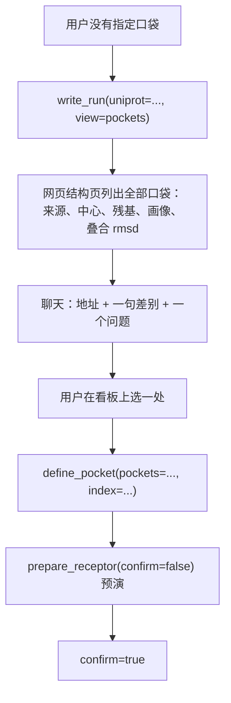

# 虚拟筛选工作流计划：确认点的产物换成主张

> 来源：`docs/molecular-design-principles.md` 与 `docs/jm5b01875.pdf`
> （Kuhn, Guba, Hert, … Stahl. *A Real-World Perspective on Molecular Design*.
> J. Med. Chem. 2016, 59, 4087−4102）。
>
> 第二份来源是一篇用 AL-Glide 筛 WLS 抑制剂的论文：Enamine REAL 约 5 亿个分子、
> 3 轮主动学习、86 个下单、68 个合成、2 个活性、IC50 6–8 µM。它只用了 Glide SP
> 加位姿聚类与经验过滤，没有走 FEP 精排。本文件取它的挑选规则与退出条件，
> 算力规模不在讨论范围。
>
> 触发：`ses_0005` 最后一轮的口袋确认点（2026-10-30）。那一轮的读数见 §0。
>
> 范围：工作流、确认点、工具出口、派发规则、候选挑选、组外探索的退出条件、每批的账。
> 不新增打分器，不改 Vina 参数。
>
> 开工前怎么判断这一轮该走哪条路（受体侧与配体侧的盘点、四类起点），
> 见 [`campaign-assessment-plan.md`](campaign-assessment-plan.md)。

---

## 0. 已核对的事实

### 0.1 上一轮的读数

| 项 | 读数 | 说明 |
| --- | --- | --- |
| `write_run` | 0 次 | 整个 `ses_0005` 没有写过运行目录，网页结构页没有出现过一处口袋 |
| `spawn_agent` | 0 次 | `agent_status` 也是 0 次 |
| `export` 族 | 未装载 | `write_run` 在这个族里（`all_tools.py:113`），模型只装了 `pocket` |
| `screening-playbook.md` | 0 次读取 | §2.2「写成一份运行目录并给出结构页地址」没有进入上下文 |
| `load_tools` | 23 次、14 个族 | 边做边装，同一族重复装载 |
| `detect_pockets` | 2 次，都空手 | `msg_0044`：共价配体被筛掉、预测超时 |

### 0.2 三个结论

1. **口袋的出口被关掉了。** 唯一能把口袋写到网页的动作不在工具清单里，模型手里只有
   聊天这一个出口，于是把口袋画成表格，请用户在看不见的盒子里挑一个。
2. **这一轮没有判断「组外还是组内」。** 直接定到一处口袋、三个盒子，跨结构的口袋
   普查与文献里的已知位点都没有做。
3. **子 agent 没有派。** 口袋普查属于「过程远大于结论」的子任务
   （`subagent-design.md` §1），派发规则里没有这个领域场景。

---

## 1. 虚拟筛选在药物研发里的位置

论文的六句原文，决定了下面所有设计：

- 「The primary deliverable of molecular design is an idea」——交付物是想法。
- 「any ranked list should be seen as raw input for further assessment within the context
  of the project」——排名是原料。
- 「docking scores are notoriously uncorrelated to binding affinity data … Appropriate use
  of docking programs involves the use of as many additional constraints as possible and
  a significant investment in visual inspection and selection」——对接是过滤器，
  靠约束与人工检视。
- 「Proper frontloading work can turn sophisticated queries into simple lookup processes
  or visualization steps」——前置加工与注释是一半的仗。
- 「it is important to understand whether it is required to broaden or narrow down
  chemical space and to choose tools and approaches accordingly」——每一轮先判断
  要放宽还是缩小化学空间。
- 「never trust a binding mode hypothesis unless all conceivable alternatives have been
  explored」——单一结合模式不可信。

全文唯一以 virtual screening 命名的案例是 SST5R：按跨膜口袋的局部序列相似性给已知
配体受体排序，测一批生物胺配体，没有做对接。它筛的是注释好的知识库。

合起来：**虚拟筛选把一个大空间缩小到一批值得做实验的分子，并给出为什么是这批的理由。**
产出是待测分子加一句可检验的理由，分数只是过程中的一个数。

---

## 2. 工作流的单位：主张

四个确认点现在产出的是「用户点头的一个选择」。改成一条带检验方式的主张。
`hypothesis` 工具已经有六个字段（claim / mechanism / evidence / test / expected / status），
四个确认点各写一条：

| 确认点 | 主张 | test | expected |
| --- | --- | --- | --- |
| 结构 | 这套结构代表我要筛的构象状态 | 与已知活性构象的关键残基位置比对 | 铰链与 DFG 位置差 ≤ 约定阈值 |
| 口袋 | 活性发生在这处口袋 | 已知活性配体是否都接触这处 | N 个已知活性里 ≥ M 个接触这处 |
| 配体 | 这类骨架能在这处口袋形成锚定 | 对接后的几何判据 | 阳性 ≥3/5 通过，阴性 ≤1/9 |
| 对接 | 这批分子里哪些能以合理构象占住口袋并形成锚定 | 几何判据逐条过（铰链距离、角度、冲突、盒内） | 阳性组通过率比阴性组高 ≥40 个百分点 |

用户点头的对象是这条主张与它的检验方式。点头之后 status 保持 `open`，拿到结果用
`record_assay` 或 `close` 结案。确认点的结论留在台账里，下一轮能回到它。

---

## 3. 六条理念的位置

| 理念 | 改变哪个决定 | 具体动作 | 判据 |
| --- | --- | --- | --- |
| 交付物是想法 | 每个确认点的产物 | 一条 hypothesis；答复的结尾是一句可判真假的话 | 没有 test 与 expected 的主张不许过确认点 |
| 排名是原料 | 对接之后的第一个动作 | 每个通过的分子一句结构理由，对照的位置一起写 | 对照排到阳性前面就宣布排名不可用 |
| 对接是过滤器 | 对接确认点 | 口袋、盒子、几何判据、对照四样齐了才许 dock；dock 之后先看位姿 | 位姿不过几何判据的分子不进通过集合 |
| 注释是一半的仗 | 每道空间决策 | 先 `write_run` 写运行目录，网页呈现全部候选，聊天给地址与一句判断 | 用户在看板上选定；聊天里不出现「选哪个盒子」 |
| 先判断组外还是组内 | 每一轮开头 | 一条 strategy hypothesis，`mode=expand`（组外）或 `narrow`（组内）；据此装载工具族 | 一轮只装一次族 |
| 单一结合模式不可信 | 结论之前 | 前 N 个位姿列至少两种替代结合模式，逐条说明怎么排除 | 没写替代解释的位姿不进结论 |

组外那一步先查注释好的知识库：本地语料、ChEMBL 已知活性、文献里的位点。对接放在
组内之后。论文里唯一以 virtual screening 命名的 SST5R 就是这样做的。

---

## 4. 对接的角色：过滤器

### 4.1 分数不承担排序

Vina 打分函数的标准误差约 2.5 kcal/mol（Trott & Olson, *J. Comput. Chem.* 2010, 31, 455）。
2 分的差在误差范围内，读不出活性差。结合自由能与细胞活性之间还隔着通透性、溶解度、外排、
蛋白结合与实验条件，2 kcal/mol 的结合差在细胞水平上可能完全看不出来。

这个项目自己的数据也是同一个结论：

| 来源 | 读数 |
| --- | --- |
| artifact#9（42 活性物 + 3 诱饵） | Pearson r = +0.100、Spearman rho = +0.043 |
| artifact#11（13 分子，刻意加大阴性差别） | 判别 AUC = 0.42（方向相反），榜首是 celecoxib |
| hyp#3 | 「Vina 对效力没有判别力」已标 supported |
| hyp#6 | 跨 seed 复跑时同一分子的分数标准差与 13 个分子之间的离散同量级 |

工作流里再要求分数与活性相关，等于要求模型去验一条已经否掉的假设。

### 4.2 分数在工作流里的三处用途

三处都不进结论：

1. **位姿选择**：同一个分子的多个位姿里挑一个来检视。
2. **分组参考**：分成「有合格位姿」与「没有合格位姿」两组时，分数只在组内决定展示顺序。
3. **异常提示**：分数与几何判据明显冲突的分子（分很高却过不了铰链判据）单独列出来，
   作为「只看分数会踩坑」的例子。

### 4.3 对接确认点的产物

从一张排名表改成三样：

- 通过几何判据的分子集合，每个附一句通过的理由（哪个原子、什么距离、什么角度）。
- 对照分子在这两组里的位置。
- 没通过的分子按原因归类：进不了盒子、有冲突、找不到锚定构象、只有分数好看的位姿。

排名表可以保留，放在附录，并写明它在这一轮不承担排序结论。

### 4.4 效力问题走另一条路

实测 SAR → 相似性 / 骨架 → 亲和力模型，每升一级说明简单方法为什么不够。
`score_affinity` 与 `fit_affinity` 回答的是效力，方向与 `dock` 相反（pK 越高越好），
两套分数不可比。`fit_affinity` 的实测只与 ECFP4 + LightGBM 打平，所以它排在实测数据
与相似性之后。

成药性（吸收、代谢、毒性）由 `admet` 族回答，对接回答的是能不能以合理构象占住这处
口袋。两件事分开写，避免把「对接没过」当成「分子不好」。

### 4.5 同一批里的并列

`rank_candidates` 的分档按百分位切，切在噪声里没有意义：同一批里分数差 1.0 kcal/mol
以内的分子，在 2.5 的标准误下分不出高低。分档之前先把同一来源内相邻、差 <1.0 的分子
并成一个 `tie` 组，档位取组里最高的那一档，表里加一列 `tie`。

并列组不省略信息：组内仍按分数排，只是结论里不写「A 比 B 好」。对照也不从组里取第一名，
按几何判据与骨架分散挑。

---

## 5. 一轮的完整形状

1. 开头一句 scope：这一轮是组外还是组内。写成一条 `mode` 明确的 strategy hypothesis。
2. 按 scope 一次装完工具族。组外装 `screen` / `pharmacophore` / `corpus` / `literature`；
   组内装 `pocket` / `receptor` / `docking` / `analysis`。
3. 空间决策先写运行目录。全部口袋或全部候选位姿上网页，聊天给地址、一句判断、一个问题。
4. 用户在看板上选。选定动作登记成一条口袋主张。
5. 对接前写预期与对照：哪几个应该过、哪几个应该不过、对照是谁。`pick_controls`
   在这一步跑，不从排名表里挑。
6. `dock`。
7. 先看位姿：几何判据逐条过，分数只用来分组。
8. 通过集合的解释：每个通过的分子一句为什么通过，每个没通过的按原因归类。
9. 替代结合模式：至少两种，逐条说明排除方式。
10. 挑选进实验的那一批：`pick_diverse` 做位姿去重、MaxMin 与骨架配额（§6）。
11. 交付一句可检验的判断、一组对照、下一步实验。分数表放附录。
12. 数据回来先 `record_assay(batch=...)`，把这一批的账记上（§6.4），再开下一轮。

---

## 6. 从候选到待测：挑选、停止、记账

### 6.1 现在没有挑选这一步

`ses_0005` 里反复调用 `analyze_pose` 逐条看位姿，没有一次把「这批分子彼此像不像」写出来——这个工具按单个分子报接触，报不出集合内部的相似度。两处默认行为都在放大同一个化学型：`screen_similarity` 多查询时取最近邻（`screen.py:232`），再按 top 截断；`rank_candidates` 按平均秩合并、按百分位分档（`analysis.py:537`），前 5% 那一档自然挤满近邻。`enumerate_analogs` 一次默认生成 200 个（`sar.py:678`），它们本来就在同一骨架上换基团。

论文从 1 万里挑 86 个用了两步：先按对接位姿的体积重叠聚簇，把同一结合模式的分子并成一组；再在簇代表之间做 MaxMin，按骨架配额取满。这两步都不看分数。

### 6.2 工具：`pick_diverse`

归 `screen` 族。挑选发生在进对接之前，与 `screen_similarity` 同一阶段；接对接产物做位姿去重时，这个族也已经装过了。

| 参数 | 默认 | 说明 |
| --- | --- | --- |
| `source` | 必填 | 候选表（`rank_candidates` 产物）或配体集 |
| `poses` | 空 | 对接产物 handle；给了才做位姿去重 |
| `limit` | 20 | 返回几个 |
| `max_similarity` | 0.6 | 两两 ECFP4 Tanimoto 的上限 |
| `per_scaffold` | 3 | 同一骨架组最多几个 |
| `previous` | 空 | 上一轮的候选表；给了才算重合 |
| `name` | 空 | 显示名，只影响产物目录名 |

四步：

1. **位姿去重**，只在给了 `poses` 时做。每个分子取对接产物里分最高的位姿，重原子为中心、半径 1.8 Å 的球并成体积，两个位姿的体积 Jaccard ≥0.5 判为同簇，每簇只留名次最高的一个。判据取体积：两个分子可以中心差 3 Å 而形状完全错开。
2. **MaxMin**：从名次最高的分子开始，每步取「与已选集合的最大相似度最小」的那个，直到选满 `limit` 或剩下的分子都超过 `max_similarity`。选不满时如实报「只挑出 N 个」，不降低门槛凑数。
3. **骨架配额**：用 `sar.scaffold_of` 分组，同一组超过 `per_scaffold` 的跳过。MaxMin 只保证两两不像：同一个骨架上换几个不同的基团，相似度就能压到 0.6 以下，名额照样被一组占满。
4. **重合统计**，只在给了 `previous` 时做：与本轮前 `limit` 个的交集个数、这一轮新出现的骨架组数。

返回一个配体集（`stage=selected`），列是 `id / smiles / scaffold / cluster / max_similarity / rank`，末尾三行：

```
位姿去重：12 个位姿并成 5 簇，最大一簇 4 个
与上一轮前 20 重合 15 个（75%），新增骨架 1 组
判定：重合 ≥60% 且新增骨架 ≤2，停止组外探索，转入实测与结案。
```

### 6.3 组外探索的退出条件

论文用 3 轮主动学习加 Top-K 重合退出，没有无限迭代。agent 这边的上限只有步数（`loop.py:39`，24 步），组外探索可以一直加轮次，中间没有判断。

两个数都从已有产物里数得出来，不需要模型：相邻两轮前 20 个的重合比例、这一轮新增的骨架组数。两个条件同时满足才算收敛。只满足重合高、新增骨架不少时，说明上一轮的挑选没把新化学型选进来，该改的是挑选规则；只满足骨架少、重合不高时，这一轮还在找到新分子，继续一轮。

阈值：重合 ≥0.6、新增骨架 ≤2。这两个数由论文的 3 轮经验换算，尚未实测（§11）。

主动学习不在范围里。`fit_affinity` 已经把微调做成产品，再叠一层代理模型会与它重复，而它的实测只与 ECFP4 + LightGBM 打平（`retro-affinity-report.md` §九）。这里要学的只有退出条件。

### 6.4 每批的账

论文的 2.9% 是 68 测 2 活，中间还有 86 下单 68 合成。`record_assay`（`sar.py:1085`）记了数值与测定类型，没有分母，也没有合成失败这一层。

`record_assay` 加一个 `batch` 参数，指向 `pick_diverse` 的产物。返回多一段：

```
本批 20 个：实测 12、未测 8（列出 id）
达标 2、未达标 9、判不了 1
产出率 2/12 = 17%
```

分母取实测数：合成失败与没排上实验是两件事，前者进不了 `assay.csv`，后者还能补测。未测清单每批都给，下一轮开头先看它。

缺了这一段，假设被 refuted 时分不清是假设本身错了，还是这批根本没挑对。

### 6.5 挑选不看分数

去重看坐标，MaxMin 看指纹，配额看骨架。分数只在名次里出现一次，用来决定从哪个分子开始 MaxMin。理由与 §4.1 相同：2.5 kcal/mol 的标准误下，名次相邻的分子分不出高低。

---

## 7. 口袋不确定时的走法

用户说「不确定口袋」，或者在消息里没有给出残基、盒子、PDB 编号：



先验清单那一路再写一个运行目录（`candidates="1M17,2ITY,5UG9"`），两页并看。
候选结构超过三份、或者要读文献确认已知位点时，第一步之前派子 agent 做普查。

### 7.1 现在做不到「全部口袋在一页」

`detect_pockets` 能一次取四路来源（`sources=ligand,complex,prior,predicted`，
`pockets.py:1318`），但它不写运行目录；`write_run` 能写网页，一次只取一路
（给了 `candidates` 走先验，给了 `uniprot` 走复合物，都没有才转预测，
`export.py:956-985`）。网页那边已经能读 `meta.pockets[]` 的列表并逐条带画像
（`web/pages/structure.js:111`、`:424`），缺的是上游把多路并成一份。

### 7.2 子 agent 的输入与输出

派发时给三样：靶点、候选结构清单、要回答的问题。它回两样：口袋清单（每处带来源、
中心、残基、画像），每处的反证条件。

反证条件是「什么观察会否掉这处口袋」：已知活性配体不接触它、壁组成与该靶点家族的
已知位点不符、文献里该位点没有活性报道。没有反证条件的口袋不进候选清单。

父会话只留选择与判断，不接收中间坐标。

### 7.3 口袋本身的可药性

`pockets.build_profile` 现在给元素组成、壁面四类计数、最近残基与 3.5 Å 内的个数，明确不给分。论文的第一步是 Sitemap 先给一个可药性判断，再谈库的大小；对应到这边，缺的是两个可算的量：

| 量 | 算法 | 阈值 | 理由 |
| --- | --- | --- | --- |
| 空腔体积 | 中心 10 Å 内、距蛋白原子 ≥1.4 Å 的 1.0 Å 网格点计数 | ≥250 ų | 药物结合位点常在 300–1000 ų；低于 250 是浅槽，撑不起三个以上相互作用 |
| 包埋度 | 从中心向 500 个球面方向射线，被蛋白阻挡的比例 | ≥0.5 | 半开放的口袋，配体有一半在水里，形状互补无从谈起 |
| 最近残基数 | 3.5 Å 内的残基个数 | ≥12 | 这一项已有，补上阈值 |

两个新量进 `build_profile`，随 `detect_pockets`、`write_run` 与网页一起出现，不新增工具：画像的每个消费方都要这两个数，多一个工具就多一处要记得调。代价是每处口袋一次 20 Å 立方的网格扫描与 500 条射线，几十毫秒。

三个量分开报，不合成一个分数，与现有画像同一口径。阈值没校准之前，它们只用来判断「这处口袋浅，先别投库」，不用来在几处口袋之间排序——排序仍由共晶配体与用户的选择决定。

---

## 8. 要改的位置

| 位置 | 现状 | 改成 | 理由 |
| --- | --- | --- | --- |
| `AGENTS.md:20-29` | 确认点行只写「呈现口袋时把画像一起说」 | 每个确认点要求一条 hypothesis；口袋那道写明先 `write_run` 写运行目录并给结构页地址 | 确认点行每一步都在前缀里，playbook 不会被读到 |
| `all_tools.py:113` | `export` 排在最后一个族 | `write_run` 与 `pocket` 同族，或常驻 | 口袋确认点在第二步就需要它 |
| `analysis.py:2861` | `pick_controls` 只吃 `rank_candidates` 的候选表 | 也接受配体集与口袋，在对接前挑三类对照 | 对照要在实验之前选 |
| `prompt.py:471` | 两条触发条件 | 补一条：口袋不确定、候选结构 ≥3、要查文献位点时派子 agent | 上一轮 0 次派发 |
| `export.py:768` | `write_run` 一次只取一路口袋来源 | 接受 `pockets=artifact#N`，或带 `sources` 参数 | `detect_pockets` 四路但不写运行目录 |
| `pockets.py:1318` | 四路来源可用 | 产出的口袋集能被 `write_run` 直接消费 | 网页只认运行目录 |
| `screen.py:232` 之后 | 只有相似性与形状两路排序，按 top 截断 | 新增 `pick_diverse`：位姿去重、MaxMin、骨架配额、与上一轮的重合统计 | 截断留下的是近邻 |
| `analysis.py:537` | 按百分位分档 | 分档前把同一来源内分数差 <1.0 kcal/mol 的相邻分子并成并列组，加 `tie` 列 | 2.5 的标准误下，档位差读不出来 |
| `sar.py:1085` | 只记数值与结案 | 加 `batch` 参数，返回实测数、未测清单、达标数 | 2.9% 需要分母 |
| `pockets.py:477` | `build_profile` 只给元素组成、壁面计数、最近残基数 | 补空腔体积与包埋度 | 论文先证可药再上库 |
| `prompt.py:392` | `HYPOTHESIS_CONTRACT` 有组外/组内与对照两句，没有挑选与停止 | 在对照那句之后加「每批先挑再测：同一化学型最多三个；组外两轮重合过半就停。」（29 token） | 前缀是唯一每一步都读的地方，`screen` 族在挑选之前不一定装过 |

---

## 9. 判据

- **前缀**：`AGENTS.md` 的确认点段含 `write_run` 与「结构页地址」；
  `tools/check_prefix.py` 的预算仍然过（新增 29 token 之后 1889）。
- **会话**：口袋不确定时，`write_run` 至少一次；答复里不出现「三个盒子选一个」
  这种没有画面支撑的问题。
- **派发**：候选结构 ≥3 时，`spawn_agent` 至少一次；`agent_status` 收到的是口袋清单
  与每条的来源。
- **对接**：`dock` 之前有对照；`dock` 之后没有「排序反映效力」的结论；
  通过集合的每一条有一句几何理由。
- **假设**：四个确认点各有一条 hypothesis 记录，test 与 expected 都在。
- **挑选**：交给实验的候选里，同一骨架不超过 3 个、两两相似度不超过 0.6；
  `pick_diverse` 至少调用一次。
- **停止**：连续两轮组外探索时，第二轮结束有重合与新增骨架的读数；
  重合 ≥0.6 且新增 ≤2 时不开第三轮。
- **记账**：`record_assay` 的返回里有未测清单；`runs/<campaign>/assay.csv` 的条数
  与本批实测数一致。
- **口袋画像**：网页口袋面板里出现体积、包埋度、最近残基数三个量。

---

## 10. 本轮不做

- 不新增打分器，不改 Vina 的 scoring / exhaustiveness / seed。
- 不接新的化合物库。
- 不重写 `write_run` 的口袋算法，只加一个入口。
- 不做主动学习代理模型。`fit_affinity` 已经把微调做成产品，两者的产出都是对同一批分子的分数。
- 不接 make-on-demand 库。这边的库来自用户文件与骨架重组，瓶颈在挑选，不在库覆盖。
- 不做 FEP 或自由能微扰。

---

## 11. 待确认

- `pick_controls` 提前之后，返回的对照表与 `rank_candidates` 的候选表要不要共用一种形状。
- `write_run` 接口袋集之后，`provenance.pockets` 的来源字段怎么记（现在按
  `prior` / `complex` / `predicted` 分）。
- 口袋普查派出去之后，子 agent 返回的口袋清单要不要自动登记成 artifact。
- `pick_diverse` 的 0.6 与每骨架 3 个要在真实库上校准。太严时挑不满 20 个，
  返回会如实报数量，但实验批会太小。
- 位姿去重的 Jaccard 0.5 与半径 1.8 Å 还没在真实对接产物上试过。对接位姿本身有
  1–2 Å 的位置误差，簇的边界会抖。
- 停止条件的 0.6 与 2 由论文的 3 轮经验换算，尚未实测。
- `record_assay` 的分母取实测数。用户报不出合成失败时，未测清单里会混进合成失败，
  产出率会比实际低；这一层靠用户自己的记录，工具不猜。

---

## 12. 实施结果（2026-10-31）

§8 那张表的十一项全部写进了代码，逐项对照如下。

| 位置 | 实际做法 | 量到的数 |
| --- | --- | --- |
| `AGENTS.md` 确认点 | 确认点 2 加「先 `write_run(view=pockets)` 写运行目录，把结构页地址与画像一起说」 | 项目规则 843 token / 42 行（当时预算 850 / 50，2026-10-31 取消上限） |
| `all_tools.py` 的 `export` 族 | **没有改族**。`write_run` 留在 `export` 族，确认点里点名之后由 `missing_tool_reason` 指路 | 装载多一步，不改族表 |
| `pick_controls` | 收候选表与配体集，新增 `pocket` 参数，对接之前可用 | 配体集走 `sar._ligandset_rows`，不核对几何，也不带分数 |
| `prompt.py` 派发条件 | 并进新段 `CAMPAIGN_DISCIPLINE` 的最后一句，`SPAWN_DISCIPLINE` 删除 | 前缀 1891 token（预算 1900） |
| `write_run` 接口袋集 | 新增 `pockets` 参数，先于 `candidates` 解析；`provenance.pockets.from` 记来源 | 只读口袋集，不重算 |
| `pockets.py` 四路来源 | 新增 `bundle_from_set()`，把 `pockets.json` 还原成 `PocketBundle` | `write_run` 与 `detect_pockets` 用同一份 |
| `pick_diverse` | 位姿去重 → MaxMin 与骨架配额 → 与上一轮求重合、数新增骨架 → 写盘登记 `stage=selected` | 探针 10 个分子 3 个位姿：并成 2 簇，挑出 5 个、4 个骨架；第二轮重合 20%、新增骨架 0 组 |
| `rank_candidates` 并列组 | `TIE_DELTA = 1.0`，相邻差 <1 归一组，组内取最高档；CSV 与渲染都带 `tie` | 5 条夹具：A 与 D 同组，高档从 1 条变成 2 条 |
| `record_assay` 批次账 | `batch` 参数，返回本批数、实测数、未测清单、达标数、产出率 | 分母取实测数 |
| `build_profile` 空腔 | 范德华半径 + 1.4 Å 探针，1 Å 格点；包埋度用 500 条射线 | AQ4 中心 661 立方埃 / 0.96；受体内部 150 / 1.0；表面外 4 埃 3706 / 0.21 |
| `HYPOTHESIS_CONTRACT` | 对照句之后加「每批先挑再测：同一化学型最多三个；组外两轮重合过半就停。」 | 28 token |

两处与计划不同的地方：

- **`AGENTS.md` 动了。** `campaign-assessment-plan.md` §8.3 说不动，理由是只剩 2 token。
  这一份 §9 的判据要求确认点里出现 `write_run` 与结构页地址，而网页端只认运行目录——
  不改这一句，用户点完口袋看不到画面。做法是把确认点 1、3、4 与交互纪律里几处冗词压掉，
  腾出 20 token 加这一句，总账从 848 降到 843。
- **`export` 族没并进 `pocket`。** 并进去会让 `write_run` 在两族里各出现一次，
  `catalog()` 展开的清单就重复了。代价是确认点那一步要多装一次族，`missing_tool_reason`
  会直接说「属于 export 族」。

判据：`tools/check_prefix.py` 通过（1891 / 843 / 42 行）；`tests/test_agent.py`
通过 3609 项；`tests/test_smoke.py` 退出码 0；`debug_tools.py` 全跑 61 次调用全部正常
（29.7 秒）；`tools/check_web_api.py` 59 条全过。

口袋面板在真浏览器里核过：`runs/A-AQ4-A-999-312-7` 的 5 个口袋，每一行的画像都带
空腔体积、包埋度、3.5 埃内的残基个数与最近的一个残基；旧运行目录（没有 `profile`）
那一行整块不挂，预测来源（没有 `cavity`）只少空腔那一段，页面没有脚本错误。

全跑期间一并处理的三件事：

- `fit_affinity` 的样例配体集取 `{ligandset:actives}`：`search_actives` 的产物在 meta 里
  写 `stage=actives`，是唯一带实测活性的配体集。
- `read_actives` 收两种布局：`search_actives` 的单个 CSV，与 `import_ligandset` 的产物
  目录（表在 `ligands.csv`）。后者整列 pchembl 为空，如实走到「没有可用的实测活性」。
- `fetch_webpage` 的样例页取 UniProt 靶点页：服务端渲染的静态 HTML，抓取后端拿得到正文。
