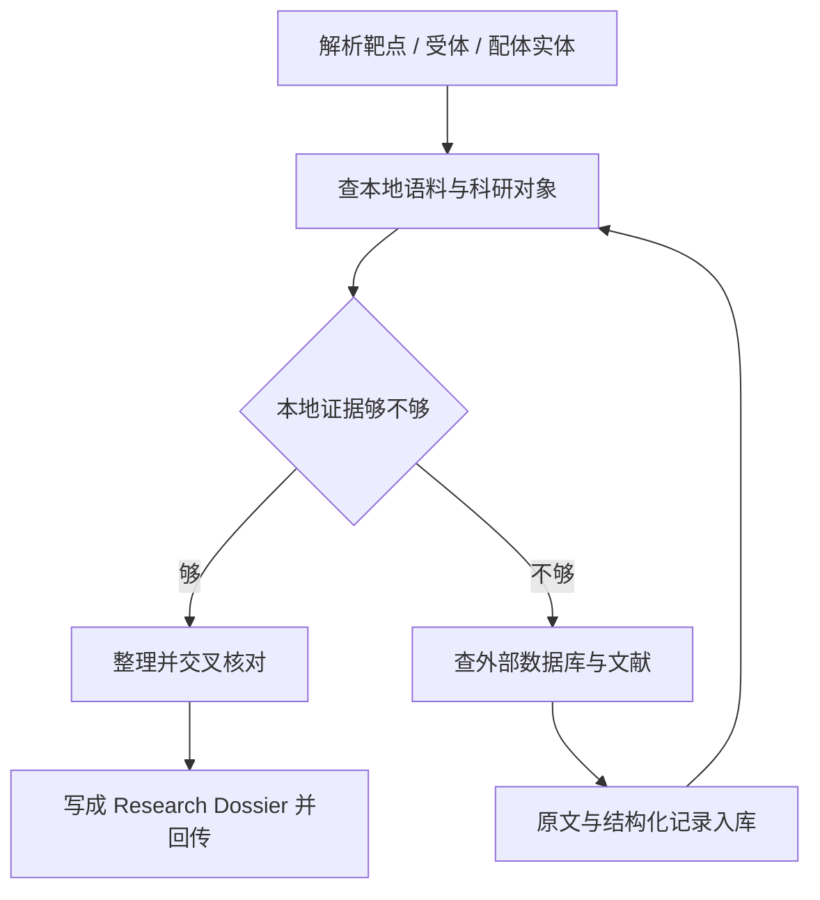
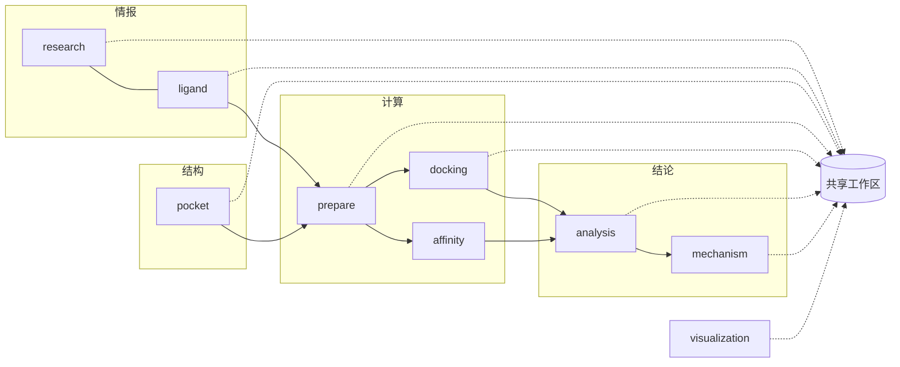
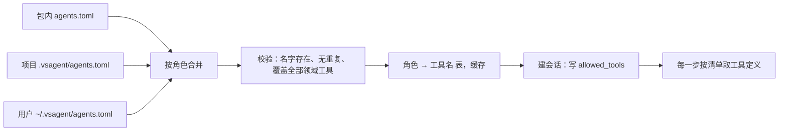

# 十个 Agent 的科研职责与边界

> 本文定「谁负责哪件事、交付什么、不许做什么」。
> 现在的形状看 `design.md` 十二；踩过的问题与阶段验收看 `archive/progress.md`。
> 本文随代码更新；`archive/` 里的是过程记录，不随代码更新。

## 0 现状读数

后面的边界都建立在这几个数上，先摆出来。

| 项 | 现值 | 取法 |
| --- | --- | --- |
| 领域工具 | 54 个，分 23 个模块 | `domain/all_tools.MODULES` |
| 常驻核心工具 | 18 个 | `coretools.build_core_tools()` |
| 常驻工具开销 | 主会话 7,108（上限 8,000），子会话 4,771（上限 5,300） | `tools/check_toolset.py` |
| 角色 | 10 个：`principal` 加 9 个专业角色 | `roles/capabilities.ROLES` |
| 能力 | 13 项，按职责分给 10 个角色 | `roles/capabilities.CAPABILITIES` |
| 合同对象 | `IntentSpec`、`TaskSpec`、`CapabilityPlan`、`AgentTask`、`AgentReport` | `roles/contracts/` |
| 科研对象 | 9 类：`target` `structure` `pocket` `ligand` `pose` `score` `evidence` `hypothesis` `report` | `research/research_objects.KINDS` |
| 证据类别 | 7 类；另有 4 种论断性质 | `research/evidence_registry` |
| 多角色执行状态 | 13 个，从「理解需求」到「交付」 | `execution/campaign_state.STATES` |
| 登记表条目 | 三类：`receptor` `ligandset` `artifact`，带 `parents` 来源关系 | `state/ledger.py` |

一个职责单元对应一个运行角色，一共十个：主控加九个专业角色。

| 职责单元 | 运行角色 | 管什么 |
| --- | --- | --- |
| Principal | `principal` | 解析需求、派发、汇总交付 |
| Research | `research` | 靶点、受体与配体调研 |
| Pocket | `pocket` | 口袋发现与画像 |
| Ligand | `ligand` | 配体发现与化学空间 |
| Prepare | `prepare` | 受体与配体准备 |
| Docking | `docking` | 对接与构象搜索 |
| Affinity | `affinity` | 亲和力预测与模型微调 |
| Analysis | `analysis` | 结果整合与候选评价 |
| Mechanism | `mechanism` | 构象关系与作用机制 |
| Visualization | `visualization` | 交互与展示 |

Research 的两条检索线、Pocket 的发现与画像，都在同一个会话里先后做。合起来之后单步的定义开销见 §18.8。

`hypothesis` 不是独立角色：它的两件工具在 `mechanism` 的名单里，机制解释与假设状态在同一份报告里收口，两者用同一份 `hypothesis` 对象表串起来。

## 1 主控 Agent

### 1.1 定位

`principal` 是整个系统里唯一直接与用户对话的会话。它把一句自然语言需求变成可执行、可验收的任务，派给专业角色，再把回来的报告合成一份交付。

### 1.2 职责

| 职责 | 做的事 |
| --- | --- |
| 理解需求 | 判断这次是调研、结构分析、配体发现、筛选还是机制解释 |
| 定规格 | 写 `TaskSpec`：目标、范围、子目标、约束、排除项、验收条件、确认点 |
| 排计划 | 写 `CapabilityPlan`：每个子目标交给哪个角色、谁等谁、哪些能并行 |
| 派发 | `dispatch_campaign` 派 `AgentTask`，同一个任务号只派一次 |
| 等待与验收 | 按依赖与并行调度，收集 `AgentReport`，核对验收条件 |
| 汇总 | 合成交付；报告里标的局限与未答问题必须原样带到用户面前 |
| 确认 | 结构选择、准备策略、计算参数在动手前问用户 |
| 改路 | 结果不符合预期时改计划，把战役推回 `replanning` |

### 1.3 不做的事

- 不调用领域工具。主会话的名单是 `orchestrator` 档，里面没有领域工具；路由关掉时才换 `full` 档，那时它本来就该自己干活。
- 不做开工盘点。盘点交给 `pocket` 与 `ligand`；根会话只留 `survey_structures` 这一件取结构全景的工具，宽泛的问题发生在第一轮，那时还没有角色可派。
- 假设的写法有分工。`hypothesis` 工具在主会话也可见，汇总与收束由主控做；机制解释、证据核对与状态变更由 `mechanism` 做。这一条靠职责约束，工具层不拦。
- 不编造结构编号、化合物编号与活性数值。所有事实必须来自工具返回或工作区对象。

### 1.4 现有的接入点

`execution/loop.py` 是执行循环，`execution/host.py` 管会话，`execution/dispatcher.py` 做派发，`execution/scheduler.py` 管依赖与并行，`planning/intent_parser.py` 与 `planning/task_compiler.py` 把需求编译成规格。这些模块由主控调用，没有一个搬进主控。

## 2 Research：靶点、受体与配体调研

### 2.1 一个角色做两件事

`research` 先回答「这是什么蛋白、值不值得做、别人做到哪一步」：`target_lookup` 负责检索与取详情，`check_druggability`、`disease_targets` 负责成药性与疾病关联。

同一个会话接着回答「文献与本地语料里写过什么」：`search_literature`（`source` 取 `europepmc` 或 `pubmed`）、`read_fulltext`、`search_corpus`、`read_source`、`search_web`、`fetch_webpage`。

这个角色只读，报告必须带 `evidence_refs`。

### 2.2 检索次序



本地优先这一条已经有实现：`search_corpus` 查本机语料，`read_source` 取回原文片段，`import_documents` 负责入库。

### 2.3 入库与结论分开

入库的对象只有原文与结构化记录，模型的归纳走另一条路：

| 内容 | 存放 | 说明 |
| --- | --- | --- |
| 原文、网页、数据库返回 | 语料库与 `evidence` 对象，`evidence_class` 取 `literature`／`database`／`user_data` | 带 URL、DOI、PMID、取回时间 |
| 结构编号、活性数值、靶点编号 | `structure`、`ligand`、`target` 对象，`refs` 指向登记表条目 | 身份由编号决定，不由登记顺序决定 |
| 归纳与解释 | `report` 对象，`evidence_class` 取 `inference` | 必须列出所依据的证据对象 |

现行七类比三分法细一层：

| 三分法 | 现行类别 |
| --- | --- |
| Source | `literature`、`database`、`user_data` |
| Fact | `experimental_activity`、`experimental_structure` |
| Interpretation | `prediction`、`inference` |

关键是别把 `database` 里的活性值当成自己的实验：那是别人测的，对我们只是记录，引用时写明出处。`prediction` 是我们算出来的，与任何人测的值都要分列。`EvidenceRegistry.check()` 按论断性质核对证据够不够，登记之后不许改等级。

### 2.4 Research Dossier

一份 `report` 对象，身份键是靶点登录号。必须包含：靶点身份与功能、疾病关联与成药性判断、可用实验结构清单及质量评价、推荐结构及理由、已知活性配体与活性条件、相关文献与构效关系证据、现有研究的空白、建议的下一步。

## 3 Pocket：口袋识别与画像

### 3.1 一个角色做两段

`pocket` 先做发现：`search_pdb`、`fetch_structure`、`fetch_alphafold`、`import_structure`、`assess_structure`、`detect_pockets`、`define_pocket`、`compare_pockets`、`similar_pockets`，外加常驻的 `survey_structures`。这一段会写（登记结构、定义口袋、切换当前受体），切换当前受体要用户点一次头。

同一个会话接着做画像：`compare_pockets`、`similar_pockets`、`assess_structure`，加 `analyze_pose`、`contact_map`、`analyze_hydrophobic` 这类与几何有关的只读工具。画像只描述，不改产物，报告必须给出 `artifact_refs` 与 `limitations`。

### 3.2 口袋来源分级

现行实现给每个口袋标 `origin`，报告里逐档写清：

| `origin` | 依据 | 证据类别 |
| --- | --- | --- |
| `complex` | 实验复合物里的共晶配体位置 | `experimental_structure` |
| `aligned` | 另一份复合物的口袋按结构叠合搬过来 | `experimental_structure`，注明是搬过来的 |
| `predicted` | P2Rank／PrankWeb | `prediction` |
| `none` | 没找到依据 | 留空，不填 |

用户或用文献给的残基走 `define_pocket`，来源写在参数里。四档不能合并成一句「预测到三个口袋」。

### 3.3 画像能做到哪一步

已经有的：中心与盒子、残基组成与四类壁（芳香、疏水、极性、带电）计数、最近残基与紧贴接触数、共晶配体的形状统计、空腔体积与包埋度（有受体坐标时才给，预测来源没有坐标就不出这两项）、实验复合物之间 6 埃以内的口袋合并、与抗靶的逐残基差异比较。

还没有的：溶剂可及表面积、残基保守性、动态柔性、同一蛋白多个口袋之间的定量形状比较。报告里这四项写成「未测」，不能由模型推断一个数。

### 3.4 Pocket Atlas

一份 `report` 对象，列出每个口袋的来源档位、几何、残基、共晶配体、与其它结构的对应关系，并给出「本次研究选哪一处、为什么」的说明。`pocket` 只描述，选择由主控在用户确认后写进 `TaskSpec`。

## 4 Ligand：配体发现与化学空间

### 4.1 边界

`research` 回答「已知有什么、有没有实验依据」。`ligand` 回答「沿这些已知分子还能往哪扩、扩出来的像不像同一类」。

### 4.2 现有实现与要补的权限

现在 `ligand` 只读：`search_actives`、`search_analogs`、`fetch_compound`、`search_similar_compounds`。

要承担你方案 §4.2 D、E 的两块，名单里要加八件工具：

| 用途 | 工具 | 理由 |
| --- | --- | --- |
| 化学空间筛选 | `rank_library`、`pick_diverse` | `rank_library` 按相似度、形状或药效团给库排序；`pick_diverse` 挑一批互不重复的 |
| 构效关系 | `scaffold_analysis`、`matched_pairs`、`enumerate_analogs`、`record_assay`、`align_ligands` | `enumerate_analogs` 会登记新配体集，所以要 `write`；`align_ligands` 把类似物叠到同一参考系，供骨架对照 |
| 药效团 | `build_pharmacophore` | 从已知活性提炼共识特征，交给 `rank_library(method=pharmacophore)` 排序 |

加上之后连同常驻约 10,400 token（见 §18.8），是十个 agent 里第二贵的一个。

### 4.3 不做的事

- 不决定哪些分子进正式对接。候选集交给主控，进入计算由 `prepare` 与 `docking` 承担。
- 不生成没有结构依据的分子。`enumerate_analogs` 只做骨架与基团的交叉组合，生成物没有活性值。
- 不把 `record_assay` 的输入当成自己算出来的。那一列来自用户，证据类别是 `user_data`。

### 4.4 Ligand Dossier

`report` 对象，包含：来源与出处、规范化结构与唯一标识、活性值与测定条件、相似度与骨架分组、匹配分子对给出的构效关系、药效团特征、候选集与推荐理由。

## 5 Prepare：受体与配体准备

### 5.1 定位

把调研与发现阶段拿到的结构、口袋与配体集，变成能直接交给对接程序的输入。这一步是整条线上唯一会把结构改写成计算输入的动作，也是唯一需要逐次确认的动作。

### 5.2 现有能力

`prepare_receptor`：选链、去水、去杂原子、留共晶配体、按口袋或残基给盒子、出 PDBQT。

`prepare_ligands`：解析、去重、加氢、生成三维构象、能量优化、出 PDBQT，失败分子单独列出。

`curate_ligands`：PAINS 与 Brenk 过滤、理化性质过滤、去重、非法结构清理。

`build_reference_set`：把 `search_actives` 的产物整理成参考活性集，供后续比较与微调。

### 5.3 两段式准备与确认点

`prepare_receptor` 与 `prepare_ligands` 默认只预演，什么都不写盘：

- 受体预演列出会删掉的水与杂原子、共晶配体取不取、盒子在哪、哪些残基匹配不上、交替构象要不要指定。
- 配体预演只做解析、去重与性质统计，失败分子单列。

`confirm=true` 才生成 PDBQT 并登记产物。这是第一层确认，拦的是写盘。

第二层是 `permission.DEFAULT_ASK`：`prepare_receptor`、`prepare_ligands`、`switch_receptor` 每次调用都问用户一次，子会话同样会问。预演与执行各问一次，用户看到的是两次调用各自的参数。

准备策略写进 `AgentTask.constraints`，用户在这两次询问里看到的参数就是策略本身：

| 受体侧 | 配体侧 |
| --- | --- |
| 链的选择 | 加氢与质子化处理 |
| 水分子留还是删 | 互变异构体处理 |
| 共晶配体留还是删 | 立体化学处理 |
| 金属离子留还是删 | 构象生成方法 |
| 缺失残基的处理 | 能量优化设置 |
| 盒子的来源（口袋或残基） | 失败分子的处理 |

### 5.4 PreparedReceptor 与 PreparedLigandSet

两者都是登记表条目，带 `meta`：原始输入 handle、参数、时间、外部程序版本、文件路径、内容指纹、质量检查结果、失败记录。`parents` 指向原始结构与原始配体集，`lineage()` 能回溯到入口。

质量检查的最小集：受体原子数与残基范围、盒子的中心与边长、配体集里成功与失败条数、电荷与可旋转键的异常值。

## 6 Docking：对接与构象搜索

### 6.1 定位

用 `prepare` 交来的受体与配体集跑对接，产出位姿与分数，做结构合理性与质量检查。它不改受体，不重跑准备。

### 6.2 三个力场

`dock` 的打分函数取 `vina`（默认）、`vinardo`、`ad4`。

- `vina` 与 `vinardo` 只要受体与盒子。
- `ad4` 要先有 `autogrid4` 算亲和力图，缺它时返回安装指引；盒子边长上限 40 Å。
- 三种力场的分数不能互相比较，也不能与实测结合自由能比较。
- vina 的标准误差约 2.5 kcal/mol，1 kcal/mol 以内的先后读不出活性高低。

### 6.3 质量检查

`validate_docking` 做共晶配体重新对接与 RMSD 判定。它输出的 RMSD 作为门禁，与分数并列看。

失败要分类记账：配体准备失败、盒子不覆盖、对接超时、引擎报错。报告里的成功率按条数写，不写「大部分成功」。

### 6.4 DockingResult

`artifact` 条目加一份 `report`：结果表、位姿文件、力场与参数、失败清单、质量评估、与受体和配体集的 `parents` 关联。

## 7 Affinity：亲和力预测与模型微调

### 7.1 两个工具与两件事

`fit_affinity` 用靶点自己的实测活性微调模型，`score_affinity` 用训练好的模型给出 pK 预测。前者要 `execute`，后者只读，所以这个角色同时具备 `execute`、`read`、`analyze` 三种权限。这也是把它从 `analysis` 里分出来的第二个理由：分析角色不该有执行权。

### 7.2 已知的边界

- 训练需要至少 40 个带 pChEMBL 的配体，配体必须来自 `search_actives`；`search_analogs` 与 `import_ligandset` 的产物没有实测值，训不了。
- 模型只对训练时的那个口袋有效。换受体或换口袋要重训。
- 排序能力随数据量变化：100 个活性约 ρ 0.04，300 个约 0.18，726 个约 0.39。
- 与「ECFP4 + LightGBM」打平，没有超出。所以这个角色的第一件事是判断「这次值不值得训」，第二件事才是训。
- 输出的 pK 是模型预测，证据类别是 `prediction`。与实测活性放在同一张表里时必须分列。

### 7.3 适用性

报告要写：训练集规模与骨架划分方式、测试集指标、预测分布与训练分布的差异、适用口袋、本次预测里处于训练化学空间之外的比例。

### 7.4 AffinityResult

`report` 对象：预测表、模型版本与训练记录、输入结构来源、适用性、失败与不确定说明。

## 8 Analysis：结果整合与候选评价

### 8.1 定位

吃已经算好的产物，回答「哪些分子值得进一步研究」。它不重新对接，不重新训练。

### 8.2 多路合成

`rank_candidates` 把多路分数按平均秩合成一张表：分子先按标识配对，各路分别排秩，取平均名次；名次分档（前 5% 高、前 20% 中、其余低），相邻且分差小于 1 kcal/mol 的并成并列组。分数方向由来源类型决定，模型不需要也不允许自己换算。

平均秩只给顺序，没有物理单位。两路都出现的分子才可靠，缺一路时该列留空。

### 8.3 其它分析

`analyze_pose` 看单个位姿的接触，`alternative_poses` 看同一分子的其它构象，`contact_map` 出残基接触表，`analyze_hydrophobic` 算疏水账，`efficiency_profile` 做配体效率体检，`rank_candidates(with_controls=true)` 从候选表里挑正向、阴性、背离三类对照并写明理由。

### 8.4 ADMET

`predict_admet` 只有规则层：分子量、脂溶性、溶解度、极性表面积、氢键供体与受体、可旋转键、以及基于规则的提示。没有毒性预测模型。报告里把这一列写成「规则计算」，与模型预测分开。

### 8.5 候选评价

现行实现是平均秩加分档，另有门禁：重对接 RMSD 或性质不过关的分子降到 `below_cutoff`，不参与名次。Pareto 前沿没有做，多目标加权也没有做。报告里写「本次按平均秩排序」，不写「综合最优」。

### 8.6 CandidateAssessment

每个候选带：结构、实测活性（有则写来源）、对接分数与力场、亲和力预测与模型版本、规则层性质、构效关系证据、名次与并列组、局限、建议的验证方式。

## 9 Mechanism：构象关系与作用机制

### 9.1 定位

回答「为什么可能是它」。输入是受体、口袋、位姿、已知复合物与实测活性；输出是结构层面的解释与可验证的机制假设。

### 9.2 能做与不能做

能做：多配体位姿比较（`compare_poses`）、与共晶配体叠合、RMSD、关键残基、氢键与疏水与盐桥与 π 堆积、金属配位、位阻、相似口袋检索与抗靶口袋的逐残基差异、跨结构比较（`align_structures`）。

不能做：从一张静态位姿断言真实结合机制。报告里这一句必须出现。

### 9.3 假设怎么写

一条假设带七项：主张、机制、现有结构证据、验证实验、定量预期、否证条件、与竞争假设的区分标准。

写进 `hypothesis` 对象，由同一个角色用 `review_hypothesis` 做评审：核对证据等级，只有实验级证据能改状态。模型推断只能提假设，不能把假设推成结论。

### 9.4 MechanismReport

`report` 对象：位姿比较、关键残基、相互作用网络、机制解释、竞争假设、可验证的突变或生化实验建议、未答问题。

## 10 Visualization：交互与展示

### 10.1 定位

把工作区里已有的结构和产物变成用户能看的页面。它不算科研结论，不改科研产物。

### 10.2 唯一视图的实现

`open_viewer` 从子会话的常驻档里拿掉，只写在两处：`[core.orchestrator]` 与 `[agents.visualization]`。主会话能直接满足「打开看一下」，其余角色要开视图就派给展示角色。

模型看不见的名字就不必再调，清单外的名字在执行处也会被拒（§17.4）。

配套要改一句提示：`survey_structures` 的返回里写着「页面地址用 open_viewer 取」。结构角色交出这份盘点之后自己打不开了，那句话要改成「由主会话或展示角色打开」。

### 10.3 视图内容与证据

页面上的每个结构、配体、分数都来自登记表，`write_run` 生成时就带上 `parents`。页面要能回答「这张图来自哪次计算」：分子标识、来源 handle、力场或模型版本、参数。

### 10.4 展示类型

| 对象 | 形式 |
| --- | --- |
| 受体、复合物、位姿 | 三维结构页 |
| 多个口袋 | 口袋位置与盒子 |
| 候选集 | 结构网格与名次 |
| 构效关系 | 骨架分组与替换基团对照 |
| 对接、亲和力 | 分数分布与并列组 |
| 规则层性质 | 多维性质表 |

## 11 任务、报告与科研对象

### 11.1 AgentTask 的字段

你方案里的字段与现行定义一一对得上，照着现有类写，不另立一套：

| 方案里的名字 | 现行字段 | 说明 |
| --- | --- | --- |
| `task_id` | `task_id` | 由计划与角色算出，可复现 |
| `agent_id` | `role` | 取值来自 `ROLES` |
| `goal` | `objective` | 一句话目标 |
| `inputs` | `input_refs` | 填 handle 或对象 ID |
| `constraints` | `constraints` | 逐条文本 |
| `dependencies` | `dependencies` | 任务号；计划里的角色名要先换算 |
| `expected_outputs` | `required_outputs` | 文本元组 |
| `completion_criteria` | `acceptance_criteria` | 每项带 `kind`，只有五种取值 |

`kind` 的取值：`artifact_exists`、`handle_registered`、`evidence_ref`、`approval_recorded`、`review_required`。前四种能机器判定，第五种是显式的人工入口，不许拿它冒充已验收。

### 11.2 AgentReport 的字段

`status` 取 `completed`／`partial`／`failed`／`cancelled`，`findings` 与 `conclusions` 标 `completed` 时不能空。各角色的必填项由 `profiles.REPORT_REQUIREMENTS` 定：

| 角色 | 不能空 |
| --- | --- |
| `research`、`ligand` | `evidence_refs` |
| `pocket` | `evidence_refs`、`artifact_refs` |
| `prepare`、`docking` | `artifact_refs`、`limitations` |
| `affinity`、`analysis` | `evidence_refs`、`limitations` |
| `mechanism` | `evidence_refs`、`unresolved_questions` |
| `visualization` | `artifact_refs` |

报告只回摘要与引用，不回聊天记录。父会话靠 `artifact_refs` 与 `evidence_refs` 去工作区取细节。

### 11.3 九份交付档案

Research Dossier、Pocket Atlas、Ligand Dossier、DockingResult、AffinityResult、CandidateAssessment、MechanismReport 七份是 `report` 科研对象；`PreparedReceptor` 与 `PreparedLigandSet` 直接就是 `receptor` 与 `ligandset` 条目。

新增一类研究对象时才动 `KINDS`。档案之间靠 `refs` 指过去，不靠复制内容。

## 12 共享工作区与写入归属

### 12.1 六块内容

| 内容 | 现存放位置 | 谁写 |
| --- | --- | --- |
| 科研知识（靶点、结构、配体、口袋、假设） | `research_objects` 对象表，按会话家族存一份，子会话共用同一实例 | 各专业角色 |
| 计算产物 | 登记表三类条目加 `runs/` 下的文件 | 产生产物的角色 |
| 证据 | `evidence` 对象，带 `evidence_class` | 要求 `evidence_refs` 的角色 |
| 任务状态 | `TaskSpec`、会话任务栏、战役状态 | 主控 |
| 事件历史 | `event_log`，每步一条，带任务号 | 全部会话 |
| 假设 | `hypothesis` 对象 | `mechanism` |

### 12.2 共享数据不等于共享写入

| 角色 | 能写 | 不能写 |
| --- | --- | --- |
| `research` | 靶点、证据、报告 | 结构、配体集、位姿 |
| `pocket` | 结构、口袋、当前受体、报告 | 已准备的受体 |
| `ligand` | 配体集、证据 | 位姿、分数 |
| `prepare` | 新受体、新配体集 | 原始结构与原始配体集 |
| `docking` | 位姿、结果表 | 受体、配体原始数据 |
| `affinity` | 模型、预测表 | 对接结果 |
| `analysis` | 候选表 | 任何计算产物 |
| `mechanism` | 报告、假设对象 | 对接结果、配体集 |
| `visualization` | 视图页 | 科研产物 |

这条现在只有一半的检查：工具清单按角色定，清单外的调用会被拒；动作类只在派发前核对（`AgentProfile.check_task`），跑起来之后不逐次核对，所以同一批工具里越权改别人对象的情况拦不住。要补的是对象级的归属检查，判据是「跨角色改写已有对象的调用被拒绝」。

### 12.3 并行写入

同一进程内，登记表每个公开方法持 `RLock`，写入走临时文件加 `os.replace`，编号与 `parents` 一起写入磁盘。跨进程没有加锁；网页端只读，所以暂时成立。要给网页端加提交任务之前，先补文件锁。

### 12.4 产物来源关系

登记表条目带 `parents`，`lineage()` 回溯到最远祖先。换受体时属于旧受体的下游条目进「搁置」，不删除。这条支撑「换掉受体之后，哪些结果需要重算」的判断。

## 13 依赖、并行与反馈



箭头是数据依赖，虚线是读写共享工作区。专业角色之间不互相派任务，派发一律经过主控。

### 13.1 前置依赖只写真正缺件的

计划里的依赖按「下游没有产出这件东西的工具」来写，不按「流程上通常先做」。角色定下来之后是五条：准备依赖口袋与配体；对接依赖准备；亲和力依赖准备；候选评价依赖对接与亲和力；机制依赖口袋与配体。口袋内部的发现与画像不算跨角色依赖，在同一个会话里先后做。

### 13.2 并行

互不等待的任务一起派：调研与配体两条情报线；对接与亲和力在拿到同一批输入之后。调度器按依赖排，`dispatch_campaign` 一次派多个。

### 13.3 反馈

五种回退各有归属：

| 现象 | 回到哪里 |
| --- | --- |
| 对接结果整体不理想 | `ligand` 扩类似物 |
| 多数配体进不了口袋 | `pocket` 复查口袋 |
| 对接与亲和力名次差别大 | `mechanism` 比构象 |
| 规则层性质明显不合格 | `ligand` 换骨架 |
| 假设无法由现有结构解释 | `research` 补文献与其它结构 |

主控把战役推回 `replanning`，改计划后重新派发；改的是计划与任务号，旧结果留在工作区不覆盖。

## 14 十条规则的检查位置

| 规则 | 检查位置 | 判据 |
| --- | --- | --- |
| 统一任务入口 | `dispatch_campaign` 只写在 `orchestrator` 档，子会话的名单里没有 | 子会话的工具清单里没有它 |
| 专业边界 | 执行侧按会话允许清单拒；`AgentProfile.check_task` 派发前核对动作类 | `worker-guard`、`agents-config` 两组 |
| 工具白名单 | 配置里的角色名单写进会话允许清单，`tool_specs` 直接按清单取定义（见 §17） | `agents-config`、`core-tools-profile` 两组 |
| 视图唯一 | `open_viewer` 只写在 `orchestrator` 档与 `visualization` 角色的名单里 | 待补一组判据 |
| 产物登记 | 领域工具返回 handle 并写登记表 | 各领域组 |
| 证据来源 | `add_evidence` 登记，`EvidenceRegistry.check()` 核对 | `research` 组 |
| 参数确认 | `permission.DEFAULT_ASK` 逐次询问 | `permission` 组 |
| 任务验收 | `validators/delivery.py` 核对验收条件，`reports.py` 从子会话抽报告 | `delivery`、`reports` 组 |
| 假设约束 | `hypothesis` 对象七项必填；只有实验级证据能改状态 | `hypothesis` 组 |
| 失败透明 | `AgentReport.status` 与 `limitations` 是一等字段，各角色必填项不同 | `profiles` 组 |

派发与完成要分开看：`dispatch` 立即返回，后面的等待、超时与失败处理由 `scheduler` 与 `coordinator` 承担。子会话刚派出就向用户宣布完成，属于流程错误。

## 15 对外表述能到哪一步

这些是现行实现的上限，报告与界面文案都不能超过：

| 环节 | 能说 | 不能说 |
| --- | --- | --- |
| 受体准备 | 默认预演，`confirm=true` 才写盘；可去水去杂、留共晶配体、按口袋给盒子 | 预测质子化态、重建侧链、生成柔性残基 |
| 对接 | 三种力场，分数用于位姿与结构过滤 | 分数等于结合自由能；跨力场比分数 |
| 亲和力 | 与指纹加 GBDT 的基线打平；只对训练口袋有效 | 优于传统方法；可直接当实验值 |
| 药代与毒性 | 规则层性质计算 | 毒性预测、完整药代动力学评估 |
| 口袋画像 | 几何、残基组成、来源分级、空腔体积与包埋度（有受体坐标时）、实验复合物的合并、与抗靶的差异 | 溶剂可及表面积、残基保守性、动态柔性；同一蛋白多个口袋的定量形状比较 |
| 机制 | 结构层面的解释与可验证假设 | 由静态位姿证明真实结合机制 |

## 16 本轮开发范围（2026-11-13～15）

重构稿的 Phase 0 到 12 已经完成，协议、路由、派发、调度、验收、工作区、假设评审都在。这一轮做六件：

1. **工具清单重整**（§18）：删两个、合并七组、新增两个、说明按统一体例重写。
2. **取消按族装载，改由配置文件固定每个角色的工具**（§17）。配置里的名字取 §18 的清单。
3. **角色按十个 agent 重排**：改 `capabilities.py` 与 `profiles.py`。`target` 与 `literature` 合成 `research`，`structure_pocket` 与 `conformation` 合成 `pocket`；`screening` 的两段分成 `prepare` 与 `docking`，`scoring` 的两半分成 `affinity` 与 `analysis`；`hypothesis` 的两件工具并进 `mechanism`；新建 `visualization`。旧会话的状态文件里存着 `agent_role`，恢复时会走到 `profiles.profile()`；角色改名要留一张 `LEGACY_ROLES` 对照表给它查，否则恢复一个旧会话会当场崩溃。派发侧只认新角色名，旧名查得到、派不出去。
4. **`ligand` 扩权限与工具**：名单里加 `rank_library`、`pick_diverse`、`scaffold_analysis`、`matched_pairs`、`enumerate_analogs`、`record_assay`、`build_pharmacophore`、`align_ligands`，权限加 `analyze` 与 `write`。
5. **`visualization` 角色与视图收权**：`open_viewer` 只留在主会话档与展示角色的名单里，改 `survey_structures` 的那句提示，补一组判据「非展示角色的子会话看不见 `open_viewer`」。
6. **系统级评测**：真实模型上跑并行派发、失败恢复、证据追溯、产物一致性与整任务成功率，与单 Agent 基线对照。重构稿 Phase 12 留的正是这一项。

判据入口：`tools/check_capabilities.py`（名单与配置对得上、逐角色额度）、`tools/check_tool_descriptions.py`（四段体例）、`tools/check_toolset.py`（两档基础档额度）、`tools/check_tools_doc.py`（工具清单与注册表一致）、`tools/check_all.py`。

六件里前五件已落地；第六件完成了离线结构判据、意图解析与一场两档对照，缺口（多任务成功率、故障注入、脚本化基线）见 §19。

## 17 取消按族装载：配置决定每个角色的工具

本节记这次改动的理由与落地形状；改完之后的实测账在 §18.8。

### 17.1 改到什么程度

改造前注册表装 81 个工具（20 个常驻 + 61 个领域），每一步只发「核心 + 这一主题装过的族」。族这个名字同时出现在四处：装配分组、能力表、能力计划、提示里。模型要自己判断该装哪一族，判断错就多走几步；每装一次清单变化，前缀缓存整段失效；换主题还要按租约释放。

改成：会话建立时工具清单定稿，运行当中不变。谁装什么只由配置决定，装配侧不再分组。

### 17.2 配置文件

三份，顺序读，同一个角色以靠后的整段为准（不按工具逐个合并，避免少写一个就悄悄丢掉一半）：

1. 包内默认 `vsagent/core/agent/roles/agents.toml`，随冻结产物一起打进 `datas`；
2. 项目 `<项目>/.vsagent/agents.toml`；
3. 用户 `~/.vsagent/agents.toml`。

```toml
# 基础名单的三档：会话一开始就有这些。full 给调试与回滚，含全部工具。
[core.orchestrator]
tools = ["bash", "read", "write", "patch", "grep", "remember", "recall",
         "task", "hypothesis", "read_turn", "search_history", "close_topic",
         "recall_event", "write_run", "registry", "open_viewer", "agent_status",
         "dispatch_campaign"]

[core.worker]
tools = ["bash", "read", "write", "patch", "grep", "recall", "task",
         "close_topic", "recall_event", "write_run", "registry",
         "add_evidence", "workspace"]

[core.full]
tools = ["*"]

[agents.docking]
core = "worker"
tools = ["dock", "validate_docking"]

[agents.visualization]
core = "worker"
tools = ["open_viewer"]
```

`core` 只能取 `orchestrator` / `worker` / `full`。`tools` 按工具名写，可以列常驻工具（`mechanism` 角色要 `hypothesis`，展示角色要 `open_viewer`），也可以列领域工具里的共享设施（`registry`、`add_evidence`、`workspace`），装配时用它补进这一档的名单。`"*"` 只允许写在 `[core.…]` 里。

主会话按路由模式取档：有可执行计划时用 `orchestrator`，路由关掉（`VSA_ROUTE=off`）时用 `full`。这一段在今天靠 `Session.principal_only` 每轮动态计算，改成建会话时选一次，`principal_only` 与它配套的动态隐藏一起删。

### 17.3 装配流程



装配期把三份配置合成一张表并校验一次，缓存在进程里；建会话时把这一角色的名单写进 `Session.allowed_tools`；`tool_specs()` 直接按名单从注册表取定义。注册表只装一份、含全部工具，可见与可调都由名单决定，`build_core_tools` 的 `allow_agents` 与 `toolprofiles.keeps` 一起删掉。

`Session` 上删掉 `tool_families`、`family_topic`、`next_tools` 三个字段，旧状态文件里的这几个键读的时候忽略。新的 `allowed_tools` 随会话存盘，恢复时按角色重新算一次再覆盖：配置改过之后，旧名单不该继续生效。

被 `tools.toml` 关掉的工具在外层减掉：名单里有、开关是关的，装配时跳过并在判据里列出来，不让它悄悄消失。

### 17.4 越权怎么拦

`capability_guard` 按族判，族名没了就失去依据。改成按会话允许清单判：工具名不在 `Session.allowed_tools` 里就拒，文案写成「这个角色没有装配 `dock`；要它请改 `agents.toml`，或把这件事派给装了它的角色」。

这条同时覆盖模型硬调一个看不见的工具：清单外的名字在执行处被拒，不必依赖「看不见就不会调」。`AgentProfile.check_task` 保留动作类（读、分析、执行、写）的核对，删掉族的那一半。

### 17.5 计划与合同的变化

`CapabilityPlan` 删 `tool_families` 与 `standalone_tools`：角色定了工具，计划不必再逐角色写一份。路由只产出角色、依赖、并行组。`SCHEMA_VERSION` 从 3 升到 4；`CapabilityPlan.from_dict` 的允许键里保留这两个名字但不再读取，因为计划会随会话存盘，恢复旧会话时不该因为多了两个键就解析失败。

`AgentTask` 不动。`capabilities.py` 保留角色、能力名、动作类、报告要求，删 `families` 与 `standalone_tools` 两个字段。能力名仍被路由模板引用。

### 17.6 删掉的东西

- `LoadToolsTool` 与 `catalog_text()`（前者每步占 420 token）；
- `hidden_names` 的减法、`expand_families`、`LEGACY_FAMILIES`、`prune_families`、`release_families`；
- `toolprofiles` 整个模块：两档名单搬进 `agents.toml`，`VSA_TOOLSET` 只用来选档；
- `build_core_tools` 的 `allow_agents` 参数：注册表只装一份，能不能由名单决定；
- `all_tools.FAMILIES` 的族名，换成按模块顺序的一张清单与 `all_names()`；`family_of` 一并删掉，越权提示不再需要族名；
- 会话上的三个字段，以及 `close_topic(next_tools=…)` 参数；
- 提示里关于装族、主题租约、装一次缓存失效的那几段文字；
- `check_capabilities.py` 里按族报账的部分，功能并进新的配置判据。

### 17.7 判据

以下检查并进 `tools/check_capabilities.py`：

| 检查 | 不过时说明 |
| --- | --- |
| 每个名字都在注册表里 | 拼错或工具已改名 |
| 同一角色名单不重复 | 重复项没有意义，还会让开销算错 |
| 每个角色至少一个工具 | 空名单的角色派出去什么也做不了 |
| 减掉 `tools.toml` 关掉的之后仍不为空 | 名单全被项目配置关掉，这个角色一步也走不了 |
| 每个领域工具至少出现在一个角色名单里 | 漏掉的工具没有任何会话能调 |
| 子会话名单里没有 `dispatch_campaign`、`agent_status` | 派发只能由主会话做 |
| 角色名单里没有 `"*"` | 通配只留给核心档 |
| 每个角色的定义开销 | 超过 10,000 提示，超过 12,000 判失败 |

改 `tools/check_toolset.py`：核心三档的名单从配置读，额度判据照旧（主 8,000、子 5,300）。

新增一组测试：装配结果与配置逐字一致；调名单外的工具被拒且文案正确；带 `tool_families` 的旧状态能恢复。

### 17.8 迁移顺序

1. 写配置与读取、校验；先把表算出来，装配仍然走原来的路。
2. 装配与 `tool_specs` 切到名单，`load_tools` 留着但不再影响清单（这一步可以退回）。
3. 删 `load_tools`、租约、三个会话字段、`close_topic` 的参数。
4. 删 `CapabilityPlan` 两个字段、`capabilities` 两个字段，改路由与派发，升协议版本。
5. 改提示与判据脚本，跑全量。

### 17.9 重整前的账

这张表按 61 个领域工具与 20 个常驻工具算，用来判断每个角色最多要背多少。§18 重整之后由判据脚本重算，§18.8 是删完之后的账。

按现在的分组把工具全部算给角色，是上限；配置按工具名写之后还会再删。

| 角色 | 工具数 | 定义开销 | 加核心（约 4,454） |
| --- | --- | --- | --- |
| `research` | 16 | 5,744 | 10,198 |
| `pocket` | 31 | 11,686 | 16,140 |
| `ligand` | 21 | 8,455 | 12,909 |
| `prepare` | 10 | 3,972 | 8,426 |
| `docking` | 17 | 6,795 | 11,249 |
| `affinity` | 6 | 2,749 | 7,203 |
| `analysis` | 13 | 5,058 | 9,512 |
| `mechanism` | 24 | 9,708 | 14,162 |
| `visualization` | 1 | 341 | 4,795 |

核心那一列按 §17 做完、§18 之前算：子会话 12 个常驻工具约 4,454（去掉 `load_tools` 与 `open_viewer`），展示角色另加 `open_viewer` 的 341。主会话从 7,213 降到 6,793。

还有一处顺带能收：`assess_campaign`（483）与 `survey_structures`（476）现在给全部子会话，是因为按族装载时没法按角色给。§18 把前者删掉、后者移进 `pocket` 的名单，子会话常驻不再给每个角色都带它。完整的账在 §18.8。

### 17.10 取舍

| 项 | 改前 | 改后 |
| --- | --- | --- |
| 子会话一步的工具定义 | 核心 + 本主题装过的族 | 核心 + 角色全部 |
| 换主题 | 释放没写进 `next_tools` 的族 | 清单不变 |
| 模型判断该装哪族 | 靠目录文字，装错就多走几步 | 不需要判断 |
| 跨角色临时用一个工具 | 装上就能用 | 改配置或换角色重派 |
| 代码里的族记账 | 会话字段、租约、旧名映射、按族判据 | 没有 |

最贵的一步是 `pocket` 的 16,140（把两个族全部算给它是上限），`mechanism` 的 14,162 次之。按工具名写清单、按职责删用不上的，实际数在 §18.8。要再压，只能从清单里删工具，或者把其中一段交给别的角色。

清单一旦定稿，「这个角色少一个工具」只能靠改配置发现。判据里那条「每个领域工具至少出现在一个名单里」就是为此：漏掉一个，不会报错，只会在某个任务上表现为「这个角色做不了」。

## 18 工具重整：删、合、增

### 18.1 四条裁法

清单按 §1 到 §12 的职责写，不按模块写，也不按原先的族写：一个角色要做什么，清单里就放哪几件。裁的时候只用四条：

1. 一个工具回答一个问题。同一个问题换数据源或换算法，用参数区分，不开第二个工具。
2. 工具只做确定性计算与取数。推荐路线、裁定取舍、写假设留在角色与主控手里。
3. 写登记表的工具只给一个有写权限的角色（§12.2）。只读工具可以由几个角色共用。
4. 说明按同一体例写：问题、输入、输出、边界。边界只留会导致误用的那几句。

61 个领域工具加 20 个常驻工具按这四条过一遍：常驻里删两个，领域里合并七组、新增两个，其余保留或改名。

### 18.2 删除

| 工具 | 现在做什么 | 删除的理由 | 职责去哪 |
| --- | --- | --- | --- |
| `load_tools` | 按族装载领域工具 | 配置固定名单之后没有装载这一步（§17） | 无 |
| `assess_campaign` | 一次调用盘点受体侧与配体侧，给推荐路线，还起草一条假设 | 走哪条路、值不值得做属于主控与角色，工具只该给数（§1.3、§18.1 第 2 条） | 结构侧 `survey_structures`（§3.1）；配体侧 `search_actives`、`scaffold_analysis`、`matched_pairs`（§4.2） |

`assess_campaign` 删掉之后，开工从一次调用变成两个角色并行，与 §13.2 的并行派发是同一件事。它的两半本来也各有归属：结构盘点给 `pocket`，配体盘点给 `ligand`。

### 18.3 合并

| 现在 | 合成 | 怎么用 | 净少 |
| --- | --- | --- | --- |
| `list_workspace`、`describe_entry`、`lookup_handles` | `registry` | 不给编号看全景（当前受体、全部条目、磁盘核对）；给编号看那些条目 | 2 |
| `search_targets`、`fetch_target` | `target_lookup` | `query` 检索，`id` 取详情 | 1 |
| `search_literature`、`search_europepmc` | `search_literature` | `source=europepmc`（默认，含预印本与全文入口）或 `pubmed` | 1 |
| `screen_similarity`、`screen_shape`、`screen_pharmacophore` | `rank_library` | `method=similarity` / `shape` / `pharmacophore`，输出都是候选表 | 2 |
| `scaffold_analysis`、`common_features` | `scaffold_analysis` | `mode=groups` 给骨架分组，`mode=mcs` 给最大共同子结构（先组内、再跨组） | 1 |
| `rank_candidates`、`pick_controls` | `rank_candidates` | `with_controls=true` 在候选表里挑三类对照并写理由 | 1 |
| `register_object`、`list_objects` | `workspace` | `action=register` 登记科研对象，`action=list` 列出 | 1 |

登记表那三件的说明里有两段几乎重复（「别凭记忆写 handle」「不要为了查编号去翻状态文件」），合成一个之后模型不必先判断该读哪个。筛选那三个与骨架那两个也一样：区别只在算法，问题都是「给这批分子排个序」。

`search_similar_compounds`（PubChem）与 `search_analogs`（ChEMBL）不合并：一个回答「哪里能买到、有没有人做过」，一个回答「已知的类似物带什么活性」，输出与用途都不同。

`analyze_pose`、`alternative_poses`、`contact_map` 也不合并：一个看单个位姿，一个看同一分子的多个摆法，一个看整批分子的残基接触；合成一个工具会让参数变成条件式，模型更容易给错搭配。

`switch_receptor` 不并进 `registry`：它改的是会话的当前受体，属于写操作，与读表是两件事，按 §12.2 归 `pocket`。

### 18.4 新增

| 工具 | 回答什么 | 输入 | 输出 | 补的是哪一节 |
| --- | --- | --- | --- | --- |
| `align_structures` | 两套结构叠得上不上、哪里不一样 | 两个结构 handle、按链还是按残基配对 | 整体 RMSD、逐残基差值、变换矩阵 | §9.2 跨结构比较结合模式 |
| `compare_poses` | 两个位姿差在哪 | 两份对接产物与各自的分子 id、受体 | 配体 RMSD（同一受体坐标系）、共同与特有接触残基、氢键差异 | §9.2 位姿叠合、比较与 RMSD |

两件都只读，不出坐标、不登记产物：`mechanism` 的权限是读、分析与写假设，不写产物文件（§9）。要看叠合后的图，由 `visualization` 用 `write_run` 按变换矩阵出页。

这两件是现在真缺的：叠受体只能用 `align_ligands`（它叠配体），位姿 RMSD 只有 `validate_docking`（拿共晶配体比重对接）。机制解释最常问的两件事恰好没有工具。

### 18.5 本轮不做

两条扩展看着顺手，但都会改动对外能说的话，本轮不做：

| 想加的 | 会改什么 | 先要做什么 |
| --- | --- | --- |
| `compare_pockets(mode=same_protein)` | §3.3 写着「同一蛋白多个口袋之间的定量形状比较」还没有，§15 禁止对外这么说 | 先定比什么、各项占多少权重，再改 §3.3 与 §15 的口径 |
| `rank_candidates(method=pareto)` | §8.5 写着没有 Pareto 前沿与多目标加权，报告一律写「按平均秩排序」 | 先定目标与方向，再改 §8.5 与 §15 的口径 |

两条都不改工具清单，以后加也不动 `agents.toml`。合并带来的那个参数（`search_literature` 的 `source`）不算扩展，写在 §18.3 里。

### 18.6 目标清单

名单按 §1 到 §12 的职责分给十个 agent。主控不装领域工具，其余九个各有一份名单。54 个领域工具里，51 件写进角色名单，3 件共享设施（`registry`、`add_evidence`、`workspace`）放进子会话常驻档。`survey_structures`、`open_viewer`、`hypothesis` 三件是常驻工具，只写进下面点名的角色名单。

| agent | 职责 | 清单 | 件数 | 能写 |
| --- | --- | --- | --- | --- |
| `principal` | §1 | 不装领域工具，名单见 §17.2 | 0 | 任务状态 |
| `research` | §2.1 | `target_lookup`、`check_druggability`、`disease_targets`、`search_literature`、`read_fulltext`、`import_documents`、`search_corpus`、`read_source`、`search_web`、`fetch_webpage` | 10 | 靶点、证据、报告 |
| `pocket` | §3.1 | `survey_structures`、`search_pdb`、`fetch_structure`、`fetch_alphafold`、`import_structure`、`assess_structure`、`detect_pockets`、`define_pocket`、`compare_pockets`、`similar_pockets`、`switch_receptor`、`analyze_pose`、`contact_map`、`analyze_hydrophobic` | 14 | 结构、口袋、当前受体、报告 |
| `ligand` | §4.2 | `search_actives`、`search_analogs`、`fetch_compound`、`search_similar_compounds`、`rank_library`、`pick_diverse`、`scaffold_analysis`、`matched_pairs`、`enumerate_analogs`、`record_assay`、`build_pharmacophore`、`align_ligands` | 12 | 配体集、证据 |
| `prepare` | §5.2 | `prepare_receptor`、`prepare_ligands`、`curate_ligands`、`import_ligandset`、`build_reference_set` | 5 | 新受体、新配体集 |
| `docking` | §6.2、§6.3 | `dock`、`validate_docking` | 2 | 位姿、结果表 |
| `affinity` | §7.1 | `fit_affinity`、`score_affinity` | 2 | 模型、预测表 |
| `analysis` | §8.2、§8.3、§8.4 | `rank_candidates`、`analyze_pose`、`alternative_poses`、`contact_map`、`analyze_hydrophobic`、`efficiency_profile`、`predict_admet` | 7 | 候选表 |
| `mechanism` | §9.2、§9.3 | `hypothesis`、`review_hypothesis`、`analyze_pose`、`alternative_poses`、`contact_map`、`analyze_hydrophobic`、`compare_poses`、`compare_pockets`、`similar_pockets`、`align_structures` | 10 | 报告、假设对象 |
| `visualization` | §10.2 | `open_viewer` | 1 | 视图页 |

「能写」这一列照 §12.2 写，用来核对清单：写登记表的工具只给一个角色，共用的一律是只读工具；常驻工具另算。

`pocket` 的两段在同一个会话里做：发现段写结构与口袋，画像段只读。清单按并集写，配置里不分两次。

几件共用的工具，配置里各写一次：

- `compare_pockets`、`similar_pockets`：`pocket`、`mechanism`；
- `analyze_pose`、`contact_map`、`analyze_hydrophobic`：`pocket`、`analysis`、`mechanism`；
- `alternative_poses`：`analysis`、`mechanism`。

`mechanism` 的 `analyze_pose` 要带 `interactions=true`，才有盐桥、π 堆积、金属配位这些键级判断（§9.2）。这一条写进它的角色说明，不另开工具。

子会话常驻因此是 13 件：`bash`、`read`、`write`、`patch`、`grep`、`recall`、`task`、`close_topic`、`recall_event`、`write_run` 十件，加 `registry`、`add_evidence`、`workspace` 三件共享设施，实测 4,771，在 5,300 的额度内。主会话是另一张 18 件的名单：多出 `read_turn`、`search_history`、`remember`、`hypothesis`、`open_viewer` 与派发那一对，少 `add_evidence`、`workspace`，实测 7,108。

三件共享设施放在常驻档，宁可让几个角色多带一段定义，也不让某个角色在需要登记时发现自己没有。要按角色再省，只能等额度真的不够时再逐件挪。

两件名字相近，分工要写进说明：`registry` 管登记表里的产物编号（受体、配体集、产物文件），`workspace` 管科研对象（靶点、结构、口袋、配体、位姿、评分、假设、报告）。一个按文件与血缘组织，一个按研究对象组织。

清单与前面各节提到的名字有几处不同，按这张表读前面的正文：

| 前文位置 | 前文写法 | 本节口径 |
| --- | --- | --- |
| §8.3 | 四个位姿工具写在「其它分析」 | 留在 `analysis`，另给 `pocket` 与 `mechanism` 共用 |
| §9.2 | 跨结构比较 | `align_structures` 只给 `mechanism`，只读，不出坐标 |
| §1.3 | `assess_campaign` 在 `ORCHESTRATOR_EXCLUDED` 里 | 工具删除，这条豁免随之取消 |

### 18.7 说明的体例

54 条领域工具说明各写四段，按顺序：常驻工具不套这个体例——它们回答通用操作，没有「产物登记成什么」这一段，额度另由 `check_toolset.py` 管。

1. **问题**：一句问句，写它回答什么。
2. **输入**：必填项，以及最容易弄错的那一个（例如「参考、不要把原始结构传进来」）。
3. **输出**：产物是什么，登记成什么类型的条目。
4. **边界**：分数方向与可比性、失败时怎么办、这件事做不到什么。

三条禁令：不写实现细节（缓存键、产物目录布局、内部函数名）；举例不超过一句；与别的工具的分工最多一句，放在边界里。

改前 61 条定义合计 25,585 token，其中说明本身 14,179；平均每条 419，最长一条 1,019。额度按整条定义算，判据按说明的字数算。改写之后实测：54 条定义合计 19,040 token，其中说明本身 7,812，平均每条 353。省下的主要是说明（14,179 → 7,812）；定义那 19,040 里还有参数表，压不动那么多。

合并前的定义相加就是上限：`registry` 838、`workspace` 633、`target_lookup` 734、`search_literature` 665、`rank_library` 1,304、`scaffold_analysis` 691、`rank_candidates` 1,036。按上限算子会话常驻是 5,487，已经越过 5,300。所以合并之后每一条的定义必须比原先两段相加更短；体例在这里直接决定额度。

判据 `tools/check_tool_descriptions.py`：

| 检查 | 不过时说明 |
| --- | --- |
| 四段齐全 | 缺段说明在写文档，或者没想清边界 |
| 第一段是一句问句 | 开头写成功能清单的，多半没想清它回答什么 |
| 每条不超过 900 字符 | 超过就是在写教程 |
| 每个参数说明不超过 160 字符 | 参数表不该承载举例 |
| 不出现内部词（cache、manifest、_MEIPASS 这类） | 这些对模型没有用 |
| 同一句话在两个工具里重复出现 | 分工该写一处 |

### 18.8 账

| 项 | 改前 | 改后 |
| --- | --- | --- |
| 领域工具 | 61 | 54 |
| 常驻工具 | 20 | 18 |
| 工具总数 | 81 | 72 |
| 领域工具定义合计 | 25,585 | 19,040（实测） |
| 子会话常驻（改前 14 件、改后 13 件） | 5,215 | 4,771（实测） |
| 主会话（前后都是 18 件） | 7,213 | 7,108（实测） |

工具的净减少是七个：九组合并省下九个名字，两个新增补回来两个。说明压缩省下的量比合并大，因为它作用在每一条、每一步上。

按角色算一步的总额：清单里各件的定义按实测相加，常驻用 §18.6 的数（子会话 4,771、主会话 7,108，`tools/check_capabilities.py` 实测）。`survey_structures`、`hypothesis`、`open_viewer` 是常驻工具，单独计入点名它们的角色。

| agent | 清单件数 | 清单定义（实测） | 一步合计 |
| --- | --- | --- | --- |
| `principal` | 0 | 0 | 7,108 |
| `research` | 10 | 2,956 | 7,727 |
| `pocket` | 14 | 4,590 | 9,361 |
| `ligand` | 12 | 4,291 | 9,062 |
| `prepare` | 5 | 2,123 | 6,894 |
| `docking` | 2 | 937 | 5,708 |
| `affinity` | 2 | 956 | 5,727 |
| `analysis` | 7 | 2,303 | 7,074 |
| `mechanism` | 10 | 3,918 | 8,689 |
| `visualization` | 1 | 340 | 5,111 |

最贵的是 `pocket` 9,361，`ligand` 9,062 次之，都没有越过 10,000 的提示线。省下的六千五百 token 里，说明重写占大头，合并只占零头：九组合并去掉九个名字，两个新增又补回两个。

### 18.9 次序

1. 定体例，写 `check_tool_descriptions.py`，先让它对现状报数（不拦）；
2. 合并三组取数类（`registry`、`target_lookup`、`search_literature`），改调用点与测试；
3. 合并其余四组（`rank_library`、`scaffold_analysis`、`rank_candidates`、`workspace`）；
4. 加 `align_structures` 与 `compare_poses`；
5. 按体例重写 54 条说明，判据转成拦截；
6. 删 `assess_campaign`（它的提示语与测试引用最多，放最后）；
7. 按 §18.6 的清单写 `agents.toml`（§17）。

每一步单独跑 `tools/check_all.py`。第 2 步到第 5 步之间，旧名字与新名字并存的时间越短越好：两套名字同时在仓库里，模型会读到一半旧一半新的说明。

## 19 系统级评测（2026-11-15）

分三块量，数字各自出处不同：

1. **结构不变量（离线）**：`tools/eval_system.py` 跑四份任务规格（结构与口袋、配体准备与对接、机制解释、证据整理），32/32 条判据通过。
2. **意图解析（真实模型）**：`tools/eval_intent_parser.py` 跑 15 条标注样例，15/15 通过。
3. **一场真实运行**：`.probe/eval_live.py`，同一句话跑两档。多角色档由根会话路由后调 `dispatch_campaign`；单 Agent 档设 `VSA_ROUTE=off`，根会话拿全部工具自己做。

任务原话：取 4HJO 的结构并找出候选结合口袋；同时汇总这个结构里的已知配体与活性。只查数据，不对接，不做亲和力。

| 读数 | 多角色 | 单 Agent |
| --- | --- | --- |
| 墙钟 | 461.7 秒 | 182.6 秒 |
| 子会话 | 2（`pocket`、`ligand`） | 0 |
| 登记条目 | 10 件（产物 7、配体集 2、受体 1） | 5 件（产物 3、配体集 1、受体 1） |
| 证据对象 | 10 条（3 + 7） | 0 |
| 报告 | 2 份，判定均合格 | 无报告 |
| 产物文件 | 全部存在 | 全部存在 |

两档都拿到了结构、口袋、配体集；多角色档另外给出了候选表（377 条）、结构全景页与按骨架分的 30 组，配体侧取到 1,321 个活性分子（`spread=True`）。单 Agent 档的 325 个是默认只取最强一段的结果，也没有把结论登记成证据对象。两个子会话都用满了本轮给的 30 步上限（`exhausted`），报告仍然合格。

这一场只回答「这条链路能不能跑通、产物与证据是不是齐」。它不构成成功率结论：每个档只跑了一次，没有方差；失败恢复没有注入故障；与脚本化基线（同工具、无模型的固定流程）的对照还没有做。
