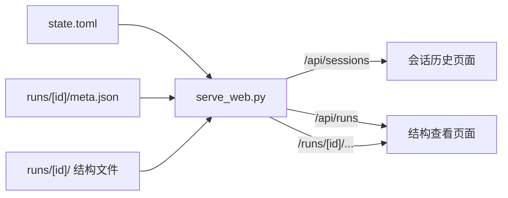

# 会话历史与结构查看的网页端架构

这一版给 opencode_tui 配一个本地网页端，两个页面：会话历史、结构查看。

## 一、数据来源

会话内容已经在磁盘上，不需要另外采集。

| 位置 | 内容 |
|---|---|
| `~/.opencode_tui/state.toml` | 全部会话：标题、消息、内容单元、模型、token、成本 |
| `~/.opencode_tui/logs/<会话>.jsonl` | 事件轨迹，每写一条刷盘 |
| `runs/<运行>/meta.json` | 结构查看的数据：靶点、口袋清单、候选分子 |
| `runs/<运行>/` 其余文件 | `receptor.pdb`、`ligands/*.pdb`、Mol* 库 |

状态文件当前有 34 个会话、618 条消息、1830 个内容单元（`Part`），正文合计约 10.9 万字符。单元类型共十一种，网页端要逐个渲染：

| 类型 | 网页端呈现 |
|---|---|
| `text` | Markdown 渲染 |
| `reasoning` | 折叠块，标题「思考过程」 |
| `tool` | 卡片：工具名、状态徽标、输入（JSON 等宽）、输出（等宽，可折叠） |
| `file` | 「引用文件 <路径>」 |
| `agent` | 「Agent <名称>」 |
| `step_start` / `step_finish` | 分隔标记 |
| `patch` | 「补丁 <路径> +N −M」 |
| `subtask` | 「子任务 <名称> <说明>」 |
| `retry` | 「重试 <说明>」 |
| `compaction` | 「上下文已压缩 <说明>」 |

## 二、服务

`tools/serve_web.py`，用 Python 标准库的 `http.server` 写，不引入新依赖。它承担两件事：把状态文件读成 JSON 接口，以及提供 `runs/` 下的静态文件。结构页面本来就需要一个静态服务，两件事合并之后，历史页面不需要单独的导出步骤。



服务复用 `opencode_tui.core.session_manager.SessionManager` 读取状态文件，会话数据的读取只有一份实现。启动参数：`--state`（状态文件路径，默认取 `default_state_path()`）、`--runs`（运行目录，默认项目根的 `runs/`）、`--web`（网页文件目录，默认项目根的 `web/`）、`--port`（默认 8860）。只绑定 `127.0.0.1`。

### 接口

| 方法 | 路径 | 内容 |
|---|---|---|
| `GET` | `/api/sessions` | 会话列表 |
| `GET` | `/api/sessions/<id>` | 单个会话的完整内容 |
| `GET` | `/api/runs` | 结构运行清单 |
| `GET` | `/runs/<id>/<路径>` | 运行目录里的静态文件 |
| `GET` | 其余路径 | `web/` 目录下的静态文件 |

### 并发读取

状态文件由 TUI 写入，服务在它写入的同一时刻读取。写入方做原子换名：先把整份内容写进同目录的临时文件，写完 `fsync`，再换名到 `state.toml`。读的人按名字打开，要么拿到换名前的旧文件，要么拿到换名后的新文件，中间不会看到半截内容。换名在目标文件正被别的进程打开时会被系统拒绝，写入方隔 5 毫秒重试，最多 40 次。

服务这一侧另加一道校验：等文件安静 40 毫秒（`mtime` 不再变化）之后连读两次，两份字节一致才交给 `tomllib` 解析，解析通过的这份字节直接填进内存。等待上限 1.5 秒，超时返回 500。

这两道是配套的。换名之前的写法是把文件清空再分段写回，中途缩到零字节再分七段长回来；被截断在表边界上的那份内容仍然是合法 TOML，解析成功说明不了完整。所以只靠服务这一侧的校验挡不住，得让写入本身原子。

实测：写入进程持续重写、服务连续请求 60 次，失败 0 次。

## 三、JSON 形状

接口字段用 camelCase，与 Python 侧的 snake_case 分开。

`GET /api/sessions`

```json
{
  "sessions": [
    {
      "id": "ses_0034",
      "title": "test",
      "messageCount": 68,
      "partCount": 220,
      "createdAt": 1790830113.76,
      "updatedAt": 1790830113.76,
      "modelId": "deepseek-chat",
      "agentName": "Build",
      "totalTokens": 181762,
      "totalCost": 0.42,
      "runId": "1iep-molstar"
    }
  ]
}
```

`runId` 由服务按 `provenance.session_id` 反查得到，没有对应运行时为 `null`。

`GET /api/sessions/<id>`

```json
{
  "id": "ses_0034",
  "title": "test",
  "modelId": "deepseek-chat",
  "agentName": "Build",
  "effort": "low",
  "createdAt": 1790830113.76,
  "updatedAt": 1790830113.76,
  "compactUpto": 12,
  "totalTokens": 181762,
  "totalCost": 0.42,
  "runId": "1iep-molstar",
  "messages": [
    {
      "id": "msg_0148",
      "role": "assistant",
      "createdAt": 1790830113.76,
      "modelId": "deepseek-chat",
      "cost": 0.004,
      "tokens": { "input": 1200, "output": 340, "cached": 900, "uncached": 300 },
      "parts": [
        { "id": "prt_0290", "type": "text", "text": "……" },
        {
          "id": "prt_0291",
          "type": "tool",
          "toolName": "read",
          "toolStatus": "completed",
          "toolInput": { "path": "opencode_tui/app.py" },
          "toolOutput": "……",
          "permission": "allow"
        },
        { "id": "prt_0292", "type": "patch", "filePath": "a.py", "patchAdded": 3, "patchRemoved": 1 }
      ]
    }
  ]
}
```

`GET /api/runs`

```json
{
  "runs": [
    {
      "id": "1iep-molstar",
      "name": "ABL kinase domain",
      "pdbId": "1IEP",
      "pocketCount": 4,
      "moleculeCount": 10,
      "sessionId": "ses_0034"
    }
  ]
}
```

`id` 取的是运行目录的名字，路由与静态文件都按它拼路径。`meta.json` 里的 `run_id` 只作为展示字段返回，不作为标识使用：现有 `runs/1iep-molstar/meta.json` 里的 `run_id` 写的是 `1iep-demo`（目录从演示那一份复制过来时留下的），与目录名不一致。构建脚本在写出 `meta.json` 时应当让两者相同，服务这一侧按目录名取标识。

`sessionId` 从 `meta.json` 的 `provenance.session_id` 读，没有这个字段时为 `null`。

## 四、两个页面

新建 `web/` 目录，一个外壳带两个页面，用 hash 路由：`#/history`、`#/history/<会话 id>`、`#/structure`、`#/structure/<运行 id>`。hash 路由不需要服务端配置路径重写。

```
web/
  index.html          外壳：顶部导航 + 页面容器
  app.css
  app.js              路由与页面切换
  pages/
    history.js        会话历史
    structure.js      结构查看
  vendor/
    molstar-lib.js    Mol* 封装，从 viz/build/viewer/ 复制
    markdown-lib.js   Markdown 渲染，从 viz/build/viewer/ 复制
```

Mol* 库有 3 MB，只在打开结构页面时加载。Markdown 库单独打一个包，历史页面加载它、不加载 Mol*。

### 会话历史页面

左栏是会话列表，右栏是对话正文。

会话列表每项显示标题、消息数、更新时间、模型，按更新时间倒序。列表上方一个搜索框（按标题过滤）与一个刷新按钮。有对应结构运行的会话，在列表项上带一个跳转入口。

对话正文按消息顺序渲染，用户消息与助手消息用不同的底色区分。每条消息内部按单元类型渲染，规则见第一节的表格。`compactUpto` 的位置插一条分隔标记，说明这里之前的内容不再发送给模型。

顶部显示会话标题、模型、Agent、token 合计、成本合计。

### 结构查看页面

顶部一个运行选择器，列出 `runs/` 下的全部运行。选中之后加载该运行的 `meta.json`，复用现有的三态视图（口袋浏览、候选分子叠合、单分子详情）。

页面顶部带一个回到对应会话的入口，用的是 `provenance.session_id`。

## 五、Markdown 渲染

正文与工具输出是 Markdown。项目规则不允许手写解析器解析成熟文件格式，所以用第三方库 `marked`（当前 18.0.14，无安装脚本，不受本机 `postinstall` 受限的影响），在 `viz/` 里打包（`viz/` 是项目里唯一安装 npm 包的地方），产物复制到 `web/vendor/markdown-lib.js`。

代码块用等宽字体与底色显示，不做语法着色。

## 六、会话与结构运行的关联

`runs/<运行>/meta.json` 的 `provenance` 段增加一个 `session_id`，记下产出这次运行的会话。这一段本来就用来记「结构来源、口袋来源、位姿来源」，会话归属放在这里与它同类。

```json
"provenance": {
  "structure_source": "RCSB PDB 1IEP",
  "pockets": "合成的演示数据",
  "poses": "合成的演示数据",
  "session_id": "ses_0034"
}
```

`tools/build_demo_data.py` 在写出 `meta.json` 时写入这个字段，取值由命令行参数给出；同时让 `run_id` 与输出目录名保持一致。

服务在 `GET /api/sessions` 与 `GET /api/sessions/<id>` 里按这个字段反查运行，会话页面据此显示跳转入口。字段缺失或没有对应运行时，入口不显示。

## 七、目录变化

```
web/                          新增：外壳与两个页面
  index.html  app.css  app.js
  pages/history.js  pages/structure.js
  vendor/molstar-lib.js  vendor/markdown-lib.js
tools/serve_web.py            新增：本地只读服务
tools/build_demo_data.py      改动：provenance 写入 session_id
viz/src/markdown.ts           新增：Markdown 库的打包入口
runs/<运行>/meta.json         改动：provenance 增加 session_id
```

`web/vendor/` 下的两个打包产物由构建命令生成，不进版本库。

## 八、判据

### 接口判据 `tools/check_web_api.py`

用标准库 `urllib` 请求，核对读数：

- 会话列表条数与状态文件里的会话数一致
- 列表按更新时间倒序
- 单个会话的消息条数与状态文件一致（拿最大的会话核对）
- 工具单元的输入与输出都在 JSON 里
- 补丁单元的增删行数正确
- 结构运行清单条数与 `runs/` 下的目录数一致
- 运行标识取的是目录名，与 `meta.json` 里的 `run_id` 不一致时仍能按目录名取到静态文件
- 会话与运行的对应关系正确
- 不存在的会话 id 返回 404

### 界面判据 `tools/check_web_ui.js`

用 Playwright，核对渲染结果：

- 会话列表渲染出的条数
- 点开最大的会话，正文里的消息条数
- 工具卡片显示工具名、状态、输入、输出四项
- 补丁卡片显示增删行数
- 思考过程折叠块存在且默认收起
- 搜索框过滤后列表条数变化
- 从会话页面跳到结构页面，运行 id 正确
- 结构页面加载出 Mol* 画布且相机没有贴进结构内部
- 全程没有页面错误

### 并发判据

另起一个子进程持续调用 `SessionManager.save_to_toml` 重写状态文件，服务这边连续请求 60 次 `/api/sessions`。每次都要核对**读到的会话条数**，只判状态码看不出问题：被截断在表边界上的那份内容解析得出结果，接口会照常返回 200，只是会话少了。另外还要测两种损坏瞬间（文件刚被清空、只写了开头几个字节）返回 500 而不是崩溃，以及文件恢复之后接口重新可用。

判据的辨别力要实测：把渲染或接口改回出错版本，判据必须报得出来。

## 九、实施

1. `viz/src/markdown.ts` 与打包产物
2. `web/` 外壳与两个页面
3. `tools/serve_web.py` 与四个接口
4. `tools/build_demo_data.py` 写入 `provenance.session_id`，并让 `run_id` 与目录名一致
5. 修正 `runs/1iep-molstar/meta.json` 里的 `run_id`
6. 接口判据、界面判据、并发判据，逐条实测通过
