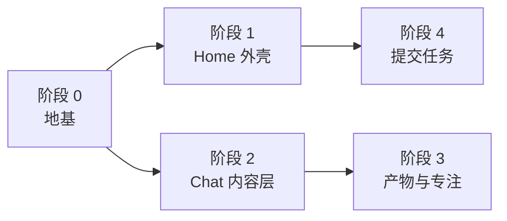

# 网页工作空间改造计划：Home、Chat、产物与提交

> 对象：`web/` 的两个页面、`vsagent/core/web/` 的接口、`tools/check_web_*.py|js`。
> 基线：`4934c0e`（主题章节三层折叠 + 实时快照）。行号会漂，认函数名。
> `docs/web-frontend-architecture.md` 停在「两个页面 + `serve_web.py`」的阶段，不再随代码更新，
> 页面与接口以本文件为准。

这份文件回答四件事：

1. 方案里哪些条目已经有实现，哪些是空的（§一）；
2. 与当前代码不一致的前提，改计划前必须知道（§二）；
3. 每个页面需要什么数据、接口怎么加、视觉规则是什么（§三、§四）；
4. 按什么顺序改、改哪些文件、用什么判据验收（§五、§七）。

---

## 一、现状对照

方案把界面分成 Workspace / Task / Topic / Step / Event / Artifact 六层。当前 `web/` 的实现在
`web/pages/history.js`（1578 行）与 `web/app.css`（1602 行）里，六层分别对应这些位置：

| 方案条目 | 现状 | 位置 | 处理 |
| --- | --- | --- | --- |
| Workspace 入口 | 不存在。`parseHash` 的默认页是 `history`，顶部只有三条导航 | `web/app.js:parseHash` | 新增 Home 页面 |
| Task 头 | `#session-head` 放标题与元信息；`taskCard()` 放目标、约束、待办、阻塞、假设 | `web/pages/history.js:taskCard` | 补任务状态与产物数 |
| Topic 卡 | 已实现。标题、序号、状态、摘要、产物标签、步数、失败一行、降级标记、折叠、深链接 | `topicCard()` / `fillTopicBody()` | 结构不动 |
| Step | 已实现。序号、意图、时长、完成/失败、失败默认展开 | `stepRow()` | 结构不动 |
| 工具三级 | 已实现。`run-head`（次数/工具数/摘要）→ `step-row` → `tool-body`（`<details>` 收起，失败默认打开） | `runBlock()` / `toolNode()` | 结构不动 |
| Event | 与 Topic 是同一个对象，一张章节卡同时是主题视图与封存摘要 | `Event` 模型 | 不新增层 |
| Artifact | 右栏常驻 300px；1200px 以下改为覆盖式抽屉 | `#artifact-pane` | 改成默认收起 + 三档宽度 |
| 输入框 | 不存在。网页端没有提交任务的路径 | — | 新增接口与页面 |
| 自动滚动 | 不存在。`renderConversation()` 清空 `#conversation` 再重建，轮末刷新时滚动位置归零 | `web/pages/history.js:renderConversation` | 阶段 0 |
| 动效 | 全站 3 处 `transition`、1 处旋转动画，没有 `prefers-reduced-motion` | `web/app.css` | 阶段 0 |
| 展开状态持久化 | 只有主题级（`manualOpen` / `manualClosed`）；工具块与单步的展开状态在内存里 | `saveOpenState()` | 阶段 2 |

方案里 P0 的「Topic 分组」「工具默认折叠」「执行状态展示」三条已经做完，剩下的工作量集中在
Home、提交、自动滚动与产物面板。

---

## 二、与方案不一致的前提

### 2.1 没有 React，也没有打包步骤

`web/` 不装 npm 包，`index.html` 直接 `<script>` 引入四个页面文件，每个文件是一个立即执行函数，
把 `mount` 挂到 `window.vsPages.<名字>` 上。组件就是一个返回 DOM 节点的函数，加上一组 CSS 类。
`viz/` 的 esbuild 只产出 Mol\* 与 markdown 两个 IIFE 全局，与页面代码无关。

方案 §7.2 的组件树按这个形状对应：`HomePage` 是 `web/pages/home.js` 里的 `mount`，`TopicSection`
是 `history.js` 的 `topicCard`，`ToolCallGroup` 是 `runBlock`，`ToolCallItem` 是 `stepRow`，
`ToolDetail` 是 `toolNode`。这一版不引入框架：加一个构建步骤会让 `check_web_ui.js` 的启动路径
多一步，也会让 PyInstaller 多打包一份产物。

### 2.2 Topic 与 Event 是同一个对象

内核里 `Event` 就是封存后的主题，`Event.steps` 是主题里的步，`Event.cut_message` / `cut_part`
是它的边界。没有独立的 Topic 对象，也没有「进行中的 Topic」这个模型：运行中的那一段由
`live/<sid>.json` 的快照描述（`vsagent/core/live.py`），封存之后才进 `Event`。

界面上因此只有两种卡片：已封存的章节卡（`topicCard`）与运行中的实时卡（`liveCard`）。方案的
「Topic 与 Event 分两层」在这一版合并。

### 2.3 没有 Task 对象，`Session` 就是任务

任务级字段在 `Session` 上：`title`、`status`（`idle` / `running` / `done` / `failed` / `cancelled`）、
`status_note`、`updated_at`、`events`。目标与约束在 `Session.task_state` 里，由 `taskCard()` 渲染。

方案的三层状态对应关系：

| 方案 | 当前取值 | 来源 |
| --- | --- | --- |
| Task Running / Completed / Failed | `running` / `done` / `failed` / `cancelled` / `idle` | `Session.status` |
| Topic Active / Completed / Failed / Waiting | `completed` / `failed` / `interrupted` | `Event.status`（由 `exit_reason` 与最后一步的未决项算出） |
| Step Pending / Running / Success / Error | `pending` / `awaiting` / `running` / `completed` / `failed` | `ToolStatus` |

`ToolStatus` 没有 `cancelled`。取消是轮级的 `EXIT_CANCELLED`，写在 `Event.exit_reason` 上，所以
「已中断」只能出现在主题状态里，工具卡上没有这一档。

### 2.4 Step 只有已经发生的

内核不记录「下一步打算做什么」。`live` 快照里只有已完成的 `steps` 与 `current`（当前工具，或者
「模型正在生成」）。方案 §5.1 里 `Topic 2 → Step 3: Pending` 那种展示需要内核先有 per-step 的
计划对象，`TaskState.todo` 是任务级的，与 step 没有编号关联。这一条本计划不做。

---

## 三、数据与接口

### 3.1 Home 需要的字段

`GET /api/sessions` 现在返回 `session_summary()`（`vsagent/core/web/routes.py:208`）：标题、消息数、
主题数（`eventCount`）、token、成本、状态、更新时间、`runId`、父子关系。Home 的列表还差两项：

| 需要 | 来源 | 加法 |
| --- | --- | --- |
| 产物数 | `ledgers/<sid>.json` 的 `entries` 条数 | `session_summary` 加 `artifactCount` |
| 最近一次主题 | `session.events[-1]` 的标题与状态 | `session_summary` 加 `lastEvent` |

两个字段都在服务端拼，前端不重新组合业务状态。`event_json` 已经存在，`lastEvent` 直接取
`event_json(session.events[-1])` 的四个键（`id` / `title` / `status` / `topicIndex`）。

### 3.2 列表接口的代价（本机实测）

`~/.vsagent/state.toml` 6.6MB、23 个会话：

| 步骤 | 耗时 |
| --- | --- |
| `load_manager()` 解析状态文件 | **515 ms** |
| `scan_runs()` 扫 `runs/*/meta.json` | 8 ms |
| 23 份登记表（318 个条目） | 9 ms |
| 23 次 `session_summary()` | 0.1 ms |

结论有两条：

1. 登记表那 9 ms 可以忽略，`artifactCount` 直接在列表里算，不需要单独的精简读法。
2. 列表接口的大头是解析 6.6MB 的状态文件。Home 不能每 5 秒重取一次整表，那样每秒要花
   约 100 ms 在解析上。

运行中的行改走 `GET /api/sessions/<id>/live`（几 KB，`_session_live` 不读状态文件）。Home 只在
初次加载时取整表；之后只轮询已知在跑的会话，某一行 `running` 变成 `false` 时再取一次整表。

### 3.3 提交任务的接口

`POST /api/tasks`，请求体 `{"text": "...", "sessionId": "ses_xxxx"}`（`sessionId` 省略时新建）。

| 情况 | 返回 |
| --- | --- |
| 正常 | `{"sessionId": "...", "created": true}`，`created` 为 `false` 表示写进了已有会话 |
| 该会话正在跑 | 409，`{"error": "这一轮还没结束"}` |
| 没有配置模型 | 400，`{"error": "先在终端里用 /model 配置模型"}` |
| 独立运行的服务（没有 `submit` 回调） | 503 |
| 缺 `X-VSA-Request` 头或 `Origin` 不对 | 403（复用 `_guard_write`） |

`WebServer` 增加一个 `submit` 回调，形状与现有的 `ingest` 相同（`vsagent/core/web/routes.py:1455`、
`service.py`）。`app.py` 在 `on_mount` 里记下当前事件循环，回调把全部动作交回循环线程执行：

```python
def _submit_task(self, text: str, session_id: str = "") -> dict:
    future: concurrent.futures.Future[dict] = concurrent.futures.Future()
    self._loop.call_soon_threadsafe(self._submit_in_loop, future, text, session_id)
    return future.result(timeout=5.0)
```

`_submit_in_loop` 里依次做四件事：检查模型已配置；`create_session` 或取已有会话（标题取正文第一行
前 40 字）；`host.prompt(session_id, text)`；`save_state()`。最后一步不能省：页面提交之后立刻跳到
`#/history/<id>`，那个接口读的是 `state.toml`，不先写盘就会 404。

回调返回两种形状，路由按其中的 `status` 决定状态码：成功是 `{"sessionId": "..."}`（200），
被拒绝是 `{"error": "...", "status": 400 或 409}`。回调自己抛出的异常交给服务端现有的 500 处理。

`SessionManager` 不是线程安全的，所有读写都必须在循环线程里做，HTTP 线程只等 `Future`。

### 3.4 权限确认的位置

`AgentHost.prompt` 起的那一轮跑到第一个 `write` / `patch` / `bash` / `dock` 会发 `permission.ask`，
弹窗由 `VSAgentApp._on_permission_ask` 排队推到终端（`vsagent/app.py:1060`）。两条边界：

- 应用在跑、用户人在浏览器：弹窗出现在终端里，300 秒无人答复按拒绝处理。
- 只有 `python -m vsagent.core.web`：没有订阅者，`loop._ask_permission` 立刻拒绝。

所以网页提交的任务只对「不需要确认的工具」一路走通：取结构、查 UniProt / ChEMBL、检索语料、
读文件。`write_run`、`prepare_receptor`、`dock` 这几步需要人回到终端点一下允许。页面要把这条写在
输入框下方，失败时把拒绝原因原样显示，不要让它看起来像故障。

---

## 四、视觉系统

### 4.1 设计变量

现有 `:root` 只有颜色与圆角。新增下面这一组，页面里不再写零散的数值：

| 变量 | 值 | 用途 |
| --- | --- | --- |
| `--measure` | 780px | 正文与章节卡的最大宽度 |
| `--measure-narrow` | 640px | 用户消息正文 |
| `--gutter` | 20px | 章节卡与消息的统一左边界 |
| `--space-1` … `--space-5` | 4 / 8 / 12 / 20 / 32px | 间距 |
| `--dur-fast` | 120ms | 状态变化、淡入 |
| `--dur` | 180ms | 展开、侧栏滑入 |
| `--ease` | `cubic-bezier(0.2, 0.7, 0.3, 1)` | 全部过渡共用 |

颜色沿用现有的 `--hot` / `--ok` / `--warn` / `--faint`。状态色只出现在状态徽标与章节卡左侧那道
2px 边上，不用于背景与图标装饰。

### 4.2 宽度

`#conversation` 是滚动容器（`web/app.css:1077`），宽度上限加在卡片上，不加在容器上：容器加
`max-width` 会把滚动条拉到页面中间。规则：

```css
.task-card, .topic-card { max-width: var(--measure); margin: 0 auto; }
.msg-user .part-text { max-width: var(--measure-narrow); }
```

工具输出里的 `<pre>` 保持横向滚动，章节卡不变宽。需要看全时用卡片右上角的「下载」。

### 4.3 动效

统一 120ms / 180ms 两档，只用在四处：章节卡展开（高度过渡）、工具块展开（内容淡入）、
运行中指示（低频呼吸，1.6s）、产物面板滑入。`prefers-reduced-motion: reduce` 时全部归零：

```css
@media (prefers-reduced-motion: reduce) {
  *, *::before, *::after {
    transition-duration: 1ms !important;
    animation-duration: 1ms !important;
    animation-iteration-count: 1 !important;
  }
}
```

章节卡的展开动画要等阶段 0 的滚动保持做完再加。`renderConversation()` 每次重建所有卡片，
动画会在重画时整体重放，滚动位置又归零，看起来像页面自己跳了一下。

---

## 五、阶段



阶段 1 与阶段 4 之间只有一条依赖：Home 的输入框要调 `POST /api/tasks`。接受 §六 的 B 方案时，
这两段可以并成一次做完，Home 一次成型。

### 阶段 0：地基

**修改 `web/app.css`**

- `:root` 加 §4.1 的变量。
- `.task-card` / `.topic-card` 加宽度上限与居中。
- `.msg-user .part-text` 收窄。
- 加 `prefers-reduced-motion` 块。

**修改 `web/pages/history.js`**

- 新增 `captureScroll(box)` 与 `restoreScroll(box, state)`：前者记 `scrollTop` 与
  `scrollHeight - scrollTop - clientHeight < 80`，后者在重画之后恢复；原来贴底就滚到底。
- `renderConversation()` 开头取一次，末尾还一次。
- `selectSession()` 换会话时按「贴底」处理，直接到底部。

**判据（`tools/check_web_ui.js`）**

- 打开一个长会话，滚到中间，写入一份 `running=false` 的实时快照触发重画，`scrollTop` 与重画前
  相差不超过 4px。
- 滚到底部，同样触发一次重画，重画之后仍在底部（相差不超过 4px）。

### 阶段 1：Home 外壳

**新增 `web/pages/home.js`（约 300 行）**

- `mount(container)` 返回 `{unmount}`，与其余四个页面同一形状。
- 左栏：工作空间标题、「最近任务」分组、根会话列表（`parentId` 为空的）。
- 主区：欢迎语、一句说明、最近任务表。
- 分组互斥：`status === "running"` 的行进「进行中」，其余按 `updatedAt` 倒序取 10 条进「最近」。
- 每行：标题、状态徽标、`eventCount` 个主题、`artifactCount` 个产物、相对时间、`lastEvent.title`。
- 点击整行跳 `#/history/<id>`；`lastEvent` 存在时跳 `#/history/<id>?event=<lastEvent.id>`。
- 轮询：初次取一次 `/api/sessions`；之后每 5 秒只对 `status === "running"` 的行取
  `/api/sessions/<id>/live`，更新「当前主题 · 第 N 步」；某行 `running` 变 `false` 时整表重取一次。
  标签页不可见时停。
- 空态：一个会话都没有时只显示欢迎语与「先在终端里开始一个任务」。

这一阶段不放输入框。输入框与 §六 的提交方案绑定，见阶段 4。

**修改 `web/index.html`**

- 导航加 `<a class="nav-link" data-page="home" href="#/home">工作空间</a>`，放在第一条。
- 加 `<script src="pages/home.js"></script>`。

**修改 `web/app.js`**

- `parseHash` 的默认页由 `history` 改成 `home`。
- `render()` 找不到模块时回到 `history` 的逻辑保留（旧链接与缓存里的 `app.js` 不会白屏）。

**修改 `vsagent/core/web/routes.py`**

- 新增 `_summary_payload(request, session, runs)`，算 `artifactCount` 与 `lastEvent`，
  `_session_list` 与 `_session_detail` 共用。
- `session_summary(session, run_id, *, artifact_count=0, last_event=None)` 追加两个键。
- `lastEvent` 取 `session.events[-1]`，没有事件时为 `null`。

**判据**

- `tools/check_web_api.py`：列表每项有 `artifactCount`（整数）与 `lastEvent`（对象或 `null`）；
  没有登记表的会话 `artifactCount` 为 0；`lastEvent` 的 `id` 能在 `/events` 里找到。
- `tools/check_web_ui.js`：默认页是 Home；最近任务行数等于根会话数；状态文案与接口一致；
  点一行进入 `#/history/<id>`；`#/history` 仍能直接打开。

**验收**

- 1920 与 1440 两个宽度下，Home 的内容列不超过 780px，两侧留白对称。
- 列表请求（`/api/sessions`）在 23 个会话的本机数据上不超过 700ms；5 秒一次的轮询不触发整表解析。

### 阶段 2：Chat 内容层

这一阶段改的是状态保存与主题尾部，章节卡与工具块的结构不动。

**修改 `web/pages/history.js`**

- `saveOpenState()` / `loadOpenState()` 的存储对象加两个键：`runs`（工具块展开的主题 id）与
  `steps`（`<事件 id>:<步号>` 与 `<事件 id>:<步号>:closed`）。
- `runBlock` 的 `head` 点击、`stepRow` 的 `head` 点击都调一次 `saveOpenState()`。
- `fillTopicBody` 在 `runBlock` 之后、`handoff` 之前加「本主题产物」：把 `event.artifacts` 里匹配
  `^(receptor|ligandset|artifact)#\d+$` 的条目按 handle 去 `/artifacts` 的 `items` 里找，找到的给
  下载链接（`/api/sessions/<sid>/artifact/<handle>`），找不到的按原样显示成文字。

**判据**

- 展开一个主题的工具块、展开其中一步，刷新页面，两者仍然展开。
- 主题尾部的产物链接数与 `/artifacts` 里匹配上的 handle 数一致；点链接下载到的字节数大于 0。

### 阶段 3：产物面板与专注模式

**修改 `web/app.css` / `web/pages/history.js`**

- `#artifact-pane` 默认收起，用 `body.artifacts-open` 控制。`#session-head` 加一个「产物」按钮。
- 三档宽度 `240 / 300 / 380`，按钮循环切换，记在 `localStorage` 的 `vsa.history.artifacts`。
- 专注模式：`body.focus-mode` 同时收起 `.history-list`、`#topic-rail`、`#artifact-pane`；
  `#session-head` 加一个按钮，Esc 退出。状态记在 `vsa.history.focus`，不分会话。
- 1200px 以下的覆盖式抽屉逻辑保留，专注模式打开时禁用这两个抽屉按钮。

**判据**

- 打开产物面板后 `#artifact-pane` 的宽度依次是 240 / 300 / 380。
- 专注模式下三栏都不可见，Esc 之后回到进入前的状态。
- 1200px 视口下，产物抽屉仍能打开并覆盖在正文上。

### 阶段 4：提交任务

**修改 `vsagent/core/web/routes.py`**

- `WebServer.__init__` 加 `submit: Callable[[str, str], dict] | None = None`。
- 新增 `JsonRoute("/api/tasks", _create_task, method="POST")`；处理函数先调 `_guard_write`，
  再按 §3.3 分派，`submit is None` 时回 503。
- `SPEC` 的注释「写入口只有三条」改成四条。

**修改 `vsagent/core/web/service.py`**

- `WebService.__init__` 与 `start()` 透传 `submit`。

**修改 `vsagent/app.py`**

- `on_mount` 里先记 `self._loop = asyncio.get_running_loop()`，再调 `self.web_service.start()`。
- `_build_web_service()` 传 `submit=self._submit_task`。方法里在调用时才取 `self.host`，
  构造顺序不用调整。
- 新增 `_submit_task` / `_submit_in_loop`，实现见 §3.3。

**修改 `web/pages/home.js`**

- 主区加输入框：多行、默认 120px、随内容增长、上限 320px 后内部滚动、最大宽度 800px。
- 发送按钮在右下角；`Ctrl/Cmd + Enter` 发送。
- 输入框下方一行说明：「提交后任务在终端进程里运行；需要确认的工具会在终端弹窗」。
- 四个快捷入口（Research / Coding / Structure / Knowledge）往输入框填模板文字，不直接启动。
- 提交成功跳 `#/history/<sessionId>`；失败在输入框下方显示服务端返回的原文。

**修改 `web/pages/history.js`**

- 中间栏底部加输入框（同一组件，`sessionId` 取当前会话）。这一轮在跑时发送按钮禁用，
  提示「这一轮还没结束」。提交成功后清空输入框并刷新当前会话。

**判据**

- `tools/check_web_api.py`：构造 `WebServer` 时传一个假的 `submit`，断言返回的 `sessionId`
  出现在 `/api/sessions` 里；缺请求头回 403；`submit=None` 回 503；假 `submit` 返回
  「正在运行」时回 409。
- `tools/check_web_ui.js`：`serve_web.py` 没有 `submit`，断言输入框提交后显示 503 的原文、
  页面不跳转。成功路径由 API 判据覆盖。

**验收**

- 从 Home 输入一句不需要确认工具的任务（例如「列出 P00533 的 UniProt 记录」），页面跳到 Chat，
  两秒内出现运行中的主题，结束后出现章节卡。
- 从 Home 输入一句会写文件的任务，终端弹出确认框；在终端允许后网页继续；拒绝后网页显示拒绝原因。

---

## 六、决策点：提交要不要做

方案把「Home 任务输入」列为 P0，这一条是本计划里唯一需要先定的。三种做法：

| 方案 | 做法 | 成本 | 限制 |
| --- | --- | --- | --- |
| A | 不做提交。Home 只做任务发现与恢复 | 阶段 1 的 300 行 | 输入框不出现，Home 的视觉中心是空的 |
| B | 做提交，确认弹窗留在终端 | 阶段 1 + 阶段 4（约 450 行，含接口与判据） | TUI 进程必须在跑；写类工具要人回到终端点允许 |
| C | 做提交，再加网页端确认面板 | B 的两倍 | 要把 `_permission_queue` 从 `VSAgentApp` 移到 `AgentHost`，新增两条接口与一个弹窗组件 |

推荐 B。只读类的任务（取结构、查库、检索语料）在 B 下完全走通，不需要回终端；筛选类任务在
第一次写文件时回终端点一下，这条限制写进页面提示即可。C 等网页端确认出现的次数多到影响使用时再做。

---

## 七、验收

四个脚本全绿，加上三个宽度与一条系统设置的手工检查：

| 项 | 命令 | 期望 |
| --- | --- | --- |
| 接口 | `python tools/check_web_api.py` | 现有 91 条 + 阶段 1 的 3 条 + 阶段 4 的 4 条 |
| 页面 | `node tools/check_web_ui.js` | 现有 90 条 + 阶段 0 的 2 条 + 阶段 1 的 5 条 + 阶段 2 的 2 条 + 阶段 3 的 3 条 |
| 内核 | `python tests/test_agent.py` | 不变 |
| 界面 | `python tests/test_smoke.py` | 不变 |
| 宽度 | 1920 / 1440 / 1024 | 正文列不超 780px；三栏在 1200px 以下按抽屉切换 |
| 动效 | 系统开「减少动态效果」 | 展开、滑入、呼吸动画都不再播放 |

方案的十条验收标准里，「UI 展开折叠不会改变内核执行状态」已经由现有结构保证：折叠只改
`manualOpen` / `runOpen` / `stepOpen` 三个前端集合，不碰 `Event` 与 `Session`。阶段 2 把后两个
也写进 `localStorage` 之后，这条要加一条判据：改 `localStorage` 再刷新，`/events` 返回的主题
条数与状态不变。

---

## 八、不做的事

- 不改 `vsagent/screens/`。这一版的对象是 `web/`；TUI 的 `ChatScreen` 保持现有主题卡。
- 不引入前端框架与构建步骤，`web/` 继续零依赖。
- 不新增 Topic 对象。Topic 与 Event 保持同一个模型，运行中的一段由 `live` 快照描述。
- 不展示「待执行的步」。内核没有 per-step 计划，`TaskState.todo` 与步号没有关联。
- 不做全局「展开所有历史工具」。现有按钮只作用于当前主题，这个范围保持不变。
- 不做网页端权限确认面板（§六 的 C 方案）。
- 不改 `/live` 的写入节奏与节流值。
- 不更新 `docs/web-frontend-architecture.md`。它记录的是两页面版本的设计，与本计划的接口形状
  不一致；以本文件为准，等全部阶段做完再决定是重写还是删除。
